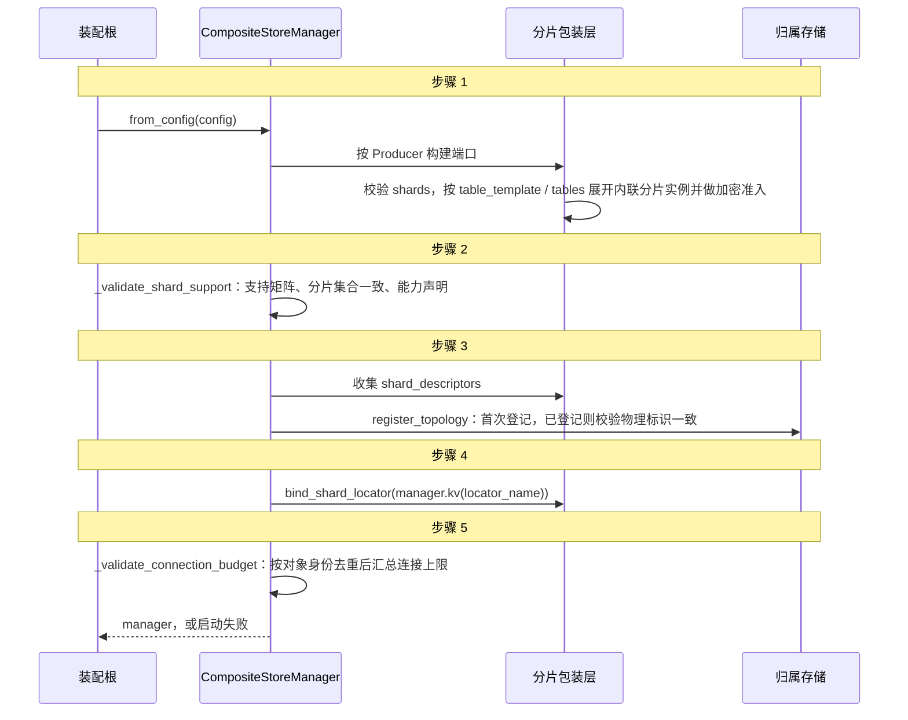
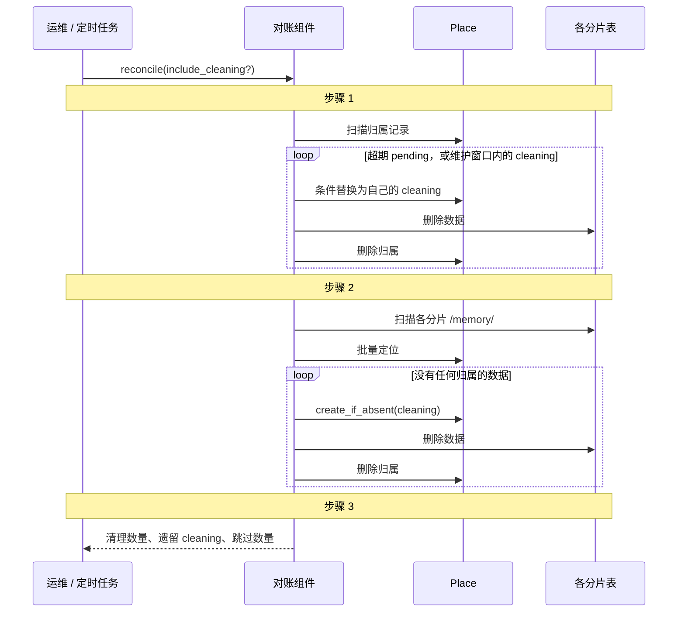
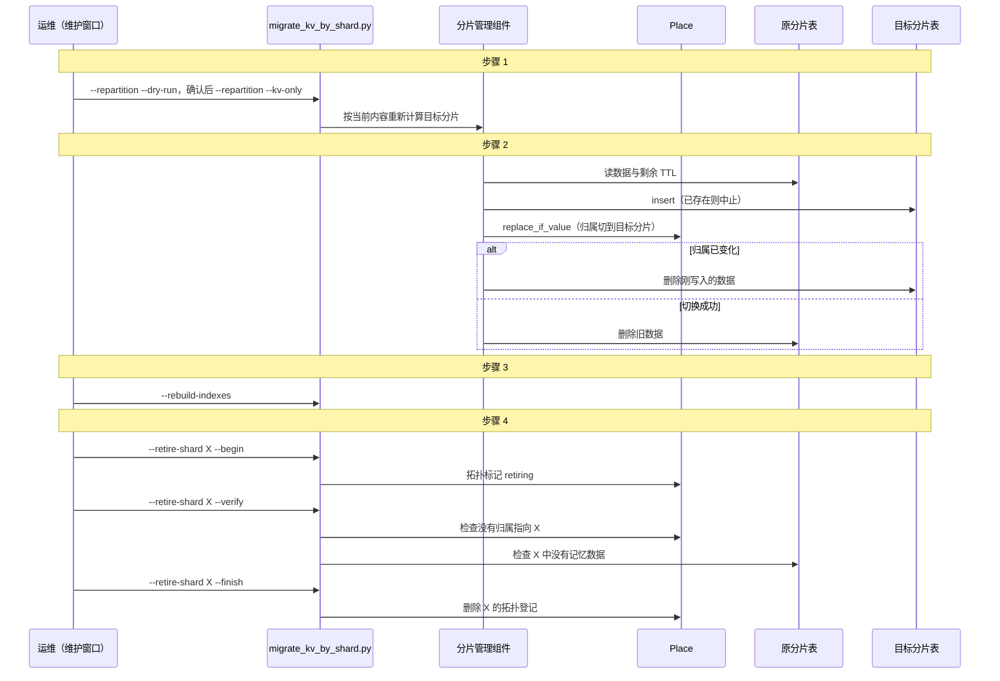
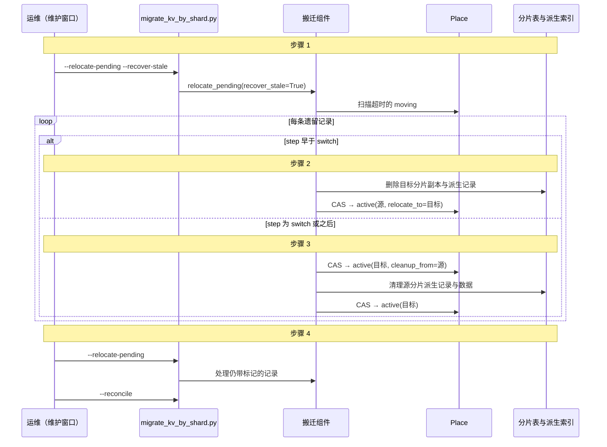

# 逻辑分片（shard）运维手册

本文是逻辑分片的部署与运维操作手册。设计决策、对外语义与已知遗留见
[F09 逻辑分片](../../docs/features/storage/F09-logical-sharding.md)，归属协议与能力契约见
[S06「逻辑分片能力协议」](../../docs/specs/S06-storage.md#逻辑分片能力协议第一阶段已实现)。

运维工具：

| 文件 | 用途 |
|---|---|
| `scripts/migrate_kv_by_shard.py` | 首次分区、重新分区、对账、索引重建、分片退役、物理搬迁、打印 DDL |
| `scripts/pg_schema_shard_template.sql` | PostgreSQL DDL 模板，经 `migrate_kv_by_shard.py --print-ddl` 按分片展开后执行，不要直接执行本文件 |
| `scripts/benchmark_shards.py` | 性能采集：`--config` / `--iterations` / `--top-k` / `--json` |

`migrate_kv_by_shard.py` 参数：`--config`（必填）、`--source-kv`（首次分区的源 KV 端口，默认 `legacy`）、
`--target-kv`（分片 KV 端口，默认 `default`）、`--dry-run`、`--reconcile`、`--include-cleaning`、
`--repartition`、`--kv-only`、`--retire-shard <分片>` 配合 `--begin` / `--verify` / `--finish`、
`--print-ddl`、`--rebuild-indexes`、`--index-builder <name>`、`--relocate-shard <分片>` 配合
`--destination-kv <name>` / `--descriptor PORT=IDENTITY`。

需要维护窗口的命令要求设置 `AGENT_MEMORY_MAINTENANCE_WINDOW=1`。该变量只是操作者确认，工具无法验证在途请求与后台任务已经排空，排空仍是运维必做步骤。

## 四步启用

**第 1 步：写分片规则**

```yaml
shard_resolver:
  default:
    target: rule_based
    params:
      shards: [working, profile, episodic, main]         # 分片集合的唯一权威来源
      default_shard: main
      on_unknown: reject
      rules:
        - { shard_from: system_metadata.shard }          # 需求 B（不需要可删）
        - { shard: working,  match: { tier: working } }  # 需求 A
        - { shard: profile,  match: { tier: core } }
        - { shard: episodic, match: { tier: episodic } }
```

**第 2 步：把各存储端口切到分片模式**

下面是默认配置的完整示例：向量 / 全文三层与实体为 `split`，图为 `shared`；改用 `shared` 的替代配置见代码块后。图通道支持 `shards`，不需要关闭；证据图（角色记忆）不分片，保持普通后端。

```yaml
kv_store:
  default:
    target: shard_routed
    params:
      resolver: default
      passthrough: kv_legacy
      placement_store: { target: postgres, params: { table: agent_memory_shard_placement } }   # 内联专用表，须声明 ConditionalKV
      table_template: { target: postgres, params: { table: "agent_memory_kv_{shard}", pool_max_size: 4 } }
      tables:                                        # 可选：某分片单独加密 / 独立后端（内联，不成为端口）
        profile: { target: encrypted, params: { raw_kv_store: { target: postgres, params: { dsn: "${PROFILE_PG_DSN}", table: agent_memory_kv_profile } } } }
  kv_legacy:      { target: postgres,  params: { table: agent_memory_kv } }

vector_store:
  default:   { target: shard_routed, params: { resolver: default, locator: default, mode: split, table_template: { target: pgvector, params: { table: "agent_memory_vectors_{shard}" } } } }
  layers_l0: { target: shard_routed, params: { resolver: default, locator: default, mode: split, table_template: { target: pgvector, params: { table: "agent_memory_vectors_{shard}_l0" } } } }
  layers_l1: { target: shard_routed, params: { resolver: default, locator: default, mode: split, table_template: { target: pgvector, params: { table: "agent_memory_vectors_{shard}_l1" } } } }

fulltext_store:
  default:   { target: shard_routed, params: { resolver: default, locator: default, mode: split, table_template: { target: elasticsearch, params: { index: "memory_fulltext_{shard}" } } } }
  layers_l0: { target: shard_routed, params: { resolver: default, locator: default, mode: split, table_template: { target: elasticsearch, params: { index: "memory_fulltext_{shard}_l0" } } } }
  layers_l1: { target: shard_routed, params: { resolver: default, locator: default, mode: split, table_template: { target: elasticsearch, params: { index: "memory_fulltext_{shard}_l1" } } } }

entity_store:                                         # 二选一
  default:     { target: shard_routed, params: { resolver: default, locator: default, mode: split,
                   table_template: { target: elasticsearch, params: { index: "memory_entities_{shard}" } } } }
  # default:   { target: shard_routed, params: { resolver: default, locator: default, mode: shared, inner: es_entities } }
  # es_entities: { target: elasticsearch, params: { index: memory_entities } }

graph_store:                                          # 关联图；二选一（证据图 evidence 保持普通后端，不能配 shard_routed）
  default:    { target: shard_routed, params: { resolver: default, locator: default, mode: shared, inner: graph_main } }
  graph_main: { target: nano_graphrag, params: { working_dir: /data/graph } }   # inner 须声明 SHARD_PREFILTER（memory / nano_graphrag / neo4j）
  # split：每个分片一个独立图，各分片 resource_descriptor 不得相同；跨分片的边会被丢弃
  # default:  { target: shard_routed, params: { resolver: default, locator: default, mode: split,
  #               stores: { working: { target: nano_graphrag, params: { working_dir: /data/graph_working } },
  #                         profile: { target: nano_graphrag, params: { working_dir: /data/graph_profile } } } } }
```

可选的共享向量/全文示例（L0/L1 使用各自的共享 inner，不能与正文共用同一索引）：

```yaml
vector_store:
  default:
    target: shard_routed
    params:
      mode: shared
      resolver: default
      locator: default
      inner: { target: pgvector, params: { table: agent_memory_vectors } }
fulltext_store:
  default:
    target: shard_routed
    params:
      mode: shared
      resolver: default
      locator: default
      inner: { target: elasticsearch, params: { index: memory_fulltext } }
```

`locator: default` 指向声明了 `ShardLocator` 能力的 `kv_store.default`；非 KV 端口的 `resolver` 只用来取分片列表（展开模板、启动校验），不用于判定归属。构建层、检索层配置不用改。`shared` 模式的 `inner` 以具名声明时会成为端口；如不希望被绕过访问，同样可改为内联。

**第 3 步：建表**：`scripts/pg_schema_shard_template.sql` 按分片列表生成 KV 表、向量三层表与归属表；ES 索引按模板创建。

**第 4 步：在维护窗口内首次分区，然后切换配置**

```bash
scripts/migrate_kv_by_shard.py --config prod.yaml --dry-run     # 预览各分片条数
AGENT_MEMORY_MAINTENANCE_WINDOW=1 scripts/migrate_kv_by_shard.py --config prod.yaml
# 生成归属并搬迁 KV 数据（只搬 KV，不重建派生索引）
AGENT_MEMORY_MAINTENANCE_WINDOW=1 scripts/migrate_kv_by_shard.py --config prod.yaml --rebuild-indexes
# 按当前归属重建向量 / 全文 / 实体索引（--index-builder 须与生产写入用的构建器一致）
```

- **「离线」的操作边界是维护窗口，不只是停写**：
  1. 在 API 入口停止接受记忆的读写请求；
  2. 等待在途请求与后台任务（调度器、演进、dreaming）排空；
  3. 执行迁移与对账；
  4. 原子切换到分片配置；
  5. 重新开放读写。

  迁移期间不提供读取，避免读到「归属已写、数据未写完」「KV 已切换、索引还在旧位置」或「部分分片已迁完」的中间状态。
- 迁移幂等，中断后重跑即可。旧单表 `agent_memory_kv` 保留作 `passthrough` 与回滚兜底。首次分区与 `--relocate-shard` 在写入时按源记录重新读取剩余 TTL 并下传；**源记录已消失、已过期（尚未物理删除）或后端无法给出 TTL 时拒绝迁移该条**（计入失败 / 中止搬迁），不按 0 写入——否则会把会过期的记忆变成永久记录。`remaining_ttl` 的契约因此是「永久记录 0.0，其余一律 None」，各后端一致（见 [`storage/AGENTS.md`](../../jiuwen_memory/storage/AGENTS.md) 本地约束）。
- 不停读的方案（新建完整目标数据集、校验后按版本切换，旧查询继续使用旧版本）留作后续工作。

**在线运维（不需要维护窗口）**：清理超期 `pending` 与无主数据按协议是在线安全的，
由运维按周期调用——崩溃遗留的 `pending` 只能靠它解除同 id 的插入阻塞，不能等到维护
窗口：

```bash
scripts/migrate_kv_by_shard.py --config prod.yaml --reconcile
```

只有 `--reconcile --include-cleaning`（回收遗留 `cleaning`）要求维护窗口且已排空在途
操作；`--dry-run` / `--print-ddl` / `retire-shard --verify` 同为只读。

## 分片相关运维操作

**改规则与重新分区是两件事**：粘性归属下，已有记忆的归属记录已经是权威落点，所以修改规则**只影响此后新建的记忆**，不需要迁移历史数据。想移动已有记忆，是单独的「重新分区」操作。

| 操作 | 是否需要迁移 | 做法 |
|---|---|---|
| 新增 / 修改 `match` 规则、调整规则顺序、修改 `default_shard`、增删 `shard_from` | **否** | 改配置后重启；只影响新建记忆，已有记忆的归属不变 |
| 新增分片 | 否 | 在 `shard_resolver.shards` 中加入、建表、重启 |
| 修改某分片的后端 / 物理表（换表、换库、换集群） | 是（该分片） | 维护窗口内执行 `--relocate-shard <分片>`：拷贝数据到新资源并校验，再更新拓扑登记中该分片的物理标识，最后切换配置 |
| 升级到 Milvus descriptor 带 collection 的版本 | 否 | 启动时自动把旧的实例级登记 `milvus://host` 原地升级为 `milvus://host/collection`，记一条 warning；滚动升级多实例并发时以先写入者为准。collection 名本身变化仍按物理身份变更拒绝启动 |
| 重命名分片 | 是，且**破坏对外契约** | 不建议；必须时用重新分区并同步通知调用方 |
| 删除（退役）分片 | 是 | 见下方「分片退役」 |
| **重新分区**（显式操作，例如把 `tier` 已被修改的记忆归位） | 是 | 维护窗口内执行：先 `--repartition --dry-run` 预览，确认后 `--repartition --kv-only` 移动 KV，随后 `--rebuild-indexes` 重建派生索引，最后 `--reconcile`（在线） |
| **重建派生索引**（重新分区 / 物理迁移之后） | 是（索引侧） | 维护窗口内执行 `--rebuild-indexes`：按 Scope 读真源，先 `remove(SOFT)` 清各分片旧索引、再 `build(RETRIEVAL_ONLY)` 按当前归属重建；`--dry-run` 只统计待重建条数，`--index-builder <name>` 指定 constructor 具名实例（默认 `default`，必须写正排 KV）。可反复执行 |
| **对账**（清理超期 `pending` / 无主数据） | 否 | **在线**按周期执行 `--reconcile`；`--include-cleaning` 才要求维护窗口。KV 错放副本与派生存储不一致记录不在对账范围内，需人工处理 |

**拓扑登记（防止换错物理资源、删掉仍有数据的分片）**

- **登记内容**：归属存储中维护拓扑登记，每个分片一条：`分片名 → {每个端口的物理标识, 状态}`。
  - 物理标识由各端口内联实例声明，不含凭据：PG 为 `host:port/database/schema/table`，ES 为 `集群标识/索引名`；
  - 状态为 `serving`（可写入）或 `retiring`（退役中，不再接收新记忆）。
- **登记时机**：在服务开始接受请求之前，装配完成后、健康检查通过前，对配置中的每个分片做一次登记。
  - 登记不存在 → 原子创建；已存在 → 比对物理标识。
  - 登记一定早于该分片上任何归属生效，因此不存在「已有数据、但未登记」的崩溃窗口。
  - 登记失败则启动失败。
- **启动校验**（任一不满足即拒绝启动）：
  1. **物理标识一致**：配置中某分片任一端口的物理标识与登记不一致（同名分片换了表、库或集群），视为未经迁移的物理变更。只能通过 `--relocate-shard` 更新登记，不能靠改配置绕过。
  2. **登记中的分片都仍在配置里**：登记中存在、配置中已删除的分片，说明可能还有数据，必须先走退役流程。
  3. **退役中的分片不接收新记忆**：规则与 `shard_from` 输出 `retiring` 分片时，insert 返回 `ValidationError`；读取照常。
- 规则内容的变化不参与校验。

**分片退役（安全移除分片）**，在维护窗口内按顺序执行：

1. `--retire-shard <分片> --begin`：把登记状态改为 `retiring`，并从规则、`default_shard` 中去掉该分片（否则启动校验失败），重启后不再有新记忆写入该分片；
2. 用 `--repartition` 把该分片的记忆迁到其它分片，或明确删除；
3. `--retire-shard <分片> --verify`：确认归属存储中没有任何归属指向该分片，且该分片的 KV 表中没有记忆数据。当前不校验派生存储，运维须自行确认各派生存储中该分片的表 / 索引已清空或索引已重建；
4. `--retire-shard <分片> --finish`：校验通过后删除该分片的登记；
5. 从 `shard_resolver.shards` 和各端口配置中移除该分片，重启；
6. 物理表 / 索引由运维另行归档或删除，不由工具自动删除。
- 分片名是对外契约，不要随意改名。

## 改路由字段后的自动搬迁

> 设计见 [F09 D16](../../docs/features/storage/F09-logical-sharding.md#d16-改路由字段后的自动搬迁已实现)，契约见 [S06](../../docs/specs/S06-storage.md#改路由字段后的搬迁协议已实现)。开关与命令参数按本节执行。

**先判断是否需要开启**：`update` 默认是 `SUPERSEDE`，会生成新 id 的新版本，新版本按修改后的内容落进对应分片，本来就不需要搬迁。只有同 id 原地写——`update(mode=OVERWRITE)` 或演进原地合并 metadata（按 metadata 分片时）——才会让记忆留在原分片。业务需要这两种情况也跟随字段当前值时才开启本功能。

开启后，原地写只给记忆打「待搬迁」标记并登记待搬迁索引，由定时任务把它搬到新分片。

**启用**

```yaml
kv_store:
  default:
    target: shard_routed
    params:
      relocate_on_update: true      # 默认 false
      relocate_min_age: 30          # 标记不足该秒数本轮跳过，须大于派生后端可见延迟（默认 30）
      relocate_max_failures: 5      # 同一记忆连续失败达到该次数后放弃标记（默认 5）
      relocate_stale_after: 900     # 搬迁中超过该秒数视为遗留（默认 900）
      # ...其余分片 KV 配置不变
```

前提（任一不满足即启动失败）：
- 所有 `shard_routed` 的向量 / 全文 / 实体端口都支持搬迁，其内层后端支持按 `metadata.unit_id` 查记录；
- 后端已为 `metadata.unit_id` 建索引：pgvector 开启 metadata 索引，ES 将 `metadata.unit_id` 映射为 keyword，Milvus 建标量索引。没有索引时按 unit_id 查记录会全表扫描。共享模式的派生索引还需为过渡标签 `metadata.system_metadata.storage_shard_next` 建与 `storage_shard` 相同的过滤索引（ES keyword）。
- 后端可见性：搬迁按 unit_id 反查记录时，ES 会先 refresh 当前索引、分页取全（单条记忆超过 10000 个文档时报错），Milvus 以强一致查询（触及 16384 条上限时报错）；不要把 `relocate_min_age` 调到低于 ES 刷新间隔。

**定时执行**（在线，不需要维护窗口）

```bash
scripts/migrate_kv_by_shard.py --config prod.yaml --relocate-pending --limit 200
```

| 建议 | 说明 |
|---|---|
| 执行周期 | 按业务可接受的「改字段到新分片可见」延迟设定，常见 1–5 分钟一次 |
| `--limit` | 单次最多处理的记忆数；按单条搬迁耗时与周期估算，避免一次运行跨越下一个周期 |
| 只跑一个实例 | 多实例并发不会出错（同一条只有一个执行者能开始搬迁），但会浪费读取 |
| 与对账的关系 | 两者都可在线定时执行，互不干扰：对账跳过搬迁中的记录 |
| `--min-age` | 缺省取 `relocate_min_age`；只在排查时临时调小，正常运行不要设为 0 |

输出含 `moved` / `skipped` / `failed` / `stale_moving` / `abandoned`：
- `skipped`：标记还不满 `min_age`，或被并发修改，下一轮再处理。
- `failed`：通常是源记录已过期、后端无法给出剩余 TTL，或复制后源数据又被修改；该记忆已回到源分片并保留标记，下一轮自动重试。
- `abandoned`：同一记忆连续失败达到 `relocate_max_failures`，或目标分片已退役，已清除标记、记忆留在原分片，需要看日志人工处理。
- `stale_moving`：执行者崩溃遗留的「搬迁中」记录，这些记忆在恢复前只读，需要按下面的流程处理。

**恢复遗留的搬迁**（维护窗口）

1. 停止读写，排空在途请求与后台任务，设置 `AGENT_MEMORY_MAINTENANCE_WINDOW=1`；
2. 执行 `scripts/migrate_kv_by_shard.py --config prod.yaml --relocate-pending --recover-stale`：切换前或「回滚中」中断的回滚到源分片并保留标记（回滚中绝不前滚）；切换后中断的先复核目标副本存在且与源一致，再前滚完成清理（复核失败按回滚处理，不会切到空目标）；
3. 再执行一次 `--relocate-pending`，处理被回滚、仍带标记的记忆；
4. 执行 `--reconcile`，然后恢复读写。

**对调用方的影响**
- 搬迁期间同一条记忆的 update / delete 返回 409（`RelocationInProgressError`），稍后重试即可；读取不受影响。update 恰好与搬迁开始并发时也会返回 409，重试即可，修改不会丢。切换后、源分片清理完成前，delete 同样返回 409。
- 改字段后、搬迁完成前，`shards` 仍按旧分片命中；不带 `shards` 的检索始终能命中。

**告警**：`stale_moving > 0`（含崩溃遗留的清理权 `claim`，同样在维护窗口 `--recover-stale` 接管）；`abandoned > 0`；`failed` 持续增长；待搬迁标记数量持续增长（执行周期或 `--limit` 不足）；单条搬迁耗时 P95 明显上升。

**与重新分区、退役的关系**：开启后，`--repartition` 复用同一状态机，先复制 KV 与派生记录、再切换归属，派生索引随 KV 一起搬，不再需要 `--kv-only` 加 `--rebuild-indexes`；单条失败会回滚并计入失败，归属保持在源分片，可重跑。目标分片处于 `retiring` 时不会开始搬迁。

## 流程时序图

参与方说明：**装配根** 为 `assemble_runtime`；**CompositeStoreManager** 为存储管理面；**分片包装层** 为各 `shard_routed` 端口；**归属存储 / Place** 为分片 KV 的归属总账；**对账组件 / 分片管理组件** 为分片 KV 的控制面。图中「步骤 N」与图下说明的编号对应。

### 启动装配



图中缩写：**Root** = 装配根（`assemble_runtime` 等）；**Mgr** = `CompositeStoreManager`；**Port** = 各 `shard_routed` 包装层；**Place** = 归属存储（同时保存拓扑登记）。

步骤说明（编号对应图中的「步骤 N」标注）：

1. 各端口按配置构建。分片表是内联实例，不成为可绕过路由的端口；分片名只用于在已配置集合中选择，不拼接用户数据。
2. 校验组合是否受支持：Document Mode、Fusion、证据图配 `shard_routed` 等不支持的组合启动失败；各包装层的分片集合必须一致；至少有一个 KV 端口声明 `SHARD_LOCATOR`。判断只看能力声明和协议，不看具体 target。
3. 把各分片的物理资源标识写入拓扑登记。同名分片换了表或库、未退役就从配置删除分片，都会启动失败。内存等没有稳定物理标识的后端跳过登记。
4. 向量、全文、实体包装层绑定定位端口，端口缺失或未声明 `SHARD_LOCATOR` 时启动失败。
5. 汇总连接池上限，超过 `globals.storage_connection_budget` 拒绝启动；未配置时只记日志。

### 对账



图中缩写：**Op** = 运维或定时任务；**Ad** = 对账组件（`shard_admin.py`）；**P** = 归属存储；**T** = 各物理分片表。

步骤说明（编号对应图中的「步骤 N」标注）：

1. 清理超过时限的 `pending`。遗留的 `cleaning` 只在显式传 `include_cleaning`（维护窗口）时处理，在线对账只统计。
2. 清理没有任何归属的无主数据：先原子占位，占位失败说明此刻有新操作持有该 id，直接跳过。归属指向别的分片时，这份数据是错放副本，当前对账不清理。
3. 对账不是正确性前提，可见性始终由归属决定。首版没有内置后台任务，需要运维定时执行 `--reconcile`。

### 重新分区与退役



图中缩写：**Op** = 维护窗口内的运维；**Tool** = `scripts/migrate_kv_by_shard.py`；**Ad** = 分片管理组件（`shard_admin.py`）；**P** = 归属存储；**Src** = 原分片表；**Dst** = 目标分片表。

步骤说明（编号对应图中的「步骤 N」标注）：

1. 重新分区只在维护窗口执行，可以先用 `--dry-run` 预览。工具用 `AGENT_MEMORY_MAINTENANCE_WINDOW=1` 作为操作者确认，不能验证在途请求已排空。
2. 先写目标分片，再切换归属，最后删旧数据。切换失败时删除刚写入的目标数据，旧数据和归属保持不变。最后一步删除失败时会留下错放副本，读不到，但需要人工处理。
3. `--repartition` 只移动 KV，必须接着执行 `--rebuild-indexes`，否则派生索引仍指向旧分片。
4. 退役先标记 `retiring` 并迁走数据，校验通过后删除登记，最后由运维修改配置并重启。`--verify` 目前只校验归属和 KV 分片表，派生索引是否已重建或清空由运维确认。

### 恢复遗留的搬迁（D16）



图中缩写：**Op** = 维护窗口内的运维；**Tool** = `scripts/migrate_kv_by_shard.py`；**Rl** = storage 内的搬迁组件 `ShardRelocator`；**P** = 归属存储；**T** = 源 / 目标物理分片表及其派生索引。

步骤说明（编号对应图中的「步骤 N」标注）：

1. 排空在途操作后显式恢复；在线执行只统计遗留记录，不接管。
2. 在切换之前中断的搬迁回滚：删除目标分片里已复制的数据，归属回到源分片并保留待搬迁标记。
3. 在切换之后中断的搬迁前滚：先复核目标副本存在且与源一致，再清理源分片的残留；不一致（例如回滚已删除目标）时按回滚处理，避免把归属切到空目标。
4. 再执行一次普通搬迁处理被回滚的记录，最后对账并恢复读写。

## 回滚 / 告警

1. **回滚**：首版**不提供自动反向合并工具**。回滚须在维护窗口内手工完成：停止读写并排空在途请求与后台任务；对每个分片表，只把归属为 `active` 且指向该表的 `/memory/` 记录（可用 `ShardLocator` 批量判定）连同剩余 TTL 写回单表 KV，并核对条数；以非分片配置启动后执行一次全量 `--rebuild-indexes` 重建派生索引（实体关联回到扁平形态），校验通过后再开放读写。不能先切换配置再迁移数据。自动反向合并列入已知遗留。
2. **灰度**：规则启动时冻结，不支持运行期按 scope 灰度；灰度靠部署级切换。
3. **告警**：对账发现无主数据、长期未回收的 `pending` 归属、派生存储中分片不一致的记录、空实体记录；启动时拓扑校验失败；扇出单分片失败接入 health / 审计。

## 运维成本

| 维度 | 分片前 | 分片后（4 分片 + 1 passthrough，默认配置） |
|---|---|---|
| 表 / 索引数 | KV 1 + 向量 3 + 全文 3 + 实体 1 + 图 1 = 9 | 默认配置：KV 5 + 控制 KV 1 + 向量 12 + 全文 12 + 实体 4 + 图 1 = 35；向量/全文各三层改 shared 各 −9，实体改 shared −3，图改 split +3 |
| 监控 | 9 组 | 按实际资源数，另监控归属状态与待搬迁数量 |
| 连接池 | 1 个 / Store 实例 | 每个分片表实例各持一个池（`PgStoreBase` 实例级池），总连接数 = Σ `pool_max_size`；需按分片数调小单表池上限 |
| 备份 | 单组一致性快照 | 多表同一时刻快照。**单个分片不是独立的恢复单位**：完整恢复一个分片至少需要该分片的真源表、归属存储中指向它的归属记录、派生索引（或据真源重建）、拓扑登记中该分片的条目，以及对跨分片引用（`shared` 模式的实体分组与图标签；`split` 模式图没有跨分片边）的处理。归属存储是所有分片共用的控制数据 |
| DDL | 改 1 张表 | 改 N 张同构表（模板化缓解） |
| 规则变更 | — | 只影响新建记忆，无需迁移；重新分区需维护窗口 |
| 故障域 | 单表 KV | 归属存储是所有分片共用的故障域（见 F09 D14） |
