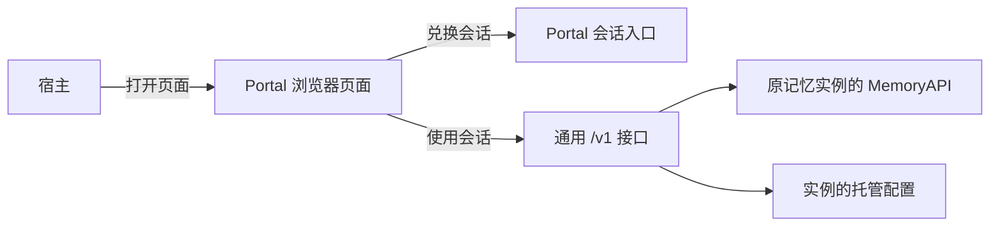

# 个人记忆管理 Portal 设计方案

## 元信息

| 项 | 值 |
|---|---|
| 日期 | 2026-11-06 |
| 影响范围 | Portal 页面、个人记忆查询与管理、模型配置、SDK 与 HTTP 接入 |
| 测试基线 | 2,055 项相关回归通过，覆盖 API、配置、检索、存储、HTTP、SDK 和前端。此前使用 Chromium 验证了主要操作和 375px 窄屏布局 |
| 接口规约 | [S02 记忆接口](../specs/S02-memory-api.md)、[S08 配置](../specs/S08-config.md) |
| 安全设计 | [S10 安全接口](../specs/S10-security.md)、[F04 安全能力与加密](common/F04-security-interfaces-and-encryption.md) |

## 背景

agent_memory 已经可以保存、查询和更新记忆，但接入应用的用户缺少一个直接查看和管理
记忆的界面。应用接入记忆模块后，用户需要知道“记住了什么”“来自哪个应用”，也需要
纠正错误记忆、遗忘不再需要的内容、调整记忆使用的模型。

Portal 是这个记忆实例的管理页面。记忆实例指应用已经启动的记忆模块，也就是代码中的
Runtime。Portal 使用同一个实例、同一份数据和已有的用户身份，不要求用户再填写服务
地址、用户身份、Scope 或存储目录。Scope 是记忆的范围标识，用于区分用户、Agent 和
会话，由接入应用和记忆模块管理。

## 决策

### 1. 使用范围

Portal 面向个人记忆管理，侧边栏提供记忆概览、我的记忆、用户画像、项目知识、过程与做法和模型设置。

| 能力 | 行为 |
|---|---|
| 记忆概览 | 查看全部、有效、纠正历史、已遗忘、已归档记录数量和有来源标记的应用数，快速进入来源筛选或记忆详情 |
| 查看记忆 | 默认展示当前用户在这个实例中有权读取的有效记忆，覆盖不同应用、Agent 和会话 |
| 筛选记忆 | 按应用、Agent、项目、认知层级、记忆分类、状态和正文／标签筛选，支持组合条件与分页 |
| 管理记忆 | 新增、纠正、遗忘；可查看纠正前的历史版本和已遗忘记录；支持本页多选遗忘 |
| 复制与导出 | 复制本页所选内容，或下载 Markdown、JSON；输出前重新读取所选记录的最新详情 |
| 语义检索 | 在“我的记忆”的同一搜索框切换为按含义查找，输入问题，从全部来源或指定应用检索，查看结果与原始记忆 |
| 模型设置 | 修改允许开放的模型参数和 API Key，预览后保存并应用 |
| 数据来源说明 | 页面提供入口，说明各区域使用哪个接口、哪个字段 |

文档记忆模式使用已有 Markdown 文件和文档索引；索引用于检索、保存记录属性及状态。
KV 模式指由键值存储保存记忆。它能通过相同的公开接口提供查询和管理时，Portal 直接
复用这些能力。配置是否可编辑，还取决于该实例是否具备可靠的配置保存位置和授权能力，
具体组合见第 7 节。

“全部记忆”限定在当前实例及当前用户的权限内。两个应用共用一个记忆实例时，可以按
来源查看；两个应用各自创建了不同实例时，需要分别打开各自的 Portal。

### 2. 页面与操作

界面使用浅灰背景、白色面板、中性色导航和蓝色操作按钮。通过统一的字体、圆角和
间距区分导航、筛选、记忆内容和操作区域。页面提供概览、卡片／列表切换、详情抽屉
和多选操作，功能与字段使用本项目已有接口。

#### 记忆概览

打开 Portal 后默认进入记忆概览，导航选中状态和面包屑保持一致。

显示全部记录、有效记忆、纠正历史、已遗忘、已归档记录和有来源标记的应用数。
全部记录等于四种状态的数量之和，来源应用数独立计算；点击状态卡片可打开对应列表。数量来自现有列表接口返回的
筛选计数；不是当前页条数，也不是估算值。读取失败时显示错误和“—”，不显示为零。
有效记忆速览取固定排序的前 5 条，不代表访问热度。来源按钮可以进入对应来源的列表。

概览发起一次列表请求，同时读取各状态的数量、来源选项及前 5 条有效记忆。
总数和各状态数量来自同一批授权记录。

#### 我的记忆

左侧为模块导航，主要区域显示筛选和记忆列表。可以切换单列列表与双列卡片；窄屏使用
单列。点击记录打开右侧详情抽屉，窄屏时抽屉占满页面宽度。
列表采用固定顺序分页，显示当前筛选条件下的数量，每页可选择 20、50 或 100 条。
有效记忆、纠正历史、已遗忘和全部状态提供快捷切换。

正文／标签搜索直接展示，来源应用、Agent、项目和状态收进可展开的“筛选”面板。
“我的记忆”还允许选择认知层级和记忆分类；分类页固定对应范围，不显示这两个选项。
筛选数量只计算面板中的附加条件，不包含搜索文字、分类页固定范围或
不限制范围的“全部状态”；选择任意具体状态（包括默认的有效记忆）计为一项。没有附加
条件时不显示数量。
侧边栏的“用户画像、项目知识、过程与做法”分别打开对应的记忆视图，标题、面包屑和
导航选中状态同步变化；三个入口复用记忆列表与管理能力，不在列表顶部重复放分类按钮。
用户画像使用
`memory_class=user_profile`；项目知识使用 `memory_class=long_term_memory` 与
`tier=semantic` 的组合，覆盖项目事实、决定等长期知识，也可能包含其他长期事实；
过程与做法使用 `tier=procedural`。它们是现有字段的快捷组合，不新增记忆类型，也不
自动识别内容是否属于项目。选择入口只替换分类与层级，保留应用、Agent、项目、状态和
文字条件；“我的记忆”取消分类和层级限制。分类页始终保留自己的固定范围，不因修改
附加筛选或“重置筛选”而跳转到其他侧边栏。重置清除附加条件并恢复有效状态；在
“我的记忆”中也清除手动选择的分类和层级。即使某一类型暂无记录，也保留当前视图。

正文／标签输入框用于文字匹配，支持大小写不敏感的子串查找。所有条件都由后端在完整
的授权记忆集合上执行，再计算数量和分页；下拉选项来自筛选前的授权集合。

| 页面字段 | 含义与数据来源 |
|---|---|
| 来源应用 | `system_metadata.source_app`；没有标记时显示“未标注来源” |
| Agent | 以 `scope.agent` 筛选；`system_metadata.agent_label` 是显示名 |
| 项目 | 优先取 `system_metadata.project`，缺失时取 `coords.project`；空值显示“跨项目／未标注” |
| 认知层级 | `MemoryTier`：working 工作、core 核心、episodic 情景、semantic 语义、procedural 程序性、archival 归档 |
| 记忆分类 | `system_metadata.memory_class`；例如用户画像、长期记忆、日常记忆，也支持自定义分类和“未分类” |
| 状态 | 列表和详情返回 `item.lifecycle`。`active` 为有效，`superseded` 为纠正历史，`forgotten` 为已遗忘，`archived` 为已归档 |
| 记录时间 | 取 `temporal.t_ingest`，即记忆进入系统的时间；没有值时显示未知 |

认知层级、记忆分类和状态是不同条件。例如，“归档记忆”这一认知层级，和“已归档”
这一状态分别使用独立字段，不能互相代替。

选择记录后，页面重新读取当前完整正文与来源信息，同时显示标签、会话、记录时间和
版本关联。列表内容只是选取记录时的摘要，详情以这次读取的结果为准。字段缺失时显示
未知或未标注，不根据应用名猜测项目、用户身份或来源。

新增弹窗提供正文、Agent 和可选项目。默认 Agent 及其锁定状态随列表返回，刷新后
重新读取列表即可恢复。宿主已绑定记忆轨时，表单显示该 Agent，
服务端使用链接绑定的完整写入范围。独立打开时，可以填写自己的 Agent ID，也可
留空保存为个人记忆。组织和用户取自认证身份，来源标为 `portal`。列表筛选条件
不改变写入归属。保存成功后，按接口实际返回的条数提示结果。
保存失败时保留正文；保存期间禁止重复提交。

纠正也使用独立弹窗：读取当前正文 → 编辑 → 对比原文和新文 → 确认。确认后创建新记录，
原记录保留为历史并退出有效列表；新记录指向它取代的旧记录。页面只修改正文，保留
原来的来源和归属，不允许借纠正修改作者或用户范围。

纠正和遗忘都只能对有效记忆执行。如果打开弹窗后记录已退出有效状态，页面提示刷新。
遗忘有独立确认窗口。成功后，记录退出有效列表和默认检索，仍可在“已遗忘”状态中
查看。遗忘不代表永久擦除文件，也不提供恢复按钮。

勾选记录或“选择本页”后，显示复制、导出和遗忘操作；切换筛选或翻页时清空选择。
复制和导出逐条读取最新详情，任一条读取失败都不输出数据，避免继续使用已失去权限的
列表缓存。Markdown 导出保存正文，JSON 保存详情字段但不包含页面内部用于选择记录的标识。
页面不把记忆或模型凭据存入浏览器本地存储。

只有所选记录全部有效时才允许批量遗忘。确认窗口说明数量，并逐条调用现有遗忘接口；
它不是一次全部成功或全部回滚的操作。完成后报告成功数量，列出失败记录和原因，
提示刷新核对后重试。

弹窗支持 Escape 关闭、键盘焦点在窗口内循环、字数提示、处理中状态和失败提示。
页面还区分加载中、没有结果、权限不足、容量限制、读取失败和分页冲突；失败不会显示
成“没有记忆”。翻页期间记录集合发生变化时，要求从第一页重新加载。

#### 统一查找区域

记忆页面提供一个输入框，默认按正文或标签文字匹配。“我的记忆”可切换到“按含义
查找”，使用同一个输入框描述问题，点击查找后展示检索结果；切回文字模式恢复列表与
分页。两种结果不会同时出现。分类页只提供文字查找，保持自身固定的记忆范围。

按含义查找时只显示来源应用和返回数量选项，隐藏文字模式的其他筛选，明确说明分类、
层级、项目、Agent 和状态条件不作用于语义检索。文字模式的条件保留，切回后继续生效。
两种方式分别使用 `/v1/list` 和 `/v1/search`，查询同一个记忆实例。

用户输入问题，选择来源和最多返回条数（1–100）。这些选项只影响本次查询，不会更改
记忆模块的全局检索策略。

后端对当前用户有权访问的记忆范围分别检索。来源过滤先于结果数量截取；个人全部记忆
检索涵盖所有项目。需要核对关联证据的角色记忆可在权限允许时通过列表和详情查看，
这类记录会在按含义查找前从候选中排除。

结果从各个记忆范围轮流取出，相关度分数只用于同一范围内排序。这里的范围按用户、
Agent、会话等划分，来源应用则是单独的筛选条件。点开结果可以查看记录的最新详情。

每个记忆范围先选出当前用户有权查看、且符合来源筛选的记录，再按相关度取前几条。例如，
只查应用 A 时，应用 B 的高分记录不会挤掉 A 的结果。点开结果时，页面会到这条记忆
所属的会话读取最新详情。候选总数超过 10000 条或有任一范围查询失败时，页面显示错误。
文档模式使用当前 SQLite 数据库的查询参数上限。上限较低时，候选未到 10000 条也可能超限报错。
全文和向量检索如何应用这些条件，见 [S06 存储规约](../specs/S06-storage.md)。

#### 设置

设置按实际接入的模型分组，常用字段直接显示，高级参数折叠。每项可以查看启动值、
已保存值、已应用的默认值和只读原因。页面同时显示保存版本和应用版本，便于判断修改
是否已经生效。不能确认实际值时明确显示未知。

Embedding 模型、向量维度、存储模式和文档目录是只读信息。文档目录按需展开，避免
挤占主要操作区域。页面也提供刷新配置、恢复启动值和放弃未保存更改。

### 3. 独立功能与已有记忆模块的关系

宿主打开页面后，浏览器先向 `/portal/api/bootstrap` 兑换会话。页面用该会话直接调用原有
`/v1/list`、`/v1/search`、`/v1/get`、`/v1/add`、`/v1/update` 和 `/v1/delete`。
列表和语义检索显式开启个人模式。服务端按认证身份确定可读范围；详情、纠正和遗忘只核对
目标记录的归属和当前权限。页面从原接口返回的记录提取展示字段。

模型设置使用通用接口 `/v1/read_config` 和 `/v1/save_config`。读取时由实例列出开放
的配置项，保存时使用完整配置键。将来开放其他配置项也使用这两个接口，并在实例侧
补充字段校验、权限和生效规则。Portal 专用入口负责提供页面和建立会话。HTTP 宿主
通过 `/portal/api/launch` 签发一次性链接。



SDK 的本地页面服务直接调用同进程 Runtime 的公开接口；HTTP 接入沿用原服务端口。
两种接入的页面使用相同的请求格式。普通 HTTP 客户端仍按原认证方式调用 `/v1`。
具体字段见 S02 的“Portal 页面操作与接口对应”。

#### Markdown 文件和检索索引如何同步

文档模式同时使用两份相互关联的数据：Markdown 文件保存可供人阅读和编辑的记忆正文，
文档索引保存供程序查询的记录，其中包括正文、来源、版本关系及有效／遗忘等状态。
Portal 通过原记忆接口查询和修改这些记录。

用户也可以直接在编辑器中修改记忆目录里的 Markdown 文件。启用文件监听后，记忆模块
已有的监听器会发现这些改动，再更新文档索引，让查询结果反映文件中的变化。这个
“Markdown 文件变化 → 更新文档索引”的过程称为文件同步，发生在记忆模块内部。
Portal 复用这套已有机制，不启动另一套同步任务。

Portal 中的纠正和遗忘先由原记忆接口完成写入。文件监听器随后处理变化时，需要保留
接口已经写入的版本关系和状态：

- 纠正“喜欢咖啡”为“喜欢茶”后，文件保存当前正文“喜欢茶”，索引还保留旧记录
  “喜欢咖啡”作为历史。文件中没有旧正文时，监听器会保留历史；旧正文仍在文件里时，
  同步也不会把它重新建成有效记录。
- 遗忘“喜欢茶”后，文件中可能仍有这段正文。监听器需要尊重索引中的遗忘标记，
  不能把它重新创建成有效记忆。

如果监听器刚读完旧内容，用户就做了纠正或遗忘，监听器会重新读取并比较，再更新索引。
在同一个进程里，监听器更新索引时，同一记忆目录的新写入会短暂等待。另一个记忆目录
可以继续写入。

模块内部只对下列必要位置做调整：

| 位置 | 调整原因 |
|---|---|
| 个人记忆接口 | 单个 Scope 的查询不能直接提供个人全部记忆，需要汇总已授权范围、筛选、分页和定位记录 |
| 配置与启动流程 | 原配置读取能力不能保证页面修改在重启后恢复，需要保存修改并在模型创建前加载 |
| 模型创建和调用 | 名称、地址、Key 和默认参数需要一起切换；正在执行的调用还需要原客户端 |
| SDK 与 HTTP 入口 | 绑定原实例与用户身份，提供页面地址，管理端口及关闭顺序 |
| 文档检索与同步 | 检索先按已授权的记录 ID 收窄候选。文件同步复用已有的历史保留规则，写回前校验读取版本，防止旧结果覆盖刚完成的纠正或遗忘 |

这些调整通过已有权限、写入、配置和加密能力完成，不另建一套存储、权限系统或通用
模型依赖追踪系统。

### 4. 哪些配置可以修改

设置页只开放当前实例已经创建、且支持在线修改的模型字段。哪些字段可以改，取决于
模型实现和接入应用设定的权限。

| 配置 | 页面行为与生效方式 |
|---|---|
| 模型提供方 `target` | 在支持的 OpenAI 兼容服务、DashScope、echo 之间选择；echo 标注为离线回显 |
| 模型名称 `llm_model` | 可修改，保存并应用后供后续调用使用 |
| 服务地址 `llm_base_url` | 修改时填写完整网址，遵守原有地址和 TLS 校验。页面只显示协议、域名和端口 |
| API Key `llm_api_key` | 可以替换；不显示原文，留空保持原值；凭据保存能力不足时只读 |
| 温度 `llm_temperature` | 按提供方校验默认值。单次调用显式传入参数时沿用该调用的参数 |
| 最大输出 `llm_max_tokens` | 修改默认输出 Token 上限，单次调用可显式指定 |
| 超时 `llm_timeout`、重试 `llm_max_retries` | 可修改，记忆模块内部替换模型客户端 |
| 思考模式 `enable_thinking` | 仅对 DashScope 显示 |

例如，在原来的模型服务里把模型 X 换成 Y，只填新的模型名即可。换到另一个服务时，
要一起填写完整网址、这个服务的 API Key 和模型名，避免把原服务的 Key 发给新服务。
如果要换回启动时的服务，把这三个字段中已覆盖的值一起恢复为启动值。

宿主锁定的字段和不支持管理的自定义模型只读，并说明原因。多个模型共用配置命名空间
时，共用的模型名称、地址和 Key 不允许按单个模型修改。

以下内容不提供编辑入口：Embedding 模型与维度、Embedding 连接与 Key、存储目录与
存储类型、认证授权、TLS、调度、通用策略、Prompt、全局检索策略及组件依赖关系。
Embedding 模型变化会影响已有向量的含义，维度相同也不能保证检索兼容；Portal 不负责
迁移向量或重建索引。原有 SDK 的配置与 Prompt 读取能力继续使用原入口。

### 5. 保存、应用和重启后的恢复

修改或恢复模型提供方时，根据最终提供方清除不适用的思考模式覆盖，避免恢复启动
提供方后被隐藏的旧参数阻断保存。

保存前先预览差异，确认后提交。每次提交携带读取配置时的版本号。另一个页面已经保存
新配置时，这次提交会报冲突；页面保留草稿、读取最新配置，要求重新预览。

| 结果 | 用户看到的状态 | 运行中的模型 |
|---|---|---|
| 校验或保存失败 | 保存失败，草稿保留 | 继续使用原配置 |
| 保存成功、应用成功 | 显示保存版本与应用版本一致 | 后续调用使用新配置 |
| 保存成功、应用失败 | 明确标记尚未应用，允许重试最新保存版本 | 继续使用原配置 |

设置应用成功后，正在进行的模型请求继续使用原设置，后续请求使用新的模型名称、
地址、Key 和默认参数。整个过程无需重启应用。“已应用”表示记忆模块已经切换设置，
模型服务能否正常访问要等实际调用才能确认。

例如，把模型从 A 改成 B，Portal 只在配置库里记录这一项变更。启动 YAML 继续保存
应用原来提供的设置。下次启动时，记忆模块先加载已保存的改动，再创建模型，所以仍会
使用 B。点击“恢复启动值”会删除这项改动，重新按启动配置应用。宿主锁定的值优先，
其次是允许修改且已保存的值、启动配置、内置默认值。

内置配置库是独立的 SQLite 文件。启用配置管理后，SDK 和 HTTP 优先使用已有文档目录
下的 `memory/.shadow/portal-config.db`。没有可用的文档目录时，可以把配置库放在实际
加载的启动配置文件旁。只传配置字典且没有可用文档目录时，页面无法编辑设置。应用开发者
也可以提供配置存储。用户打开页面时无需再选目录。

API Key 经已有加密组件保存，普通配置只保留凭据引用。内置实现的加密密钥放在配置库旁
的 `.model-key` 文件，由现有密钥组件管理文件权限；响应、预览、日志和浏览器本地存储
不保存 Key 原文。配置库和加密密钥需要一起保护，完整边界见 F04。新 Key 与其他配置按
同一版本提交，失败不会更改旧引用。

Portal 保存的 Key 与当时的模型服务绑定。宿主更改启动网址或锁定 Key 后，如果已保存
的网址和 Key 无法配套使用，该模型先用启动设置。页面会提示检查并重新填写，其他有效
设置和已保存记录仍保留。

### 6. 启动与打开页面

#### SDK 接入

“宿主”就是接入记忆模块的应用。下面区分用户操作和应用开发者需要做的接入工作。

**用户怎么用：**启动应用和记忆模块后，Portal 页面服务一起启动。用户打开应用提供的
访问链接即可，不用再启动一个记忆服务、不用填 Scope、身份或存储目录。页面服务启动
不代表浏览器会自动弹出；接入应用可以自动打开浏览器，也可以提供菜单或按钮。

**应用如何接入：**创建记忆插件时，`portal` 是构造参数中的一个配置对象，完整写法
如下。这里使用已有的记忆配置文件，`security_provider` 使用应用原来接入 SDK 时提供的
可信身份获取函数：

```python
memory_provider = AgentMemoryMemoryProvider(
    config_path="memory.yaml",
    security_provider=get_current_user_context,
    portal={"enabled": True, "port": 8138},
)
```

| 配置 | 作用 | 默认值 |
|---|---|---|
| enabled | 是否启动 Portal 页面服务 | True |
| port | 页面端口；0 自动选择空闲端口，1–65535 指定固定端口 | 0 |
| allowed_frame_origins | 允许嵌入的宿主来源列表，含协议、域名和端口 | 空列表 |

指定 8138 时，页面服务使用本机 8138 端口。设为 0 时，打开插件返回的链接即可。
`enabled=False` 会关闭 SDK 本地 Portal，记忆模块直接按启动配置工作，即使以前的
Portal 配置库损坏也能启动。

服务只监听本机地址。重复初始化复用原服务。固定端口占用时，记忆继续工作，Portal
状态显示不可用。端口释放后，用户再次打开 Portal 就会重试。

应用原本已经创建并正确接入记忆插件时，继续使用那个对象。初始化它就会连带启动
Portal，然后取得访问链接并打开浏览器：

```python
await memory_provider.initialize()               # 记忆和页面服务一起启动
portal_link = await memory_provider.open_portal() # 取得带访问授权的页面链接
if portal_link:
    webbrowser.open(portal_link)                 # 打开浏览器，需先 import webbrowser
```

`open_portal()` 的作用是生成访问链接；打开浏览器由 `webbrowser.open` 完成。链接包含
一次性访问授权，应当完整使用，不写入日志或长期保存。再次打开时重新取得链接。
“打开记忆管理”按钮只是承载这几步的一个选择，不是必须增加的功能。
宿主可用 `portal_status["supported"]` 判断是否显示入口。SDK 模式的 `available` 表示
页面监听已启动。HTTP 模式在首次请求链接前为 `False`，之后反映取链接是否成功。

应用中已经有记忆实例时，只在原插件上增加打开页面的操作，不再创建第二个实例。
身份接入继续复用应用已有的可信身份获取函数，不要求用户在 Portal 重新登录。

如果应用原本等第一次对话才初始化记忆，页面也要等到那时才会启动。想在对话前就打开
页面，应用开发者需要把已有初始化调用移到应用启动阶段。这是调用时机的调整，不是
用户每次使用时需要额外执行的操作。

插件提供页面服务和访问链接；具体的启动调用位置、自动打开或菜单按钮仍需要由
接入应用实现，仓库外的这部分尚未实测。

#### HTTP 接入

Portal 使用原 HTTP 服务的端口。例如服务监听 8137，页面路径就是
`http://127.0.0.1:8137/portal/`。初始化沿用 `/healthz` 检查记忆服务是否可达。
用户打开 Portal 时，应用调用插件的 `open_portal()` 获取本次访问链接。

HTTP 启动时先看安全配置是否声明了固定个人身份。声明了，才会尝试打开或创建配置库。
没有声明，或者宿主直接传入了自定义安全组件，服务就按启动配置运行。即使有旧配置库
或者库已损坏，也会跳过它。此时 Portal 仍可按权限查看和管理记忆。宿主需要显式接入
配置存储和授权，页面才能改设置。

#### 在宿主设置页嵌入

SDK 在 `portal.allowed_frame_origins` 设置宿主页面的实际来源。HTTP 由记忆服务配置
`http.portal_frame_origins`。例如宿主页面在 `http://localhost:8080`，两个入口各自
配置允许的来源：

```python
portal = {"allowed_frame_origins": ["http://localhost:8080"]}
```

```yaml
http:
  portal_frame_origins:
    - http://localhost:8080
```

宿主完成用户授权后，使用已经按记忆轨范围初始化的 Provider 调用 `open_portal()`，
将完整链接设为 iframe 的地址。SDK 链接绑定原轨的 Scope。HTTP 客户端使用与工具调用
相同的 Scope 映射签发链接。页面只读取绑定后的 Agent 名称，新增仍通过原写入权限检查。
每次重新加载 iframe 都由宿主提供新链接。iframe 会话仅在页面内存中保存，避免依赖
第三方 Cookie。页面监听继续使用本机地址。

#### 身份和关闭顺序

宿主提供已认证的身份，后端据此找出可能属于该用户的记忆范围并逐个判权。缺少用户
标识的范围还要核对每条记录的作者。浏览器提交的 Scope 和 ID 用于定位已有记录。
详情、纠正和遗忘每次都重新检查个人归属和访问权限。
一次性链接换成浏览器会话后，每次数据请求仍走原权限检查。HTTP 服务会重新认证，若原凭据
现在对应另一个身份，旧页面不能继续使用。会话失效后，页面提示从应用重新打开记忆管理。

Portal 页面、浏览器会话请求和托管配置接口的响应都要求浏览器和代理不要缓存。
SDK 的页面服务由插件启动和关闭，记忆实例仍由插件管理。HTTP 的页面随原 HTTP 服务关闭。

### 7. 支持条件与限制

| 组合或情况 | 行为 |
|---|---|
| SDK 已开启 Portal，或 HTTP 声明固定个人身份 | 优先从文档根定位配置库，其次使用实际加载的启动配置文件 |
| 只有配置字典且没有可用文档目录 | 记忆继续按启动配置运行，页面无法编辑设置 |
| HTTP 无固定个人身份 | 普通启动直接使用启动配置，宿主可另行接入配置存储和授权 |
| 已启用配置管理，候选位置均无法建库 | 记忆服务继续运行，页面无法编辑设置 |
| 已启用配置管理，某个模型的网址和 Key 无法配套 | 该模型使用启动设置，页面提示重新配置 |
| 已启用配置管理，已有配置库或加密凭据无法读取 | 启动时报告错误 |
| 缺少安全保存新 Key 的能力 | API Key 只读，其他可编辑字段照常使用 |
| 已启用统一存储加密 | 内置配置管理不可用 |
| 个人列表或检索候选超过 10000 条 | 返回容量限制，不静默截取后声称已展示全部 |

方案不提供永久删除、遗忘恢复、标签编辑、按会话或日期范围筛选、Embedding 迁移、
Prompt 管理、多个独立实例的合并、多用户共享管理或远程 Portal 部署。

## 拒绝的方案

| 方案 | 原因 |
|---|---|
| 增加轨迹日志、演化图表、共享与扫描功能 | 现有接口没有对应数据；这些能力需要单独设计，不扩大当前页面管理功能的范围 |
| 为批量操作新增后端接口 | 当前页选择可由前端调用已有详情和遗忘接口完成，需明确逐条处理和部分失败 |
| SDK 用户另起一个完整记忆服务 | 两个进程不一定使用同一数据和配置，还会重复启动后台任务 |
| 页面自行扫描文件或直接修改索引 | 绕过原有权限检查和文档写入流程，容易造成正文与状态不一致 |
| 只把配置修改留在内存里 | 用户看到保存成功，重启后却恢复旧值 |
| 改写启动 YAML | 启动文件可能由应用生成或由环境变量组成，不适合由页面覆盖 |
| 所有配置修改都等待宿主重启 | 模型客户端可在记忆模块内部替换，无需重启整个应用 |
| 自动扫描所有组件的模型消费者依赖图 | 配置管理只需要已接入模型及其能力信息，没有必要扩大通用工厂职责 |
| 在设置页开放 Embedding 换模型 | 需要处理旧向量迁移和索引重建，超出模型参数设置的职责 |
| 增加 Prompt 管理和通用配置中心 | 它们需要独立的使用与维护规则，不属于个人记忆查看和管理的目标 |

## 验证

- 用临时 Markdown 和 SQLite 索引验证新增、按来源筛选、纠正和遗忘。纠正前已开始的
  同步会重新读取；一个目录同步时，另一目录仍可写入。
- 用真实全文和向量检索验证来源筛选。其他来源或会话的高分记录不会占用目标记录的名额。
- 验证普通 HTTP 启动跳过配置库、个人设置保存后重启恢复，以及保存冲突、应用失败和重试。
- 验证 SDK 与 HTTP 的嵌入链接都能绑定当前 Agent 的写入范围。HTTP 会话在身份变化后失效。
  页面、浏览器会话和配置接口返回禁缓存指令，普通记忆接口和健康检查沿用原规则。
- 此前在 Chromium 中验证了概览、列表筛选、详情、导出、纠正、遗忘、设置和 375px 窄屏布局。
  模型相关自动化测试使用可控的离线客户端。

## 已知遗留

接入应用的实际启动、配置透传及页面按钮仍需在对应宿主验证。
纠正沿用原记忆接口。两个请求同时纠正同一条有效记录时，都可能通过状态检查，产生两条
有效的新记录。
远端模型可用性、所有外部 KV 后端及部署环境的密钥保护未逐个实测。文档索引全量重建
如何保留历史与遗忘状态，不属于普通文件同步的验证范围。
