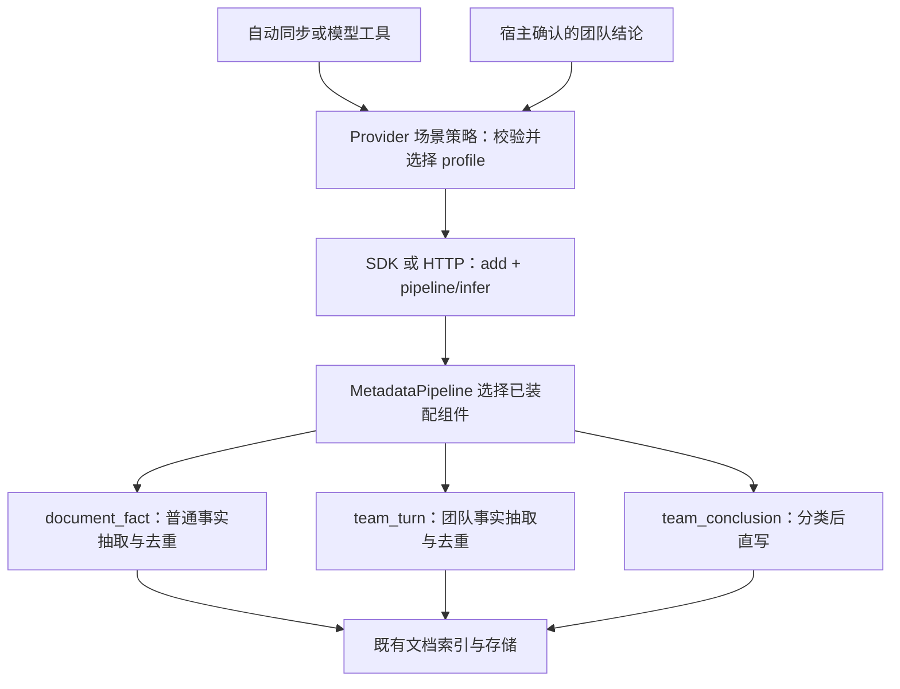

# Team 场景文档记忆

## 元信息

| 项 | 值 |
|---|---|
| 日期 | 2026-11-20 |
| 影响范围 | JiuwenSwarm Adapter、Pipeline、构建算子、文档存储与 Shadow |
| 设计依据 | D-20261113-2017-jiuwen-memory-team-upgrade 及已确认的三仓接入方案 |

## 核心决策

Team 复用既有 add/search/read_md_file/edit_md_file。新增 `scene=team`，每位回答者有独立 Provider；Swarm 宿主统一以配置 memory.builtin.jiuwen.agent_id（默认 main_agent）绑定 Work/Code/Team 的记忆身份，再绑定项目和团队键；运行名称和角色不变。独立 Provider 继续接受调用方 agent_id，内核不硬编码身份。画像跨项目共享，项目事实在同项目共享，团队结论仅在同团队召回。所有共享仍受 Scope 授权约束。不同运行名称的助手在同配置下也共享；不同配置身份继续隔离。旧身份数据不自动归并或跨身份搜索；默认 main_agent 兼容原默认身份；已有显式 agent_id 仍优先，不自动覆盖。

团队键为 `{project}--{digest}`，digest 是用户 org/user、项目键、专家团名称组成的 JSON 数组的 SHA-256 前 24 位；JSON 使用默认分隔符及 ensure_ascii=False。会话 ID、成员和侧栏不参与键。路径为 `memory/teams/{team}/MEMORY.md`，共享 `USER.md`、项目目录和 shadow.db。摘要由宿主生成，Memory 校验键格式和项目匹配，不复核摘要对应的明文身份；Scope 授权独立执行。

团队结论由 Core 专用 Agent 生成 decision/lesson/member/context 条目。Provider 校验标签、非空正文及宿主 project/team 对应关系，固定 infer=false 并选择 team_conclusion。模型不能选择流程或覆盖坐标。存储继续校验路径格式、项目匹配与身份权限。没有放开公共 system_metadata 对 memory_class 的赋值。

团队标签同时保存在元数据和新写入正文的 `[decision]`、`[lesson]`、`[member]`、`[context]` 前缀中，已有相同前缀不重复添加。这样 SDK/HTTP 的搜索、读取和预取沿用现有 content 输出即可呈现类别，不需要新增返回字段。历史无前缀条目不自动回填。

Provider 在写入前校验整批结论：空提取返回 0；混合批次保存有效项，告警仅含跳过数量和原因；非空但全部无效时报 ValueError，避免将抽取格式错误当成正常空结果。错误日志不记录记忆正文。

Code 与 Team 并列复用 BaseDocumentScene 的项目绑定、SDK 文档配置和预取超时机制，各自定义工具、写入 profile 和召回策略。Team 不再继承 Code 的场景行为；Work 保持既有协议实现。

## 写入流程与算子边界

复用已有 MetadataPipeline，在初始化时装配具名组件，按每次写入的 system_metadata.pipeline 选取；不保存跨请求的当前场景。原来的引擎 Team 校验和通用抽取器中的应用判断已移到 Provider 策略与独立算子。

| 入口 | profile / infer | 处理 |
|---|---|---|
| Work/Code 自动同步、普通写入工具 | document_fact / true | DocumentFactExtractor → ProjectTeamDedup → 原文档索引 |
| Team 自动同步、team_memory_write | team_turn / true | TeamLlmExtractor → ProjectTeamDedup → 原文档索引 |
| 宿主 add_team_memories | team_conclusion / false | TeamDocumentClassifier → 原文档索引；不新增抽取或去重 |

DocumentFactExtractor 要求 project_fact 为布尔值，项目事实只使用来源绑定的项目；TeamLlmExtractor 在此基础上要求 team_internal=false，排除协作内部内容和未确认草稿。两个算子不读取 source_app 或 memory_scene 再次分流。TeamDocumentClassifier 写入受保护的 memory_class=team_memory，并委托原分类器补充 tier、tags、importance。ProjectTeamDedup 复用 Shadow 去重算法，普通事实排除团队类别，团队候选只对照同项目、同团队。

Team 的来源说明、排除规则和字段纠正指令均遵循现有 extractor_language：cn/en，非法值回退 cn；JSON 字段名和布尔值不变。

Team 抽取响应缺少 team_internal 或类型错误时，对该批不合格候选集中追加一次字段纠正请求；只补布尔标记，不重抽或改写正文。首次合格候选保留，明确 true 的候选正常排除。纠正请求最多调用一次 LLM，即使超时、请求失败、格式仍错也不再次重试；未修复项告警后过滤。原始抽取请求的异常重试策略保持不变，纠正状态仅属于当前批次，不保存在共享算子实例。拒绝将缺失字段默认当 false，以免团队草稿进入普通事实。

具名配置在 Adapter 的 pipeline_profiles.py，SDK 加载基准配置、应用场景要求后，仅在最终 write_document 开启时补齐三个 profile；保留 default、video 和显式具名覆盖。Work 使用非文档配置时保留原 Pipeline，不装配依赖 Shadow 的文档去重；Code/Team 仍覆盖为文档模式。布尔值与字符串开关复用内核归一规则。HTTP 客户端仅传 profile，服务端需加载 deploy/local/document-memory-http.yaml，或在装配前调用 configure_document_pipelines。示例启用 strict_routes：未知显式流程报错，混合流程批次必须拆开；未指定流程使用 fallback。通用 MetadataPipeline 默认仍保持原有未知值回退语义。

采用具名组合是为了让其他应用按相同规则复用算子，规则不同则装配另一组实例。没有增加新的 Pipeline 框架，也不在控制引擎、通用抽取器内维护应用分支。查询、读改文档继续走现有接口和过滤，不增加 Team 查询算子；本次不扩展后台 evolve/EXTRACT 的路由。

## 查询与编辑

- 预取并行读取画像、项目/团队兜底文档及两段搜索，各操作独立限时 5 秒。项目、团队各最多 5 条命中；无结果或失败则采用已读取的对应文档，不叠加命中与全文。画像和兜底文档不受 top_k 限制。
- 项目查询排除团队类别，团队查询同时限制 project、team、memory_class。Work 的自动召回与搜索工具在给定项目时都使用 project 等值过滤，不混入旧空项目条目；USER.md 单独读取，独立 Provider 未传项目时的旧行为保留。
- FTS 仍在截断前过滤。向量查询中，单独或 AND 中的 `memory_class != team_memory` 不再触发逐条距离计算；没有其他 ID、类别、团队约束时，复用原有 vec0 KNN 四倍过采样，再由 SQL 过滤项目、身份及类别。类别等值、团队和 ID 约束继续先筛选再计算距离；OR/NOT 组合保留原路径。该规则同样适用于普通事实的向量去重候选。
- 普通去重不检索团队条目；团队候选若进入去重，只对照同项目同团队。
- 文档读改用 Context coords 传 team；只允许匹配项目的团队 MEMORY.md。相同内容的其他文档不能通过 hash 扩大读取范围。
- 看门狗和编辑补偿从规范路径恢复项目、团队及类别；手改可能丢失 sidebar/member 等来源信息。

## Runtime 与边界

Provider 可注入宿主 document_runtime_holder。普通 SDK 由 Swarm 按规范根目录复用 Runtime、看门狗和 Shadow，独立保留请求身份；首份配置生效、后续差异告警。取消 awaiter 不取消已接受操作，最后租约释放前排空操作。关闭失败不允许新 Runtime 覆盖旧实例。独立使用 Provider 而未注入 holder 时保留原生命周期。

HTTP 不创建本地 Runtime，服务端配置文档根、模型、embedding 与看门狗。接续 Runtime 池及其配置冲突契约不变。资源级锁继续覆盖文档写入与对账；不新增跨进程协调，不迁移旧团队文件，不做复杂团队语义去重。

## 拒绝的方案

| 方案 | 拒绝原因与当前选择 |
|---|---|
| 每个团队单独建立 shadow.db | 会增加索引、装配与跨画像/项目查询的管理成本；复用现有索引，按 Scope、project、team、类别进行隔离 |
| 每个 Provider 独立创建同根 Runtime | 同一目录会重复初始化和监听；由宿主持有者按根共享 Runtime，通过租约管理释放，Provider 保留独立请求上下文 |
| 将共享 Runtime 写死在 Provider 内部 | 独立使用、生命周期及宿主测试难以解耦；通过 holder 注入共享能力，未注入时保留原生命周期 |
| Team 直接继承 Code 场景 | 会隐式继承 Code 的行为和日志；仅抽取公共文档机制到 BaseDocumentScene，场景策略并列实现 |
| 缺少 team_internal 时直接视为 false | 可能将团队草稿混入普通事实；采用一次有界字段纠正，仍不合格则过滤并告警 |
| 所有类别过滤都先筛选再逐条计算距离 | Work 常用的排除团队条件可能只排除少量记录；仅这一条件复用 KNN，保留团队等选择性约束的原路径，不调整表结构 |

## 已知遗留

- 成员回合与 Leader 收口可能产生重复结论，本次不增加复杂语义去重。
- 旧身份、旧团队文件以及历史无标签前缀正文不自动迁移或回填。
- 文档块拆分/合并后的重建及看门狗重建可能丢失 sidebar、member、team_label 等元数据；项目、团队和类别按路径恢复。
- 共享 Runtime 与资源级锁不提供新增的跨进程协调能力。
- 排除团队的 KNN 路径仅在有限候选中执行 SQL 过滤，不足时不补取或回退；其他项目、身份或团队条目占满窗口时，可能漏掉窗口外的合格记忆，普通事实的向量去重也受此限制。
- 类别等值、团队和 ID 等约束保留先筛选再计算距离的路径；两条路径的性能尚需专项验证，不能将 top_k 当作距离计算数量上限。

## 验证入口

`test_team_memory_provider.py` 覆盖 SDK 团队共享与隔离、编辑和工具参数；`test_agent_memory_provider_http.py` 覆盖真实 HTTP 服务链路；`test_sqlite_shadow_index.py` 验证超过候选窗口的干扰项不能挤掉目标团队；`test_local_watchdog.py` 验证手改后的团队归属；`test_agent_llm_extractor.py` 验证独立事实/团队抽取算子及通用抽取兼容；`test_document_pipeline_profiles.py` 校验 SDK/HTTP 配置一致、具名覆盖和原视频路由保留；`test_coding_memory_provider.py` 校验不同配置来源和布尔/字符串开关下 Work/Code/Team 的装配边界；`test_jiuwenswarm_access.py` 覆盖非文档 Work 的搜索隔离、画像工具和文件工具拒绝；`test_pipeline.py` 校验严格路由与旧回退行为。

标签可见性复用 SDK/HTTP 的写入、搜索、预取与编辑读取链路验证；另覆盖四类前缀、空批次、全无效及混合批次反馈。Shadow 分区测试仅在缺少可选 sqlite_vec 依赖时跳过向量用例，全文用例继续运行；已安装但初始化失败仍判失败。排除团队的向量用例覆盖项目/身份过滤、候选不足不补取，以及叠加 ID、团队、类别条件和 OR 时保留原路径。

上述测试使用离线模型或确定性模型替身，不代替真实 LLM 质量和页面验收。Swarm 的共享持有者与 Core Rail 生命周期由对应仓库测试覆盖。

离线回归覆盖 Adapter、Provider HTTP、事实抽取与分类、Pipeline、SQLite Shadow、Agent/Cloud 引擎、同步写入分支、检索流程、去重和文档生命周期。自动同步与显式工具均覆盖 Work/Code/Team，项目事实共享及跨项目画像共享规则保持一致；团队结论直写、默认/视频流程和严格路由也有回归保护。
