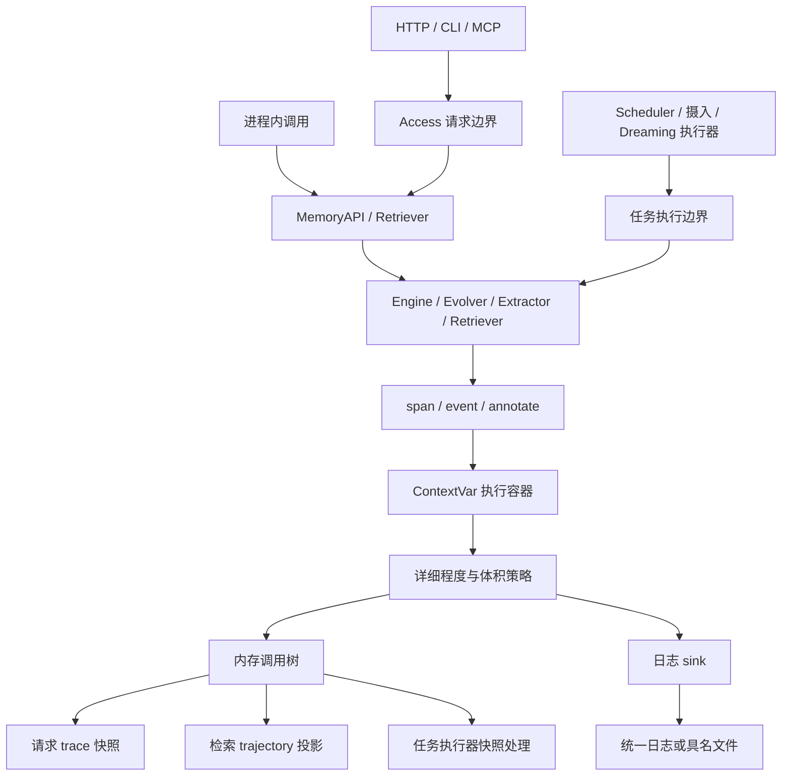
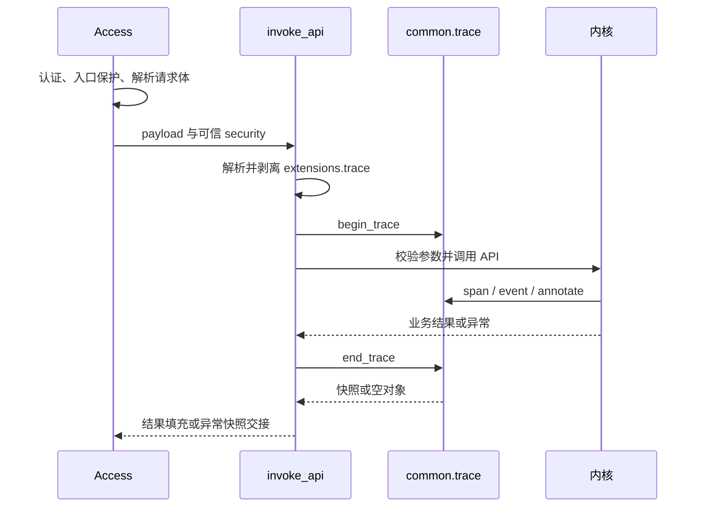

# Trace 统一追踪设计

| 项 | 值 |
|---|---|
| 日期 | 2026-11-12 |
| 测试基线 | Trace、检索、去重、冲突巩固与隐私相关回归 822 项通过；相关模块回归 3745 项通过；隐私专项 111 项通过；改动 Python 文件 Ruff 检查通过 |
| 适用范围 | 在线请求、检索 trajectory、后台任务、日志输出与运行时资源管理 |
| 关联模块 | `jiuwen_memory/common/trace/`、`api/`、`config/`、`control/`、`construction/`、`retrieval/`、`jiuwen_memory_entry/` |

## 当前实现与后续设计边界

本次实现提供请求级调用树、`info` / `debug`、`noop` / `memory` / `log` / `both`、
请求覆盖及写入、检索、抽取和去重埋点。响应填充、错误附带与默认装配见 S07。
固定护栏为 128 个内存节点、256 字符和 4 层深度。
检索阶段使用请求独占的 `RetrieveRun.record` 同时记录 trace 事件与可选 trajectory；
`PipelineRetriever.retrieve` 保留 span，阶段覆写与 pipeline 选择沿用分阶段检索契约。

下文描述完整目标设计。`memory_log` 更名、trajectory 单一记录源、可配置或取消护栏、
后台任务独立作用域、按任务类型选择实例和专用日志文件均尚未实现，不能使用对应配置
作为当前功能。当前组合输出的注册名是 `both`，trajectory 保持原有独立记录。
进程内接口仅支持 `begin_trace(target=None, trace_id=None, *, level=None)`，尚无
`collector=` 覆盖。当前用法见 [Trace 设计说明](../../design/trace_design.md)。

本次选择独立 ContextVar 请求容器和当前 span，避免并发分支共享可变栈；拒绝沿业务
调用链逐层传 collector，以保持业务签名和职责边界。完整方案取舍见第 13 节。

## 1. 需求与设计目标

一次记忆写入经过摄入、路径选择、抽取、去重和索引构建，一次检索经过查询解析、
多路召回、融合、重排、阈值过滤和披露。只查看最终结果，难以确定候选在哪一步减少、
去重为何产生某个决定、请求走了哪条路径，以及耗时集中在哪里。后台抽取、演进和
摄入任务同样需要按执行实例还原过程。

Trace 提供统一的结构化过程记录能力，满足以下需求：

1. 用调用树表达组件、执行阶段、嵌套关系、耗时、数量及必要的决策信息。
2. 支持关闭、内存收集、日志输出、内存与日志同时输出四种策略，默认关闭。
3. 支持启动配置和单次请求覆盖，业务代码无需沿调用链传递 collector。
4. 同步、异步、请求内并发和工作线程共享正确的追踪上下文，不串入其他执行的数据。
5. 保留 API 的 `with_trajectory` 和 `trajectory`，通过同一份记录生成检索轨迹。
6. 后台任务复用同一套接口，以 scope 与 job ID 关联过程，按任务类型配置输出及文件。
7. 默认限制记录规模，允许服务端配置取消对应限制，并明确呈现截断。

三个相关概念的职责如下：

| 概念 | 解决的问题 | 使用入口 |
|---|---|---|
| 过程 trace | 一次请求或任务执行了哪些步骤、产生什么统计、耗时多少 | trace 配置、模块级埋点、请求覆盖 |
| 检索 trajectory | 向检索调用方返回步骤列表 | `with_trajectory=True`、`RetrievalResult.trajectory` |
| 记忆血缘 trace | 一条记忆由哪些记忆派生而来 | `MemoryAPI.trace` / MCP `memory_trace` |

过程 trace 与 trajectory 共用底层记录，血缘回溯保持独立语义。设计范围为进程内追踪，
历史数据保留通过日志输出完成；不引入跨服务传播协议或按 trace ID 查询快照的服务。

## 2. 总体架构与职责

Trace 作为 common 横切能力，采用 `TraceCollector` 接口与 `TraceProducer` 注册式工厂，
遵循两级配置命名空间。它不继承 `Plugin`，不进入 `PluginType`。



| 层次 | 职责 |
|---|---|
| `common.trace` | 执行作用域、当前 span、调用树、捕获区间、计时、过滤、截断和计数 |
| collector | 根据配置定义 sink 行为，持有装配期配置，不持有请求或任务数据 |
| API 装配与 runtime | 注册实现、解析配置、注入默认策略、管理日志资源 |
| Access | 解析请求覆盖，配对开启 / 结束请求作用域，填充通用快照或错误体 |
| 检索层 | 标记可投影的阶段事件，将记录转换为 `TrajectoryStep` |
| 后台执行器 | 选择任务策略、生成 trace ID、配对管理作用域、交接快照 |

Access 从 `jiuwen_memory.api` 获取公开作用域入口；内核各层从 `common.trace` 获取埋点
函数。common 不依赖检索结果类型，也不根据业务类名推断任务类别。

## 3. 作用域、状态与并发

### 3.1 执行容器

每次请求或任务使用独立执行容器，包含：

| 状态 | 用途 |
|---|---|
| collector 与输出选择 | 决定日志行为及是否输出通用快照 |
| trace_id | 关联请求、任务、日志与审计 |
| 详细程度 | 控制 info / debug 节点采集 |
| 体积策略 | 固定本次执行的节点数、字符串长度和深度限制 |
| 根节点与当前计数 | 保存调用树、统计保留和丢弃节点 |
| 捕获区间 | 标记一次检索及其子分支，支持局部读取与轨迹转换 |
| closed | 阻止执行结束后复制的旧 context 继续写入 |

执行容器放在一个 `ContextVar` 中，当前 span 放在另一个 `ContextVar` 中。
collector 只定义输出策略，执行数据由容器统一管理，不使用每次请求 fork collector
的协议。是否收集内存节点、是否写日志、是否向调用方输出通用快照分别决定。

没有活动作用域或输出策略关闭时，埋点快速返回。内层 noop 屏蔽外层普通过程收集；
显式 `with_trajectory=True` 可在该检索区间临时开启内存捕获，以兑现轨迹返回要求。

### 3.2 上下文传播与收尾

`asyncio.run`、`gather`、`create_task`、`to_thread` 传播执行上下文；副本指向同一执行
容器，各子任务持有发起时的父 span，形成平级分支，避免共用可变栈造成错误嵌套。
直接使用 `ThreadPoolExecutor.submit` 时，每次提交分别复制 context，不能让多个
并发工作线程同时进入同一个 Context 对象。共享容器的计数、预算判定与节点挂载
需要保证并发安全。

入口在成功、异常和取消路径均成对调用 begin / end。结束时恢复外层 ContextVar 并
关闭本次容器；复制了旧 context 的延迟执行不再向其写入。节点通过 owner 校验归属，
不会将旧 span 挂到下一次执行上。

后台 job 在实际执行入口新建作用域，即使提交时继承了请求 context，也使用自己的
容器和 trace ID。任务与触发请求分别结束，互不影响生命周期。

## 4. 数据模型与输出格式

### 4.1 节点模型

| 类型 | 产生方式 | 语义 |
|---|---|---|
| span | `trace_span` / `traced` | 包住执行区间，记录耗时，容纳子节点，异常时记录类型名 |
| event | `trace_event` | 记录阶段数据，同名事件逐条保留 |
| annotation | `trace_annotate` | 合并数据到当前 span，不额外创建节点 |

节点以 `component` 和 `stage` 命名。span 的 `cost_ms` 使用 `perf_counter` 测量，包含
内部执行与等待时间；子节点可能并发或共享计时区间，不能简单相加推导总耗时。
span 的 `error` 只记录异常类型名，原异常继续传播。

快照包含 `trace_id`、根节点列表 `spans`，以及发生节点丢弃时的 `dropped`：

```json
{
  "trace_id": "request-id",
  "spans": [
    {
      "component": "InMemoryEngine",
      "stage": "write",
      "cost_ms": 2.315,
      "children": [
        {
          "component": "InMemoryEngine",
          "stage": "ingest",
          "data": {"units": 1, "modality": "text", "path": "raw"}
        },
        {
          "component": "InMemoryEngine",
          "stage": "result",
          "data": {"path": "raw", "originals": 1, "returned": 1}
        }
      ]
    }
  ]
}
```

`spans` 同时容纳 span 和 event；空 data / children 可省略，event 不必有 cost_ms。
debug 节点带 `level: "debug"`，概要节点省略 level。一次批量写入可有多个根节点。
快照用于结构化过程诊断，不以全量时间戳或独立 span ID 重建精确并发时间线。

### 4.2 四种输出类型

| target | 收集调用树 | 写日志 | 典型用途 |
|---|---|---|---|
| `noop` | 否 | 否 | 默认关闭 |
| `memory` | 是 | 否 | 随请求返回，或交给进程内调用方 / 任务执行器 |
| `log` | 否 | 是 | 服务端观测 |
| `memory_log` | 是 | 是 | 同时读取调用树和日志 |

`memory_log` 复用 log 输出并开启内存收集，名称明确表示两种介质。注册名、配置、
请求覆盖统一使用该名称，不保留 `both` 别名。显式轨迹捕获可临时增强 noop / log
的内存能力，但不改变其日志选择及通用响应选择。

### 4.3 详细程度与日志行

`TraceLevel` 只有 `info` 和 `debug`。info 记录计数、耗时和路径；debug 额外记录逐条
决策等明细。debug 作用域包含 info 节点。过滤在复制数据前完成，被过滤的 span
不建节点，其内部满足阈值的事件挂到外层 span。

日志路径为根到当前节点的 `组件.阶段`，以 `/` 连接：

```text
trace[<trace_id>] <level> Engine.write/Evolver.evolve/Extractor.extract <data>
```

事件记录时调用 sink，span 退出时调用 sink，后者 data 包含 cost_ms 和可选 error。
日志使用 `agent_memory.` 命名空间，统一以 logger 的 INFO 写出，trace 级别放在行内。
logger / handler 设置为 WARNING 及以上仍会过滤这些日志。

## 5. 公共接口

### 5.1 埋点与作用域接口

这些接口分为三组：begin_trace / end_trace 管理一次执行的收集范围，trace_span /
traced 标记需要计时的执行区间，trace_event / trace_annotate 记录过程与结果数据。
作用域通常由请求入口或任务执行器管理，业务组件只使用埋点接口。

| 接口 | 作用 | 典型调用位置 | 返回或记录内容 |
|---|---|---|---|
| `begin_trace` | 开始一次追踪，绑定输出策略、ID、级别及执行容器 | 请求 / job 入口，或进程内显式追踪入口 | 返回恢复上下文用的 token，不返回快照 |
| `end_trace` | 结束本次追踪，恢复外层上下文并取走结果 | 与 begin 配对的 finally | 内存快照；没有可返回数据时为 `{}` |
| `trace_event` | 记录一个阶段发生了什么 | 解析完成、召回完成、决策产生等位置 | 新增事件节点，不自动测量执行时长 |
| `trace_span` | 包住一段执行，建立父子关系并自动计时 | 方法内部的一段逻辑，使用 with | span 节点，退出时补耗时和异常类型 |
| `traced` | 将整个方法包装为 span，省去手写 with | 同步 / 异步方法的装饰器 | 与 trace_span 相同，保留方法原返回值和异常 |
| `trace_annotate` | 给当前 span 补充或更新数据 | 获得处理结果后、span 结束前 | 合并到当前节点，不新增事件 |
| `parse_trace_spec` | 解析请求覆盖字符串 | Access 读取 extensions.trace 时 | target 与 level，不开启作用域 |
| `configure_default` | 设置未显式选择输出时使用的 collector | 应用装配阶段 | 更新默认输出选择，不开始记录 |

```python
from collections.abc import Callable, Iterator, Mapping
from contextvars import Token
from enum import Enum
from typing import Any

class TraceLevel(str, Enum):
    INFO = "info"
    DEBUG = "debug"

def begin_trace(
    target: str | None = None,
    trace_id: str | None = None,
    *,
    level: TraceLevel | str | None = None,
    collector: TraceCollector | None = None,
) -> Token: ...

def end_trace(token: Token) -> dict[str, Any]: ...

def trace_event(
    component: str,
    stage: str,
    data: Mapping[str, Any],
    *,
    level: TraceLevel = TraceLevel.INFO,
) -> None: ...

def trace_span(
    component: str,
    stage: str,
    data: Mapping[str, Any] | None = None,
    *,
    level: TraceLevel = TraceLevel.INFO,
) -> Iterator[None]: ...  # contextmanager

def traced(
    stage: str,
    component: str | None = None,
    *,
    level: TraceLevel = TraceLevel.INFO,
) -> Callable[[Callable], Callable]: ...

def trace_annotate(
    data: Mapping[str, Any], *, level: TraceLevel = TraceLevel.INFO
) -> None: ...

def parse_trace_spec(spec: str) -> tuple[str | None, TraceLevel | None]: ...
def configure_default(collector: TraceCollector) -> None: ...
```

begin_trace 的 target 与 collector 互斥；collector 供可信进程内入口传入已经装配的
具名实例，完整保留 level / log_file。二者均省略时选择配置默认。trace_id 显式值优先，
其次取受控认证上下文中的 request_id，再次生成 UUID。level 显式值优先于实例配置。

end_trace 关闭本次作用域，返回内存快照；没有 buffer 或没有节点时返回空字典。
对局部检索捕获的读取使用非破坏性快照，不能调用 end_trace 提前关闭外层请求。
#### begin_trace：建立一次执行的追踪上下文

begin_trace 确定“接下来发生的埋点属于哪次执行、用什么策略输出”。它不会执行业务，
也不会自动创建根 span。开启后，同一上下文中的嵌套调用可以直接埋点，无需接收
token 或 collector 参数。

token 是上下文恢复凭据，不是 trace_id，也不是节点 ID。调用方应保存 token，并在
同一执行上下文中恰好调用一次 end_trace。嵌套 begin / end 按后进先出配对；普通业务
组件不应在每个方法里重新 begin，以免把同一次执行拆成不相关的追踪。
target / collector / level 非法时开始操作失败，不进入后续业务调用。

#### end_trace：关闭作用域并取得快照

end_trace 使用 begin 返回的 token 恢复之前的作用域，并将结束的容器标记为关闭。
因此复制了该容器的延迟任务也不能继续向它写事件。存在外层作用域时，结束内层后
后续埋点重新归属外层；结束整个请求后，不再向本次请求追加节点。

应先退出所有 span、等待属于本次追踪的子调用完成，再执行 end_trace，确保耗时和
结果数据已经写入。成功、异常、取消都要收尾，所以放在 finally 中。结束操作不会
替调用方吞掉业务异常，不会结束其他 job，也不会关闭共享日志文件。log-only 的日志
在执行期间已经写出，end 返回 `{}` 不表示没有记录日志。

#### trace_event：记录一次阶段事实

trace_event 使用 component 标明组件，stage 标明组件内部阶段，data 保存数量、路径、
决策等结构化信息。事件挂在当前 span 下；没有当前 span 时成为根事件。同名事件逐条
保留，不按 component / stage 覆盖，因此可记录多个召回通道或多次去重决定。

它不包住业务代码，也不自动测量耗时；需要阶段耗时时可在 data 中传入已计算的
cost_ms，或使用 trace_span。返回值为 None；没有活动追踪、作用域已关闭或 debug
事件不满足当前级别时不记录。数据先经过统一体积策略，再进入内存记录和选定 sink。

#### trace_span：计时一段执行并组织子节点

trace_span 是同步上下文管理器，可在同步函数和 async 函数中使用 `with`。进入时创建
span、设置为当前父节点；退出时恢复父节点，并将整个区间耗时写入 cost_ms。区间中
的事件和子 span 自动成为 children，data 参数可提供进入时已知的信息。

区间抛异常时只记录 error 的异常类型名，原异常继续传播。span 关闭时向日志 sink
输出一次完整区间数据，内存节点保留开始到结束的结构。被级别过滤的 span 不建节点，
内部符合级别的事件仍挂到可用的外层 span。

#### traced：为整个方法自动创建 span

traced 是 trace_span 的方法装饰器形式，适合 write / retrieve / evolve 等完整方法。
stage 指定阶段名；component 默认取实际 self 类型，支持继承后的实现名称。普通函数
应显式提供 component。同步方法在返回 / 抛错时结束 span，异步方法在 await 完成 /
抛错时结束 span，方法的参数、返回值和异常语义保持不变。

同一个完整方法通常选 traced，方法内部另需观察的子阶段用 trace_span 或 trace_event。
不必用两者重复包住同一范围。

#### trace_annotate：补充当前区间的结果

trace_annotate 将 data 合并到当前 span.data，用于填充开始时未知的结果，如 created、
returned 或最终状态。同名字段以本次值替换旧值，不执行计数累加；需要累加时由业务
代码计算后传入。它不创建新节点，不另开计时，也不会单独写一条日志，补充数据随
当前 span 结束一并输出。

没有当前 span、span 不属于当前执行或不满足级别时不记录；它不会回头修改最近一次
event。若要记录多个阶段各自发生的事实，应逐条使用 trace_event。

#### parse_trace_spec 与 configure_default：解析和装配

parse_trace_spec 将 `"memory:debug"` 拆为 target 与 level，将 `":debug"` 的 target
解析为空以沿用默认 collector。它只做格式和级别解析，target 是否注册在实例解析时
校验；不产生事件、不更改上下文。

configure_default 在装配阶段注入默认 collector。之后不显式传 target / collector
的 begin_trace 使用该默认值；已经开始的追踪继续持有开始时选择的实例。它不用于
请求级切换，也不保存本次执行的数据。

#### 接口协作示例

以下示例将一次追踪限定在一个工作单元内。阶段埋点不持有 token，token 只由外层负责
收尾。假定应用已完成 trace 实现注册：

```python
from jiuwen_memory.common.trace import (
    begin_trace,
    end_trace,
    trace_annotate,
    trace_event,
    trace_span,
    traced,
)

class ExampleWorker:
    @traced("run")
    def run(self, values: list[int]) -> int:
        trace_event("ExampleWorker", "input", {"count": len(values)})
        with trace_span("ExampleWorker", "calculate", {"operation": "sum"}):
            total = sum(values)
            trace_annotate({"result": total})
        trace_annotate({"processed": len(values)})
        return total

token = begin_trace("memory", trace_id="example-1")
try:
    result = ExampleWorker().run([1, 2, 3])
finally:
    snapshot = end_trace(token)
```

该调用生成以下层级，result 仍为业务返回值 6：

```text
追踪作用域 example-1                    begin_trace / end_trace 管理
└── ExampleWorker.run                    traced 自动计时，data.processed=3
    ├── ExampleWorker.input              event，data.count=3
    └── ExampleWorker.calculate          span 自动计时
                                        data.operation="sum"、data.result=6
```

calculate 内的 annotate 只补充 calculate；退出它后，当前 span 恢复为 run，后面的
annotate 因而补充 run。scope 结束时才取得完整快照。

### 5.2 collector 与注册

```python
class TraceCollector:
    buffers: bool = False
    enabled: bool = True
    level: TraceLevel

    def record(
        self,
        trace_id: str,
        path: str,
        data: Mapping[str, Any],
        level: TraceLevel,
    ) -> None: ...
```

`TraceProducer.TOP_NAME = "trace"`，实现通过 `TraceProducer.register(name)` 注册，
由 common bootstrap 导入实现包完成注册。输出实现依次为 NoopTraceCollector、
MemoryTraceCollector、LogTraceCollector、MemoryLogTraceCollector。

buffers / enabled 描述常规输出能力，显式轨迹捕获独立决定临时内存收集。
实现不得保存请求树、当前 span 或 job 执行数据。sink 应自行处理输出故障，避免
record 异常传播到业务，或在 span 收尾时覆盖原异常。data 使用可 JSON 序列化的值，
枚举与时间应在埋点处转换成字符串或基础值。

### 5.3 接入辅助接口

| 接口 | 语义 |
|---|---|
| `pop_trace_target(payload)` | 返回剥离覆盖后的 payload 副本、target 和 level |
| `invoke_api(api, verb, payload, security)` | 参数解析、API 调用、序列化及请求 trace 收尾 |
| `error_trace(exc)` | 读取随调用异常交接的非空快照 |

请求覆盖常量为 `TRACE_OVERRIDE_KEY = "trace"`，只解释 payload 顶层 extensions 中
的该键，其余键仍交原 API 签名校验。

## 6. 在线请求流程与响应

### 6.1 配置选择与请求覆盖

请求覆盖格式为 `<target>[:<level>]`：

| 示例 | 语义 |
|---|---|
| `memory` | 按 target 选内存输出，使用其默认 info |
| `memory:debug` | 内存输出并记录明细 |
| `memory_log:debug` | 内存与日志同时输出并记录明细 |
| `log:info` | 仅日志概要 |
| `:debug` | 保留默认 collector，仅覆盖详细程度 |
| `noop` | 关闭本次普通过程输出 |

显式 target 按注册名解析，使用空 params 构建；它不是配置中的具名实例引用，不继承
该实例的 level 或 log_file。保留默认具名配置并调整级别应使用 `:info` / `:debug`。
默认 noop 时，单独 `:debug` 不会开启普通过程输出；显式轨迹要求另按第 7 节处理。
体积限制来自统一执行策略，不随 target 覆盖改变。

覆盖解析在 API 参数校验前完成，复制 payload，不改变调用方对象。extensions 剥空
时移除整个字段，其余键继续校验。非字符串覆盖、未注册 target 和非法级别抛
ValidationError。target 名按注册名匹配，级别支持去除首尾空白并转换大小写。
覆盖不参与鉴权或业务路由，也不允许携带日志文件路径。

### 6.2 执行边界



认证、入口限流及 HTTP body 读取 / JSON 解析发生在请求 trace 边界之前。
legacy handler.dispatch 复用覆盖解析及作用域能力，在其 dispatch 边界收尾。

### 6.3 响应语义

| 情况 | 行为 |
|---|---|
| noop、log，或没有可返回节点 | 保持原业务结果 |
| 有通用快照，序列化结果为字典 | 增加 trace 键，同名键被替换 |
| 有通用快照，结果为列表、标量或 null | 包装为 `{"result": 原结果, "trace": 快照}` |
| 仅 with_trajectory 临时收集 | 只填充原 trajectory，不新增 trace 键或结果包装 |
| 调用血缘 trace 动词 | 保留其结果语义，不附过程快照；日志输出可独立工作 |

invoke_api 异常路径关闭作用域，将快照交给 surface。HTTP / CLI 的一般
AgentMemoryError 错误体可带 trace；InternalError 不附。HTTP 对 AuthenticationError
和 RateLimitedError 的独立错误分支不提取快照。MCP 将业务错误转换为 RuntimeError
文本。legacy dispatch 对已有错误体在快照非空时附加 trace，包括其 500 响应。
覆盖解析失败发生在作用域建立之前，不产生本次快照。

HTTP trace_id 复用受控 request_id，与 `X-Request-ID`、访问日志和审计关联。
直接调用 MemoryAPI 时，调用方显式 begin / end 取得通用快照，业务结果对象保持原类型。

## 7. trajectory 统一设计

### 7.1 API 与结果契约

保持检索参数与结果结构：

```python
def search(
    query: str,
    context: Context,
    *,
    security: RequestSecurityContext,
    filters: FilterExpr | list[FilterClause] | dict | None = None,
    as_of: datetime | None = None,
    top_k: int = 10,
    disclosure: DisclosureLevel = DisclosureLevel.L0,
    with_trajectory: bool = False,
) -> RetrievalResult: ...
```

| 类型 | 字段 |
|---|---|
| `TrajectoryStep` | stage、channel、candidate_count、cost_ms、detail |
| `RetrievalResult` | items、trajectory、errors |

trajectory 是 `list[TrajectoryStep]`，不是调用树对象。channel 为召回通道枚举或 None，
detail 为 `dict[str, str]`。with_trajectory=False 时 trajectory=[]，errors 不受该开关控制。

### 7.2 开关组合

| with_trajectory | 通用输出 | 轨迹行为 |
|---|---|---|
| false | noop | 不收集轨迹 |
| false | memory / log / memory_log | 按配置输出 trace，trajectory 为空 |
| true | noop | 临时内存捕获，返回 trajectory，不额外写日志 |
| true | log | 保留日志并临时内存捕获，返回 trajectory |
| true | memory / memory_log | 从同一份记录生成 trajectory |

显式轨迹要求优先保证可用 buffer，不能被 noop 或 log-only 抑制。它不自动提升 debug
级别，也不自动开启通用 trace 响应。调用方同时选择两种返回视图时，底层仍只记录一次。

### 7.3 单一记录源与局部捕获

检索在阶段记录处只写 trace event，事件保留独立的阶段结构及内部投影元信息：

| 规范事件字段 | trajectory 映射 |
|---|---|
| stage | stage |
| channel | channel |
| candidate_count | candidate_count |
| 原精度阶段 cost_ms | cost_ms |
| 独立 detail | detail |

通用视图可格式化耗时、将数量呈现为 data.candidates，但投影不依赖格式化后的值，
也不从摊平的 data 反推 detail。不按 component 类名或固定 stage 白名单识别轨迹，
以支持自定义阶段并避免同名字段冲突。

捕获边界覆盖完整检索编排，并支持直接调用 Retriever。已有活动容器时复用其 trace ID
和预算，临时增强本检索区间的内存收集；无活动容器时建立临时作用域。返回前读取
局部记录并转换为步骤，finally 恢复增强或关闭临时容器，不关闭外层请求。
业务异常仍按原语义传播。

轨迹只包含本次检索及其子分支的阶段事件，排除无关业务事件、包装 span 和普通 debug
明细。保留重复通道事件、跳过原因与降级信息，不维护另一份无限制步骤列表。

### 7.4 多模态与跨空间

多模态分支显式传播 context，记录分支降级及最终 RRF 融合步骤，保留 detail.branch。
trajectory 按 native、multimodal_clip、multimodal_event 的编排顺序输出，不能改用
并发完成顺序。跨空间检索按空间优先级合并各空间步骤，子记录只投影一次。

子检索共用根捕获区间预算，不能每个分支重置上限。调用树的记录顺序和轨迹兼容顺序
可以不同，由捕获区间保存编排关系并在投影时恢复。

### 7.5 截断可见性

trajectory 使用受限记录，因此默认不承诺返回所有步骤和完整 detail。节点丢弃时，
步骤列表末尾附加一个不占预算的保留步骤：

```json
{
  "stage": "trace_truncated",
  "channel": null,
  "candidate_count": 0,
  "cost_ms": 0,
  "detail": {"reason": "max_nodes", "dropped": "12"}
}
```

dropped 只统计本次检索捕获区间及子分支被丢弃的节点；多分支合并只汇总一次。
未丢弃节点时不添加该步骤。字符串截断保留 `...[truncated]`，深度超限保留类型标记，
投影不会恢复被截断的数据。需要完整已埋点记录时，通过服务端配置取消对应限制。

## 8. 后台任务设计

### 8.1 trace ID

在 Scheduler、摄入控制器、Dreaming 驱动等实际执行入口，根据受控的任务 scope 和
执行 job_id 生成 trace ID，显式传给 begin_trace：

```text
job|org=<org>|space=<space>|user=<user>|agent=<agent>|session=<session>|job_id=<job_id>
```

各值按 UTF-8 百分号编码，仅保留 URI 非保留字符（字母、数字、`-._~`），保留空维度，
编码 `%`、`|`、`=` 等分隔符。避免直接拼接 str(scope) 或使用有损替换的路径片段。
ID 用于关联，不作为文件路径或鉴权依据。

每次实际执行创建根 `Job.run` span，记录 task_type、job_id、状态及耗时。
周期执行优先使用本次实例 job_id，另记 parent_job_id；若重试或周期入口复用 job_id，
增加 execution_id / attempt 区分执行，每次新建容器和预算。派生 job 独立建作用域，
通过 parent_job_id 关联父任务。

### 8.2 输出选择与执行责任

启动配置将稳定任务类型键映射到 trace 具名实例，选择顺序为：

```text
globals.trace_jobs.types[task_type]
    > globals.trace_jobs.default
    > trace.default
```

类型未匹配时向后回退，显式 noop 表示关闭，不继续回退。所有缺省配置沿用 noop。
任务不读取触发请求的 extensions.trace，实例参数完整保留，不能降为 target 名与空
params 的缓存。类型由执行器显式提供：evolve / middle_to_long 对应 JobType 值，
ingest / dreaming 为相应执行入口策略键，不要求扩展 JobType 枚举。

执行器通过 `begin_trace(trace_id=job_trace_id, collector=selected_collector)` 开启作用域，
内部复用相同埋点接口。成功、异常、取消都在 finally 收尾。子协程 / 工作线程传播任务
context，独立后台 job 重新建立自己的作用域。

memory / memory_log 快照交给执行器内部处理，未消费则释放，不回写已经结束的请求，
不增加 JobInfo 字段或改变 job_status 结构。长期过程保留使用日志文件。

## 9. 配置契约

### 9.1 默认输出与配置层级

内核配置采用 `trace.<实例名>.target / params`，默认实例名为 default：

```yaml
trace:
  default:
    target: memory
    params:
      level: info
```

SDK 通过 assemble / Config.from_dict 直接装配时使用以上顶层结构。
HTTP、CLI、MCP 的启动配置把内核配置放在 memory_api 段，trace 和 globals 都在其内：

```yaml
memory_api:
  trace:
    default:
      target: memory
      params:
        level: info
```

params.level 只读本实例配置，不从 globals 回退。显式 begin_trace level 或请求覆盖
级别优先于实例级别，最终默认 info。启动配置以同一规则供任务策略选择具名实例。

### 9.2 体积策略

| 内核配置键 | 默认值 | null 语义 |
|---|---|---|
| `globals.trace_max_nodes` | 128 | 取消内存节点数限制 |
| `globals.trace_max_value_chars` | 256 | 取消字符串值截断 |
| `globals.trace_max_depth` | 4 | 取消按深度替换值 |

非 null 值必须为正整数，bool、0、负数、字符串、小数在装配期抛 ValidationError。
省略用默认值，显式 null 保留为 None，不被配置 fallback 替换。

限制在请求或任务开始时固定，独立于 collector target，所有输出覆盖、轨迹临时
buffer 和子分支共用。节点数按 span 与 event 合计，超出计入丢弃计数，只限制 buffer，
不限制日志行数。字符串保留前 N 字符再追加截断标记，深度超限替换为类型标记。
字符串与深度处理后的数据同时供快照、trajectory 和 sink 使用。

节点预算不是轨迹步骤数量承诺，也不是总字节预算；容器宽度、名称和路径长度不在
这三项限制内。trace_max_nodes=null 也不会自动关闭其他两项限制。

### 9.3 日志文件

log / memory_log 接受实例级 params.log_file：

| 值 | 行为 |
|---|---|
| 省略或 null | 沿用统一日志输出 |
| 非空白路径字符串 | trace 行写入该实例专用文件 |

noop / memory 配置 log_file 或传入空白路径视为配置错误。相对路径以启动工作目录
为基准；装配时创建目录并验证文件可打开，失败直接报错。路径仅来自启动配置，
请求扩展、scope 与 job_id 不参与文件名选择。

文件 sink 使用独立 logger / handler，保持 `agent_memory.` 命名空间、统一格式与隐私
filter，隔离父级传播，避免重复写入默认日志或其他任务文件。普通业务日志继续使用
原日志配置。同一路径受控共享 handler，不同文件的实例不能被按 target 缓存合并。

runtime 持有文件资源，任务停止并收尾后再 flush / close；end_trace 只结束作用域。
多个 runtime 共用 handler 时按引用释放。文件以 UTF-8 追加，轮转由部署日志设施管理。

### 9.4 完整启动配置示例

```yaml
memory_api:
  globals:
    trace_max_nodes: 128
    trace_max_value_chars: 256
    trace_max_depth: 4
    trace_jobs:
      default: background
      types:
        evolve: evolve_trace
        middle_to_long: middle_trace
        ingest: ingest_trace
        dreaming: dreaming_trace
  trace:
    default:
      target: noop
    background:
      target: log
      params:
        level: info
        log_file: /var/log/agent-memory/background.trace.log
    evolve_trace:
      target: memory_log
      params:
        level: debug
        log_file: /var/log/agent-memory/evolve.trace.log
    middle_trace:
      target: log
      params:
        log_file: /var/log/agent-memory/middle.trace.log
    ingest_trace:
      target: log
      params:
        log_file: /var/log/agent-memory/ingest.trace.log
    dreaming_trace:
      target: memory_log
      params:
        log_file: /var/log/agent-memory/dreaming.trace.log
```

任务策略默认值与 types 值均为 trace 具名实例引用，未知引用和非法策略装配期拒绝。
同一实例可由在线默认策略或多个任务类型复用。

取消三项限制的启动配置：

```yaml
memory_api:
  globals:
    trace_max_nodes: null
    trace_max_value_chars: null
    trace_max_depth: null
  trace:
    default:
      target: noop
```

此时 with_trajectory=true 仍临时捕获检索轨迹，其余请求保持默认关闭。

## 10. 使用方法

### 10.1 启动与请求覆盖

将接入层配置保存为 trace.yaml，使用既有脚本加载：

```bash
scripts/run-server.sh --auth-mode dev trace.yaml
scripts/run-cli.sh --auth-mode dev --config trace.yaml add \
  --content '用户偏好美式咖啡' --scope '{"org":"local","user":"developer"}' --pretty
```

dev 用于本地示例。排查单次 HTTP 请求可在 payload 顶层传覆盖：

```bash
curl -X POST http://127.0.0.1:8137/v1/search \
  -H 'Content-Type: application/json' \
  -d '{
    "query": "咖啡",
    "context": {"scope": {"org": "local", "user": "developer"}},
    "with_trajectory": true,
    "extensions": {"trace": "memory:debug"}
  }'
```

顶层 extensions.trace 控制过程输出；context.extensions 中的检索扩展保持业务语义。
这个请求同时要求 trajectory 与通用调用树，两者来源相同。

### 10.2 CLI 与 MCP

检索轨迹直接使用原参数：CLI search 的 `--with_trajectory true`，HTTP / MCP 的
`with_trajectory: true`。使用轨迹不要求新增通用 trace 参数。

CLI 通用参数由 MemoryAPI 签名生成，add / search 没有顶层 extensions 参数；NDJSON
batch 在发送前先校验签名。MCP add / search 也没有通用顶层 extensions。它们的通用
trace 输出通过默认配置控制；已有顶层 extensions 参数的方法可经同一解析器覆盖。
search 的 context.extensions 不充当通用 trace 开关。

memory / memory_log 通用快照会改变部分结果形态，客户端、CLI 展示及 MCP 输出
schema 需按第 6 节处理字典加键和 result 包装。依赖列表或 quiet 模式提取 ID 的脚本
应使用明确的解析路径；仅开启 trajectory 时继续使用原检索返回结构。

### 10.3 进程内调用

以下示例中的 api、context、security 由应用按既有方式提供。

```python
from jiuwen_memory.api import begin_trace, end_trace

token = begin_trace("memory", level="debug")
try:
    result = api.search("咖啡", context, security=security, with_trajectory=True)
finally:
    snapshot = end_trace(token)

steps = result.trajectory
```

result 保持业务对象类型，snapshot 独立读取。只需要步骤列表时直接传
with_trajectory=True，由检索捕获边界管理临时内存收集。

### 10.4 新增业务埋点

```python
from jiuwen_memory.common.trace import TraceLevel, trace_annotate, trace_event, traced

class Builder:
    @traced("build")
    def build(self, units):
        trace_event(type(self).__name__, "input", {"count": len(units)})
        for unit in units:
            trace_event(
                type(self).__name__, "item", {"id": unit.id}, level=TraceLevel.DEBUG
            )
        trace_annotate({"processed": len(units)})
```

埋点参数会先求值，关闭时也应避免昂贵计算。新增 sink 通过 collector 与工厂注册扩展，
新增检索阶段同时提供投影元信息，新增任务入口显式提供任务类型键。

## 11. 埋点与阶段信息

| 链路 | 节点 | 信息 |
|---|---|---|
| Engine 写入 | write span | 总耗时、异常类型 |
| 写入摄入与返回 | ingest / result | 单元数、模态、raw / infer / middle / procedural 路径、原始与返回数量 |
| Evolver | evolve span | 模式、输入、created / updated / superseded / forgotten 统计 |
| Extractor | extract event | 输入数、响应字符数、解析条目数、候选数 |
| 去重汇总 | dedup event | 实现、候选数、各决策数量、需 LLM 判定数量 |
| 去重明细 | dedup_decision debug event | 候选 ID、决策、最佳匹配 ID、分数、direct / llm 来源 |
| 检索编排 | retrieve span | 总耗时、异常类型 |
| 检索阶段 | parse / recall / fuse / recheck / rerank / resolve / threshold / secondary_rank / disclose | 数量、耗时、通道、降级及阶段 detail |
| 多模态编排 | 分支事件 / 融合事件 | branch、分支失败、融合策略、最终数量 |
| 后台执行 | Job.run span | task_type、job_id、parent_job_id、执行标识、状态与耗时 |

阶段事件反映实际执行路径，条件阶段只在运行到时出现。没有节点时不返回通用快照，
因此响应没有 trace 键不能单独用来判断配置是否生效。总耗时与阶段数量不等于每个
存储或模型调用均有独立计时。

## 12. 框架影响与运行约束

| 方面 | 设计要求 |
|---|---|
| 装配 | common 注册输出实现，API 选择默认实例、任务策略和体积配置 |
| 业务接口 | 不新增逐层 collector 参数，保留 search 的 with_trajectory 与 trajectory |
| 接入响应 | 通用内存快照按结果类型填充；单独轨迹请求保持原结果形态 |
| 后台执行 | 实际执行入口新建作用域，scope + job_id 关联，按类型选择实例 |
| 资源 | collector 不保存执行数据，文件 handler 归 runtime 生命周期管理 |
| 数据与存储 | MemoryUnit、存储 schema 与 JobInfo 不因过程追踪改变 |
| 鉴权与审计 | 沿用原鉴权；trace 为诊断数据，不能替代安全审计或改变权限判断 |
| 性能 | 关闭时快速返回，开启时承担建树、复制、截断、序列化和同步日志成本 |

默认 collector 与按 target 的解析缓存按进程级基础设施管理；后续装配会影响之后
使用默认策略的执行，已开始的容器继续持有自己的 collector 与策略。文件及具名实例
不能仅按 target 合并；同进程多 runtime 使用不同输出时应显式绑定其装配实例。

data 以计数、枚举、必要 ID 和分数为主，避免正文、prompt、LLM 原文和凭证。
memory 快照直接交调用方，普通 dict 的字符串不会仅因进入统一日志命名空间就自动
完成脱敏。隐私 filter 处理显式敏感值标记；异常 detail 需要遵守同一数据约定，
safe_error_message 的归一与长度控制也不能代替内容审查。

取消体积限制只影响记录规模，不扩大埋点数据范围。通用请求覆盖沿用入口认证和资源
保护，日志路径固定在启动配置中。trace 的开关只控制该设施的输出，普通业务日志
仍按其原有 logger 配置运行。

## 13. 方案取舍

| 选择 | 原因 |
|---|---|
| ContextVar 与独立执行容器 | 保持业务签名，隔离请求数据并支持任务内上下文传播 |
| 独立当前 span | 并发子任务继承发起节点，避免共享可变栈造成错误嵌套 |
| 调用树与逐条事件 | 保留层级与重复阶段，比扁平覆盖键更适合多路召回和决策 |
| 单一记录源、trajectory 投影 | 避免两份数据漂移，同时保留公开步骤列表 |
| 独立后台作用域 | 生命周期、ID、预算与输出策略归实际任务，而非触发请求 |
| 具名输出实例 | 完整保留 level / log_file，按任务类型复用资源 |
| info / debug 两档 | 区分概要与明细，异常类型和业务日志承载失败信息 |
| 显式 null 取消限制 | 省略与无限制含义清晰，避免 0 / -1 多套约定 |

不采用沿调用链传 collector、每请求 fork 有状态 collector、成对 tracing ABC 或
仅提供方法入口 / 出口的代理。通用能力也不绑定 TrajectoryStep 或记忆血缘模型。
日志可观测性通过统一 sink 获得，不为本进程诊断引入完整的分布式追踪依赖。

## 14. 验证与验收

| 维度 | 验收要求 |
|---|---|
| 输出类型 | noop / memory / log / memory_log 行为与配置、请求覆盖一致 |
| 开关组合 | with_trajectory 保证所需 buffer，false 时为空，临时收集不额外包装响应 |
| 单一记录 | trace 与 trajectory 同源，同名事件不丢失、不重复记录或投影 |
| 并发隔离 | 请求、任务、分支、线程上下文正确归属，旧作用域结束后不再写入 |
| 生命周期 | 正常、异常、取消均恢复外层上下文，局部读取不关闭外层请求 |
| 轨迹兼容 | 阶段字段、detail、通道及编排顺序保持，包含多模态降级和最终融合 |
| 体积策略 | 默认边界、各项 null、非法类型、共享预算与截断标记均可验证 |
| 后台标识 | scope 空值与分隔符编码无碰撞，周期 / 重试不累积旧节点 |
| 任务配置 | 类型匹配与默认回退明确，实例参数完整保留，不继承触发请求选择 |
| 文件输出 | 分文件隔离、同文件受控复用、无重复传播、装配失败可见、收尾后释放 |
| 接入一致性 | HTTP / CLI / MCP / SDK 的轨迹参数及通用结果处理符合契约 |
| 回归 | 默认关闭时业务结果、鉴权、调度、存储及既有错误语义保持 |

重点测试入口为 `tests/unit/common/trace/test_trace.py`、
`tests/unit/api/test_trace_pipeline.py`、
`tests/unit/jiuwen_memory_entry/test_api_contract_trace.py`，并覆盖多模态、跨空间、
后台执行器和完整接入链路。超过默认节点数与字符串长度的固定输入，应分别验证
默认截断及取消限制后的完整记录。

## 15. 关联文档

本文将 trace 需求、方案、接口和使用方式整理为一个完整设计。相关模块契约与设计记录：

- [Memory API 规约](../../specs/S02-memory-api.md)
- [控制层规约](../../specs/S03-control.md)
- [检索层规约](../../specs/S04-retrieval.md)
- [公共组件规约](../../specs/S07-common.md)
- [Trace 特性设计](F11-new-trace.md)
- [Trace 设计说明](../../design/trace_design.md)
