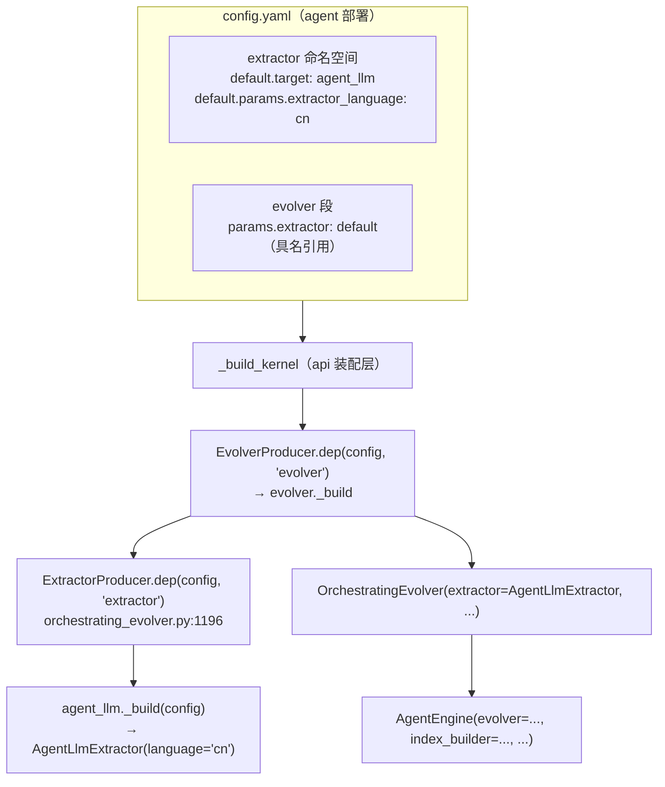
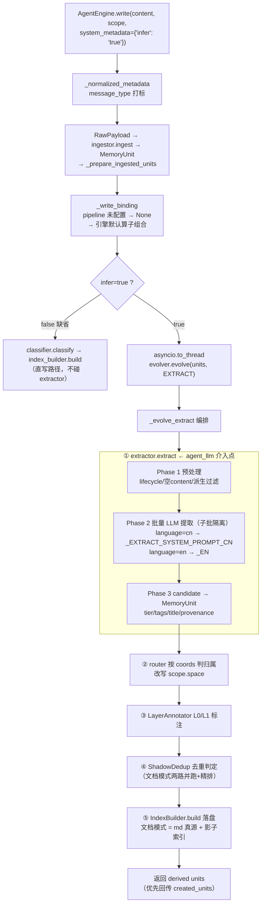

# agent_llm：agent 方向记忆提取 Extractor（中英文可配）

## 元信息

| 项 | 值 |
|---|---|
| 系统范围 | agent 方向（user↔agent 对话、以用户为中心）记忆提取；prompt 指令面中英文可配；抽取时同步判定 memory_class（三类归属类别）；抽取管线与输出契约不变 |
| 日期 | 2026-10-12 |
| 状态 | 已实现（2026-10-13 落地：前置改造 + agent_llm_extractor + 单测；2026-10-14 增强：prompt 精简为十条 + memory_class 抽取时同步判定 + md 落盘三类映射键，见 §4.3 / §5） |
| 关联模块 | `jiuwen_memory/construction/extractor_impl`（llm_extractor / agent_llm_extractor）、`jiuwen_memory/control/engine_impl/agent_engine.py`（对接消费方）、`jiuwen_memory/storage/markdown_impl/local_markdown_store.py`（md 落盘分流键联动，F08 §决策二） |
| 适用调用面 | agent 方向部署（`extractor.target: agent_llm` 一行切换）；云侧基线 `llm` 不受影响 |
| 参考 | agent-core_6760 `openjiuwen/harness/prompts/sections/memory.py`：双语常量对构造模式 + `MEMORY_PROMPT_EN` 的提取方向（用户与 agent 对话中关于用户的信息） |

## 1. 系统目标和边界

`agent_llm` 是 `llm` extractor 的 agent 方向版本：**同一套抽取管线、同一套输出契约，分化点是 prompt 指令面的场景重定向（人际对话 → user↔agent、以用户为中心）与指令面语言可配（`language` 中英切换）**。target 名以场景（agent）命名而非语言特征——语言是 `extractor_language` 参数，场景才是实现分野。

解决的问题：

- 现有 `llm` extractor 的 system prompt 全英文（~100 行规则资产），agent 方向（jiuwenswarm）对话源文本以中文为主，英文指令驱动中文 LLM 的指令遵循度不如母语指令。
- AgentEngine 是 agent 对接方向的独立引擎（与 CloudEngine 平级无继承），中英文 extractor 适配是其预告的第一个 agent 侧特化（agent_engine.py 模块 docstring「算子归属」节：中英文切换（agent_llm）走上层 `extractor.target` 配置）。
- **提取方向重定向**：`_EXTRACT_SYSTEM_PROMPT` 是人际对话方向——对称多方说话人模型（A/B/C 平等参与、"I/me" 是该说话人、"you" 是被称呼者）、例子全是人际场景（A 劝 B 换驾照、C 提议 D 问）、无角色区分与提取中心。agent 场景的真实形态是**用户与助手的对话**，提取核心是关于用户的信息——用户的画像、稳定偏好、身份、习惯、决定、计划（对照 memory.py `MEMORY_PROMPT_EN` 的关注点）。agent_llm 的 prompt 是**场景重定向版**：与原 prompt 的关系是「抽取纪律继承、场景面重定向」，中英两版均为新写，英文版不再复用 `_EXTRACT_SYSTEM_PROMPT`。
- **抽取时同步判定 memory_class**（2026-10-14 增强，见 §4.3）：agent 场景的编排精简目标之一是绕开 `_route`（Router 判归属）整条链路——归属类别改为在抽取 prompt 里同步产出，省一次独立 LLM 调用（判定输入 content 本就是抽取产物）。三类 `user_profile / long_term_memory / daily_memory` 与 Router 的三类语义一一对应，md 落盘共享同一路径（`_PATH_MAP` 加同名映射键，F08 §决策二）。

重定向的具体面（其余纪律逐条继承，见 §4）：

| 面 | 原 prompt（人际对话） | agent_llm（user↔agent） |
|---|---|---|
| 说话人模型 | A/B/C 多方对称 | user / assistant 两方；用户谈到的人是第三方 |
| 提取中心 | 无（各方平等） | 以用户为中心：用户的事实/偏好/决定/计划/身份/处境 |
| 助手输出的地位 | 无此概念（人人都是提取源） | 解释/建议/代码/总结本身不是条目；用户对其行动时才成条，记用户的决定 |
| 言语行为范围 | 建议/请求/承诺/拒绝/回答 | 保留全部 + 助手提案被用户接受 |
| 不记录清单 | 无 | 纯本地指称（"那段代码"）、助手未经确认的建议本身、无长期价值的过程细节（对齐 memory.py `MEMORY_MGMT_PROMPT_EN` 的 What Not To Record） |
| 归属类别 | 无（由下游 Router 独立判定） | 抽取时同步产出 `memory_class` 三类（§4.3） |

明确不做的事：

- **输出语言仍跟源文本**：「每条陈述用与其源相同的语言写，绝不翻译」这条规则在两个语言版本里都保留。中文化的是指令面，不是输出契约。
- **云侧基线不动**：`llm` target 行为零变化（前置改造仅改引用形式）。
- **不走 PromptRegistry**：仓里已有的 prompt 可配基础设施（yml `prompts` 段 + phase/key 查询）是 dynamic 路径专属机制（S05 铁律 11/13），orchestrating 路径接入它会扩大该机制的边界，且 ~100 行规则放 yml 后 review 体验差。本方案采用双语常量对内联。

构造模式参考 agent-core_6760 `openjiuwen/harness/prompts/sections/memory.py`：模块级 `_CN` / `_EN` 常量对 + 构造时按 `language` 选择。

## 1.1 与 dynamic_llm 的边界（为什么不是重复造轮子）

`dynamic_llm` 是仓内已有的"prompt 可配"实现，与本方案的分工：

| 维度 | `llm` / agent_llm（本方案） | `dynamic_llm`（现有） |
|---|---|---|
| 配套 evolver | OrchestratingEvolver（agent_engine infer 路径、serve-doc 配置实际在用） | DynamicEvolver 四步（consolidate/reflect 共用同一 registry） |
| prompt 来源 | 内置常量——携带 ~100 行调优规则资产（agent_llm = 其 agent 方向双语版） | 外置 yml `prompts.extract` 段，registry 按 key 查——本身不携带 prompt 内容 |
| 生效条件 | 无条件，装配即用 | 每次 write 须在 system_metadata 下推 `_extract_prompt_<strategy>` 键，无键整体 fallback 到 keyword（非 LLM） |
| 子批隔离 | 有（extract_batch_size 切分 + 单批失败隔离） | 无（全部 accepted 单次调用） |

**本质**：dynamic_llm 是 prompt 的**选择机制**（按次策略语义，为 DynamicEvolver 多策略抽取设计）；agent_llm 是规则资产的**场景重定向版**（user↔agent 方向 + 部署级 language 配置，为 agent 方向开箱即用设计）。用 dynamic_llm 实现中文指令面的代价：① 中文规则仍需完整翻译（yml 无现成 prompt，工作量与本方案相同）；② 需 provider/SDK 侧跨仓下推策略键（当前零个下推点），且"语言是部署属性"与按次下推语义不符；③ 丢失子批隔离与 observation_date 解释行；④ 要真正吃到 dynamic_llm 须连 evolver 换成 DynamicEvolver，改变演进链路形态。

## 2. 要做什么（三个交付物）

### 2.1 前置改造：`llm_extractor.py` prompt 引用点类属性化（已落地）

现状：`ExtractorImpl` 方法体直接引用模块常量，子类无法只换 prompt 不动管线。改造后引用点与方法内 `self.X` 引用（行号为落地后现状）：

| 引用点 | 位置 | 内容 |
|---|---|---|
| `_PROCEDURAL_SYSTEM_PROMPT` | 类属性 `PROCEDURAL_SYSTEM_PROMPT`；`_extract_procedural`（L786）引用 | 过程记忆汇总 prompt |
| `_EXTRACT_SYSTEM_PROMPT` | 类属性 `EXTRACT_SYSTEM_PROMPT`；`_llm_extract_batch`（L950）引用 | 主提取 prompt |
| `_EXTRACTION_FIDELITY_SUFFIX` | 类属性 `EXTRACTION_FIDELITY_SUFFIX`；`_llm_extract_batch`（L951）拼接 | 评测保真追加段 |
| context 参考段模板 | 模块常量 `_CONTEXT_SECTION_TEMPLATES`（L352）+ 类属性 `CONTEXT_SECTION_TEMPLATES`；`_format_context_block`（L379）加 `templates` 参数，`_llm_extract_batch`（L942）传 `self.CONTEXT_SECTION_TEMPLATES` | user 侧 context 参考段（默认英文标题与说明） |
| observation_date 前缀 | 模块常量 `_OBSERVATION_DATE_PREFIX`（L371，`{date}` 占位）+ 类属性 `OBSERVATION_DATE_PREFIX`；`_llm_extract_batch`（L940）format | user 侧时间基准说明行（默认英文） |

改造：模块常量保留，赋值为**类属性默认值**，方法内引用从模块名改为 `self.X`：

```python
class ExtractorImpl(Extractor):
    # prompt 面挂类属性：子类（agent_llm）覆写换场景与语言，抽取管线零改动
    EXTRACT_SYSTEM_PROMPT: str = _EXTRACT_SYSTEM_PROMPT
    PROCEDURAL_SYSTEM_PROMPT: str = _PROCEDURAL_SYSTEM_PROMPT
    EXTRACTION_FIDELITY_SUFFIX: str = _EXTRACTION_FIDELITY_SUFFIX
    CONTEXT_SECTION_TEMPLATES = ...   # context 参考段双语模板
    OBSERVATION_DATE_PREFIX: str = ...  # observation_date 前缀行模板
```

`llm` target 行为零变化（引用形式改写，语义不变）。

### 2.2 新增 `extractor_impl/agent_llm_extractor.py`

```python
_EXTRACT_SYSTEM_PROMPT_CN = """..."""   # user-agent 场景重定向版（见 §4.2）
_EXTRACT_SYSTEM_PROMPT_EN = """..."""   # user-agent 场景重定向版（见 §4.1）
                                        # ——不再复用 llm 的 _EXTRACT_SYSTEM_PROMPT（那是人际对话方向）
_PROCEDURAL_SYSTEM_PROMPT_CN = """..."""   # 同批场景重定向
_PROCEDURAL_SYSTEM_PROMPT_EN  = """..."""
# + fidelity suffix / context 参考段 / observation_date 前缀的双语对

_MEMORY_CLASSES = frozenset({"user_profile", "long_term_memory", "daily_memory"})
_DEFAULT_MEMORY_CLASS = "long_term_memory"

class AgentLlmExtractor(ExtractorImpl):
    """llm 的 agent 方向版：管线与输出契约继承，prompt 指令面按场景（user↔agent）
    重定向、按 language 切换；抽取时同步判定 memory_class。"""

    def __init__(self, language: str = "cn", **kwargs) -> None:
        super().__init__(**kwargs)
        lang = language if language in {"cn", "en"} else "cn"
        self.EXTRACT_SYSTEM_PROMPT = (
            _EXTRACT_SYSTEM_PROMPT_CN if lang == "cn" else _EXTRACT_SYSTEM_PROMPT_EN
        )
        # 其余四组模板同款选择
        # 输出契约不随语言切换：source_id / tier / memory_class 枚举值 / JSON schema 骨架恒英文

    def extract(self, units, *, context=None):
        # 抽取 + memory_class 值域收口（§4.3）：合法三类保留，
        # 非法（warning 留痕）/ 缺失兜底 long_term_memory
        ...


@ExtractorProducer.register("agent_llm")
def _build(config):
    return AgentLlmExtractor(
        llm=LlmProducer.dep(config, default="echo"),
        min_confidence=config.get("extractor_min_confidence", 0.5),
        retry_max_retries=config.get("extractor_retry_max", 3),
        retry_backoff_ms=config.get("extractor_retry_backoff", 1000),
        extract_batch_size=config.get("extract_batch_size", _DEFAULT_EXTRACT_BATCH_SIZE),
        language=config.get("extractor_language", "cn"),
    )
```

### 2.3 配置面（上层一行切换，engine / 装配零改动）

```yaml
extractor:
  default:
    target: agent_llm          # llm → agent_llm，其余不变
    params:
      llm: default
      extractor_language: cn  # 可省，默认 cn；显式 en 切回英文指令面
```

自注册架构（`@ExtractorProducer.register`）保证新增 target 无需改 producer / build_kernel。

## 3. 对接链路：extractor 如何进 AgentEngine

### 3.1 装配链（配置 → 算子实例）

AgentEngine **装配不到 extractor**（agent_engine.py docstring「算子归属」节）：extractor 由 evolver 的 `_build` 装配（`orchestrating_evolver.py:1196` `ExtractorProducer.dep(config, default="keyword")`），引擎只持有 evolver 整体。`language` 的选择冻结在 extractor 装配期，engine / evolver / pipeline 对此无感知。



### 3.2 运行链（write 请求 → 落盘）



**边界**：`_write_binding` 只决定 evolver / index_builder / classifier 的 profile 组合，extractor 恒经 evolver 引用链进入；缺省直写路径（infer=false）完全不经过 extractor。

## 4. 初版记忆提取 prompt（中英双版，user-agent 场景重定向版）

两版均为新写（场景重定向），与 `_EXTRACT_SYSTEM_PROMPT` 的关系：**抽取纪律逐条继承**（不臆测、保持具体、粒度、否定撤回拆三条、言语行为、自包含、时间四款、语言跟源、省略句补全、社交外壳），**场景面重定向**（见 §1 重定向表）。写法参考 memory.py 风格：分节短句、例子内联、输出契约字段与枚举值保持英文。

2026-10-14 精简为**十条规则**（忠实+具体+自包含合并为第一条、社交外壳与不记录合并为最后一条），并新增 **memory_class 字段**（字段描述 + 判定顺序 + 兜底值 + schema 行，见 §4.3）。以下为当前落地全文（与 `agent_llm_extractor.py` 常量逐字一致）。

### 4.1 英文版（`_EXTRACT_SYSTEM_PROMPT_EN`，重定向版）

```text
Output ONLY a JSON array. No explanation, no markdown fences.

This is a conversation between a user and the assistant. For each source line: identify
which side is speaking, resolve pronouns against that speaker, resolve time against the
observation date, decide what the line does, then extract items.

Rules:

- Extract what the line states, plus what follows from it in one direct step. Never
speculate. Keep every specific: named entities, quantities and descriptive attributes
survive in the source's own wording, never replaced by their category; each item is
self-contained, carrying whatever time, place, party or occasion gives the fact its
meaning.
  GOOD "The user's flight to Lisbon was delayed by two hours."  BAD "The user's travel
  was disrupted."

- The record is user-centred: items record the user's facts, preferences, decisions,
plans, identity and circumstances, and the matters the user raises about the world and
about other people. The assistant's own output - explanations, suggestions, code,
summaries - is not itself an item; it becomes one only where the user acts on it
("do it your way", "let's go with option two"), and then the item records the USER's
decision, naming what was decided.

- Granularity follows the information, not the length: one matter per item, and every
matter the line raises becomes an item. A claim plus the reasons or attributes offered
for it is ONE matter - do not split into parallel fragments, do not let a second matter
vanish into the first. Never generalise, raise abstraction, or combine across source
lines.

- Negation, retraction or correction of an earlier position is its own matter, separate
from the claim it cancels and from any new preference that replaces it. "I was wrong
before; I don't use macOS, I use Windows" is three items: the user retracts the earlier
claim of using macOS (episodic), the user does not use macOS (semantic), the user uses
Windows (semantic). Word the negation as the direct opposite of the earlier statement -
a negation buried in a positive claim cannot be matched against the record it overrides,
so the stale memory is never superseded.

- Write what the line DOES. If the proposition holds whether or not it was uttered, the
verb is a reporting wrapper (said, stated, mentioned) - drop it and state the fact
directly. If the utterance itself creates the fact - request, approval, refusal, promise
or answer - keep that verb and name whom it addresses.
  GOOD "On 2026-03-14, asked where to host the service, the user chose the Hangzhou
        region - it must stay within the mainland budget."
  BAD  "The user mentioned that the deadline is Friday."  ->  "The deadline is Friday."

- Speaker attribution: in a user line "I/me/my/we" is the user and "you/your" is the
assistant; in an assistant line the reverse. Write every item in the third person with
an explicit subject ("the user ...", "the assistant ..." or a person's name), naming
each party as the source labels them, and resolve every pronoun. Never assert of the
user what the assistant only proposed, asked or assumed: an assistant line "I've renewed
the certificate, and you should rotate yours" yields "The assistant renewed the
certificate" and "The assistant advised the user to rotate the user's certificate" -
never "The user rotated the certificate". People the user talks about are third
parties: keep their names and facts as the user states them.

- Time. The user message opens with "observation_date: YYYY-MM-DD" - the date the lines
were said and the reference for every time expression.
  (a) Whatever places the item in time belongs in the CONTENT TEXT - a time left in
"event_date" alone is invisible and does not count. The observation date is that time
unless the source gives another. A fact that holds without reference to any time needs
none.
  (b) Resolve every relative expression ("yesterday", "a year ago") against that date
and REMOVE the original wording - never keep both.
  (c) Never state a precision the source lacks: a named day stays a day, "last month"
becomes a month, "last week" a range; do not invent an hour.
  (d) "event_date": ISO 8601, omitted when the item has no time component. At month or
range precision, put the first day here and keep the content text coarser.

- Language: write each statement in the same language as its source. Never translate.

- A line that answers or continues the one before it may be elliptical on its own.
Complete it from the recent context into a standalone item; the item is still this
line's and keeps its source_id.
  GOOD context "The assistant proposes rewriting the parser in Rust and asks where to
       start" line "[user]: The lexer first."  ->  "The user plans to start the rewrite
       with the lexer."

- Do not record what only this exchange needs: social framing (greeting, thanks,
praise, sign-off), purely local references ("that code", "as above"), the assistant's
unconfirmed suggestions, and process detail with no lasting value. Social framing also
does not make the rest of the line disappear - judge what the line adds once it is set
aside; return [] only when nothing is left. When in doubt, record only what would still
matter in a future conversation with this user.

Fields:
- "source_id": the bare UUID from the "[ID: ...]" marker, no wrapper or quotes - the
line the item is about. Context may supply a referent or what an elliptical line
answers, and never changes this id; a matter only the context raises is not an item.
- "memory_class": the ownership class of the item, one of three:
  "user_profile" - the user's stable profile: identity, preferences, habits, skills,
long-term circumstances ("The user prefers written handovers over verbal ones").
  "long_term_memory" - facts, decisions and knowledge with lasting value across
sessions: project and technical decisions, matters the user raises about the world and
other people ("The user's project chose the Hangzhou region").
  "daily_memory" - short-lived content: near-term arrangements, to-dos, same-day plans
and process ("The user plans a dinner for Friday night").
  Order of decision: a stable attribute of the user's own is "user_profile"; anything
with a clear short-term horizon that lapses once passed is "daily_memory"; the rest is
"long_term_memory". When unsure, "long_term_memory".
- "confidence": 1.0 stated outright, 0.7 directly entailed, 0.5 weakly suggested. Never
emit below 0.5.
- "tier": "episodic" happened at a point in time; "semantic" a fact, concept or
preference; "procedural" how something is done. When unsure, "semantic".
- "title": a short heading naming THE MATTER this item records (e.g. "Service region
choice" / "Certificate rotated"), in the content's language, about 20 characters or
fewer. It names the specific matter, never a category - "Fact" or "Preference" is
wrong. It is not a tag: exactly one title per item, and it may differ from every tag.
Avoid repeating the same title across items of this batch when the matters differ.
- "tags": 1-3 short lowercase labels for the topic, in the content's language, not
repeating words already central to the content.

Output schema:
[{
  "source_id": "32049cd0-5f7c-419f-928f-503b24318f7c",
  "target": "fact" | "event" | "preference" | "context" | "structured_record" | "artifact",
  "memory_class": "user_profile" | "long_term_memory" | "daily_memory",
  "tier": "episodic" | "semantic" | "procedural",
  "content": "one self-contained statement, every specific kept",
  "title": "short heading naming the matter",
  "tags": ["tag1", "tag2"],
  "confidence": 0.5~1.0,
  "event_date": "2026-03-14"
}]
```

### 4.2 中文版（`_EXTRACT_SYSTEM_PROMPT_CN`，user-agent 场景重定向版，已随实现落地）

```text
只输出一个 JSON 数组。不要解释，不要 markdown 代码块。

这是一场用户与助手的对话。对每一行源文本：判断是哪一方在说话，以该说话人解析代词，以观测日期为基准解析时间，判断该行做了什么，然后提取条目。

规则：

- 提取该行陈述的事实，以及由它一步直接推出的内容。绝不臆测。一切保持具体：具名实体、数量与描述性属性以源文本自己的措辞保留，绝不用它所属的类别替代；每条自包含，携带赋予该事实意义的时间、地点、当事方或场合。
  好 "用户飞往里斯本的航班延误了两小时。"  坏 "用户的出行受到了影响。"

- 记录以用户为中心：条目记录用户的事实、偏好、决定、计划、身份与处境，以及用户谈到的关于世界与他人的事。助手自己的输出——解释、建议、代码、总结——本身不是条目；仅当用户对它有所行动时（"就按你说的办""选第二个方案吧"）才成为条目，且条目记录的是用户的决定，指明决定了什么。

- 粒度跟随信息而非长度：一件事一条，且该行提出的每一件事都要成为一条。一个主张连同为它给出的理由或属性是同一件事——不拆成并列碎片，不让第二件事在合并中消失。绝不泛化、拔高抽象层级或跨源合并。

- 对先前立场的否定、撤回或修正是独立的事，与它所否定的主张、以及取代它的任何新偏好分开。"我之前说错了；我不用 macOS，我用 Windows" 是三条：用户撤回先前使用macOS 的说法（episodic）、用户不使用 macOS（semantic）、用户使用 Windows（semantic）。否定要写成先前陈述的直接反面——埋在肯定表述里的否定无法与它要覆盖的记录匹配，过期记忆就永远不会被替代。

- 写出该行「做了什么」。若命题不论这句话是否被说出都成立，该动词是转述壳（说、表示、提到）——去掉它，直接陈述事实。若话语行为本身造就事实——请求、批准、拒绝、承诺或回答——保留该动词并指名它针对谁。
  好 "2026-03-14，被问到服务部署在哪个区域时，用户选择了杭州区域——须控制在大陆预算内。"
  坏 "用户提到截止日期是周五。"  →  "截止日期是周五。"

- 说话人归属：用户行里的"我/我们"是用户、"你/你们"是助手；助手行里相反。每条以第三人称书写并带显式主语（"用户……""助手……"或人名），按源文本的称呼方式命名各方，解析所有代词。绝不把助手只是提议、请求或假设的内容断言为用户的事实：助手行"我已续期了证书，你也该轮换你的" 产出 "助手续期了证书" 与 "助手建议用户轮换用户的证书"——绝不是 "用户轮换了证书"。用户谈到的人是第三方：按用户的陈述保留他们的名字与事实。

- 时间。用户消息以 "observation_date: YYYY-MM-DD" 开头——这是各行被说出的日期，也是一切时间表达的解析基准。
  (a) 将条目定位于时间的信息必须写进 CONTENT 文本——仅存于 "event_date" 的时间不可见、不生效。除观测日期外源文本未给出其他时间时，观测日期即该时间。不依赖任何时间即成立的事实无需时间。
  (b) 将一切相对表达（"昨天""一年前"）对照该日期解析为绝对时间并去掉原措辞——绝不两份并存。
  (c) 绝不声称源文本没有的精度：说了具体某天就保持某天，"上个月" 归为月份，"上周" 归为区间；不发明小时。
  (d) "event_date"：ISO 8601，条目无时间成分时省略。月份或区间精度时，把首日写在这里，content 文本保持较粗精度。

- 语言：每条陈述用与其源相同的语言书写。绝不翻译。

- 回应或承接上一行的发言，自身可能是省略句。从近期上下文将其补全为独立条目；条目仍属于该行，保留其 source_id。
  好的上下文 "助手提议用 Rust 重写解析器，并问从哪里开始"
       该行 "[user]: 先做词法分析器。"  →  "用户计划从词法分析器开始这次重写。"

- 不记录只有本次交流才需要的东西：社交外壳（问候、致谢、赞美、道别）、纯本地指称（"那段代码""如上所述"）、助手未经用户确认的建议、无长期价值的过程细节。社交外壳也不会让该行的其余部分消失——剥去外壳后判断该行增添了什么；仅当什么都不剩时才返回 []。拿不准时，只记录在将来与该用户的对话中仍然要紧的东西。

字段：
- "source_id"："[ID: ...]" 标记中的裸 UUID，不带外壳、不带引号——即该条所述的行。上下文可提供指称对象或省略句所回应的内容，但绝不改变此 id；仅由上下文提出的事不是条目。
- "memory_class"：条目的归属类别，三选一：
  "user_profile"——用户的稳定画像：身份、偏好、习惯、能力、长期处境（"用户偏好书面交接而非口头交接"）。
  "long_term_memory"——跨会话有长期价值的事实、决定与知识：项目与技术决策、用户谈到的关于世界与他人之事（"用户的项目选了杭州区域"）。
  "daily_memory"——短期时效内容：近期安排、待办、当日计划与过程（"用户计划周五晚聚餐"）。
  判定顺序：关于用户本人的稳定属性归 "user_profile"；有明确短期时效、过期即失效的归 "daily_memory"；其余归 "long_term_memory"。拿不准时用 "long_term_memory"。
- "confidence"：直接陈述 1.0，直接蕴含 0.7，弱暗示 0.5。绝不低于 0.5。
- "tier"："episodic" 发生在某个时间点；"semantic" 是事实、概念或偏好；  "procedural" 是某事的做法。拿不准时用 "semantic"。
- "title"：为该条所记「这件事」命名的短标题（如 "服务区域选择" / "证书已轮换"），  用内容自身的语言，20 字以内。命名具体的事，绝不命名类别——"事实" 或 "偏好"  是错的。它不是 tag：每条恰一个标题，且可与所有 tag 不同。本批各条所述之事  不同时，避免跨条重复同一标题。
- "tags"：1-3 个简短的小写主题标签，用内容自身的语言，不复述 content 中已居  核心地位的词。

输出 schema：
[{
  "source_id": "32049cd0-5f7c-419f-928f-503b24318f7c",
  "target": "fact" | "event" | "preference" | "context" | "structured_record" | "artifact",
  "memory_class": "user_profile" | "long_term_memory" | "daily_memory",
  "tier": "episodic" | "semantic" | "procedural",
  "content": "一条自包含的陈述，一切具体细节保留",
  "title": "命名这件事的短标题",
  "tags": ["tag1", "tag2"],
  "confidence": 0.5~1.0,
  "event_date": "2026-03-14"
}]
```

**翻译对齐说明**：

- 逐条对应英文版 10 条规则 + fields 六项（含 memory_class）+ output schema，语义一一对应（比人际基线多的面：「以用户为中心」记录中心、「不记录」清单、memory_class 归属判定）；
- 例子与英文版一一对应并本地化（杭州区域选型、证书轮换、Rust 重写词法分析器）——源文本将是中文，例子贴近真实输入形态比字面对应更有约束力；
- `source_id` / `tier` / `memory_class` 枚举值 / JSON 骨架保持英文，解析端 `build_candidates` 零改动；
- 其余四组模板（procedural prompt、fidelity suffix、context 参考段、observation_date 前缀）已同批落地双语对（`agent_llm_extractor.py`），结构同此不逐条列出。

### 4.3 memory_class：抽取时同步判定归属类别（2026-10-14 增强）

**三类定义与判定顺序**（prompt 字段描述即判定表，声明即约束）：

| 类别 | 语义 | 例 | md 路径 |
|---|---|---|---|
| `user_profile` | 用户的稳定画像：身份、偏好、习惯、能力、长期处境 | "用户偏好书面交接而非口头交接" | `{root}/USER.md` |
| `long_term_memory` | 跨会话有长期价值的事实、决定与知识：项目与技术决策、世界与他人之事 | "用户的项目选了杭州区域" | `{root}/memory/{project}/MEMORY.md` |
| `daily_memory` | 短期时效内容：近期安排、待办、当日计划与过程 | "用户计划周五晚聚餐" | `{root}/memory/{project}/daily_memory/日期.md` |

判定顺序：关于用户本人的稳定属性 → `user_profile`；有明确短期时效、过期即失效 → `daily_memory`；其余 → `long_term_memory`。**默认类 `long_term_memory`**——三类里最宽的桶，拿不准时宁可长期保留，不按天丢弃。

**数据通路**（零新增数据结构，全程复用既有通道）：

1. LLM 输出 `memory_class` → 基类 `build_candidates` 透传进 `ExtractionCandidate.metadata`（`llm_extractor.py`，基类**纯搬运不校验值域**——`llm` 基线 prompt 不输出该字段，恒空即零影响）；
2. `_build_units` 的 `system_metadata = inherited_system_metadata([source]) | {...} | c.metadata`——candidate.metadata 直接并入派生 unit 的 `system_metadata[MEMORY_CLASS_KEY]`；
3. `AgentLlmExtractor.extract` 覆写做**值域收口**：合法三类保留；非法值 warning 留痕后兜底 `long_term_memory`；缺失静默兜底（procedural 汇总路径的 prompt 未要求输出该字段，同落默认类）；
4. 文档模式落盘：`MEMORY_CLASS_KEY` 本就是 md 分流键，`_PATH_MAP` 以三类新名为键（收敛后单一命名口径，旧三类名已从 `_PATH_MAP` 移除，F08 §决策二）。

**与 Router 判定的分工**：Router（`llm_router.py`）按 route_table 逐条判定并**改写 scope.space**（带空间路由语义）；本方案只产出归属类别**不动 scope**。agent 场景编排精简（绕开 `_route`）后，归属信息由抽取时同步产出，md 落盘分流不受影响。

**已知代价**（接受）：
- 看门狗反推（`_class_from_md_path`）已随命名收敛同步产出新三类名（`_FILE_NAME_TO_CLASS` 映射 `USER.md`→`user_profile`、`MEMORY.md`→`long_term_memory`、daily→`daily_memory`、未知→`long_term_memory`）——用户手改 md 触发补登的 unit 与 agent_llm 产出的 `memory_class` 同名，shadow category 列一致，无旧版「`user_memory` vs `user_profile`」不一致遗留；
- `memory_class` 取值空间无跨层硬校验：配置解析层（`_parse_classes`）只查非空+不重复，本类 `extract` 收口自己的枚举，md 端对未知值静默兜底 `long_term_memory`——新类别要进系统必须同时改 `_MEMORY_CLASSES` 与 `_PATH_MAP` 两处。

## 5. 测试与归档

- **单测** `tests/unit/construction/test_agent_llm_extractor.py`（跟随 construction 单测现状平铺，不在 `extractor_impl/` 子目录）：
  - language=cn（默认）/ en 两装配态的 prompt 选择断言；非法 language 兜底 cn；
  - prompt 是 user↔agent 场景重定向版（非人际基线）；输出契约恒英文（source_id / tier / memory_class 枚举 / schema）；
  - memory_class 判定描述在两版 prompt 均存在（字段说明 + 判定顺序 + 兜底值）；
  - memory_class 通路三态：合法值落 `system_metadata[MEMORY_CLASS_KEY]`、非法值兜底 `long_term_memory`、缺失静默兜底；
  - extract 继承 llm 管线（provenance / source_ref / tier 兜底 / tags 合并）；
  - user 侧模板双语（observation_date 前缀、context 参考段）+ fidelity suffix 双语 opt-in；
  - `llm` target 回归（类属性化零行为变化）+ `_format_context_block` 缺省英文（外部消费者零改动）+ `agent_llm` 注册存在性。
- **storage 侧** `tests/unit/storage/test_local_markdown_store.py`：新三类名 `_md_path` 共享路径用例（user_profile → USER.md、long_term_memory ± project、daily_memory 按天）。
- **验证基线（2026-10-13；2026-10-14 增量后复验）**：`pytest tests/unit/construction/ tests/unit/storage/ -q` 全绿；`ruff check` 与改动前持平（新增文件干净，`local_markdown_store.py` 存量 6 项 / 测试文件存量 3 项非本次引入）。
- **归档**：本特性影响公开配置面（新 target `agent_llm` + `extractor_language` 键）+ 多方案取舍，按仓库规约三提交拆分 feat / test / docs；实现列表归 `jiuwen_memory/construction/AGENTS.md`（specs 不列实现，S05 无需修订）。

## 6. 决策记录

| 决策 | 选择 | 拒绝的方案与理由 |
|---|---|---|
| 切换机制 | 新 target `agent_llm` + `extractor_language` 参数（默认 cn） | ① 接 PromptRegistry（yml prompts 段）：dynamic 路径专属机制，orchestrating 接入扩大边界，规则资产放 yml review 体验差；② 双 target（llm_cn / llm_en）：target 名冗余，语言是参数不是实现分野 |
| target 命名 | `agent_llm`：分化点（agent 场景）+ 血缘词根（`llm`），与 `dynamic_llm` 构词同构——名字即说明"给 agent 做记忆抽取的 llm extractor" | ① `llm_i18n`（语言特征命名）：语言是参数不是分野，且不表达 agent 用途，望文生义度差；② `llm_agent`：易读成 "LLM agent"（LLM 驱动的 agent），歧义大；③ `agent_memory`：丢 `llm` 血缘词根，无法表达"继承 llm 管线与输出契约" |
| prompt 组织 | 模块级双语常量对 + 构造时选择（参考 memory.py 模式） | 实例级 if/else 散在方法内：prompt 面不可整体审视，漂移风险高 |
| 输出契约 | 恒英文（字段名/枚举值/schema） | 字段名中文化：解析端 `build_candidates` 需要双语分支，契约面翻倍 |
| 前置改造 | prompt 引用点类属性化（行为零变化） | 子类整方法覆写 `_llm_extract_batch` / `_extract_procedural`：管线逻辑重复，改一处漏一处 |
| memory_class 产出时机（2026-10-14） | 抽取 prompt 同步产出（省一次独立 LLM 调用——判定输入 content 本就是抽取产物） | ① 复用 Router 独立判定：agent 场景要精简 `_route` 整条链路，保留即违背目标；② 纯规则判定（正则/关键词）：三类边界是语义判断（"稳定画像" vs "长期事实"），规则表会持续漏水 |
| 三类命名与 md 衔接（2026-10-14） | 新三类名 `user_profile / long_term_memory / daily_memory` + `_PATH_MAP` 加映射键（与旧三类共享路径） | ① 沿用旧三类名（user_memory 等）：语义是 Router 视角（存储去向），不是 agent 场景的归属语义，且 "team_memory" 在 agent 场景无 team 概念；② 新三类映射新路径：路径分裂，同一 USER.md 会被两套类名写成两个视图 |
| 命名彻底收敛（2026-10-16） | 移除 `_PATH_MAP` 旧三类名键，全链路（Router 配置 / agent_llm / 看门狗反推 / 测试 / 文档）统一新三类名 | ① 保留六键共存（旧+新共享路径）：两套命名长期并存，看门狗补登 unit 的 category 与 agent_llm 产出不一致遗留无法根治；② 回退旧三类名：语义是 Router 存储去向视角，非 agent 场景归属语义，"team_memory" 在 agent 场景无 team 概念 |
| 值域收口分层（2026-10-14） | 基类 `build_candidates` 纯搬运 + 子类 `extract` 收口自己的枚举 | 基类收口：`llm` 基线被迫持有 agent 场景的枚举（场景泄漏）；完全不收口：非法值透传到 md 分流键，落未知路径 |

## 7. 待确认点（已确认，随实现落地）

1. 中文版 prompt 内容——以 §4.2 实现落地版为准（user-agent 场景重定向，10 条规则与 EN 一一对齐）；
2. 默认 `language: cn`——确认（`_build` 缺省 `config.get("extractor_language", "cn")`）；
3. user 侧两段模板 + procedural / fidelity 双语化——按「同批产出」处理，五组双语常量对全部落地在 `agent_llm_extractor.py`；
4. （2026-10-14）memory_class 三类与 md 落盘分流衔接——用户选定「新三类名 + md 映射加键」（§6 决策表）；
5. （2026-10-14）默认类 `long_term_memory`、看门狗反推不区分两套名（shadow category 列可能不一致，接受）——已随实现落地，代价记录在 §4.3。
