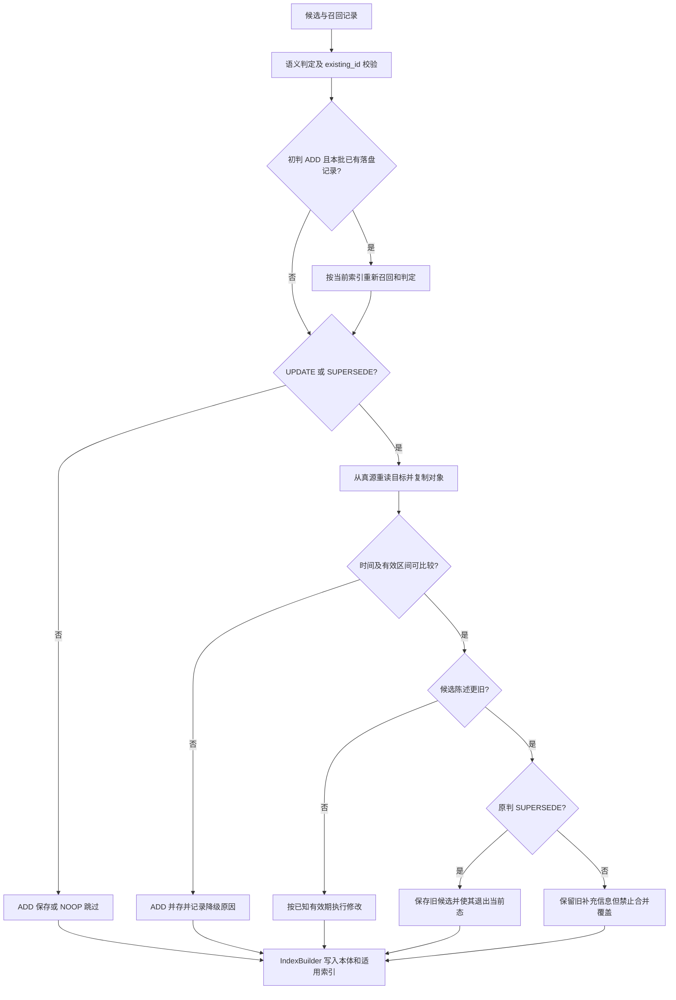

# F09 — 乱序陈述防覆盖与候选自失效

## 元信息

| 项 | 值 |
|---|---|
| 日期 | 2026-10-16 |
| 状态 | 已实现；验证结果及基线问题见「验证」 |
| 关联需求 | W-01.2 |
| 影响范围 | `jiuwen_memory/construction/`、`tests/unit/construction/`、`tests/integration/construction/`；`docs/specs/S05-construction.md`、`docs/specs/S02-memory-api.md`、`docs/features/api/F03-batch-write-api.md` |
| 测试基线 | 针对性验证新增 6 项未来消息边界用例；2026-10-23 同步 upstream 后关联回归 1366 passed；检视修复后构建层及集成回归 890 passed；历史全量 unit 基线问题及复跑结果见「验证」 |

## 背景

原实现将“本次收到的 `candidate`”当成“更新的事实”。LLM 一旦返回 `SUPERSEDE`，
就保存 `candidate`，将 `existing` 标成 `SUPERSEDED`，并把 `t_invalid` 写为处理时刻。
`UPDATE` 的合并提示词 也会在内容冲突时偏好第二个输入，即后收到的 `candidate`。
这两条路径都可能让迟到的旧消息破坏新陈述。

问题同时存在于 `legacy` 和 `dynamic`：此前它们分别实现了 `_apply_decision`，
只修父类不能保护 `dynamic` 的覆盖方法。

### 1. 乱序消息覆盖当前事实

| 顺序 | 消息原本发生时间 | 内容 | 原行为 | 修复后 |
|---|---|---|---|---|
| 先写 B | 6/10 | 张三负责 B 项目 | B 有效 | B 有效 |
| 后补 A | 5/20 | 张三负责 A 项目 | 若判 `SUPERSEDE`，A 取代 B | A 落盘但退出当前态，B 不变 |

前提：两条消息都显式提供有时区的消息时间，且去重判定确认是可以替代的事实。
如果判 `UPDATE`，则 A 独立保留、不合并进 B；这是为了保留旧消息中可能存在的补充信息。
这条保守分支可能让多条记录同时进入当前检索，但不会覆盖 B 的内容。

### 2. 消息时间与事实生效时间不同

6/15 收到“我从 5/20 开始住北京”，消息时间与业务生效时间并不相同。
本次保留 `t_valid` 的既有含义，不统一回填消息日期或事件日期。

普通派生记录的 `t_valid` 继续是创建时间。若旧候选在 6/15 创建后自失效，
其 `t_invalid` 使用此次处理时刻，不使用已有新陈述的 6/10 消息时间。
否则会形成“6/15 才生效，6/10 已失效”的反向区间。
这表达系统已摄入并淘汰该旧陈述，不表示已经恢复它在业务事实的真实有效期。

### 3. 未来有效期需要保留当前状态

如果已有明确 `t_valid` 表示新版下个月才生效，则当前版本保持 `ACTIVE`，
`t_invalid` 截到新版起点；新版在起点前由现有有效期过滤排除。
即使先写未来版本再补当前旧陈述，当前陈述也可以保留到未来版本生效。
只有未来 `t_event`、没有对应未来有效期时，保守并存，不自动推断状态切换时刻。

## 决策

### 1. 两种 Evolver 共用决策执行入口

删除 `DynamicEvolver` 重复的 `_apply_decision`，直接继承父类；
`dynamic` 保留自身的判定提示词、重判和内容合并方法。
两个实现共用确定性的时间护栏，所有写入仍经过 `IndexBuilder`。

### 2. 按消息时间排序，独立校验有效区间

| 情形 | 动作 |
|---|---|
| 候选消息时间更早，判 `SUPERSEDE` | 保存候选，通常标 `SUPERSEDED`；`existing` 内容和本体不变 |
| 候选消息时间更早，判 `UPDATE` | 保存候选为独立记录，不调用合并、不更新 `existing` |
| 候选更晚，且可比较 | 执行原修改逻辑；截止点尊重已知未来有效期，不延长已有截止点 |
| 消息时间缺失、无时区、相等或在未来 | `ADD` 并存；写入原因，不猜测顺序 |
| 有效区间不相交、非法或时区未知 | `ADD` 并存，不做自动截断 |
| 候选事件发生在未来，但没有对应的未来有效期 | `ADD` 并存，不提前替代当前状态 |

只使用双方明确且带时区的 `t_message` 判断陈述先后，统一到 UTC 比较。
`t_event` 不作兜底，也不以“两侧 `t_event` 不同”断言它们是不同事件。
是否同一主体、同一属性、同一事件，继续由召回与语义判定负责。

### 3. 校验修改目标并处理批内变化与重试

- `legacy` LLM 单条与批量返回都校验 `existing_id`；多候选缺 ID、越界 ID 转 `ADD`。
  仅有一个候选时允许响应省略 ID，以兼容已有判定提示词。
- 执行修改前从同一配置的 `DomainStore` 重新点读目标。
  如果同批前一条已经替代该目标，沿本次结果中的后继关系重新定位再裁决。
- 初次批量召回时库为空的 `ADD`，在前一条落盘后重新召回，使后续候选能够召回本批已写入记录。
  `dynamic` 重判使用自身的动态提示词，不切换到 `legacy` 默认判定。
- 修改在副本上进行；构建失败不会提前改变调用方持有的 `existing`/`candidate`。
- 同 ID 重试时校验内容、来源和消息时间；匹配则保留已落盘决策并刷新索引。
  新版已保存、旧版回写失败时，同 ID 重试可以继续完成旧版失效。
- 反向失效的候选同时回传 `created_ids`、`created_units` 和 `superseded_ids`，
  不增加 `expired_ids` 或新生命周期枚举。旧候选的 `supersedes` 不指向较新的记录。

### 4. 按来源确定相对日期依据

`legacy`/`dynamic` 抽取都逐来源给出 `observation_date`：
元数据中的显式值优先，其次该来源带时区的 `t_message` 所对应的当地日期，最后才回退当前 UTC 日期。
同批 5 月与 6 月的消息不会共用第一条消息的日期解释“昨天”。
修改放在公共抽取路径，SDK/Core API 等入口同样受益，不仅覆盖 HTTP handler。

### 5. 决策流程



注：如果 `existing` 已知未来才生效，M 分支的当前候选保持 `ACTIVE` 到该未来边界，
不提前退出当前态。`NOOP` 不写入。

### 6. 变更文件

| 文件 | 修改目的 |
|---|---|
| `jiuwen_memory/construction/evolver_impl/temporal_validity.py`（新增） | 无存储和 LLM 依赖的时间护栏、时区处理、时间上下文 |
| `jiuwen_memory/construction/evolver_impl/orchestrating_evolver.py` | 共享裁决、目标校验、真源复核、批内重判、副本写入和同 ID 重试 |
| `jiuwen_memory/construction/evolver_impl/dynamic_evolver.py` | 移除重复写入逻辑，保留动态重判，给模型补时间上下文 |
| `jiuwen_memory/construction/evolver_impl/dedup_direct_noop.py` | 截止时间变化、未来或未知时区有效起点不直接 `NOOP` |
| `jiuwen_memory/construction/extractor_impl/observation_time.py`（新增） | 逐来源日期依据的共享处理 |
| `jiuwen_memory/construction/extractor_impl/llm_extractor.py` | `legacy` 接入逐来源日期，纠正解析失败注释 |
| `jiuwen_memory/construction/extractor_impl/dynamic_llm_extractor.py` | `dynamic` 接入逐来源日期 |
| `tests/unit/construction/test_temporal_validity.py`（新增） | 时间规则、双入口、目标校验、未来有效期、失败及重试 |
| `tests/unit/construction/test_observation_time.py`（新增） | 两种抽取路径的混合日期、显式日期优先和当地日期 |
| `tests/integration/construction/test_out_of_order_fact.py`（新增） | 六种输入排列、批内空库、真实 `hybrid`/`unified` 写入与索引状态 |
| `tests/unit/construction/test_evolver_dedup.py` | 既有正常更新用例补明确消息时间，不依赖缺少消息时间时仍执行覆盖的旧行为 |
| `tests/unit/construction/test_dynamic_extraction_consolidation.py` | 同步动态正常更新用例的明确时间输入 |
| `jiuwen_memory/construction/AGENTS.md` | 新文件地图、共享写入入口和本地护栏约束 |
| `docs/specs/S05-construction.md` | 修改型裁决、结果字段语义、时间轴及日期依据契约；标清目标 API 与当前入口 |
| `docs/specs/S02-memory-api.md` | 补齐 `Temporal.t_message`，注明 `occurred_at` 的实际落点 |
| `docs/features/api/F03-batch-write-api.md` | 将 `occurred_at` 进入 `t_event` 的过时说明改为 `t_message` |
| 本文 | 问题、例子、决策、文件清单、逻辑图、验证与复现 |

方案校订说明：`VectorDedup` 与 `KeywordDedup` 原本就排除非 `ACTIVE` 记录，
`ShadowDedup` 额外下推 `ACTIVE` 谓词。方案初稿对此的误判已勘误，无需修改去重实现。

## 拒绝的方案

1. **消息时间、事件时间和当前时间逐级兜底**：混用不同时间轴，回退到当前时间会使缺失信息被误作真实顺序。
2. **全量回填 `t_valid` 并钳制未来时间**：改变历史可见性，可能提前切换未来状态。
3. **`t_event` 不等就并存**：无法区分状态变更、独立事件和同一事件改期。
4. **只改 `SUPERSEDE` 或只改父类**：分别遗漏 `UPDATE` 旧值覆盖和 `dynamic` 的独立实现。
5. **无时间 `UPDATE` 仍直接合并**：冲突时偏好后输入，保留了原漏洞。
6. **先淘汰 `existing` 再保存 `candidate`**：构建失败可能使新旧两条都无法用于当前检索。

## 验证

### 1. 验证环境与结果

验证日期为 2026-10-16，环境为 Windows、PowerShell、Python 3.12 和 pytest。
测试使用 Mock LLM 与内存 Store，不依赖真实 LLM 或远端数据库。

| 检查 | 实际结果 |
|---|---|
| construction、ingest、retrieval、batch API/handler、engine versioning 和新增集成回归 | **688 passed**，2 条既有 `security.local` 弃用警告 |
| 全量 `pytest -m unit` 首轮 | **2781 passed，5 failed，7 skipped，664 deselected**；之后增加的测试已进入最新关联回归 |
| 原始 HEAD 临时副本单独复跑上述 5 项 | **5 项全部失败复现**，未包含本次业务代码修改 |
| 第二轮 unit 排除已复现的 5 项 | **2783 passed，1 failed，7 skipped，669 deselected**；失败为本地 HTTP PUT 请求连接中断，随后当前代码与 HEAD 单独复跑各 **1 passed** |
| 改动 Python 文件 ruff | **通过** |
| 仓库全量 ruff | 当前 **56** 条；原始 HEAD **61** 条；按文件、规则和消息比较 **无新增告警** |

2026-10-20 将 upstream 更新同步至 `mem2Feature` 后，重新执行下述关联回归，结果为
**691 passed**，2 条既有配置弃用警告。改动 Python 文件的 Ruff 和 `git diff --check` 均通过。
pytest 退出清理临时目录时另有 Windows `WinError 5` 提示，测试断言通过且进程退出码为 0。
该次验证不包含已撤回的时区入口校验与去重监测改动；上表全量 unit 与全仓 Ruff 为
2026-10-16 的历史记录，未在本次同步后重新运行。

第二轮的额外失败是 `test_http_server_security.py::test_http_unsupported_method_uses_json_error_contract[PUT]`，
异常为 Windows `ConnectionAbortedError / WinError 10053`。该项首轮通过，
第二轮失败后在当前代码与 HEAD 上分别单独复跑均通过；记录为本地连接不稳定，未修改 HTTP 代码。

### 2. 既有失败与环境限制

首轮 5 项失败明细：

| 用例 | 原因与基线证据 |
|---|---|
| `test_memory_runtime_lifecycle.py::test_sync_start_boots_watchdog_in_loop_thread_and_close_stops_it` | 缺少 watchdog；HEAD 同样失败 |
| 同文件 `test_async_start_background_boots_watchdog_in_current_loop` | 缺少 watchdog；HEAD 同样失败 |
| `test_local_watchdog.py::test_started_reflects_lifecycle_and_stop_start_resets_closed` | 缺少 watchdog；HEAD 同样失败 |
| `test_local_markdown_store.py::test_safe_abs_path_rejects_symlink_escape` | Windows 创建符号链接报 WinError 1314；HEAD 同样失败 |
| `test_sqlite_shadow_index.py::test_vec_load_failure_logs_warning` | 日志已输出但 caplog 未捕获，断言失败；HEAD 同样失败 |

跳过项包括既有真实 LLM/Redis 用例，以及缺少 Elasticsearch/Milvus 客户端的可选后端测试。
全量回归仍有上述失败项；watchdog、系统权限和日志捕获问题不在本次修复范围内。

### 3. 可重复验证步骤

在仓库根 PowerShell 执行，使用项目 Python 环境。缺开发依赖时按仓库说明安装 `.[dev]`。

#### 针对性验证

```powershell
python -m pytest `
    tests/unit/construction/test_temporal_validity.py `
    tests/unit/construction/test_observation_time.py `
    tests/integration/construction/test_out_of_order_fact.py `
    --tb=short
```

2026-10-16 的针对性验证结果为 **47 passed**。该命令使用固定日期、Mock LLM 和内存 Store。重点观察：

- `test_old_statement_cannot_change_new_fact`：较新 `existing` 的原始 KV 字节不变；
  旧 `SUPERSEDE` 候选被保存为 `SUPERSEDED`，旧 `UPDATE` 候选不发生合并。
- `test_all_write_orders_keep_latest_statement_current`：三条已确认可替代陈述的全部六种排列，
  两个 Evolver 均只让最新消息对应的记录进入当前态；全文与向量投影生命周期和 KV 一致。
- `test_batch_initial_empty_recall_is_rechecked_after_each_write`：初始空库，同批乱序也能保护最新陈述。
- `test_each_source_has_its_own_date`：同批不同日期的“昨天”各自按来源解释。
- 未来有效期、无时区时间、缺失时间、反向区间、目标 ID、构建失败和同 ID 重试均有独立断言。

#### 关联回归

```powershell
python -m pytest `
    tests/unit/construction/ `
    tests/unit/ingest/ `
    tests/unit/retrieval/ `
    tests/unit/api/test_batch_write.py `
    tests/unit/api/test_batch_handler.py `
    tests/unit/control/test_engine_update_versioning.py `
    tests/integration/construction/test_out_of_order_fact.py `
    --tb=short
```

2026-10-16 的关联回归结果为 **688 passed**。
2026-10-20 同步 upstream 后，执行同一命令的结果为 **691 passed**。
2026-10-23 同步 upstream 后，执行同一命令的结果为 **1366 passed**。

与上游树结构能力共同使用时，Dynamic 与 Orchestrating 复用同一写入路径，
保留 Snapshot 提示继承、UPDATE 的叶提示替换和写入前的树结构保护。
时间护栏保守降级为 ADD 时，按最终 ADD 校验候选；反向失效写入前同样校验 Snapshot。
Snapshot 的 UPDATE 用例显式给出消息先后；补充旧 Snapshot 反向失效、消息时间未知时
保留两条 Snapshot 的回归用例，两种 Evolver 均覆盖。

树结构入口、自动 Snapshot 与控制层兼容验证共 **346 passed**：

```powershell
$hierarchyTests = @(Get-ChildItem tests/unit/api/test_hierarchy*.py | ForEach-Object FullName)
python -m pytest -o addopts='' -q @hierarchyTests `
    tests/unit/api/test_automatic_snapshot.py `
    tests/unit/control/test_hierarchy_runtime_compatibility.py `
    tests/unit/control/test_hierarchy_job.py --tb=short
```

验证保留了已有 security.local 配置迁移弃用警告；首次关联回归结束时出现 Windows
临时目录符号链接清理的权限告警，测试退出码为 0，不影响上述断言结果。


#### 全量回归与静态检查

```powershell
python -m pytest -m unit --tb=short
ruff check --output-format concise
git diff --check
```

在相同环境中，前两个命令仍可能返回上述已复现的失败/告警。
检查本次改动时，运行上述针对性验证、关联回归，以及下列定向静态检查：

```powershell
ruff check `
    jiuwen_memory/construction/evolver_impl/temporal_validity.py `
    jiuwen_memory/construction/evolver_impl/orchestrating_evolver.py `
    jiuwen_memory/construction/evolver_impl/dynamic_evolver.py `
    jiuwen_memory/construction/evolver_impl/dedup_direct_noop.py `
    jiuwen_memory/construction/extractor_impl/observation_time.py `
    jiuwen_memory/construction/extractor_impl/llm_extractor.py `
    jiuwen_memory/construction/extractor_impl/dynamic_llm_extractor.py `
    tests/unit/construction/test_temporal_validity.py `
    tests/unit/construction/test_observation_time.py `
    tests/unit/construction/test_evolver_dedup.py `
    tests/unit/construction/test_dynamic_extraction_consolidation.py `
    tests/integration/construction/test_out_of_order_fact.py
```

需要完整验证 watchdog 和符号链接用例时，先补齐部署可选依赖并提供系统符号链接能力；
这不是 W-01.2 业务修复的运行前提。

### 4. CI 静态规范处理

28 条一般级别告警按职责分别处理：

- 生产代码的 2 条复杂条件告警拆为具名布尔变量，保留未来事件保护与半开区间判据。
- 测试的 6 条内部依赖访问改为构造注入或直接使用测试持有的依赖：辅助函数支持选择
  Evolver 类型、注入 LLM/PromptRegistry，并返回 IndexBuilder，不再反取或改写内部依赖。
- 其余 20 条为定向验证内部阶段的白盒访问，在对应测试函数内说明理由并局部禁用
  `protected-access`；其他函数和生产代码继续检查，不为测试扩大生产接口。

2026-10-23 调整后验证结果：

- `python -m pytest -o addopts='' -q tests/unit/construction
  tests/integration/construction/test_out_of_order_fact.py --tb=short`：**884 passed**，
  3 条既有配置弃用警告。
- 修改前后的时间护栏对比覆盖 **6250** 组输入，包括缺失时间、naive 时间、有效期端点、
  未来事件和两种陈述顺序，action、reason、boundary 全部一致。
- 改动 Python 文件 Ruff 与 `git diff --check` 通过。
- Pylint 3.3.9 定向检查 `protected-access` 与 `too-many-boolean-expressions`
  （`--max-bool-expr=3`），覆盖时间护栏和三个对应测试文件，**无告警**。
  依赖仅安装在本地临时目录，未修改项目依赖；远端扫描平台是否采用相同规则及注释
  处理方式，仍以重新执行 CI 的结果为准。

### 5. 检视意见与时钟边界验证

Snapshot 演进测试的固定消息日期必须配套固定裁决时钟。测试 fixture 仅在对应测试内
将两种 Evolver 共用的 `_now` 固定为 `2026-10-01T00:00:00Z`，pytest 自动恢复补丁；
保留来源日期和树区间，不改用随执行日漂移的相对时间，也不扩大生产接口。
模拟外部演进时钟为 `2026-09-10` 时，修改前 8 项相关用例失败，修改后整个 Snapshot
测试文件 **80 passed**。完整构建层及相关集成回归为 **890 passed**，3 条既有配置弃用警告。

不采用“未来消息默认容忍 5 分钟”的建议：当前契约明确只对不晚于裁决时刻的陈述排序，
没有调用方时钟误差上限或校准来源，不能将未来时间自动当作已发生的陈述。计划事件时间
应写入 `t_event`，业务生效时间使用有效期；不应通过放宽消息时间检查来代偿。
未来消息造成的保守并存仍是已知边界，不承诺时钟追上后自动合并已保存记录。
补充 6 项纯函数测试，分别检查 candidate/existing 在 `now`、超前 1 秒及超前 5 分钟的行为；
恰好等于 `now` 可排序，未来消息返回 `preserve/future_message_time`。函数文档明确
调用方会将该结果下的 UPDATE/SUPERSEDE 降级为 ADD，业务规则不变。

## 已知遗留

- **本次提供陈述顺序保护，不提供业务事实历史重建。** 没有独立可信的状态生效输入，
  就不能实现计划中“补齐三版本业务历史区间”的完整保证。本次不迁移存量数据，
  不恢复 `[5/20, 6/10)` 这样的真实业务有效期。
- `UPDATE` 可能是互补信息，旧候选或未知时间候选会保守并存；存在检索到多条信息的可能，
  字段级冲突消解仍未实现。
- 召回漏命中、低相似直接 `ADD`、模型未识别冲突，仍可能并存；顺序排列测试以确定性模型正确识别可替代关系为前提。
- 批内重判依赖实际索引同步可见；异步索引后端、跨请求并发没有新增锁或 CAS，不承诺全局原子性。
- 同 ID 重试可刷新索引并补完旧版失效；跨后端部分写入仍可能短暂留下多条当前记录，异常会向上传递。
  不同 ID 的上游重试仍依赖已有去重/幂等机制。
- 未来保护依据显式有效期或未来事件的保守分支；仅凭自然语言文本无法可靠确定未来状态的生效时刻。
