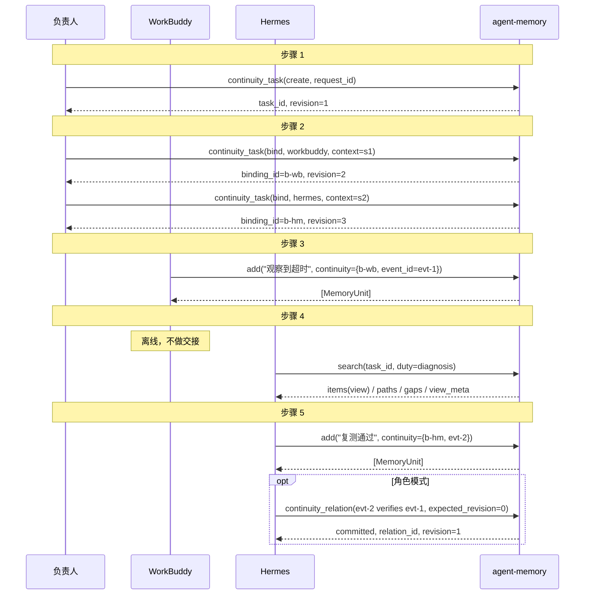
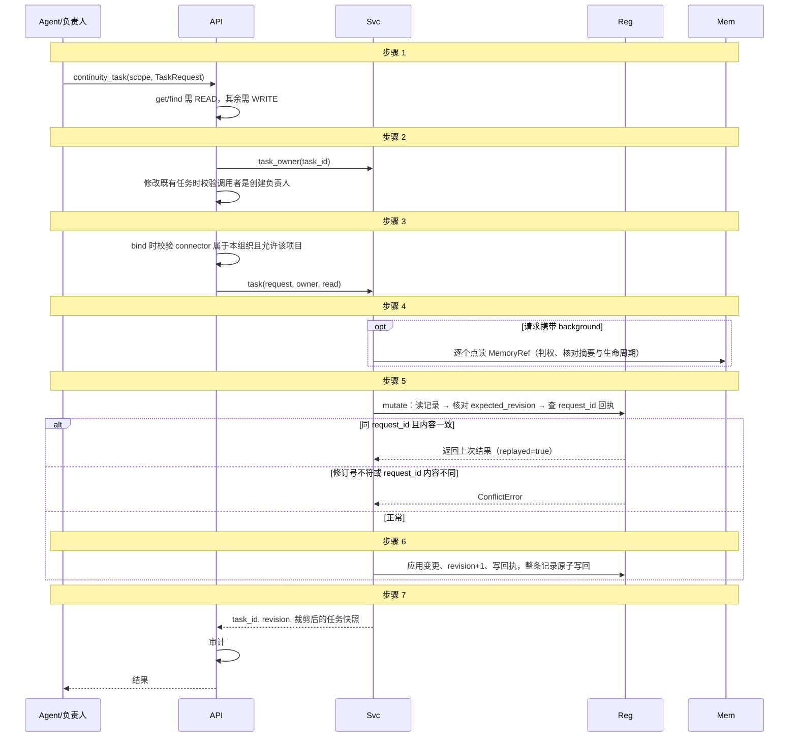
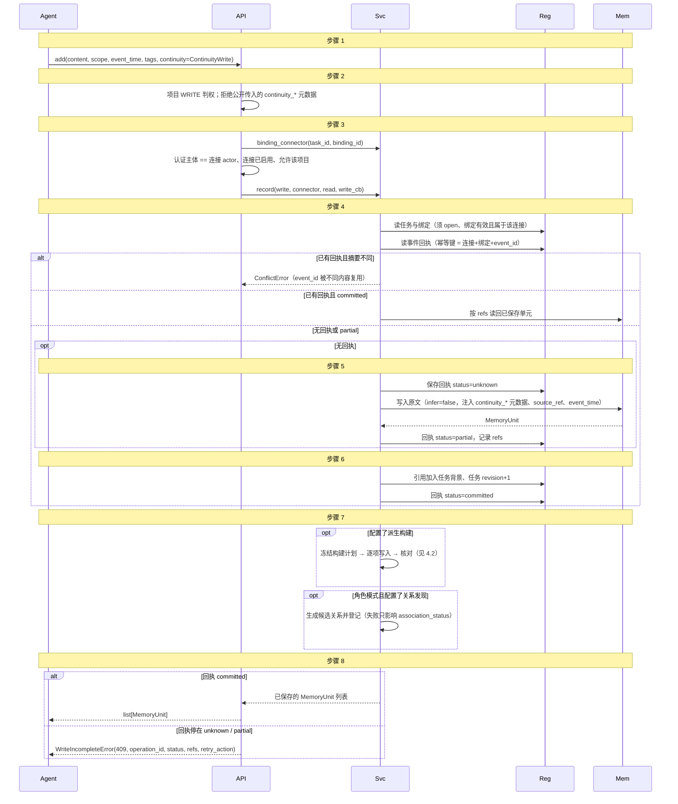
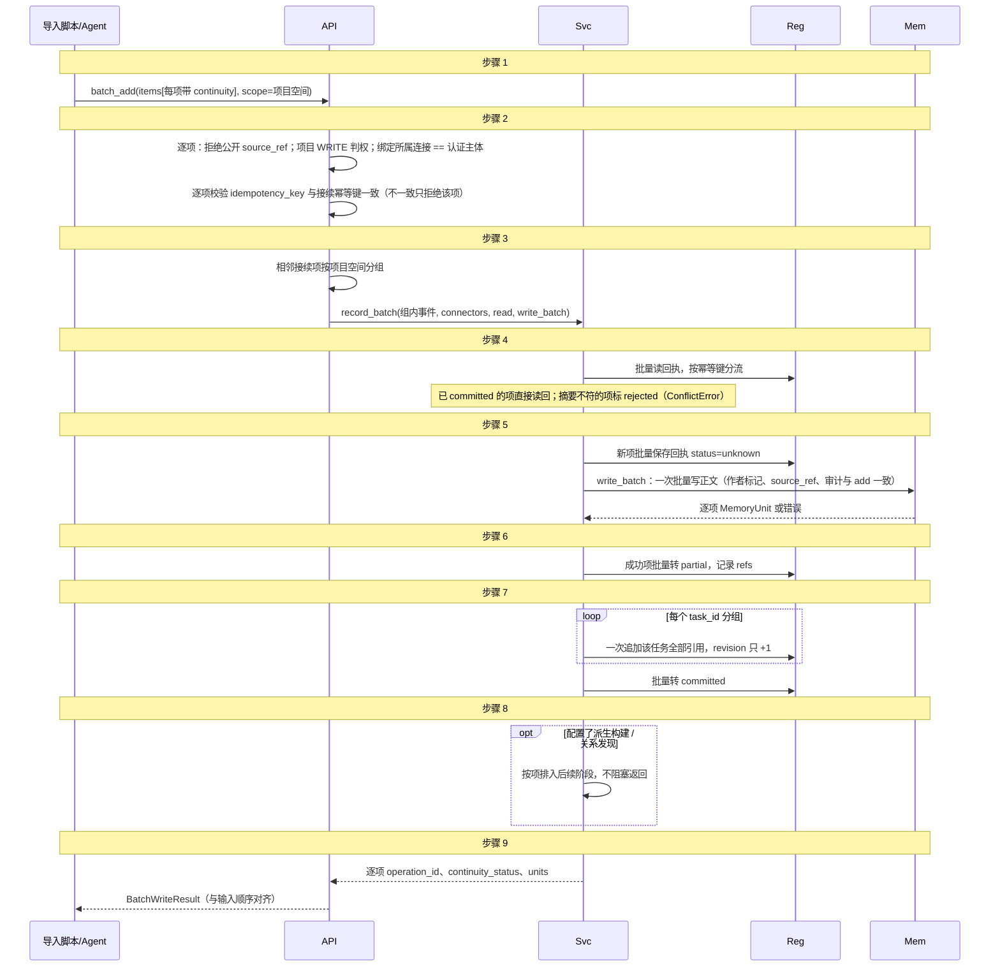
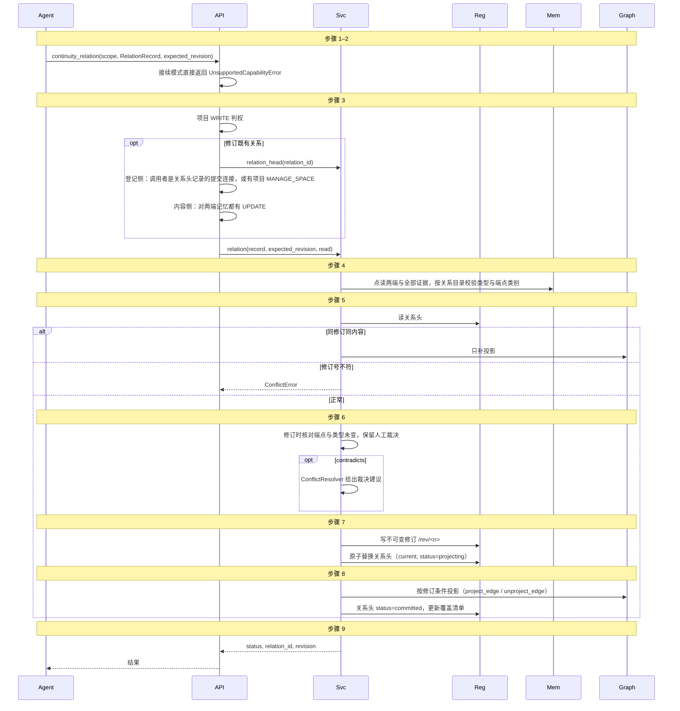
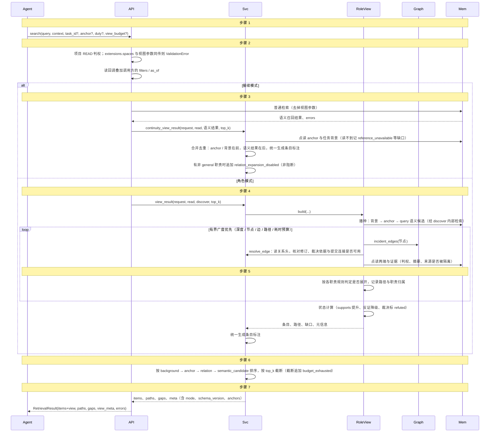
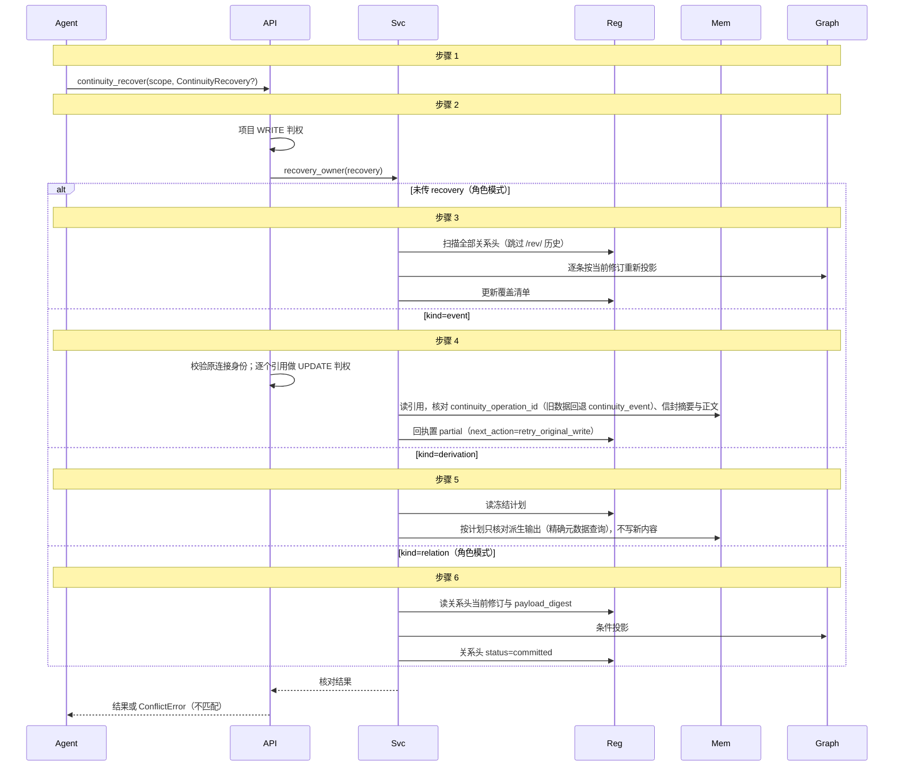
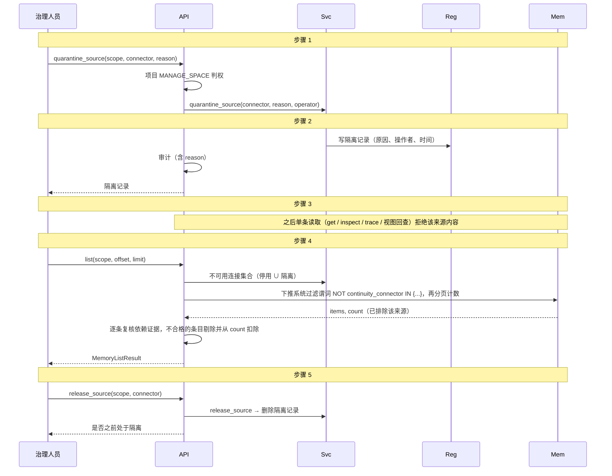

# 角色记忆：职责驱动的关系扩展与跨 Agent 接续设计

## 元信息

| 项 | 值 |
| --- | --- |
| 日期 | 2026-10-27 |
| 状态 | 2026-11-05 设计修订已落地：两档模式（接续 / 角色）、接口并入 add / batch_add / search、关系真源改存 Registry KV、范围收敛；剩余实现差距见 12.2。真实产品 G0 联调、外部 Agent 记忆迁移未完成 |
| 影响范围 | 外部 Agent 接入适配；api、control、construction、retrieval、storage、common |
| 关联规约 | [S02](../../specs/S02-memory-api.md)、[S03](../../specs/S03-control.md)、[S04](../../specs/S04-retrieval.md)、[S05](../../specs/S05-construction.md)、[S06](../../specs/S06-storage.md)、[S07](../../specs/S07-common.md)、[S09](../../specs/S09-plugin-development.md)、[S11 接续契约](../../specs/S11-cross-agent-continuity.md) |
| 代码入口 | `jiuwen_memory/control/continuity.py`、`jiuwen_memory/retrieval/role_view.py`、`jiuwen_memory/api/memory_api_impl/continuity_ops.py` |
| 测试基线 | 见 11.4 |

## 1. 背景与目标

### 1.1 问题

agent-memory 面向框架无关的记忆摄入、构建、检索和生命周期管理。用户的一个任务可能始于 WorkBuddy，随后由 Hermes 接手，再交给 JiuwenSwarm 或 DeepSeek Harness 组织执行或验证。各产品有自己的会话、工具环境和记忆，换一个产品继续工作时，前面的目标、进度和证据就断了。本特性要解决两个相关但不同的问题：

1. **跨 Agent 接续**：不同产品关联同一任务、写回新结果，有权限的接任者无需前任在线或主动交接，就能取得必要上下文。同一职责换 Agent、未声明角色的任务都要支持。
2. **职责角色记忆**：同一段经历对不同职责意味着什么？规划、诊断、执行、测试等角色面对同一批历史，需要回答不同的问题：

| 角色 | 真正需要回答的问题 | 所需记忆形态 |
| --- | --- | --- |
| 规划 Agent | 哪些前置条件必须满足？哪些步骤还被阻塞？ | 依赖、约束、已完成事项与未决事项 |
| 诊断 Agent | 哪些原因有证据支持？哪些已被排除？ | 假设与证据链、反例、尚未验证的推断 |
| 执行 Agent | 当前环境下可以复用什么操作？ | 带适用条件、参数与验证方法的操作经验 |
| 测试 Agent | 已经验证了什么？还遗漏哪些场景？ | 覆盖范围、失败条件、测试缺口与预期行为 |

统一摘要容易丢失关系；统一向量检索可能找到主题相关的记录，却找不全解决问题所需的证据；给每个角色复制一套记忆，又会带来冗余、更新成本和事实不一致。核心问题是：**共享事实如何转化为与职责和当前任务相关、有证据依据的可用上下文**。此外，测试角色积累的回归清单、诊断角色验证过的排查顺序、执行角色遇到的失败条件，应作为经验被明确保存、修正，并由接任同一职责的新 Agent 在授权内继承。

### 1.2 目标与非目标

目标：

- 提高多 Agent 完成任务的成功率，减少上下文缺失造成的重复探索、证据遗漏和错误复用。
- 使不同角色共享事实，同时获得适合自身任务的证据结构。
- 支持跨产品任务恢复和角色交接，保留职责状态、判断依据与未决事项。
- 支持角色经验跨任务积累，并由新的合适参与者在授权内继承。
- 把外部 Agent 自有的记忆读入 agent-memory，统一抽取、去重、消解冲突并管理（见第 8 节）。
- 减少反复阅读历史和重新整理上下文的成本。
- 让输出可解释且可被程序消费：能够追溯来源、关系和适用条件。
- 用可复现实验区分角色信息的收益与一般检索增强的收益。

能力边界：角色记忆改善协作中的信息条件，不单独保证分工合理、目标一致或决策正确。历史记录缺少证据时，不能保证得到可靠结论；角色身份本身也不能作为其判断可信的依据。

非目标：首版明确不做：通用任务编排、自动职责分配、工具及运行环境迁移、跨组织授权互信、角色继承体系、自动判定外部事实真伪、无限深度判断图维护、通用消息推送平台。它们不构成绕过共享授权和交接核验的理由。

首版范围以"证明职责记忆价值"为准，其余能力按依赖和指标分阶段引入：

| 能力 | 首版 | 后续 |
| --- | --- | --- |
| 两档模式：接续模式（不需要图）与角色模式（需要图），显式配置 | 必做 | — |
| 任务登记、绑定、无交接恢复 | 必做 | — |
| 事件可靠记录（原始事件持久化、幂等、恢复），经 `add` / `batch_add` 的 `continuity` 参数 | 必做 | — |
| 按一个或多个职责的关系展开与结构化视图（4.3），经 `search` 的 `duty` 等参数；角色模式 | 必做 | — |
| 显式关系登记、复核、撤回；冲突保留与人工裁决 | 必做 | 自动消解策略扩展 |
| 经验的显式积累、继承与修正 | 必做 | 从全量历史自动挖掘经验 |
| 外部事件进入统一抽取、去重、巩固 | 原始事件持久化与派生构建契约（4.2，created / reused）＋ `batch_add` 批量导入＋一条外部来源的验证 | 派生 updated、外部历史全流程巩固、增量同步与双写切换 |
| 来源隔离与解除（治理） | 必做 | 自动信任打分 |
| 跨空间显式发布、复核影响传播 | — | 有真实需求时再评估（见 10、12.3） |
| 图后端 | `kv`（本地开发、单元测试）与 `neo4j`（集成测试、部署）两个后端（3.4） | 按规模、并发、延迟指标调优（12.3） |
| 主动推送、大范围后台巩固 | — | 实测成本与需求支持时引入 |

### 1.3 一句话方案

外部 Agent 用现有的 `add` / `batch_add`（带 `continuity` 参数）把观察、结果和经验可靠地写入 agent-memory，内容以 MemoryUnit 落盘；配置派生构建后进入统一抽取与精确去重，语义巩固尚未接通（见 4.2、12.2）；TaskRegistry 只登记"哪些记忆属于哪个任务"。部署选择两档之一：**接续模式**只做任务登记、可靠写入与任务背景检索，不需要图存储；**角色模式**再加上关系登记与职责扩展——查询时用 `search` 带 `duty`，从记忆起点出发按一个或多个职责选择关系类型和方向做有界展开，在 `RetrievalResult` 的可选字段里返回证据路径和缺口。

## 2. 核心概念

### 2.1 术语

全文的"角色"均指**职责角色**。

| 术语 | 定义 | 对应代码 |
| --- | --- | --- |
| 参与者 | 经接入认证识别的人或 Agent，决定以谁的身份请求访问；不能从文本自称推断 | `RequestSecurityContext.auth.actor` |
| 连接 | 某个产品的一份可信接入配置，映射到一个参与者身份和允许的项目 | `globals.continuity_connectors` |
| 任务 | 可跨产品、会话持续的工作，有 agent-memory 生成的稳定 `task_id`；不能靠标题相似自动合并 | TaskRecord（Registry 内部） |
| 绑定 | 某连接的某个本地上下文（会话、产品内任务）参与某任务；一个任务可有多个绑定 | Binding（TaskRecord 内） |
| 事件 | 一次带接续信息提交的观察、陈述、判断、结果、经验或纠正；正文走 `add` / `batch_add`，接续信息放在 `continuity` 参数 | `ContinuityWrite`（原 `ContinuityEvent`） |
| 记忆引用 | 指向一条 MemoryUnit 的稳定引用，内容变化后不再匹配 | `MemoryRef` |
| 关系 | 两条记忆之间带类型、带版本的有向连接，例如证据支持判断；真源存在 Registry KV，不是 MemoryUnit | `RelationRecord` |
| 职责策略 | 查询时沿哪些关系类型、哪个方向展开及预算；只选择策略，不授予权限 | `duty` + `TraversalRule` |
| 角色视图 | 在当前授权、任务、职责和预算下组织出的结构化结果，不另存事实真源；以 `search` 返回的 `RetrievalResult` 可选字段表达 | `view_meta.schema_version = "role-view/2"` |
| 接续模式 / 角色模式 | 部署档位（`continuity.default.params.mode`），两档是叠加关系而不是二选一：接续模式提供多 Agent 接续（任务登记、可靠写入、历史导入、任务背景检索、来源治理），不装配图与关系能力；角色模式包含接续模式的全部能力，并在其上增加关系登记与按职责展开。文中标注"角色模式"的能力只在 `mode: role` 下可用，不表示角色模式没有多 Agent 接续 | `mode: continuity` / `mode: role` |
| 任务判断 | 针对某次任务作出的解释、建议或决策，关联证据和适用条件；不自动成为跨任务经验 | `ContinuityWrite.kind=judgment` |
| 职责经验 | 从经历中明确归集的可复用策略、步骤或失败条件，可关联多个职责，保留来源任务、证据和验证范围 | `ContinuityWrite.kind=experience` |

一个 Agent 可同时承担多个职责，也可与其他 Agent 共担同一职责；职责承担关系由负责人或编排方提供。一次查询可选择一个或多个遍历策略（duty），多个时按 4.3 合并为一次展开；业务职责由部署配置或调用方显式映射到策略，未指定时用 general。首版不定义角色层级与继承："安全测试"不会因为名称自动继承"测试"的经验，更不会继承权限。作者职责、经验适用职责（写入时放在 `tags` 的 `duty:<id>`）与查询策略分别记录，不混为同一字段。不同角色可以基于同一份证据提出不同判断，但不能改写事实。

### 2.2 概念关系图

```
连接 ──1:N── 绑定 ──N:1── 任务（TaskRecord，控制面，Registry KV）
                            │
                            └─1:N─ 背景引用 MemoryRef（必需 / 可选）
                                         │
                                         ▼
add / batch_add（continuity=ContinuityWrite）──写入──▶ MemoryUnit（1..N 条，内容面）
                                         ▲            ▲
关系 RelationRecord（角色模式）── source / target ──┘            │
          │  └─ evidence_refs（N 个 MemoryRef）───────┘
          │
          ├─ 真源：Registry KV 的关系头与修订历史（/continuity/relations/...）
          └─ 投影：GraphStore 中的一条边（可重建）

查询：search(query / task_id / anchor, duty) ─▶ 起点（背景 / anchor / 语义候选）
      ─▶ 角色模式：按 duty 展开关系；接续模式：不展开，返回 relation_expansion_disabled 缺口
      ─▶ RetrievalResult（items ＋ 可选 paths / gaps / view_meta）
```

任务只持有引用，不复制正文；事件正文与派生输出统一以 MemoryUnit 存放和管理。关系是结构化登记数据，真源放在 Registry KV（4.1 的例外）；图边是关系真源的投影，丢失后可从真源重建。

### 2.3 职责角色与权限角色

职责角色与现有 `SpaceContentRole`（viewer、contributor、editor）和 `SpaceGovernanceRole` 不同，后两者属于权限治理。职责只决定查询时如何展开关系，不授予任何读写权限；接口使用明确的职责语义命名（`duty`、`duty_ids`），避免无上下文的 `role`，不引入人格意义的 persona。

## 3. 总体方案

### 3.1 架构

```
外部 Agent
  JiuwenSwarm provider ─┐
  MCP stdio 桥（WorkBuddy / Hermes；OpenClaw、DeepSeek Harness 待 G0 验证）─┤ 每连接独立凭据
                        ▼
  HTTP /v1/add|batch_add|search（带接续参数）
       /v1/continuity_task|continuity_relation|continuity_recover
       /v1/quarantine_source|release_source（治理，仅管理面）
                        ▼
  api/MemoryAPI（PEP：认证、授权、可信连接核对、审计）
                        ▼
  control/continuity_impl（TaskRegistry、事件回执、关系头、编排）
      │ 写入正文 ─▶ 现有 add / batch_add 写入链 ─▶ ingest / construction ─▶ DomainStore（MemoryUnit）
      │ 控制记录 ─▶ 具名持久 KV（/continuity/tasks|events|relations|coverage|quarantine）
      │ ── 以下角色模式装配 ──
      │ 关系投影 ─▶ construction/evidence_graph ─▶ GraphStore（证据图：kv 或 neo4j）
      │ 冲突消解 ─▶ construction/ConflictResolver
      │ 候选关系 ─▶ construction/evidence_llm（可选）
      └ 职责扩展 ─▶ retrieval/role_view_impl/bounded ─▶ GraphStore ＋ 关系头 ＋ 点读 MemoryUnit
```

接续模式只装配上半部分（Registry、回执、写入与任务背景检索），不需要图存储；角色模式装配全部。两档由 `continuity.default.params.mode` 显式选择（6.4）。

### 3.2 三条主数据流

写入（`add` / `batch_add` 带 `continuity`）：

1. Agent 以自己的连接凭据调用 `add`（或 `batch_add`），正文照常传 `content`，另带 `continuity`（`task_id`、`binding_id`、稳定 `event_id` 等）。
2. API 核对认证主体与绑定所属连接一致，校验项目 WRITE 权限。
3. Registry 以连接、绑定、事件 ID 生成幂等键，先保存 unknown 回执。
4. 正文经现有写入链落成 MemoryUnit；回执记录引用，状态转为 partial。
5. 引用加入任务背景，任务修订号递增，回执转为 committed 后返回已保存的 MemoryUnit 列表；未完成时抛 `WriteIncompleteError`。`batch_add` 把同一任务的背景追加合并为一次修订（5.2 `ContinuityWrite`、6.2.4）。

查询（`search` 带 `task_id` / `anchor` / `duty`）：

1. Agent 调用 `search`，`query`、`anchor`、`task_id` 至少一项非空，可选 `duty`、`view_budget`；三者都不传时就是普通检索，行为不变。
2. 起点依次取任务背景、anchor，再按 query 做有界语义候选发现。
3. 角色模式：按 duty 对应的遍历规则沿关系类型和方向展开；每条边回查 Registry 中的关系头，端点和证据逐一判权。接续模式：不展开，非 general 的 duty 只产生非阻断缺口 `relation_expansion_disabled`。
4. 反证（contradicts）和前置条件（requires）检查对所有职责强制执行（角色模式）。
5. 结果按 background → anchor → relation → semantic_candidate 排序放进 `items`，每项的 `view` 标注类别、状态与路径；路径、缺口、元信息放进 `paths`、`gaps`、`view_meta`。

跨产品接续：

1. 负责人 `continuity_task(create)` 得到 `task_id`，为每个产品连接 `bind` 得到各自的 `binding_id`。
2. WorkBuddy 经 `add` 提交若干事件后离线，不生成交接单。
3. Hermes 以自己的身份调用 `search(task_id=...)`，从任务背景恢复上下文并检查缺口。
4. Hermes 写入新结果，JiuwenSwarm、DeepSeek Harness 等后续参与者同样读取。

### 3.3 模块落点与插件布局

| 层 | 责任 | 明确禁止 |
| --- | --- | --- |
| 外部 Adapter / Entry | 产品事件转换、认证接入、查询已登记绑定、视图呈现与结果回写 | 直连底层存储；在核心添加产品分支 |
| API | 校验公共输入（含 `add` / `batch_add` / `search` 的接续参数）、认证授权、审计，向控制层传递受控调用上下文 | 用职责字段授予权限；承载经验算法或编排 |
| Control | TaskRegistry 持久映射、事件回执与关系头、写入结果核对与来源治理 | 绕过统一门面或创建第二套身份/存储状态 |
| Construction | 关系投影、冲突消解、候选关系发现；经 IndexBuilder 落盘与建索引（角色模式） | 直接写裸 KV；让抽取置信度等同于验证状态 |
| Retrieval | 组合共同背景、记忆起点、按职责的关系展开及证据回读，把结果填进 `RetrievalResult` 可选字段 | 越过系统过滤；把单一排序算子当完整检索 |
| Common / Storage | 公共类型、关系目录；统一数据面读写和能力表达 | 后端专有字段承担授权；用图索引作为唯一事实来源 |

新增组件遵循仓库"契约文件 + `*_impl/` 实现目录 + Producer 注册"的插件布局（S09）：

| 契约 | 实现 | Producer 命名空间 | 注册名 | 装配档位 |
| --- | --- | --- | --- | --- |
| `control/continuity.py` | `control/continuity_impl/` | `continuity` | `local` | 两档 |
| `retrieval/role_view.py` | `retrieval/role_view_impl/` | `role_view` | `bounded` | 角色模式 |
| `construction/conflict_resolver.py` | `construction/conflict_resolver_impl/` | `conflict_resolver` | `verification`、`recency`、`llm`、`chain` | 角色模式 |
| `construction/index_builder.py` | `construction/index_builder_impl/evidence_graph.py` | `constructor` | `evidence_graph` | 角色模式 |
| `construction/associator.py` | `construction/associator_impl/evidence_llm.py` | `associator` | `evidence_llm` | 角色模式（可选） |
| `storage/graph.py` | `storage/graph_impl/kv_graph_store.py`、`neo4j_graph_store.py` | `graph_store` | `kv`、`neo4j` | 角色模式 |
| `common/relations/` | 无（共享配置与纯函数，不是插件族） | — | — | 角色模式 |

职责策略表是运行时选用的数据，不是每个职责一个插件。有状态依赖（StoreManager、Registry 管理端口、IndexBuilder、GraphStore）按具名引用共享；组合组件聚合必需依赖的 health，关闭由装配根负责。声明支持某能力就必须支持其正常、拒绝、部分失败和恢复路径；必需引用失败不降级成完整视图，插件缺失不当作空记忆。接续模式不装配角色模式列出的组件，也不要求 GraphStore 能力（`ContinuityService` 仅在 `mode=role` 时校验 `supports_incident_edges` 与投影器共用同一图对象）。

### 3.4 核心组件设计

本节逐个说明新增组件的职责、接口、内部流程、持久化与失败处理。组件之间的数据结构见第 5 节，字段定义见 S11。

#### TaskRegistry（任务登记）

**职责**：维护全局任务、产品绑定和任务背景引用，是"哪些记忆属于哪个任务、哪个产品上下文在参与"的唯一真源。它不保存正文，不分配执行权，也不推送通知。

**组成**：契约在 `control/continuity.py`（`Continuity.task`、`task_owner`、`binding_connector`），实现由 `control/continuity_impl/service.py` 的 `ContinuityService.task` 与 `repository.py` 的 `ContinuityRepository` 组成。Repository 只负责控制记录的读写、修订检查和幂等回执；业务规则（谁能改、绑定校验、背景校验）在 Service 与 API PEP。

**操作流程**：

| 操作 | 流程 | 修订与幂等 |
| --- | --- | --- |
| create | 以"负责人身份摘要 ＋ `request_id`"计算 `task_id`，初始化 `state=open`、空绑定与背景；同请求可附带背景引用 | `expected_revision=0`；同 `request_id` 重试返回原结果 |
| bind | API 先校验连接已配置、属于本组织且允许该项目；Service 追加 Binding，`binding_id` 由任务与 `request_id` 计算 | 需当前修订号；同修订并发只有一个成功 |
| unbind | 软撤销：`active=false`，记录撤销者与原因；绑定记录保留供审计 | 同上 |
| attach | 把 `MemoryRef` 加入背景（标注必需或可选），逐个点读校验存在、可读、摘要一致 | 同上；背景按值去重 |
| close | `state=closed`；之后拒绝变更和新事件，不删除记录 | 同上 |
| get | 读取任务快照，去掉回执窗口；背景按调用者权限裁剪，有不可读项时 `background_partial=true` | 只读 |
| find | 按连接 ＋ 本地上下文找出有活跃绑定的任务 | 只读；多个匹配全部返回，不默选 |

**并发与持久化**：所有变更在 Repository 的进程内锁下执行"读记录 → 校验修订 → 应用变更 → 修订号加一 → 写回执 → 整条记录写回"。整条记录一次写入具名持久 KV，依赖 KV 的单记录原子替换；跨进程由 `claim_single_writer` 保证只有一个写服务。回执窗口 256 条，超出按修订号淘汰最旧的；淘汰后旧请求重放会因修订号不符被拒绝，不会被当成新操作执行。

**权限**：读操作需项目 READ，变更需 WRITE；修改既有任务限创建负责人（首版无委托表）。绑定和背景登记都不授予来源读取权，读取时仍按原 Scope 判权。

**失败处理**：修订冲突、`request_id` 被不同内容复用返回 `ConflictError`；任务已关闭返回 `ConflictError`；绑定不存在或已解绑返回 `ValidationError`；背景引用不可读或摘要不符在提交前即拒绝，不写入半条记录。

**与 MemoryUnit 的关系**：1:N 引用，不复制正文（理由见 4.1）。

#### 事件记录器（`add` / `batch_add` 的 continuity 分支）

**职责**：把外部事件可靠地写成记忆并挂到任务上，保证重试不重复、确认丢失可恢复。它不是独立入口，而是 `add` / `batch_add` 在请求带 `continuity` 时走的分支；不带 `continuity` 的写入完全不经过它，也不需要幂等键。

**单条流程（`add`）**：API 核对认证主体等于绑定所属连接的身份 → Service 以"连接 ＋ 绑定 ＋ 事件 ID"计算幂等键（即 `operation_id`） → 保存 unknown 回执 → 经现有写入链写入原文 → 回执记录引用并转 partial → 引用加入任务背景、任务修订号加一 → 回执转 committed → 返回已保存的 MemoryUnit 列表 → 若启用关系发现（角色模式），在此之后执行，失败只影响 `association_status`。同键同内容重放返回已保存单元，不重写正文；同键异内容返回 `ConflictError`；回执停在 unknown / partial 时抛 `WriteIncompleteError`（携带 `operation_id`、`status`、已确认的 `refs`、`retry_action`）。

**批量流程（`batch_add`，供外部 Agent 历史快速导入）**：

1. 校验：批级 `scope` 必须是同一个项目空间；每项可带自己的 `BatchWriteItem.continuity`，不同任务可同批；同时带 `idempotency_key` 时必须与接续幂等键一致，否则该项拒绝。
2. 一次批量写入全部 unknown 回执。
3. 正文走现有批量写入链（批量 embedding、批量建索引），这是相对逐条 `add` 的主要提速来源。
4. 批量把已保存引用写入回执并转 partial。
5. 按 `task_id` 分组，每个任务**只追加一次**背景、修订号只加一次。
6. 批量转 committed；`BatchWriteOutcome` 逐项返回 `operation_id` 与 `continuity_status`（committed / partial / unknown / rejected）。
7. 派生构建与关系发现按项排入后续阶段，不阻塞批写返回。

单项失败按 `continue_on_error` 处理，不中断其他项；整批重放安全（已 committed 的项按幂等键直接返回已保存单元）。

**引入统一抽取后的契约**见 4.2"原始事件与派生构建"：回执分成"原始事件已持久化"和"派生构建状态"两段，分别记录与恢复。

**当前实现**：已实现。`add(..., continuity=)` 经 `ContinuityService.record` 单条提交，`batch_add` 中相邻且同项目的接续项合并为一次 `ContinuityService.record_batch`（先登记 unknown 回执，再一次 `write_batch` 写全部正文，每任务只追加一次背景、只递增一次修订号）；正文写入复用 `add` 的作者标记、`source_ref` 与审计；回执停在 unknown / partial 时单条抛 `WriteIncompleteError`，批量逐项返回 `continuity_status`。`record_batch` 的派生构建仍按事件逐条执行（12.2）。

#### 关系登记（`continuity_relation`，角色模式）

**职责**：保存带版本的证据关系，维护 Registry KV 中的"关系头"与修订历史，驱动图投影。接续模式下返回 `UnsupportedCapabilityError`。

**流程**：校验修订号为 `expected_revision + 1` → 点读两端和全部证据，按关系目录校验类型与端点类别 → 若是修订，读关系头中的当前记录，核对端点和类型未变，保留此前的人工裁决 → contradicts 关系调用冲突消解器 → 写入不可变修订 `/continuity/relations/<relation_id>/rev/<n>` → 原子替换关系头（`current` 为完整 RelationRecord，`status=projecting`），这一步即真源提交点 → 图投影成功后头部转 `committed`。撤回写新修订，投影删除对应边，修订历史保留。并发由单写者 Registry 与 `expected_revision` 保证，不依赖 KV CAS。

**查询侧回查**：视图每走一条边，都按边属性中的 `relation_id`、`revision` 读关系头核对当前修订，再检查端点与证据可读、提交连接未被隔离；投影滞后不能复活已撤回的边。

**当前实现**：已实现。关系真源存 Registry KV 关系头（`current` ＋ `/rev/<n>` 不可变历史），头中记录提交连接 `connector`；修订需提交连接本身或项目治理角色（`MANAGE_SPACE`），并对两端记忆有 UPDATE；读取时提交连接被停用或隔离的关系按不可用处理。

#### 关系目录（RelationCatalog）

**职责**：启动时加载并校验关系类型和职责策略，构建侧（关系校验、关系发现）与查询侧（视图展开）注入同一实例。职责的新增、修改都通过配置完成，不需要新增算子（见 5.2 `Duty`）。

**校验规则**：内置六类关系的语义不可覆盖；新增类型必须声明方向、端点类别；策略只能引用已注册类型；每个策略强制追加反证与前置条件检查。任一不合法则启动失败，运行时不动态注册。

#### 视图构建器（RoleView）

**职责**：`search` 带 `task_id` / `anchor` / `duty` 时调用它，在已授权的读回调之上从起点按职责做有界展开，把结果组织进 `RetrievalResult` 的可选字段。它不读取产品身份，不访问 Registry 以外的控制数据。接续模式下只做播种（任务背景、anchor、语义候选），不展开关系，非 general 的 duty 产生非阻断缺口 `relation_expansion_disabled`。

**算法**：
1. 播种：任务背景（标注必需与否）→ anchor → 按 query 做至多 5 个语义候选（已有固定起点时只接受程序性或经验类候选）。
2. 广度优先展开（角色模式）：对队首节点取有向邻接边（数量受剩余边预算约束）；按策略优先级排序；逐条边按 `relation_id` 回查关系头、核对修订、实际方向与端点、按策略规则判断是否展开；读不到的端点或证据记为 `reference_unavailable` 且不再穿过。
3. 只有 confirmed 的边进入路径；未确认的边产生 `review_pending`，未决反证另产生 `unresolved_conflict`。
4. 状态计算：`supports` 提升被支持的判断；反证待决时降为 needs_review；有裁决时标记失败方。
5. 任何节点、边、深度、耗时预算耗尽都写入缺口，不返回"完整"；`top_k` 截断 `items` 时追加非阻断 `budget_exhausted`。
6. 输出：条目按 background → anchor → relation → semantic_candidate 排序，每项的 `RetrievedItem.view` 标注 kind、status、discovery 等；原 role-view/1 的五个分组（facts / judgments / experiences / open_issues / risks）改由 `view.kind` 与 `view.status` 表达。

**当前实现**：已实现。`search` 给出 `duty` / `task_id` / `anchor` 任一时走视图路径，视图条目、缺口与元信息由 `Continuity.view_result` / `continuity_view_result` 组装，API 只做鉴权与类型转换。两档条目共用一个构建器：标注为完整的 S11 字段，按 background → anchor → relation → semantic_candidate 排序后再按 `top_k` 截断；`view_meta` 带 `mode` 与 `schema_version=role-view/2`，并携带底层检索的 `errors`。

#### 冲突消解器（ConflictResolver）

**职责**：对 contradicts 关系给出保守的裁决建议，不修改正文。策略链见 4.4，裁决规则修正见 4.4"验证依据"。

#### 证据图投影与图存储

**职责**（角色模式）：`evidence_graph` IndexBuilder 把 Registry KV 中已提交的关系修订投影为图边，边属性记录 `relation_id` 与 `revision`；它只支持 RETRIEVAL_ONLY 模式，不写正文。GraphStore 必须支持有向邻接查询（`supports_incident_edges=True`）与条件投影；持久实现为 `kv` 与 `neo4j` 图存储。投影可以从关系头按最新修订重建（`continuity_recover(kind=relation)`），图不是事实来源。

#### Neo4j 图存储

**定位**：首版必须交付的持久图后端，用于真实图数据库上的集成测试和部署；`kv` 图存储保留给本地开发与单元测试。实现放在 `storage/graph_impl/neo4j_graph_store.py`，注册名 `neo4j`，实现 GraphStore 的全部抽象方法和 `incident_edges`，声明 `supports_incident_edges=True`。Neo4j 官方 Python 驱动作为可选依赖纳入 `deploy` extra，惰性导入：未安装时仍能完成注册，装配该后端时报明确错误。

**数据模型**：

| 对象 | 表示 | 说明 |
| --- | --- | --- |
| 节点 | 标签 `MemNode`，属性 `scope_key`、`id`、`label`、`content`、`props` | `scope_key` 为五维 Scope 的规范化表示；`content` 是从 `Node.properties["content"]` 独立投影出的字符串属性（缺省为空串），供种子定位；其余属性序列化为 JSON 存入 `props`。写入和更新时 `content` 与 `props` 在同一事务内一起重写，读取时合并还原为 `Node.properties` |
| 边 | 关系类型统一为 `MEM_EDGE`，属性 `scope_key`、`id`、`relation`、`props` | 业务关系类型（supports 等）放在 `relation` 属性里，不用 Neo4j 关系类型承载：业务类型可通过配置新增，Cypher 的关系类型不能参数化 |
| 约束 | `MemNode (scope_key, id)`、`MemProjection (scope_key, id)`、`MemGraphLock (scope_key)` 三个唯一约束 | `MemProjection` 保存投影修订与撤回水位，`MemGraphLock` 让同一 Scope 的写入跨进程串行；边 ID 的唯一性在写锁内检查，没有单独的边约束，也没有 `relation` 属性索引。首次写入前幂等创建，`health()` 不执行 DDL；需要 Neo4j 5.x |

同一对端点之间允许多条边（Neo4j 原生支持），这正是 `nano_graphrag` 无向单边模型做不到的。

**操作语义**：

| 操作 | 语义 |
| --- | --- |
| insert | 一个事务内创建节点和边；`(scope_key, id)` 已存在报 `ConflictError` |
| update | 一个事务内按 `(scope_key, id)` 更新；不存在报 `NotFoundError`；边的端点变化时在同一事务内删除旧边、按新端点重建 |
| delete | 删除节点时连同其边一起删除（`DETACH DELETE`）；按 ID 删除边 |
| incident_edges | 一条参数化查询取指定节点的入边和出边，保留 `startNode` / `endNode` 方向，按 `id` 排序并受 `limit` 约束 |
| seed_ids | 只负责定位种子，不做遍历：在 `scope_key` 内按 `content` 包含任一 token 匹配节点，返回节点 ID；可选为 `content` 建全文索引 |
| search | 只负责遍历：从 `start_id` 出发，在客户端逐层调用邻接查询，不分方向，可选按 `relation` 过滤，受 `depth`、`limit` 约束，返回到达的节点；不使用单条原生多跳查询 |

每个写操作一个事务，解决 `kv` 实现中"边写入成功、邻接更新失败"的不一致问题。

**失败与恢复**：连接断开、超时或集群不可用时抛后端错误，不返回空结果，由调用方按 partial 处理。驱动按配置自动重连，重连期间的调用同样报错而非静默成功。

提交确认丢失（事务可能已提交）时，**不使用"先删后插"重放**：删与插之间再次失败会造成缺边，重放旧操作可能覆盖新修订，删除节点还可能误删其他关系。改为在关系投影流程中做**按修订的条件投影**：

- 每条投影边的属性记录关系 ID 与关系修订号 `revision`；节点只增不删（以 `MERGE` 按 `(scope_key, id)` 创建或复用）。
- 投影一条关系修订时，在**单个事务**内：按确定性边 ID 读取当前边；不存在则创建；已存在且修订号小于待投影修订则原地更新端点与属性；等于则视为已完成，不做任何改动；大于则拒绝旧修订覆盖，返回"已有更新版本"。
- 撤回同样走条件投影：仅当当前边的修订号不大于撤回修订时删除该边，不删除任何节点。
- 普通 `GraphStore.insert` 仍保持"重复 ID 报冲突"的契约；条件投影是 GraphStore 的一项可选公开能力（见 S06），由关系投影器使用。`kv` 后端在其写锁内实现同一语义。
- 投影失败或状态不明时，`continuity_recover(kind=relation)` 从 Registry 中的关系头按最新修订重新投影。

**Scope 隔离**：所有读写语句都以参数形式带 `scope_key` 过滤，不拼接字符串；边两端必须同一 `scope_key`，否则拒绝写入。部署方可另行按组织使用不同 database。

**连接与生命周期**：配置 `uri`、`database`、`username`、`password`，经 ConfigSource 晚绑定；开启 `ssl_verify` 时必须提供 `ssl_ca_cert`，URI 必须是 `bolt+s://` 或 `neo4j+s://`，装配和 URI 晚绑定时都会校验，不能降级。驱动不允许 `+s` scheme 与自定义 CA 同时使用，所以连接时把 scheme 转为无后缀形式，并显式传 `encrypted=True` 和 `TrustCustomCAs`，连接仍强制 TLS（规则见 [F04 存储 SSL](../storage/F04-storage-ssl.md)）。驱动连接池由该 Store 持有；`health()` 只执行一次只读探测；`close()` 关闭驱动，由装配根统一调用。

**与 Registry 的关系**：Neo4j 只存关系的图投影，不是事实来源，可从 Registry KV 中的关系真源重建；Registry 仍在具名 KV，单写约束不因更换图后端而解除。

**测试**：GraphStore 契约测试由 `kv` 与 `neo4j` 共用一套（方向、同端点多边、Scope 隔离、端点移动、删除节点连带删边、`limit`、`content` 与 `props` 更新一致）；角色视图端到端测试至少在 `neo4j` 上跑通一次。真实后端验收还须覆盖：连接中断与恢复、提交确认丢失后的重放与重建、事务失败回滚、`runtime.close()` 后同进程重新装配。集成测试连接真实 Neo4j（例如容器），标记 `integration`；环境缺失时跳过但单独记录，不能算作交付通过。

**当前实现**：已实现（`storage/graph_impl/neo4j_graph_store.py`），`deploy` extra 已包含驱动。单元测试使用驱动替身，真实数据库集成测试（`tests/integration/storage/test_role_neo4j.py`）需配置 `F10_NEO4J_URI`、`F10_NEO4J_USER`、`F10_NEO4J_PASSWORD`，尚未在真实实例上通过，TLS 握手同样未验证。（差距见 12.2）

#### API PEP（continuity_ops）

**职责**：接续相关的全部公开入口——`add` / `batch_add` 的 `continuity` 分支、`search` 的 `task_id` / `anchor` / `duty` 分支、`continuity_task`、`continuity_relation`、`continuity_recover`，以及治理组的 `quarantine_source`、`release_source`——的认证、授权、可信连接核对和审计；构造只读回调（点读并核对摘要、生命周期、有效时间、来源连接是否启用）和写回调（经现有写入链写入）交给 Service。普通 get、inspect、trace 读到接续记录时复核其依赖与来源可用性；普通 search 与 list 把不可用连接（停用 ∪ 隔离）作为系统过滤谓词下推，在分页和计数之前生效（4.6）。关系真源不再是 MemoryUnit，普通读取无需隐藏关系记录。

**当前实现**：已实现。公开入口为 `continuity_task`、`continuity_relation`、`continuity_recover`、`quarantine_source`、`release_source`，可靠写入与视图并入 `add` / `batch_add` / `search`；`list` 把不可用连接作为系统过滤谓词在分页与 `count` 之前下推，依赖复核剔除的条目同时从 `count` 扣除。

#### Adapter 组件

| 组件 | 位置 | 职责 |
| --- | --- | --- |
| `ContinuityClient` | `jiuwen_memory_adapter/continuity/client.py` | 远程 HTTP 客户端：强制 HTTPS（loopback 除外）、Bearer 凭据、不跟随重定向；409 `WriteIncompleteError` 解析为 unknown / partial 并保留 `operation_id`，其余 4xx 返回 rejected，5xx 与网络错误返回 unknown，不吞成成功 |
| MCP 桥 | `jiuwen_memory_adapter/continuity/mcp.py` | stdio MCP server，按服务端返回的 `continuity_mode` 注册工具（7.3）并转发到同一远程服务；不在产品进程内装配 Registry |
| 工具 schema | `jiuwen_memory_adapter/continuity/__init__.py` | 由公开 DTO 反射生成嵌套 schema |
| 历史导入 | `jiuwen_memory_adapter/continuity/history.py` | JSONL 预检、生成导入清单、按批调用 `batch_add`（每项带 `continuity`）、遇到非 committed 的项停止推进下一批、按原 Scope 关联旧记忆、关系按批补建与撤回（角色模式） |
| JiuwenSwarm provider | `jiuwen_memory_adapter/jiuwenswarm/agent_memory_provider.py` | `continuity_enabled` 时按服务端模式注册接续工具并经 `continuity_call` 转发 |

**当前实现**：已实现。`tool_schemas(mode=…, include_governance=False)` 按档位生成工具，接续档不含 `continuity_relation`，治理工具默认不进 Agent 清单；`history.py` 按 50 条分块调用 `batch_add`（`continue_on_error=False`）。内核 MCP 仍静态注册 `memory_continuity_relation`，接续档由服务端返回 `UnsupportedCapabilityError`（12.2）。

#### 装配与生命周期

S09 要求依赖拓扑显式、有状态依赖共享、能力声明真实、资源由装配根关闭。本特性的契约如下：

0. **档位显式**：`continuity.default.params.mode` 必填，取 `continuity` 或 `role`；缺失或取其他值启动失败。接续模式不解析图与关系相关配置，出现了也只在启动日志里 warning 一次并列出被忽略的键；角色模式缺 `graph_store`（或后端不支持 `incident_edges` / 条件投影）或缺 `role_view` 时启动失败。文档模式（`write_document`）下配置派生构建一律启动失败（6.4 能力矩阵）。
1. **同一图实例**（角色模式）：Continuity 查询使用的 GraphStore 与关系投影写入的 GraphStore 必须是**同一个对象**。端口名相同不代表同一实例。两者都由同一装配上下文解析：查询侧取 `storage.graph(graph_store)`，投影器由 `relation_index_builder` 指定或按 `graph_store` 构建默认的 `evidence_graph`；`ContinuityService` 构造时用公开能力 `projection_graph()` 取得投影器实际持有的图，按对象身份比较，不读取实现的私有字段。不一致即启动失败，避免"写入成功、查询不到"。
2. **部分能力不得误配为完整构建器**：IndexBuilder 以公开能力声明其支持的写入模式（例如 `supported_write_modes()`），该能力属于 IndexBuilder 契约，定义在 S05。装配器检查 Engine 主写入链使用的构建器声明了完整写入模式，只声明 RETRIEVAL_ONLY 的构建器（如关系投影器）被配到该位置时在启动阶段拒绝。判断依据是能力声明，不按 target 名、模块路径或具体类型识别（S09 §9）。
3. **资源所有权与关闭**：Registry 的 KV（含单写锁）、证据图及其 KV 由 MemoryRuntime 的装配根持有；`runtime.close()` 必须按"先停止接续服务准入 → 关闭 Continuity → 关闭图存储 → 关闭底层 KV"的顺序释放，被多个组件共享的 KV 只关闭一次；单写锁随 KV 关闭释放，关闭后同一进程可以重新装配。**借用资源**（由外层注入、或由其他装配根创建后共享给本次装配的 Store 与连接）不由当前装配根关闭。装配中途失败时，只释放本次装配创建的资源（包括本次获取的单写锁），借用资源保持原状。上述行为须通过公开的 `runtime.close()` 测试验证，不能靠直接关闭内部 KV 绕过。
4. **可选组件的故障规则**：关系发现（`relation_associator`）和 LLM 冲突策略是可选组件。**显式配置了即为必需**：启动时 health 失败则启动失败，不静默降级；运行时调用失败则显式降级——关系发现失败记 `association_status=partial`，LLM 策略失败返回 escalate，均记录脱敏日志。未配置则不装配，行为等同关闭。

**当前实现**：第 0 条由 `continuity_impl/service.py` 的 `build` 校验（`mode` 必填，接续模式忽略图相关键并 warning，角色模式缺图或视图启动失败）；第 1 条由 `ContinuityService` 构造时校验；第 2 条由 `require_full_write_chain` 在 CloudEngine、InMemoryEngine、AgentEngine 的装配中校验；第 3 条已满足，`runtime.close()` 释放单写锁后同进程可以重新装配，只清理本次创建的 Store，借用资源不关闭，Registry 构造后失败由工厂释放锁；第 4 条启动期由 `service.health()` 检查已配置组件并返回 `continuity_mode`，运行期降级已实现。

## 4. 关键设计决策

每条决策按"决策 / 理由 / 影响 / 当前实现"组织。"当前实现"与目标不一致的地方，差距统一列在 12.2。

### 4.1 内容统一以 MemoryUnit 流转，TaskRegistry 与关系真源属于控制面

**决策**

- 事件正文和派生输出都是 MemoryUnit，经现有 `add` / `batch_add` 写入链落盘，可被检索、演进和生命周期管理复用。不另建"每个角色一个库"，也不新增 Scope 维度或 MemoryTier。
- **例外：关系真源存放在 Registry KV**（`/continuity/relations/<relation_id>` 关系头与 `/rev/<n>` 不可变修订历史），不是 MemoryUnit。关系只在角色模式下存在。
- 记忆内容按用途区分：来源记录（原始消息、工具结果、人工反馈，原文保留，纠正以新记录关联旧记录）；任务判断（结论、建议及其依据、条件、作者职责背景和验证状态，新判断保留旧版本，分歧并存）；职责经验（可复用策略、步骤、停止条件、验证办法、适用职责与条件和来源，程序性经验可用既有 PROCEDURAL 分类）；交接快照（可选背景记录，生成后不原地覆盖，不是接续前提）。
- TaskRecord 不是 MemoryUnit，独立存放在具名持久 KV 的 `/continuity/tasks/` 下。任务与 MemoryUnit 是 1:N：通过 `background` 列表中的 `MemoryRef` 关联；关闭任务只把 `state` 改为 `closed`，不删除记录。

**理由**

TaskRecord 是控制面注册表，不是记忆内容：

1. 需要整条原子替换和 `expected_revision` 乐观并发控制，MemoryUnit 的追加写入语义不提供这一点；
2. 不应被向量检索召回（搜"超时问题"不应命中任务映射记录）；
3. 不应被抽取、巩固或 dreaming 处理；
4. 包含幂等回执窗口等纯控制数据。

这与 Scope、Space 管理记录是同一模式。业务归集与权限归属分离：职责、任务标识只用于组织信息，真实归属仍是 `MemoryUnit.scope`。

关系真源改存 Registry KV 的理由（与 TaskRecord 相同的控制面属性，外加两点）：

1. 关系是结构化登记数据（类型、端点、证据、状态、裁决），不是要被语义召回的正文；修订需要"先写不可变历史、再原子替换头"，MemoryUnit 的追加写入不提供这种语义。
2. 文档模式（`write_document`）下 MemoryUnit 会落成 Markdown 文件，关系 JSON 进入用户可编辑的文档树，需要再加特殊隐藏规则；存在 KV 里则与写入模式无关，角色模式在文档模式下同样可用。
3. 普通 search、list、get、Evolve 不再需要识别并隐藏"关系记录"，少一类必须处处记得过滤的特殊单元。

代价：关系不再自动享有 MemoryUnit 的检索、导出与生命周期工具；关系的审计、导出与迁移由 Registry 自己提供（关系头、修订历史和覆盖清单）。被拒绝的原方案见第 10 节。

**影响**

- 引用必须带足以解析的 Scope、unit ID 和内容摘要，不能假定 ID 全局唯一或同 ID 内容永不变化；内容被 OVERWRITE 后摘要不匹配，依赖它的验证状态需重新核验。
- `source_ref`、`provenance`、`supersedes` 分别表示来源、派生血缘和版本替换，不能替代"支持、反驳、适用条件"等证据关系。
- 多源派生不能靠 metadata 交集继承作者职责、支持关系或经验范围，由构建过程显式组装并回指原记录。
- 一个任务可关联 WorkBuddy 的任务、Hermes 的多个 session、JiuwenSwarm session，表示"这个上下文参与该任务"，不表示粒度和生命周期相同。一会话多任务时用不同 `binding_id`，逐事件显式选择，无法唯一解析时拒绝写入。产品拿不到原生 ID 时，由接入桥生成持久上下文别名并标明 `adapter` 来源。
- 绑定不授予源记忆读取权限；旧记忆通过背景清单关联其原 Scope、ID 和内容摘要，不需要原地补 task_id。

**当前实现**：TaskRegistry 与上述一致（`control/continuity_impl/repository.py`、`service.py`）；关系真源已迁到 Registry KV，存量关系 MemoryUnit 由 `scripts/migrate_relations_to_kv.py` 迁移（默认只预演，`--write` 才写）。

### 4.2 外部内容进入统一的抽取、去重、巩固流程

**决策**

外部 Agent 写入的事件和导入的历史，原文作为来源保留，派生内容由统一的 Extractor / Dedup / Evolver 生成和维护；连接、任务、事件类型、职责标签以系统 metadata 随 MemoryUnit 流转。已在 agent-memory 中的记忆不重复抽取，但与新写入内容一起参与去重、巩固和冲突消解。

写入流程为：认证与归属校验 → 保留来源 → 校验与分类 → 统一构建记忆及索引 → 返回实际持久化结果。适配器只转换格式和传递已知上下文，不替内核推断权限、验证状态或重做编排。

经验积累走**显式归集**：参与者提交一条有价值的策略，选择来源及适用职责，系统保存为经验候选。可用现有抽取、抽象算子辅助生成候选，但没有来源或验证结果时仍是候选；不要求每条都人工批准，也不能由模型自行宣称验证完成。经验的语义状态与 MemoryUnit 生命周期分开：

| 触发 | 经验状态及动作 |
| --- | --- |
| 从经历中提出经验 | 候选，标明尚未验证的条件；允许作为建议检索 |
| 收到可定位的执行或测试结果，或明确的责任方确认 | 记录"在给定条件下获得支持"；确认来源和验证范围可见，不升级为通用真理 |
| 出现相关反例、依赖版本变化或条件不匹配 | 待复核；旧适用范围保留，但不能直接作为当前已验证操作 |
| 复核产生修订经验 | 形成新版本并关联新旧依据；旧版本保留追溯 |
| 明确否定或不再维护 | 停止作为当前建议，按保留策略归档或遗忘 |

**理由**

agent-memory 是统一记忆底座。外部内容如果只存原文、不进入统一流程，同一事实被不同 Agent 各报一次就会存成互不相干的记录，跨来源冲突也无人发现，角色记忆就退化成挂在底座旁边的独立系统。

**影响**（约束）

- 原文可追溯，派生内容不覆盖原文；派生记忆能回到具体是哪个 Agent、哪次事件。
- 独立来源计数不得被去重抹掉：两个 Agent 独立观察到同一现象，合并后仍保留"两个来源"；同一来源的多次转述不得计为多个来源。
- 受托导入他人历史时，区分"本次导入者"和"原记录声称的作者"，后者不能变成已认证身份；修改或撤回他人记录仍由既有权限决定。
- 原始事件不被抽取、巩固和 dreaming 改写（派生只新建或复用其他记忆）；关系真源不是 MemoryUnit，天然不进入这些流程。

**原始事件与派生构建**

打开抽取后，一个事件可能产生零条、一条或多条派生记忆，去重还可能复用已有记忆而不新建。因此不能只把 `infer` 打开就算接入完成，持久化与恢复分成两段：

| 阶段 | 内容 | 回执记录 | 失败与重试 |
| --- | --- | --- | --- |
| 原始事件持久化 | 原文作为来源 MemoryUnit 保存，不经抽取、不被去重合并 | `status`（unknown / partial / committed）与原始引用 `source_refs` | 与现有流程相同：同键重试复用已保存引用，不重写原文；unknown 先核对再重试 |
| 派生构建 | 抽取、去重、关系发现（角色模式），以原始事件为输入 | `derivation_status`（pending / committed / partial / failed）、构建器与模型版本、派生结果 `derived` 列表：每项为 `{output_key, ref, action}`，`action` 取 created（新建）或 reused（去重复用已有记忆）；首版不做 updated（巩固更新），见 10、12.3 | 以"事件幂等键 ＋ 构建器版本"为重试键，只重跑派生构建，不重写原文；已记录的 created 结果重试时复用，不重复新建；零条派生也是 committed，不是失败 |

对应关系：每条派生记忆的来源（`provenance`）指向原始事件引用；去重复用已有记忆时，不改其正文，只追加一条"该事件也支持此记忆"的来源关联，独立来源计数据此累计。任务背景登记原始事件引用（作为可追溯证据），派生记忆作为可选背景随之登记。带 `continuity` 的 `add` / `batch_add` 在原始事件 committed 后即返回，派生构建状态单独查询或在回执中以 `derivation_status` 表达，派生失败不影响原始事件已保存的结论。

**派生记忆的时间语义（首版决定）**

原始事件的原始发生时间由调用方经现有 `event_time` 参数传入，写入其 `t_event`；`occurred_at` 保持普通 `add` 的 t_message 语义，不再承载原始时间。派生输出不自动继承，当前写入链仅按派生正文中的日期推断，未找到日期则保持空值。reused 保留目标已有时间，本轮不重写既有记录的时间轴。

理由：同一来源可能同时描述过去事实、未来计划或跨任务经验，来源时间不等于每条派生结论的事件时间。首版没有“该输出描述的就是同一事件”的可靠声明，不能用来源时间补齐所有空值。这一决定保留时间的不确定性，也意味着无日期的同事件摘要可能被时间过滤漏掉。

需要按源事件时间定位历史时，先检索原始事件，再依据已授权来源引用核对派生结果；现有查询不会自动把来源时间过滤扩展到派生记录，调用方需显式串联。后续若提供经验证的同事件声明，再设计有来源依据的继承规则，不能直接回填全量历史。

**派生构建的提交顺序与恢复**

只定义重试键不能保证写入幂等：派生记忆写成功、`derived` 尚未保存就崩溃时，重试会重复新建。因此派生构建按"先冻结计划、再逐项写入、最后核对"执行：

1. **构建批次**：`build_id` = 事件幂等键 ＋ 构建器与模型版本的摘要。先计算批次标识，完成计划后将 `build_id`、`derivation_status=pending` 与计划在同一回执中原子保存，避免新批次误用旧计划。
2. **冻结构建计划**：抽取、去重判定的结果（即"要新建什么、复用哪条"）作为构建计划持久化到回执，每项分配确定的输出标识 `output_key` = `build_id` ＋ 序号。规则：
   - **计划落盘前禁止任何派生写入**。
   - **已有计划就复用，不重新调用模型**；模型重新生成的内容可能不同，重跑会产生另一套结果。
   - **没有计划时允许重新生成**：模型调用后计划落盘前崩溃的情况，因为尚无任何派生写入，重新调用模型生成计划是安全的。
   - **同一批次只能有一份计划**：计划以"`build_id` 尚无计划"为条件原子写入回执（单写 Registry 下由回执记录的原子替换保证）；条件不满足说明已有计划，读取并复用已存计划。
   - 显式以新的构建器或模型版本重建时产生新的 `build_id` 与新计划，旧批次输出保留，由新批次显式替代，不自动删除。
3. **逐项写入，写入物自带标识**：created 新建输出在系统元数据中携带 `continuity_build` 与 `continuity_output`；reused 保留目标原有标识，只追加来源关联，使"写成功但回执没记下"的结果可以被查到。
4. **逐项恢复规则**：

| 动作 | 写入前回执记录 | 恢复时核对 | 结论 |
| --- | --- | --- | --- |
| created | `output_key` 与计划内容摘要 | 按 `system_metadata.continuity_output` 在真源上做**精确等值查询**；不使用可能滞后的向量或全文索引 | 已存在且摘要一致：直接采用，不再新建；不存在：按计划新建；存在但摘要不一致：标记冲突，`derivation_status=partial`，等待人工处理 |
| reused | 被复用记忆的引用与要追加的来源关联 | 来源关联以"事件 ＋ 被复用记忆"为键 | 关联是集合语义，重复追加无副作用；被复用记忆已不可读则该项失败并记录 |
   **前置能力**：上表依赖写入链提供"按系统元数据等值过滤的结构化查询在写入返回后立即可见（写后可读）"。所选后端不具备时（文档模式即如此），created 的核对不能可靠完成，配置派生构建在启动时失败。首版不做 updated，因此不需要带期望摘要的条件更新（KV CAS）。
核对入口对 created 校验批次、输出标识与计划摘要；对 reused 校验冻结目标引用（含摘要）。目标被其他写者修改时拒绝采用，不以调用方提供的新摘要替换计划依据。

5. **核对入口**：派生状态为 pending 或 partial 时，用同一事件重试即按上表逐项核对后补完；也可通过 `continuity_recover(kind=derivation)`（`operation_id` 为事件 `operation_id`）只做核对、不写新内容。全部项完成后 `derivation_status=committed`，`derived` 列表与计划一致。

**当前实现**：原始事件经 `add` / `batch_add` 的接续路径以 `infer="false"`、`middle="false"` 写入，只保存原文。配置 `derivation_extractor`、可选的 `derivation_dedup` 和显式 `derivation_version` 后，事件提交后进入派生构建（冻结计划、created/reused 恢复已实现）；未配置时没有派生结果。派生 updated 与 KV CAS 已删除。EvolveJob 与默认 OrchestratingEvolver 仍排除 `continuity_kind=relation` 的单元，仅用于保护尚未迁移的旧关系单元。

### 4.3 关系模型与职责驱动的有界展开

**决策**

本节能力仅在角色模式下装配；接续模式的 `search` 只做第 1、2 步与语义候选，非 general 的 duty 返回非阻断缺口 `relation_expansion_disabled`（6.3）。

主线不是"通用路＋职责标签路"的双路向量检索。向量、全文和实体索引用于定位起点；职责决定后续沿什么关系、什么方向展开。同一查询文本在相同范围内使用同一查询向量，差别发生在图遍历阶段。正文和图投影共用，不按职责复制记忆。查询分五步：

1. **限定范围并取共同背景**：认证授权后读取任务的明确引用；目标、约束、风险及未决事项不能被相似度 top-k 淘汰。
2. **确定起点**：提供完整记忆引用时直接点读；否则通过向量、全文、实体召回得到少量起点。实体命中需解析到记忆，不假定 entity ID 等于 MemoryUnit ID。
3. **按职责展开**：服务端把 duty 映射为已装配策略，规定关系类型、入出方向及预算。诊断优先原因和证据，测试优先验证方法和结果，执行优先方案与前置条件。无职责用通用策略，未知职责报错，不静默猜测。
4. **核验并回读**：每一步先校验边及目标可读性、关系来源、版本和有效状态，再继续扩展；无权节点不能当隐藏桥梁。循环去重，限制跳数、节点数、边数和耗时，超限报告缺口。对选中结论的直接反证和必要条件执行共同检查，不能被职责策略跳过。
5. **组织结果**：在 `RetrievalResult.items` 中按 background → anchor → relation → semantic_candidate 排序，每项以 `view.kind` / `view.status` 区分事实、判断、经验、未决与风险，另在 `paths`、`gaps`、`view_meta` 返回证据路径、缺口和元信息。路径相通不等于逻辑成立，支持关系不自动传递，待核实关系不升级为事实。

跨任务经验没有与起点连边时，允许按任务目标或 query 在授权经验中做一次有界语义候选发现。候选标注"语义相关、无关系路径"，不得拼成图路径，可从候选自身再展开；与图共用预算。仅 task_id 且无可用目标内容时返回 `missing_input`。

关系模型采用轻量 ontology：预定义节点类别、关系含义、端点约束和关系状态，不引入通用推理平台、角色继承或行业概念库。关系类型、状态和职责策略的含义见 5.2，字段定义见 S11。

**多职责查询**

一个 Agent 常同时承担多个职责（例如既诊断又执行），首版允许一次查询传入多个职责，合并为**一次**有界展开。合并后的结果不能简单按标签过滤还原成单职责视图——一条路径可能先走诊断允许的边、再走执行允许的边，整条路径不属于任何单独职责——因此按以下规则设计：

1. **输入**：`search` 的 `duty` 参数接受一个策略名，或去重后 1–4 个策略名的列表（保持传入顺序）；任一未注册即报 `ValidationError`，不静默忽略；未传时为 general。
2. **展开判定按职责原始规则**：每个职责保留自己的 TraversalRule（含强制的反证、前置条件检查），不合并成一张规则表。对第 k 跳的一条边，职责 d 允许它，当且仅当 d 的某条规则匹配该边的类型和实际方向，且 k 小于该规则的 `max_depth`。一条边只要被至少一个职责允许就展开；`step.matched_duties` 就是允许它的职责集合，按上述条件逐职责计算，不能因为其他职责的规则允许更深就记到当前职责名下。例如职责 A 的规则允许 1 跳、B 允许 3 跳，第 3 跳只记 B。
3. **预算共享，不按职责倍增，但不能无声饥饿**：
   - 生效预算 = 请求预算与各职责策略预算中最大者取较小值，所有职责共用一份节点、边、耗时与路径预算。
   - **调度**：总预算始终优先。先给每个职责保留最低探索配额：边预算 B 不小于职责数 k 时，每个职责保留 ⌊B/(2k)⌋ 条（至少 1 条）；B 小于 k 时，按职责传入顺序轮转，每个职责至多 1 条，直到预算用完，未分到预算的职责标记 not_started。配额用完后，剩余预算按合并后的优先级在各职责间轮转分配。不要求各职责获得相同数量，但不能无声饥饿。
   - **共享边计费**：一条边无论被几个职责允许，真源回查、判权和预算只计一次；但它同时计入所有允许它的职责的覆盖统计（`expanded_edges`）。
   - **逐职责覆盖说明**：`view_meta.duty_coverage` 为每个职责给出 `status`（complete / truncated / not_started）、实际展开的边数和截断原因（budget_exhausted / depth_limit / timeout / graph_unavailable）。调用方据此判断某职责是否被截断，而不只看到一个通用的 `budget_exhausted`。其中 complete 只表示该职责在本次有界展开中没有被截断，不表示该职责所需的证据已完整覆盖；证据与关系的覆盖仍以 `relation_coverage`、`completeness` 和缺口为准。
4. **正文去重与路径状态去重分开**：
   - **正文去重**：同一 MemoryRef 在结果中只出现一个条目（`RetrievedItem`），后续到达只追加 `view.path_ids` 和 `view.valid_duties`。
   - **路径状态去重**：遍历的单位是"路径状态"，不是节点。路径状态 = 当前节点 ＋ 每个仍然有效的职责在该点的**剩余深度**（该职责规则允许的最大跳数减去已走跳数）。同一节点经不同长度的路径到达，后续可展开范围不同，不能只按"节点 ＋ 职责集合"去重。
   - **支配规则**：同一节点上，若状态 S 的有效职责集合包含 T 的，且对 T 中每个职责，S 的剩余深度都不小于 T 的，则 S 支配 T，T 不再展开；新到达的状态若支配已有状态，则替代它。互不支配的状态都保留。
   - **跨职责状态**：有效职责集合变空后，路径仍可以继续，后续每一跳允许沿"任一职责在当前跳数下仍允许的边"前进（各职责规则按其自身 `max_depth` 与已走跳数判断，取并集），整条路径的有效职责保持为空；跨职责状态在每个节点只保留剩余深度最大的一个。
   - **主动截断**：单节点最多保留 k＋1 个互不支配的状态（k 为职责数）。这是主动截断上限，不是自然成立的上界——k 个职责可能组合出更多集合。达到上限时丢弃新状态，必须报告 `unchecked_dependencies` 缺口，并在 `view_meta.duty_coverage` 中把受影响职责标为 truncated，不能声称展开完整。
   - 不使用全局的"已见边"集合截断后续路径；同一条边可以出现在不同职责的路径里，但每条边的真源回查与判权只做一次并缓存结果。
   - **路径上限**：`ViewBudget.max_paths`（默认等于 `max_edges`，上限 500）限制返回路径数；单节点最多保留 k＋1 个路径状态。超限停止派生新路径并报告 `budget_exhausted`，在 `view_meta.duty_coverage` 中标出受影响职责。
5. **两种归属分开记录**：
   - **边匹配的职责**：每一步记录 `step.matched_duties`，即这条边被哪些职责的规则允许；
   - **路径有效的职责**：每条路径记录 `path.valid_duties`，即路径上每一步都被允许的职责的交集，可能为空。为空的路径是**跨职责路径**，照常返回，但不归属任何单一职责。
   - 经关系到达的条目记录 `view.valid_duties`，为到达它的所有路径的 `valid_duties` 之并。
6. **始终保留的内容**：任务背景、anchor 和语义候选条目，强制检查产生的反证与风险条目，以及全部缺口，都标记 `view.common=true`，不随职责过滤消失；不用"空职责列表"表示共同背景。
7. **还原单职责视角的规则**：保留 `common=true` 的条目和全部缺口，加上 `valid_duties` 包含该职责的路径及其条目。由于预算共享和去重，过滤结果不保证与单独查询该职责完全相同；需要严格的单职责视图时，应单独查询。
8. **元信息**：`view_meta.duty` 为字符串（单职责时为该职责，多职责时为列表第一个），另有 `view_meta.duties` 列表、`view_meta.duty_coverage` 与组合后的 `policy_version`；`view_meta.schema_version` 为 `role-view/2`（结果并入 `RetrievalResult` 后的版本，见 5.2）。单职责查询同样填写这些字段：`duties=[duty]`，`matched_duties`、`valid_duties` 为该职责或空。
9. 多职责同样只选择遍历策略，不授予任何权限。

**当前实现**：多职责算法已实现（`duty` 接受去重后 1–4 个列表、逐职责边判定、带剩余深度的路径状态与支配、跨职责路径、`matched_duties`/`valid_duties`/`common`、`view_meta.duty_coverage` 与 `view_meta.duties`），经 `search` 输出到 `RetrievalResult` 的可选字段。

**理由**

只改查询措辞、给结果加职责标签或双路向量召回，无法表达"沿因果假设、证据、验证和条件路径展开"。实体反向索引表达"同一实体相关的记忆"，不表达支持、因果或验证；现有 Associator 的相似、共现关系不能直接当证据边。

**影响**

- 关系类型须先定义、版本化；具体连边可在摄入时显式指定或抽取为候选，后续增量增加、修订或撤回。"建过向量索引"不等于"已建立所有关系"。
- 关系真源（Registry KV 关系头）先提交，再更新图投影；投影失败时关系头停在 `projecting`，按关系 ID 和修订幂等补建，不重抽正文。删除或撤回先在真源生效，滞后的投影不得复活旧边。
- 涉及本次新记忆的关系，先经 `add` 取得真实引用再调用 `continuity_relation` 登记，不支持客户端临时端点。
- 首版不持久化跨主体共享的视图缓存；图滞后、缺失或不可用时返回起点及背景的 partial 视图，不把无边、未建图和通道失败混为一谈。

**当前实现**：展开算法与上述一致（`retrieval/role_view_impl/bounded.py`、`common/relations/catalog.py`），关系从 Registry KV 关系头回查。所有职责策略都被强制追加 `contradicts`（双向）和 `requires`（出向）两条检查规则，配置无法删除。

### 4.4 冲突检测与消解，以及与 Evolver 的关系

**决策**

变化与复核采用**读时有界检查、推进前处理**，不在每次版本变更后同步扫描并改写全库判断图：

- 纠正、反例和验证结果引用被影响的记录或明确的环境条件；变化持久化，历史版本不丢。受影响引用建立可精确过滤的系统投影，检查时从真源读取，不依赖语义 top-k；无法精确读取时依赖状态记为未知。
- 视图生成和交接核验检查当前选中判断的依赖链，带访问去重和节点数、深度、耗时上限；环或超界都产生"未完成检查"状态。
- 路径上任一依据待复核、失效或无法取得，依赖它的结论不能继续作为当前已验证结论。尚未访问的全库节点不必立即写标记，读取时执行同一规则。
- 明确的条件变化只影响匹配记录，不能因"版本升级"把所有经验都判为错误。
- 首版不维护变化日志，也不做跨视图的复核影响传播（`/continuity/changes` 变更日志、`review_changes` / `propagate_review` 聚合与 `ViewMeta.review` 已删除，见 10、12.3）；但视图内仍沿 supports 正向、requires 反向在本次展开路径上做保守降级——路径上任一依据待复核 / 失效，依赖它的结论降级为待复核，视图只报告本次展开遇到的待复核关系、反证与未检查依赖（`review_pending`、`unresolved_conflict`、`unchecked_dependencies` 缺口）。
- 复核闭环：变化入库 → 当前参与者显式获取视图 → 分配复核或报告阻塞 → 责任人写回证据或裁决 → 下次视图重新核验。确认已读与完成复核分开，缺少新证据不能自动恢复"已验证"；首版不做主动推送。

冲突分类：

| 冲突类型 | 含义 | 示例 |
| --- | --- | --- |
| factual | 同条件下相互不兼容的事实陈述 | 同一时间、同一系统："内存 16G" 与 "内存 32G" |
| temporal | 同一事实在不同时间的变化 | "用户住在北京"（2025）→"用户住在上海"（2026） |
| advisory | 不同职责或视角下的建议差异 | "可以继续试验" 与 "尚不足以全面执行" |

消解策略（`ConflictResolver` 实现，结果类型见 5.2 `Resolution`）：

| 策略 | 逻辑 | 适用场景 |
| --- | --- | --- |
| VerificationResolver | 同条件下一方有已确认的正向支持（`supports` 关系，带证据且条件与冲突关系一致）、另一方没有时选前者；`verifies` 只说明"做过验证"，不说明结果是支持还是否定，不能单独作为选胜依据；失败或不确定的验证结果不算正向支持；同级别或条件不可比时 DEFER | 有测试结果的事实冲突 |
| RecencyResolver | 仅对 temporal 冲突、同一来源、存在显式纠正时按时间选后者；不同来源 ESCALATE | 同一 Agent 自我纠正 |
| LLMResolver | 只允许输出 BOTH_VALID 或 ESCALATE，结果标为模型候选，不自动生效 | 复杂场景的辅助判断 |

策略链按配置顺序执行，第一个非 DEFER 的结果生效；默认链为 verification → recency。触发时机：写入或登记 contradicts 关系时；生成视图遇到 contradicts 边时按消解状态呈现；人工复核提交裁决时，人工裁决优先于所有自动策略。

消解结果的记录：PREFER_A/B 保留反证边和两份原记忆，只在当前条件下的视图把失败方标为 refuted，并保存所依据的正向支持关系引用，依据失效后裁决降级；BOTH_VALID 保留反证边并补充条件差异；ESCALATE 进入视图缺口 `conflict_escalated`（阻塞）；DEFER 进入风险区，不阻塞但显式标注。

**验证依据**：自动选胜者只能依据同条件下已确认的正向支持证据。一次失败的测试只能通过 `contradicts` 或撤销原有 `supports` 表达，不能因为"存在验证关系"就让被测试的一方胜出。

关键约束：自动消解只处理 factual 和 temporal；advisory 差异永不自动合并；证据不全或多于两方的冲突整组 ESCALATE；旧记忆不物理删除。

目标：`ConflictResolver` 作为 Evolver CONSOLIDATE 的子能力接入统一巩固流程，Associator 发现 contradicts 后触发消解，消解结果与 SUPERSEDE 语义统一；不同来源的事实冲突不得按"后写入者胜出"处理。

**理由**

全库同步传播代价高且噪声大，一次版本升级可能把大半个判断图标成待复核；读时有界检查只对当前用到的结论负责。自动裁决必须保守，否则记忆系统会替责任方做事实裁决。

**影响**

- 记忆系统只管已保存信息的组织、呈现和一致性，不管任务执行协调；多方矛盾的进度判断按上述流程处理，无法自动消解时交给用户。
- 没有调用记录的阶段不能宣称已完成核验；正在运行且不再查询的 Agent 没有实时通知保证。

**当前实现**：`ConflictResolver` 在 `continuity_relation` 登记 contradicts 关系时由 `ContinuityService._resolve_conflict` 调用，并已接入接续事件关系发现主链（`_associate_event` 分流目录类型与旧 LLMAssociator 类型，旧类型经 `resolve_discovered_conflicts` 转候选并触发消解）；与 construction Evolver CONSOLIDATE 模式的跨层回传仍互不感知。读时有界检查已实现（review_pending、reference_unavailable、unchecked_dependencies 等缺口）。复核传播（变更日志、`review_changes` / `propagate_review`、`meta.review` 聚合）已删除。没有独立的 review 工具，复核结果通过关系登记写入新修订（如确认、撤回或提交裁决）。`VerificationResolver` 已改为只依据同条件、已确认、带证据的 `supports` 选胜者，`verifies` 不再单独作为选胜依据。

### 4.5 接续与并发

**决策**

用户或受托脚本把新产品上下文绑定到已有任务，新 Agent 即可查询已保存的背景和关系。前任可离线，无需交接单；后任不需要 accept 即可读取或写入获授权的观察。可选交接快照只是明确引用的补充材料；首版不实现 prepare/accept/cancel、lease 或强制单推进方。

- TaskRegistry 的串行修订只保护任务映射与背景清单，不锁外部执行。变更带 `expected_revision` 和稳定 `request_id`，同修订竞争只有一个成功，其余返回冲突。绑定撤销后拒绝新事件，不自动改绑；关闭任务不删除历史，新写入不隐式重开任务。
- 多个获授权 Agent 可贡献观察。事件幂等键包含组织、落点、可信连接与绑定；同键同内容重试不重复计证据，同键异内容冲突。不同来源的矛盾结果并存、显式标出，不按时间戳或摘要合并成确定进度。
- 成功记录后按引用写后可读；向量、实体、图索引不承诺同时更新。正文持久化结果与索引状态分开返回，unknown 先核对再重试。
- Registry 首版只允许**一个写服务实例**：持久 KV 须声明单记录原子替换并支持 `claim_single_writer(namespace)`，SQLite 用独立文件锁拒绝第二写者（仅限单机文件系统）。三方接续调用必须指向同一个服务的 Registry 写入口，不能各自装配 SDK 内核再共享同一 KV。

**理由**

前任可能已经离线，把主动交接或单推进方作为前提会让接续不可用。现有 KV 不提供 CAS，把"先读再写"包装成跨实例原子保证不可靠，所以首版收敛为单写。

**影响**：记忆系统不承诺执行 exactly-once；多写实例需另增条件写或租约契约，本期不承担。只替换图后端不会解除 Registry 的单写约束。

**当前实现**：与上述一致；回执窗口 256 条，按修订号淘汰。

### 4.6 权限与来源治理

**决策**

首版**新建项目共享空间 P**，归属同一组织 O，用于新协作记录、共享经验及任务登记；不把现有 JiuwenSwarm 私有空间直接改成共享。各产品分别认证并获得 P 内所需权限，提交者保留在可信来源及审计中，不靠伪装同一 Agent 身份共享。现有 provider 的映射是 `scope_id→org`、`space→space`、`user_id→user`、`agent_id→agent`、`session_id→session`；`scope_id` 不是项目 space。旧单元保留原五维 Scope，新模式的项目落点与历史 `bound_scope` 分开配置，不能清空旧 user、agent、session 或修改原 org 来"打通"。

旧记忆进入任务背景只有一条路径——**授权引用**：Registry 保存原 Scope、ID 和摘要，接任者另有该来源读取权时按原 Scope 点读。P 的读取权和任务绑定都不替代来源权限；不同空间的引用逐来源授权。需要让接任者看到私有记忆时，由来源空间的管理者用现有 `grant` 授予读取权，再用 `continuity_task(attach)` 把引用挂到任务背景；首版不提供把私有内容复制到共享空间的"发布"接口（见第 10 节）。

| 行为 | 要求 |
| --- | --- |
| 读共享任务与经验 | 当前调用身份有权读取；角色名称不提供权限 |
| 写入或修正判断 | 有目标空间及对应资源的操作权，记录真实提交者；作者职责仅作业务背景 |
| 让接任者读取私有经验 | 来源空间管理者经 `grant` 显式授权后挂到任务背景；不能把私有原文自动摘要成公开事实 |
| 撤销共享 | 后续读取立即重新判权；已交付给外部产品的内容无法由记忆服务保证远程擦除 |
| 隔离异常来源 | 有治理权限者经治理接口 `quarantine_source` 指定来源连接与原因（`release_source` 解除），后续查询和经验引用停止把该来源用于可执行建议，并可审计；治理接口只在管理面暴露，不进入 Agent 工具清单 |

来源隔离采用**先阻断后整理**：保存受治理的来源状态，读侧检查命中记录及其依赖，先阻止继续使用，再整理关联记忆。不把"删除了源记录但派生摘要仍可读"视为完成。门禁覆盖普通 get、list、search（含职责视图）、inspect、trace 和交接等所有返回内容的入口，不能只在角色视图中过滤。列表类入口（search、list）把不可用连接集合（停用 ∪ 隔离）作为系统过滤谓词 `NOT system_metadata.continuity_connector IN {...}` 下推到 Engine，在分页与 `count` 之前生效，保证计数与分页一致，不因某一条被隔离而整页失败；单条读取（get）仍返回 `PermissionDeniedError`，不区分不存在。上述来源门禁和派生可见性检查是本特性必须新增的控制，不能假定现有授权接口已自动完成。

**理由**

来源认证回答"谁提交"，不回答"内容是否真"。共享底座意味着一个出错或被注入的 Agent 写入的错误内容会扩散给所有参与者，必须能整体隔离。

**影响**

- 首版来源限同组织；遗留数据属于另一组织时不改字段冒充，须走独立批准的导入流程。
- 引用因撤权不可读时，视图显示安全缺口或阻塞，不能继续展示旧摘要。核验以控制真源的必需引用集合为准：对调用者隐藏无权引用的身份，不等于从必需集合删除它。
- 首版不自动把多空间素材合成为更广可见的经验：持久化派生只在可验证的共同可见边界内进行，否则拒绝，由有权责任方显式授权或在共享空间重新写入允许共享的内容；跨空间组合视图只对当前调用者生成并逐项校验来源；派生读取时来源权限失效或无法验证，保守停止返回依赖该来源的内容。工具输出、导入文本和历史建议均按数据处理，不能提升为系统指令。

**当前实现**：来源隔离支持按连接整体关闭（`globals.continuity_connectors.<name>.enabled=false`）与按连接动态隔离（`quarantine_source` / `release_source`，带原因/操作者/时间），普通 get/search、跨空间查询（逐空间真实 Scope 复核）、`list`（过滤谓词下推）与关系读取都重新检查。`role_publish` 已按第 10 节删除。任务管理权首版仅限创建负责人，没有独立的委托表；未实现自动信任打分。

### 4.7 与既有机制的关系

| 既有机制 | 复用方式 | 不混淆的边界 |
| --- | --- | --- |
| Scope / Space（[F03](../common/F03-scope-space-isolation.md)） | 继续承担数据归属、隔离与共享治理 | 职责、任务不是新权限轴；跨产品任务 ID 不能取代空间授权 |
| middle-term（[F06](../control/F06-middle-term-memory.md)） | 缓冲原始对话，供后续抽取 | 交接依赖已持久化来源和结果，不等待后台抽取；抽取后归档原文不能让必需引用失效 |
| memory tree（[F08](../common/F08-memory-tree.md)） | 后续可用于任务历史的结构化浏览 | 包含树不等于证据支持图，也不表示角色继承；首版不依赖它 |
| temporal（[F07](../common/F07-temporal-t-message.md)） | 区分事件、消息、摄入和有效时间 | 时间新不代表可信，消息时间不等于验证时间 |
| dreaming（[F04](../F04-dreaming.md)） | 需要后台巩固时复用现有演进调度及持续授权 | dreaming 是调度方式，不能自动把候选经验变为已验证经验 |

任务关闭后，交接和任务判断转为历史，按保留策略归档；仍被活动任务或经验引用的证据不能被自动清理提前移除。被推翻的假设退出当前建议但保留原因。长期未用的经验可降为低优先级或归档，不能仅凭引用次数推断真假。首版采用已有生命周期机制加引用检查，不新增独立遗忘引擎；关系真源无法读取或解析时不能据此判定“无引用”，引用检查应保守保留并记录异常类型，未预期的编程异常向上传播；管理方主动删除或强制遗忘优先于引用保留，之后引用显示证据缺失。归档不是授权隔离，不能用 ARCHIVED 代替撤权。自动压缩和巩固复用 Evolver/Abstractor，保持来源、条件、反例和验证范围，不能把多个局部成功合并成全面成功。

**当前实现**：引用检查已实现（`ContinuityService.retains` 保护开放任务背景及未撤回关系的端点、证据、裁决引用；`is_referenced` 扫描 Registry KV 关系头，跳过 `/rev/<n>` 历史行，无法确认依赖时保守保留），装配时通过 `engine.configure_retention` 接入生命周期 sweep 和默认 FORGET；角色接续不依赖 memory tree；dreaming 经 EvolveJob 排除原始事件（以及尚未迁移的旧关系单元）。

## 5. 数据结构

本节说明每个结构的含义、谁创建和读取、生命周期，并给出最小示例。字段级定义（类型、默认值、约束）见 [S11 数据结构](../../specs/S11-cross-agent-continuity.md#数据结构)；2026-11-05 修订后 S11 的结构名可能与本节小标题不完全对应，以 S11 为准。标为"内部"的结构不是公开 DTO，调用方不会直接构造，但理解它们有助于排查重试和恢复。

### 5.1 对象一览与关系图

| 结构 | 一句话含义 | 谁创建 | 谁读取 | 持久化位置 | 档位 |
| --- | --- | --- | --- | --- | --- |
| `MemoryRef` | 指向一条 MemoryUnit 的稳定引用 | 服务端（写入结果）或调用方（从已读记忆计算） | 所有接口 | 嵌在其他结构中 | 两档 |
| `TaskRequest` | 任务操作请求 | 调用方 | `continuity_task` | 不持久化 | 两档 |
| TaskRecord 与 Binding（内部） | 任务控制记录与产品绑定 | Registry | Registry、视图 | Registry KV `/continuity/tasks/` | 两档 |
| `ContinuityWrite` | 一次写入携带的接续信息（原 `ContinuityEvent` 去掉正文与时间后的部分） | 调用方、历史导入 | `add`、`batch_add`（`BatchWriteItem.continuity`） | 映射进 MemoryUnit 的 `source_ref`、`tags` 与 `continuity_*` 系统元数据 | 两档 |
| 事件回执（内部） | 事件的提交状态和已保存引用 | Registry | 重试、恢复、`WriteIncompleteError` | Registry KV `/continuity/events/` | 两档 |
| `WriteIncompleteError` | 接续写入未完成（unknown / partial）时抛出的错误 | API | 调用方 | 不持久化 | 两档 |
| `RelationRecord` 与 `RelationStatus` | 带版本的有向证据关系及其状态 | 调用方、关系发现 | `continuity_relation`、视图 | Registry KV 关系头 `current` 与修订历史 | 角色模式 |
| 关系头（内部） | 关系当前修订、投影状态与历史 | Registry | 修订检查、视图回查、投影修复 | Registry KV `/continuity/relations/` | 角色模式 |
| `EvidenceRelation` | 内置六类关系 | 代码 | 关系目录 | 代码常量 | 角色模式 |
| `RelationCatalog`、`RelationTypeSpec`、`TraversalRule` | 关系类型定义与职责遍历规则 | 启动装配 | 构建、查询 | 进程内只读配置 | 角色模式 |
| `Duty` | 内置职责策略名 | 代码 | `search` 的 `duty` 参数 | 代码常量 | 两档（接续模式只回显、不展开） |
| 职责查询参数与 `ViewBudget` | `search` 的 `task_id`、`anchor`、`duty`、`view_budget` | 调用方 | `search` | 不持久化 | 两档 |
| 视图结果（`role-view/2`） | `RetrievalResult` 的可选字段 `paths`、`gaps`、`view_meta` 与 `RetrievedItem.view` | 视图构建器 | 调用方 Agent | 不持久化 | 两档（接续模式无 `paths`） |
| `Resolution` 与 `ConflictResolution` | 冲突消解结果 | ConflictResolver | Registry 写入关系 | 写入关系记录字段 | 角色模式 |
| `ContinuityRecovery` | 写入确认丢失或投影未完成后的核对请求 | 调用方 | `continuity_recover` | 不持久化 | 两档（`kind=relation` 角色模式） |
| `continuity_connectors` | 可信连接配置 | 部署方 | API PEP | 服务端配置 | 两档 |
| 导入清单（manifest） | 历史导入批次元信息 | 导入脚本 | 导入报告 | 报告文件 | 两档 |

```
continuity_connectors ─▶ 连接身份 ─▶ Binding ─┐
                                              ▼
TaskRequest ─▶ TaskRecord ── background ─▶ MemoryRef ─▶ MemoryUnit
                                                ▲
add / batch_add（ContinuityWrite）─▶ 事件回执 ── refs ┤
RelationRecord ─▶ 关系头（Registry KV，current ＋ /rev/<n>） │
   source / target / evidence_refs ─────────────┘
   └─ 投影 ─▶ GraphStore 边（ID 前缀 continuity:relation:，属性 relation_id ＋ revision）
search（task_id / anchor / duty）＋ Duty ─▶ TraversalRule ─▶ RetrievalResult（paths / gaps / view_meta）
导入清单 ＋ JSONL ─▶ batch_add（每项带 continuity）
```

### 5.2 逐个说明

#### `MemoryRef`

- **含义**：指向一条 MemoryUnit 的稳定引用，由完整五维 `scope`、`unit_id` 和 `content_digest`（64 位小写 SHA-256）组成。摘要只覆盖各段的内容、资产和来源类型，不含向量、生命周期和授权信息。
- **创建者与读取者**：服务端在写入结果中返回（`WriteIncompleteError.refs`、`BatchWriteOutcome` 的已保存单元）；调用方也可以对已读取的 MemoryUnit 计算（`MemoryRef.of(unit)`）。任务背景、事件证据、关系端点和证据都使用它。
- **生命周期**：引用本身不变；被引用的内容一旦变化，读取时摘要不匹配，报冲突，依赖它的验证状态需要重新核验。
- **示例**：

```json
{"scope": {"org": "demo", "space": "role-project", "user": "", "agent": "", "session": ""},
 "unit_id": "u-42", "content_digest": "9f2c…（64 位十六进制）"}
```

#### `TaskRequest`

- **含义**：任务操作请求。`operation` 取 create / get / find / bind / unbind / attach / close 七个值之一。
- **创建者与读取者**：调用方构造，`continuity_task` 消费。变更操作必须带稳定 `request_id`（幂等键）和 `expected_revision`（乐观并发）；get、find 不需要。
- **生命周期**：请求本身不持久化，其效果写入 TaskRecord，`request_id` 进入回执窗口。
- **示例**：

```json
{"operation": "bind", "request_id": "bind-hermes-1", "task_id": "t-1", "expected_revision": 1,
 "connector_id": "hermes", "context_id": "session-123", "context_source": "native"}
```

#### TaskRecord 与 Binding（内部）

- **含义**：TaskRecord 是任务控制记录，键为 `task_id, owner, revision, state, bindings, background, receipts`。Binding 是其中的产品绑定，键为 `binding_id, connector_id, context_id, context_source, created_by, active`，解绑后增加 `revoked_by, revocation_reason`。`background` 每项为 `{ref, required}`。
- **创建者与读取者**：Registry 在 create 时生成（`task_id` 由负责人摘要与 `request_id` 计算），后续 bind、unbind、attach、close 和带 `continuity` 的写入修改；`continuity_task(get)`、视图读取。`get` 返回时去掉 `receipts`，并按调用者权限裁剪 `background`，标出 `background_partial`。
- **生命周期**：创建后持久保留；close 只把 `state` 改为 `closed`，不删除。`receipts` 窗口最多 256 条，按修订号淘汰最旧的；淘汰后的旧修订请求仍被拒绝。`batch_add` 对同一任务的多个事件只递增一次修订。
- **示例**：

```json
{"task_id": "t-1", "owner": "…", "revision": 3, "state": "open",
 "bindings": [{"binding_id": "b-1", "connector_id": "workbuddy", "context_id": "local-session",
               "context_source": "native", "created_by": "…", "active": true}],
 "background": [{"ref": {"…MemoryRef…": "…"}, "required": false}]}
```

#### `ContinuityWrite`

- **含义**：`add` 的 `continuity` 参数、`BatchWriteItem.continuity` 字段，描述"这次写入属于哪个任务、哪个绑定、哪个事件"。字段：`task_id`、`binding_id`、`event_id`（三者必填）、`kind`（observation / statement / judgment / result / experience / correction / unclassified，缺省 unclassified）、`classification_confidence`（low / high / unknown，low 时强制把 `kind` 改为 unclassified，high 也不等于事实确认）、`evidence_refs`、`claimed_author`、`context_id`、`source_locator`、`schema_version`（`continuity-write/1`）。
- **与现有写入参数的分工**：正文仍是 `add` 的 `content`；原始发生时间用现有 `event_time`（写 `t_event`），`occurred_at` 保持 t_message 语义；经验适用职责放在 `tags`（`duty:<id>`）。不再有 `ContinuityEvent` 那样包含正文和时间的独立信封。
- **落盘映射**：`source_locator` → `MemoryUnit.source_ref`；`kind` → 原始事件统一 `tier=episodic`（不经 classifier 改写），类别写 `continuity_kind`；其余字段写入 `continuity_task`、`continuity_binding`、`continuity_event`、`continuity_connector`、`continuity_confidence`、`continuity_evidence_refs`、`continuity_claimed_author`、`continuity_envelope_digest` 系统元数据。`continuity_*` 是保留前缀，公开调用方不能经 `system_metadata` 直接设置，只能经 `continuity` 参数由内部写路径注入。
- **幂等与身份**：幂等键（即 `operation_id`）= 摘要（可信连接, `binding_id`, `event_id`）；只有带 `continuity` 的写入需要它，普通 `add` 不变。连接由认证链解析，仅当请求带 `continuity` 时核对认证主体等于绑定所属连接的身份。`scope` 必须是项目空间。`batch_add` 中某项同时带 `idempotency_key` 时须与该幂等键一致，否则该项拒绝。
- **生命周期**：不单独持久化；信封摘要 `continuity_envelope_digest` 供恢复核对。
- **示例**（`add` 调用的接续部分）：

```json
{"content": "v2 下批量 20 复测通过", "event_time": "2026-10-28T10:00:00+08:00", "tags": ["duty:testing"],
 "continuity": {"task_id": "t-1", "binding_id": "b-1", "event_id": "evt-7",
                "kind": "result", "classification_confidence": "high"}}
```

- **当前实现**：已实现。`ContinuityWrite` 为公开形态；`ContinuityEvent` 只作为内部信封与历史导入交换格式，已去掉 `source_position` / `previous_position`；`duty:<id>` 标签在写入时还原为 `continuity_duties`。

#### 事件回执（内部）

- **含义**：一个事件的提交进度，键为 `digest, status, refs, connector, task_id`；启用派生构建时增加 `build_id, build_plan, derived, derivation_status, derivation_conflicts`；启用关系发现时（角色模式）增加 `association_status, relation_candidates`。
- **创建者与读取者**：带 `continuity` 的 `add` / `batch_add` 创建和更新；重试、`continuity_recover(kind=event | derivation)` 读取；`WriteIncompleteError` 的 `operation_id`、`status`、`refs` 即来自它。
- **生命周期**：`unknown`（已登记、写入未确认）→ `partial`（正文已保存，引用已记录，背景未关联）→ `committed`（背景已关联）。同一事件重试时，partial 会复用已保存的引用补完，不重写正文；unknown 必须先用恢复接口核对。关系发现失败只影响 `association_status`，不撤销已提交事件。`batch_add` 对整批回执做批量状态推进，但每个事件仍是独立回执。
- **示例**：

```json
{"digest": "…", "status": "committed", "refs": [{"…MemoryRef…": "…"}],
 "connector": "workbuddy", "task_id": "t-1"}
```

#### `WriteIncompleteError`

- **含义**：`PartialFailureError` 的子类，HTTP 映射 409。带 `continuity` 的 `add` 回执停在 unknown 或 partial 时抛出，字段 `operation_id`、`status`（unknown / partial）、`refs`（已确认保存的 MemoryRef，可能为空）、`retry_action`（partial 为 `retry_original_write`，unknown 为 `recover_then_retry`）。
- **为什么不改返回类型**：`add` 的返回值 `list[MemoryUnit]` 是既有公开契约，接续写入只多出"未完成"这一种结果；用错误表达可以让不关心接续的调用方零改动，同时调用方无法把未完成误当成功。
- **`batch_add`**：不抛此错误，逐项在 `BatchWriteOutcome` 中给出 `operation_id`、`continuity_status`（committed / partial / unknown / rejected）和 `error_type`。

#### `RelationRecord` 与 `RelationStatus`

- **含义**：两条记忆之间带版本的有向证据关系。状态取 candidate / confirmed / needs_review / revoked；旧值 proposed、retracted 读取时分别映射为 candidate、revoked。冲突相关字段为 `conflict_kind`（factual / temporal / advisory）、`resolution`、`resolution_reason`、`resolution_origin`、`resolution_refs`。
- **创建者与读取者**：调用方通过 `continuity_relation` 登记或修订（角色模式）；关系发现产生的候选、旧关系映射（`common/relations/legacy.py`）也生成它。视图逐边读取关系头中的当前记录。
- **生命周期**：

```
candidate ──（新修订，须有 evidence_refs）──▶ confirmed
    │                                           │
    │            needs_review（由调用方显式写入） │
    └──────────────▶ revoked ◀──────────────────┘
```

  所有状态转换都由调用方提交新修订完成，代码不会自动把关系转为 needs_review：端点内容变化或依据不可读时，视图跳过这条边并产生阻塞的 `reference_unavailable` 缺口。每次修订 `revision` 加一，并要求 `expected_revision` 等于当前值；修订不能更换端点或关系类型（需要新 ID）。confirmed 必须带 `evidence_refs`，verifies 必须带 `conditions`，advisory 冲突不能选胜者。撤回写新修订，历史保留。人工裁决（`resolution_origin=human`）在后续自动修订中保留。
- **示例**：

```json
{"relation_id": "r-1", "revision": 1, "relation_type": "supports", "status": "confirmed",
 "source": {"…MemoryRef 证据…": "…"}, "target": {"…MemoryRef 判断…": "…"},
 "evidence_refs": [{"…": "…"}], "conditions": ["version=2"]}
```

#### 关系头（内部）

- **含义**：一条关系在 Registry KV 中的真源，键 `/continuity/relations/<relation_id>`，字段为 `revision, digest, payload_digest, status, connector, current`。`current` 是当前修订的完整 RelationRecord（含服务端补充的裁决字段），`payload_digest` 是其摘要，供投影核对；`connector` 是提交连接，用于来源隔离。旧修订以不可变记录保存在 `/continuity/relations/<relation_id>/rev/<n>`。
- **创建者与读取者**：`continuity_relation` 写入；修订冲突检查、视图回查边、`continuity_recover(kind=relation)` 投影修复读取。
- **生命周期**：先写不可变修订记录，再原子替换关系头（`status=projecting`），替换成功即真源提交；图投影完成后转 `committed`。没有 unknown 状态——单记录原子替换就是提交点，失败即未提交，可直接重试。并发由单写者 Registry 与 `expected_revision` 保证。图边 ID 为 `continuity:relation:<relation_id>`，边属性带 `relation_id` 与 `revision`；节点 ID 为 `continuity:memory:<Scope 与 ID 的摘要>`；业务 `relation_id` 不能以 `continuity:` 开头。
- **读取判权**：项目 Scope READ ＋ 两端与证据均可读 ＋ 提交连接未停用、未隔离。
- **示例**：

```json
{"revision": 2, "status": "committed", "connector": "hermes",
 "digest": "…", "payload_digest": "…", "current": {"relation_id": "r-1", "revision": 2, "…": "…"}}
```

- **当前实现**：已实现，关系头字段为 `revision, digest, payload_digest, status, connector, current`，历史在 `<relation_id>/rev/<n>`。

#### `EvidenceRelation`

- **含义**：内置六类证据关系。

| 关系 | 方向 | 对称 | 传递 | 语义 |
| --- | --- | --- | --- | --- |
| supports | forward | 否 | 否 | A 为 B 提供事实或实验依据；相似不等于支持 |
| contradicts | both | 是 | 否 | A 与 B 在相同条件下不兼容 |
| possible_cause_of | forward | 否 | 否 | A 被认为可能导致 B，不表示因果已证实 |
| verification_method_for | forward | 否 | 否 | A 描述验证 B 的方法，不表示已执行 |
| verifies | forward | 否 | 否 | A 的执行结果在明确条件下验证 B；关系本身不说明结果是支持还是否定 |
| requires | forward | 否 | 是 | A 的成立或执行需要 B 作为前置条件，不表示 B 已满足 |

- **创建者与读取者**：代码内置，由 `RelationCatalog` 注册；构建和查询都读取。
- **生命周期**：随代码版本固定；部署只能改展示名和说明。
- **旧关系映射**：`caused_by` 反转方向后映射为 `possible_cause_of`；`contradicts` 保留；`similar_to`、`corefers` 不进入证据图；其他旧类型拒绝隐式映射。

#### `RelationCatalog`、`RelationTypeSpec`、`TraversalRule`

- **含义**：`RelationCatalog` 是启动时校验的不可变配置，包含关系类型表和职责策略表。`RelationTypeSpec` 描述一种关系，键为 `name, display_name, description, direction, symmetric, transitive, valid_source_kinds, valid_target_kinds`；端点类别取 observation / statement / judgment / result / experience / correction / unclassified / method / plan / action。`TraversalRule` 描述一条遍历规则，键为 `edge_type, direction, priority, max_depth`（`max_depth` 取 1–4）。
- **创建者与读取者**：装配 `continuity.local` 时从 `relation_types`、`duty_policies`（内联字典）或 `relation_types_path`、`duty_policies_path`（YAML 文件）读取，二者不能同时指定；构建侧（关系校验、关系发现）和查询侧共用同一份。
- **生命周期**：进程内只读，运行时不能增删类型。内置类型只能覆盖 `display_name`、`description`；每个职责策略都会被追加 `contradicts`（双向）和 `requires`（出向）两条强制规则，`priority=0`、`max_depth=4`。`policy_version` 是配置内容的摘要，出现在视图元信息中。
- **示例**：见 [relation_types.yaml](../../../examples/role_memory/relation_types.yaml) 与 [duty_policies.yaml](../../../examples/role_memory/duty_policies.yaml)：

```yaml
security:
  traversal:
    - {edge_type: mitigates, direction: backward, priority: 1, max_depth: 2}
  budget: {max_depth: 2, max_nodes: 30, max_edges: 60, timeout_ms: 1000}
```

#### `Duty`

- **含义**：内置职责策略名。只选择遍历策略，不授权、不代表业务身份。

| 策略 | 展开规则（不含强制追加的两条） |
| --- | --- |
| general | 所有已注册关系类型，双向 |
| diagnosis | possible_cause_of 双向；supports 入向（找支持某判断的证据） |
| testing | verification_method_for 入向；verifies 入向 |
| execution | requires 出向；verifies 入向 |

- **创建者与读取者**：调用方在 `search` 的 `duty` 参数中传入一个或多个；JiuwenSwarm provider 可配置 `default_duty`。未传时为 general，未知名称报错。接续模式下仍校验名称并回显在 `view_meta`，但不展开关系，非 general 时返回非阻断缺口 `relation_expansion_disabled`。
- **生命周期**：内置四个随代码提供默认规则；职责策略配置可新增策略，也可用同名配置覆盖内置策略的展开规则（强制检查仍会追加）。一次查询可传一至四个职责，合并规则见 4.3"多职责查询"。

#### 职责查询参数与 `ViewBudget`

- **含义**：`search` 新增的可选参数 `task_id`、`anchor`（MemoryRef）、`duty`（策略名或 1–4 个策略名的列表）与 `view_budget`（`ViewBudget`）。三者（`task_id`、`anchor`、`duty`）都不传时 `search` 行为与改动前完全一致；传了任意一个即进入任务 / 职责视图路径，此时 `query`、`anchor`、`task_id` 至少一项非空，仅给 `task_id` 或 `anchor` 时 `query` 可为空串。首版职责视图只在单个项目空间内生成：`context.extensions.spaces`（跨空间检索）与这些参数同传返回 `ValidationError`。
- **`ViewBudget`**：字段 `max_depth`、`max_nodes`、`max_edges`、`max_paths`、`timeout_ms`，默认 2 / 30 / 60 / 60 / 1000，单字段上限 4 / 200 / 500 / 500 / 10000；生效预算再与职责策略预算取较小值。内置四个职责策略没有单独配置预算，取的就是默认值，所以对内置职责而言请求超过默认值也不会生效；要放宽，须在职责策略配置中为该职责设置更大的 `budget`。`top_k` 仍限制返回的 `items` 数量，截断时追加非阻断 `budget_exhausted`。
- **创建者与读取者**：调用方构造，`search` 消费。
- **生命周期**：不持久化；实际生效的预算回显在 `view_meta.effective_budget`。`timeout_ms` 只限制继续展开，不强行中断已进入的存储调用。
- **示例**：

```json
{"query": "", "task_id": "t-1", "duty": "testing", "view_budget": {"max_depth": 2, "max_nodes": 30}}
```

#### 视图结果（`role-view/2`）

- **含义**：职责视图不再是独立的结果类型，而是 `RetrievalResult` 上仅在给出 `task_id` / `anchor` / `duty` 时填充的可选字段：
  - **`items`**：沿用 `RetrievedItem`，按 background → anchor → relation → semantic_candidate 排序；每项新增可选 `view`（`ViewAnnotation`），字段 `kind`（observation / statement / inference / suggestion / decision / experience / open_issue / risk）、`status`、`classification_confidence`、`discovery`（background / anchor / relation / semantic_candidate）、`conditions`、`evidence_refs`、`duty_ids`、`valid_duties`、`common`、`path_ids`。原 role-view/1 的 facts / judgments / experiences / open_issues / risks 五个分组改由 `view.kind` 与 `view.status` 表达，调用方按需分组。
  - **`paths`**：`RelationPath` 列表，每步带 `relation_id`、`revision`、关系类型、遍历方向、端点、状态、证据、条件与 `matched_duties`，路径带 `valid_duties`；不再带关系 MemoryRef（关系真源不是 MemoryUnit）。接续模式下为空列表。
  - **`gaps`**：缺口，带 `code`、脱敏说明、是否阻塞和受影响条目。缺口码：missing_input、reference_unavailable、budget_exhausted、retrieval_partial、graph_unavailable、unchecked_dependencies、review_pending、unresolved_conflict、conflict_escalated、relation_coverage_unknown、environment_unconfirmed，以及新增的 `relation_expansion_disabled`（接续模式下请求非 general 职责，非阻断）。
  - **`view_meta`**：`schema_version`（`role-view/2`）、`mode`（continuity / role）、`task_id`、`anchors`、实际职责 `duty` / `duties`、`duty_coverage`、策略版本、关系模型版本、生效预算、`relation_coverage`、`completeness`、`continuation_ready`、`unchecked_scope`、`registry_revision`、`generated_at`。不再有 `review` 聚合字段（见 4.4）。
- **条目状态规则**：默认 reported；经验条目为 candidate；只有被已确认、带证据和非空条件的 `supports` 关系指向的判断，才提升为 supported_in_conditions，并带上该关系的条件、证据和路径；同时存在未决反证时降为 needs_review；被裁决为失败方时为 refuted；关系撤回后重新计算。接续模式没有关系，状态只取 reported / candidate。
- **为什么首版 `completeness` 固定为 partial、`continuation_ready` 固定为 false**：遍历结束只说明本次有界展开完成，不能证明全部历史已摄入、关系已覆盖或环境已核实；首版没有这两类证明。
- **为什么并入 `RetrievalResult` 而不是保留独立视图**：Agent 只需要学一个检索工具；不带接续参数的调用方看到的结果完全不变；可选字段只增不改，旧客户端忽略即可。代价是五个分组要由调用方自行按 `view.kind` 组织。
- **创建者与读取者**：视图构建器生成；Agent 必须先消费结构化字段（尤其 gaps 和阻塞缺口），Markdown 只用于展示。
- **示例**（示意：无职责标签的旧记忆进入共同背景；只列接续相关字段）：

```json
{
  "items": [{
    "unit_id": "legacy-unit-1", "content": "历史记录报告：v1 下批量大小 20 的一次测试通过。",
    "view": {"kind": "statement", "status": "reported", "discovery": "background",
             "evidence_refs": [{"scope": {"org": "org-demo", "space": "legacy-space", "user": "user-a",
                                          "agent": "swarm-a", "session": "session-old"},
                                "unit_id": "legacy-unit-1", "content_digest": "0000…0000"}],
             "conditions": ["环境 v1；单次测试"], "duty_ids": [], "valid_duties": [], "common": true, "path_ids": []}
  }],
  "paths": [],
  "gaps": [
    {"code": "environment_unconfirmed", "message": "尚未提供 v2 的复测结果。", "blocking": true, "affected_item_ids": ["legacy-unit-1"]},
    {"code": "relation_coverage_unknown", "message": "历史记录尚未补建关系；仅返回明确背景。", "blocking": false, "affected_item_ids": ["legacy-unit-1"]}
  ],
  "view_meta": {
    "schema_version": "role-view/2", "mode": "role", "task_id": "task-demo", "anchors": [],
    "based_on_handoff": null, "generated_at": "2026-10-27T00:00:00Z", "registry_revision": 3,
    "duty": "general", "duties": ["general"], "policy_version": "…", "model_version": "memory-relations/1",
    "effective_budget": {"max_depth": 2, "max_nodes": 30, "max_edges": 60, "max_paths": 60, "timeout_ms": 1000},
    "relation_coverage": "unknown", "completeness": "partial", "continuation_ready": false,
    "unchecked_scope": ["additional_history", "relation_coverage", "environment"]
  }
}
```

- **当前实现**：已实现为 `RetrievalResult` 的可选字段，条目带 `view`（`ViewAnnotation`），`RelationPath` 步骤不再带 `relation_ref`，`meta.review` 已删除；`anchors` 放在 `view_meta`，不占 `top_k`。`view_meta.schema_version` 为 `role-view/2`。

#### `Resolution` 与 `ConflictResolution`

- **含义**：`Resolution(decision, reason, candidate)` 是一次冲突消解的结果。`decision` 为 `ConflictResolution` 五值之一：prefer_a（采用关系的 source）、prefer_b（采用 target）、both_valid、escalate、defer。`candidate=True` 表示模型给出的候选，不自动生效，落库时记为 escalate。
- **创建者与读取者**：`ConflictResolver` 实现（4.4 的三种策略及策略链）生成；Registry 写入关系的 `resolution`、`resolution_reason`、`resolution_origin`（human / automatic / model_candidate，由服务端设置）和 `resolution_refs`（自动选胜者时依据的同条件已确认 supports 关系引用）。
- **生命周期**：随关系修订保存。每次使用时回查依据关系的当前状态，依据被修订或撤回后裁决失效；人工裁决优先，后续自动修订不覆盖。
- **示例**：

```json
{"decision": "prefer_b", "reason": "authorized verification evidence under the same conditions", "candidate": false}
```

#### `ContinuityRecovery`

- **含义**：写入确认丢失或投影未完成后的核对请求，字段 `kind`、`operation_id`、`refs`：
  - `kind=event`：`operation_id` 为回执的 `operation_id`，`refs` 为调用方查到的已实际保存的 MemoryRef（非空）；核对一致后回执转 partial，需用原 `event_id` 重试一次以完成背景关联。
  - `kind=derivation`：只核对派生构建状态，不写新内容，`refs` 可为空。
  - `kind=relation`（角色模式）：`operation_id` 为 `relation_id`，`refs` 为空；按关系头的当前修订与 `payload_digest` 重新投影。关系真源在 KV，不存在"真源写入是否成功未知"的情况，所以不需要调用方提供引用。
- **创建者与读取者**：调用方构造，`continuity_recover(recovery=...)` 消费。它同时覆盖"未知写入核对"和"投影修复"——MemoryAPI 没有公开的索引重建入口，投影修复只能经此。
- **生命周期**：不持久化。只核对，不创建第二份内容，不自动认定写入失败；不匹配返回 `ConflictError`。
- **示例**：

```json
{"kind": "event", "operation_id": "…", "refs": [{"…MemoryRef…": "…"}]}
```

- **当前实现**：入口为 `continuity_recover`，服务端按关系头重新投影；`ContinuityRecovery` 只在 `kind=event` 时要求 `refs` 非空。

#### `continuity_connectors`

- **含义**：服务端可信连接配置 `globals.continuity_connectors.<连接名>`，键为 `actor`（五维身份）、`projects`（允许的 space 列表）、`enabled`。它是"连接名 → 身份"的映射，不是认证器，也不授予空间权限。
- **创建者与读取者**：部署方配置；API 在 bind（校验连接属于本组织和项目）、带 `continuity` 的写入（校验认证主体等于连接身份）、读取（`enabled=false` 时隐藏该来源的内容，列表类入口下推为过滤谓词）时读取。
- **生命周期**：随服务配置；关闭某连接即隔离其来源。
- **示例**：

```yaml
globals:
  continuity_connectors:
    hermes:
      actor: {org: demo, space: '', user: hermes, agent: '', session: ''}
      projects: [role-project]
      enabled: true
```

#### 导入清单（manifest）

- **含义**：一次历史导入批次的元信息，键为 `batch_id, product, version, method, context_id, context_source, file_sha256, record_count, missing_fields, coverage`；`method` 取 user_supplied / native_export，`coverage` 当前固定为 selected_events_only。
- **创建者与读取者**：`jiuwen_memory_adapter/continuity/history.py` 的 `prepare_history` 生成，写入导入报告；人工核对时读取。
- **生命周期**：随导入报告保存；同一源文件变化视为新批次。
- **示例**：

```json
{"batch_id": "batch-1", "product": "hermes", "version": "x.y", "method": "native_export",
 "context_id": "session-123", "context_source": "adapter", "file_sha256": "…",
 "record_count": 42, "missing_fields": ["claimed_author"], "coverage": "selected_events_only"}
```

## 6. 接口与使用流程

### 6.1 接口一览

接续能力不再是一组独立的 `role_*` 方法，而是"现有写入 / 检索方法的可选参数 ＋ 三个接续方法 ＋ 两个治理方法"。MemoryAPI 公开方法总数从 47 变为 43：删除九个 `role_*`，新增 `continuity_task`、`continuity_relation`、`continuity_recover`、`quarantine_source`、`release_source`。签名与逐字段参数表见 [S02](../../specs/S02-memory-api.md)，跨模块契约见 [S11](../../specs/S11-cross-agent-continuity.md)。

共同规则：带接续参数的调用与三个接续方法要求 scope 是 org + space 的项目空间（user、agent、session 为空），`security` 必填；未配置 `continuity` 时，带接续参数的 `add` / `batch_add` / `search` 与接续方法返回 `UnsupportedCapabilityError`，不带接续参数的调用不受影响。

| 接口 | 用途 | 接续相关入参 | 返回 | 所需权限 | 档位 |
| --- | --- | --- | --- | --- | --- |
| `add` | 写入一条记忆；带 `continuity` 时幂等记录一个事件并关联到任务 | `continuity: ContinuityWrite \| None`；原始时间用既有 `event_time` | `list[MemoryUnit]`（重放返回已保存单元）；未完成抛 `WriteIncompleteError`（409） | 项目 WRITE；带 `continuity` 时认证主体须等于绑定所属连接的身份，且连接已启用 | 两档 |
| `batch_add` | 批量写入；每项可带 `continuity`，用于外部 Agent 历史快速导入 | `BatchWriteItem.continuity` | `BatchWriteResult`，`BatchWriteOutcome` 新增 `operation_id`、`continuity_status` | 同上，逐项核对 | 两档 |
| `search` | 检索；带 `task_id` / `anchor` / `duty` 时返回任务背景与职责视图 | `task_id`、`anchor`、`duty`、`view_budget` | `RetrievalResult`，可选字段 `paths`、`gaps`、`view_meta`，条目 `view` 标注 | 项目 READ；每个起点、节点、证据逐一判权 | 两档（接续模式不展开关系） |
| `continuity_task` | 创建、查询、绑定、解绑、挂背景、关闭任务 | `TaskRequest` | 任务快照、修订号、是否重放 | get/find 需项目 READ；其他需 WRITE，修改既有任务限创建负责人；bind 还校验连接属于本组织和项目 | 两档 |
| `continuity_relation` | 登记、复核或撤回一条证据关系 | `RelationRecord`、`expected_revision` | `status`（projecting / committed）、`relation_id`、`revision` | 项目 WRITE；修订既有关系另需按关系头快照做 UPDATE 判权 | 角色模式，否则 `UnsupportedCapabilityError` |
| `continuity_recover` | 核对写入确认丢失的事件、核对派生构建、修复关系投影 | `ContinuityRecovery` | 核对结果、`next_action` | 项目 WRITE；事件恢复逐个引用 UPDATE 判权并校验原连接身份 | 两档（`kind=relation` 角色模式） |
| `quarantine_source` | 治理：按来源连接隔离，记录原因 | `connector`、`reason` | 隔离记录 | 项目 `MANAGE_SPACE` | 两档 |
| `release_source` | 治理：解除来源隔离 | `connector` | 布尔，表示之前是否处于隔离 | 项目 `MANAGE_SPACE` | 两档 |

`search` 的附加约束：

- `task_id`、`anchor`、`duty` 都不传时行为与改动前完全一致；传了任意一个即进入视图路径，`query`、`anchor`、`task_id` 至少一项非空。
- **首版不支持跨空间职责视图**：`context.extensions.spaces`（跨空间检索）与 `task_id` / `anchor` / `duty` 同传返回 `ValidationError`。职责视图依赖单个项目空间内的任务登记与关系图，逐空间合并路径和预算的语义尚未设计。
- 接续模式下 `duty` 非 general 不报错，返回正常检索结果并追加非阻断缺口 `relation_expansion_disabled`，`view_meta.mode="continuity"`。

被移除的旧入口：`role_record`（并入 `add` / `batch_add`）、`role_view`（并入 `search`）、`role_task` / `role_relation` / `role_rebuild`（改名为 `continuity_task` / `continuity_relation` / `continuity_recover`）、`role_quarantine_source` / `role_release_source`（改名并归入治理组）、`role_publish` 与 `role_mark_source_cutover`（删除，见第 10 节）。

本是首批对外发布前的直接调整：九个 `role_*` 均属本特性首版新增、尚未发布到外部调用方，因此直接删除 / 改名、不设废弃周期（S09 §14 的兼容义务适用于已发布的冻结接口）。移除后调用旧签名得到「方法不存在」——HTTP 404、CLI / SDK `AttributeError`、MCP 工具注册列表里不再出现——改名项的新名见上表，`role_record` / `role_view` 迁移到 `add` / `batch_add` / `search` 的接续参数，不对旧 `role_*` 保留别名或双实现。

**暴露方式**：HTTP 通过 `POST /v1/<方法名>` 暴露，CLI 由 `MemoryAPI` 签名反射生成，两者包含全部 43 个方法。内核 MCP server（`jiuwen_memory_entry/mcp_server`）沿用 `memory_<方法名>`：`memory_add` / `memory_search` 增加接续参数，另注册 `memory_continuity_task`、`memory_continuity_recover`，角色模式再注册 `memory_continuity_relation`；治理方法不注册为 MCP 工具。面向外部 Agent 的通用 MCP 桥与 JiuwenSwarm provider 的工具清单见 7.3。

**当前实现**：已落地为目标形态——43 个公开方法，`role_*` 并入 `add` / `batch_add` / `search` 并改名为 `continuity_task` / `continuity_relation` / `continuity_recover` 与治理面的 `quarantine_source` / `release_source`；MCP 注册 `memory_continuity_*`（治理方法不注册），适配器注册 `agent_memory_continuity_*`。

### 6.2 时序图

参与方说明：**Agent** 为外部产品（经 MCP 桥或 provider）；**API** 为 `MemoryAPI` 的鉴权层（`continuity_ops.py`）；**Svc** 为 `ContinuityService`；**Reg** 为 Registry 具名 KV（`/continuity/...`）；**Mem** 为现有写入与读取链路（`add` / `batch_add` / `get` / `list` / `search` 的内部写读，最终落 MemoryUnit）；**Graph** 为证据图（`evidence_graph` 投影 + GraphStore，角色模式）。所有接口第一步都先执行可信上下文校验和项目 Scope 检查（`org + space`，不带 user / agent / session），图中不再重复。以下时序图描述目标设计。

#### 6.2.1 端到端：跨产品无交接接续



端到端步骤说明（编号对应图中的「步骤 N」标注）：

1. 负责人用稳定 `request_id` 调用 `continuity_task(create)`，取得 `task_id`。
2. 负责人为每个连接调用 `bind`，提供 `connector_id`、`context_id`、`expected_revision` 和 `request_id`，取得独立的 `binding_id`；不按标题自动合并任务。
3. WorkBuddy 以自己的身份调用 `add`，正文放 `content`，`continuity` 带稳定 `event_id`，保存返回的 MemoryUnit（可算出 `MemoryRef`）。
4. WorkBuddy 可以离线。Hermes 用 `search(task_id=...)` 恢复背景并检查 gaps，无需交接或确认。
5. 角色模式下，新内容先经 `add` 取得引用，再用 `continuity_relation` 登记关系。对同一个起点分别传 diagnosis、testing、execution，服务端选择不同类型和方向的边；复核通过新修订写回，必须带 `expected_revision`。接续模式下没有第 5 步，`search` 带 duty 只返回背景与语义结果并提示 `relation_expansion_disabled`。

#### 6.2.2 continuity_task（以 bind 为例）



步骤说明（编号对应图中的「步骤 N」标注）：

1. 调用方传入项目 Scope 和 `TaskRequest`。`get` / `find` 只需项目 READ，`create` / `bind` / `unbind` / `attach` / `close` 需要项目 WRITE。
2. 修改既有任务（`create` 以外的写操作）时，API 先通过 `task_owner` 取回任务创建负责人，只有负责人本人可以改；首版没有委托。
3. `bind` 额外校验 `connector_id` 在 `globals.continuity_connectors` 中、属于本组织，且其 `projects` 包含当前空间。绑定只说明"这个产品的这个会话参与该任务"，不授予任何读取权。
4. 请求带 `background`（挂背景引用）时，服务逐个点读这些 `MemoryRef`：调用者必须有读取权、内容摘要必须一致、记忆未被删除，否则整个请求失败，不会挂上读不到的引用。
5. Registry 在单写锁内读出任务记录，依次核对：`request_id` 是否已处理过（处理过且内容一致则原样返回上次结果，标 `replayed=true`；内容不同则冲突），`expected_revision` 是否等于当前修订号（不等则冲突，调用方须先 `get` 再重试）。
6. 核对通过后应用变更、修订号加 1、写入本次 `request_id` 的回执，整条任务记录一次原子写回，不存在"变更写了、回执没写"的中间状态。
7. 返回任务 ID、新修订号和任务快照；快照中调用者读不到的背景引用会被裁剪，只用 `background_partial=true` 表示有省略，不暴露被省略引用的身份和数量。最后写审计。

#### 6.2.3 add 带 continuity



步骤说明（编号对应图中的「步骤 N」标注）：

1. Agent 照常调用 `add`，正文放 `content`，原始发生时间放 `event_time`，经验适用职责放 `tags`（`duty:<id>`），接续信息放 `continuity`（任务、绑定、事件 ID、类别、来源定位等）。不带 `continuity` 的 `add` 完全走原有路径。
2. API 做项目 WRITE 判权，并拒绝调用方在 `system_metadata` 里自带 `continuity_*` 保留键或 `infer` / `middle` / `procedural` 这类与"原文直落"冲突的开关。
3. API 通过 `binding_connector` 查出该绑定属于哪个连接，核对：当前认证主体就是该连接配置的 `actor`、连接已启用、连接允许当前项目。`claimed_author` 只是来源声明，不能替代这一步。
4. 服务在单写锁内读任务与绑定：任务必须是 open，绑定必须有效且属于该连接。随后用"连接 ＋ 绑定 ＋ event_id"计算幂等键，读事件回执，分三种情况：
   - 回执已存在但请求摘要不同：同一个 `event_id` 被拿来写不同内容，返回 `ConflictError`。请求摘要覆盖正文、来源、资产、标签、元数据和时间，改任何一项再重试都算不同请求。
   - 回执已是 committed：直接读回已保存的单元返回，不重复写正文，也不重复挂背景。
   - 没有回执或停在 partial：继续下一步。
5. 没有回执时，先保存 `status=unknown` 的回执，再写正文。正文以 `infer=false`、`middle=false` 直接落盘，`tier` 为 episodic，并注入 `continuity_*` 系统元数据、`source_ref`（来自 `source_locator`）、`t_event`（来自 `event_time`）以及作者标记；写成功后回执转 partial 并记下引用。先写回执是为了在"正文写了、确认丢了"时仍有记录可供核对，不会被当成新事件再写一份。
6. 把引用按值去重后加入任务背景、任务修订号加 1，回执转 committed。
7. 配置了派生构建时，在原始事件提交之后冻结构建计划再写派生结果（4.2）；角色模式且配置了关系发现时，生成候选关系，失败只把 `association_status` 置为 partial，不撤销已提交的事件。
8. 回执 committed 时返回已保存的 `list[MemoryUnit]`；停在 unknown / partial 时抛 `WriteIncompleteError`（409），携带 `operation_id`、`status`、已确认的 `refs` 和 `retry_action`。partial 用原 `event_id` 直接重试即可；unknown 须先用 `continuity_recover(kind=event)` 核对再重试（6.2.7、6.3），不能换一个 `event_id` 重写。

#### 6.2.4 batch_add 批量导入



步骤说明（编号对应图中的「步骤 N」标注）：

1. 导入脚本（或 Agent）把一批事件放进 `batch_add`，每项都是普通的 `BatchWriteItem`，额外带 `continuity`。同一批可以混合普通项和接续项，系统按输入顺序推进：相邻的普通项合成一批走原有路径，相邻的接续项合成一批走下面的流程。
2. API 逐项做入口校验：公开调用方不能自带 `source_ref`（它只由 `source_locator` 映射而来）；项目 WRITE 判权；绑定所属连接必须等于当前认证主体；若同时给了 `idempotency_key`，必须等于接续幂等键。任何一项不合格只拒绝这一项，同批其他项照常处理。
3. 接续项按项目空间分组，每组调用一次 `record_batch`；不同项目的条目不会被塞进同一组。
4. 服务批量读回执，按幂等键分流：已 committed 的项直接读回原单元；请求摘要不同的项标 rejected（`ConflictError`）；其余为待写项。
5. 待写项先全部登记为 `status=unknown` 并落盘，再调用一次 `write_batch` 写全部正文。正文写入复用 `add` 的处理：作者标记、`source_ref`、`t_event`、审计都与单条写入一致，embedding 与建索引按批进行。这一步是导入变快的关键。
6. 写成功的项批量转 partial 并记下引用；`write_batch` 整体失败时这些项保持 unknown，等待恢复核对，不会被当成没写过。
7. 按任务分组，每个任务只追加一次背景、修订号只加 1，然后把这些项批量转 committed。导入 1000 条事件到同一个任务，任务修订号只涨一次。
8. 派生构建和关系发现按项排在提交之后执行，不阻塞批量写入返回。
9. 返回与输入顺序对齐的 `BatchWriteResult`：每项给出 `operation_id` 和 `continuity_status`（committed / partial / unknown / rejected），批量写入不抛 `WriteIncompleteError`。`continue_on_error=False` 时，第一处失败之后的项标 skipped、不再写入。导入脚本据此决定整批重放（已提交的项会直接读回，重放安全）或先恢复再重放；适配器的 `import_history` 按 50 条一块提交，遇到非 committed 的项即停止。

#### 6.2.5 continuity_relation（角色模式）



步骤说明（编号对应图中的「步骤 N」标注）：

1. 只有角色模式提供关系登记；接续模式调用直接返回 `UnsupportedCapabilityError`。
2. 关系的两端和证据都必须是已经保存过的记忆（先用 `add` 取得 `MemoryRef`），首版不接受客户端临时端点。新登记传 `expected_revision=0`，修订传当前修订号。
3. API 做项目 WRITE 判权。修订既有关系时再加两道检查：登记侧要求调用者就是关系头里记录的提交连接，或者在项目上有治理权限（`MANAGE_SPACE`），关系头没有记录连接的旧关系只允许治理角色修改；内容侧要求对两端记忆都有 UPDATE 权。撤回（revoked）也走同样的检查。新登记时，服务端把当前认证主体对应的连接记入关系头。
4. 服务点读两端与全部证据，读不到或摘要不符即拒绝；再按关系目录校验关系类型、方向和端点类别，未知类型或端点类别不符直接拒绝。
5. 读关系头：与当前修订内容完全相同的重试只补图投影；`expected_revision` 与当前修订号不符返回 `ConflictError`。
6. 修订时核对端点与关系类型没有变化（要换端点须撤回后新建），并保留已有的人工裁决。类型为 `contradicts` 时由 `ConflictResolver` 给出裁决建议，模型结果只作候选。
7. 先写不可变的历史修订 `/rev/<n>`，再原子替换关系头（`current` 为本次修订，`status=projecting`）。关系头写入即真源提交点，不再有"真源是否写成功不明"的状态。
8. 按修订号做条件投影：新建或更新边用 `project_edge`，撤回用 `unproject_edge`，旧修订的重放不会覆盖新修订。投影成功后关系头转 committed，并更新关系覆盖清单。
9. 返回 `status`、`relation_id`、`revision`。投影失败时关系头停在 `projecting`，返回 `status=projecting`；调用方用相同参数重试，或调用 `continuity_recover(kind=relation)` 补投影。投影滞后只会降低视图完整性，撤回和来源隔离始终以关系头为准立即生效。

#### 6.2.6 search 带 task_id / anchor / duty



步骤说明（编号对应图中的「步骤 N」标注）：

1. 不传 `task_id`、`anchor`、`duty` 时，`search` 与改动前完全一样，不进入本流程。传了任意一个才进入视图路径，此时 `query`、`anchor`、`task_id` 至少一项非空；只给任务时 `query` 可以为空串。
2. API 做项目 READ 判权。首版不支持跨空间职责视图，`context.extensions.spaces` 与视图参数同传返回 `ValidationError`。调用方的 `filters` 与 `as_of` 叠加到读回调上，anchor、背景和关系端点逐条按同样条件过滤，不会经 anchor 把明确不匹配的条目带出来。
3. 接续模式不展开关系：先用去掉视图参数的普通检索取得语义召回结果，再由接续服务点读 anchor 和任务背景，合并去重后生成条目。anchor 读不到记 `reference_unavailable`；任务不存在或背景不可读按存储的 `required` 标记记为阻塞或非阻塞缺口，缺口里不带受限记录的 ID。请求了非 general 职责时追加非阻断缺口 `relation_expansion_disabled`，同一个 Agent 工具在两档部署间可以通用。
4. 角色模式由视图构建器从起点出发：先播种任务背景和 anchor，再用 query 发现语义候选（经 `discover` 内部检索，同样带调用方的过滤条件）。然后在深度、节点、边、路径和耗时预算内按广度优先展开：每条边都回查关系头，核对当前修订、裁决依据，以及提交连接是否被停用或隔离；再点读两端与证据并逐一判权。读不到的节点或关系记为 `reference_unavailable`，并且不再从它继续往外走，无权节点不能当作中间桥梁。
5. 多职责查询只展开一次：每条边按各职责的规则判定是否匹配，路径记录匹配的职责与仍然成立的职责（`valid_duties`），共同背景和强制检查的风险以 `common` 标记保留。展开结束后计算证据状态：已确认的 `supports` 关系把结论提升为条件内成立，待复核反证降级为 `needs_review`，明确裁决失败的一方标为 `refuted`。
6. 两档最后都交给同一个归一化步骤：每个条目生成完整的 S11 标注（`kind`、`status`、`discovery`、`required`、`evidence_refs`、`path_ids`、`valid_duties` 等），按 background → anchor → relation → semantic_candidate 排序后再按 `top_k` 截断，被截断时追加 `budget_exhausted`；排序先于截断，必需背景不会被语义候选挤掉。
7. 返回 `RetrievalResult`：条目带 `view` 标注；`paths` 为已授权的扩展路径（接续模式为空）；`gaps` 为结构化缺口；`view_meta` 带 `mode`、`schema_version`（`role-view/2`）、`anchors`、实际职责与覆盖情况；底层普通检索的部分通道失败放在 `errors` 中一并返回。任何预算耗尽都写入缺口，`completeness` 不宣称完整。

#### 6.2.7 continuity_recover



步骤说明（编号对应图中的「步骤 N」标注）：

1. `continuity_recover` 用来对账和补救，不用来"重新写一遍"：写入或投影停在中间状态、调用方不确定已经保存了什么时调用。它不会认定写入失败，不删数据，不写第二份正文，也不重新调用模型。
2. API 做项目 WRITE 判权。事件和派生恢复还要求调用者就是当初提交该事件的连接（从回执里取 `connector` 核对认证主体），并对每个传入的引用做 UPDATE 判权。
3. 不传 `recovery`（角色模式）：把项目内全部关系头按当前修订重新投影到图上，历史修订行不参与。读不到端点的关系记入缺口，最后返回投影结果与关系覆盖状态。
4. `kind=event`：调用方传回执的 `operation_id` 和自己认为已保存的引用。服务逐条核对：引用属于这次事件（`continuity_operation_id` 一致，改造前的旧数据回退读 `continuity_event`）、信封摘要等于回执摘要、拼接后的正文等于原请求正文。全部一致时回执置 partial，返回 `next_action=retry_original_write`，调用方再用原 `event_id` 重试 `add`，补完挂背景与提交；不一致返回 `ConflictError`。
5. `kind=derivation`：按回执里冻结的构建计划，用精确元数据查询核对每个派生输出是否已经存在、摘要是否一致；只核对，不写新内容，`refs` 可以为空。
6. `kind=relation`（角色模式）：按关系头的当前修订和 `payload_digest` 重新做条件投影，成功后关系头转 committed；不需要 `refs`。关系真源在 KV 里，不存在"真源是否写成功不明"的情况，这里只修投影。

#### 6.2.8 治理：quarantine_source / release_source



步骤说明（编号对应图中的「步骤 N」标注）：

1. 治理人员发现某个来源连接有问题（例如产品被入侵或导入了错误历史）时，调用 `quarantine_source`，指定连接名和原因。需要项目 `MANAGE_SPACE` 权限；这两个接口只在 HTTP / CLI 管理面暴露，不进入 Agent 工具清单，避免被注入内容诱导的 Agent 隔离或解除来源。
2. 服务在 Registry 中写入隔离记录（原因、操作者、时间），API 写带原因的审计。隔离按连接生效，不影响其他来源。
3. 隔离立即生效，采用"先阻断后整理"：数据不删除，读侧在每次返回内容前检查。单条读取（`get`、`inspect`、`trace`、视图回查）遇到该来源的内容即拒绝；依赖该来源的派生结果因依赖复核失败同样不可读；由该连接登记的关系在视图展开时按不可用处理。
4. 列表类入口不整页报错：`list` 把"停用 ∪ 隔离"的连接集合作为系统过滤条件，在分页和计数之前下推到存储层，结果里直接不含这些条目，`count` 与页面一致；之后再逐条复核依赖证据，不合格的条目剔除并同步从 `count` 扣除。普通 `search` 在返回前逐条跳过来自不可用连接的结果，带依赖的派生结果不经普通检索返回，只能通过会复核依赖的点读获取。
5. 问题处理完后调用 `release_source` 解除隔离，返回该连接此前是否处于隔离；之后的读取恢复正常，不需要重建数据。连接在配置中设为 `enabled=false` 是另一种整体停用方式，效果相同，但需要改配置重启。

### 6.3 失败与恢复

| 状态或错误 | 含义 | 调用方应做 |
| --- | --- | --- |
| 成功返回 / `committed` | 该操作要求的真源和回执已保存（关系还要求投影完成）；不表示任务完成 | 继续 |
| `WriteIncompleteError`（`status=partial`，HTTP 409） | 带 `continuity` 的写入已有可恢复进度：正文已存但背景未关联 | 用相同参数重试原请求（`retry_action=retry_original_write`） |
| `WriteIncompleteError`（`status=unknown`，HTTP 409） | 写入确认不足，不知道是否已保存 | 不能换新 `event_id` 重写；先查已保存记录，用 `continuity_recover(kind=event)` 核对，再用原 `event_id` 重试（`retry_action=recover_then_retry`） |
| `BatchWriteOutcome.continuity_status` 为 partial / unknown | 批量写入中某项未完成，其他项不受影响 | 按上两行逐项处理；整批重放安全 |
| 关系 `status=projecting` | 关系真源已提交，投影未完成 | 用相同参数重试，或 `continuity_recover(kind=relation)` |
| 缺口 `relation_expansion_disabled` | 接续模式下请求了非 general 职责；结果是正常检索结果，未展开关系 | 不需重试；需要关系扩展时由部署方切到角色模式 |
| `ConflictError` | 修订号过期、幂等键被不同内容复用、引用内容已变化、任务已关闭、绑定所属连接与提交者不符、恢复核对不匹配 | 先 `continuity_task(get)` 或读取当前关系，再决定是否发新请求 |
| `PermissionDeniedError` | 认证授权失败、连接身份不匹配、依赖不可读或来源被隔离（单条读取） | 不重试；检查凭据、绑定和授权 |
| `ValidationError` | 字段、枚举、项目形状或关系模型不合法；绑定不存在或已解绑；`search` 视图参数与 `extensions.spaces` 同传 | 修正请求；绑定失效时重新 bind |
| `UnsupportedCapabilityError` | 未配置 `continuity` 时使用接续参数或接续方法；接续模式下调用 `continuity_relation` 或 `continuity_recover(kind=relation)` | 检查服务配置与 `continuity_mode` |

存储故障也可能直接抛出，不能把异常当作"未写入"的证明。列表类入口（`search`、`list`）对隔离来源只过滤，不报错。

**当前实现**：已实现。`WriteIncompleteError` 映射 HTTP 409 并携带 `operation_id` / `status` / `refs` / `retry_action`；适配器把 409 解析为未完成写入回执；接续模式下请求非 general 职责时返回 `relation_expansion_disabled` 缺口。

### 6.4 启用与配置

角色记忆默认关闭。服务端配置里出现顶层 `continuity` 命名空间才会装配（`jiuwen_memory/api/memory_api_impl/assembly.py`），否则带接续参数的调用与接续方法返回 `UnsupportedCapabilityError`。出现该命名空间时必须显式给出 `continuity.default.params.mode`。两档是叠加关系：`mode: continuity` 提供多 Agent 接续；`mode: role` 包含接续模式的全部能力，另加关系登记与按职责展开（需要图存储）。完整可运行配置见 [examples/role_memory/server.yaml](../../../examples/role_memory/server.yaml)。

**两档模式与能力矩阵**

| 能力 | 接续 × 普通写入 | 接续 × 文档模式 | 角色 × 普通写入 | 角色 × 文档模式 |
| --- | --- | --- | --- | --- |
| 任务登记 / 绑定（`continuity_task`） | ✓ | ✓ | ✓ | ✓ |
| 可靠写入（`add` / `batch_add` 带 `continuity`） | ✓ | ✓ | ✓ | ✓ |
| 任务背景检索（`search` 带 `task_id` / `anchor`） | ✓ | ✓ | ✓ | ✓ |
| 来源隔离 / 解除 | ✓ | ✓ | ✓ | ✓ |
| 派生构建 | 可选 | ✗（无精确元数据查询，配置即启动失败） | 可选 | ✗（同左） |
| 关系登记（`continuity_relation`） | ✗ `UnsupportedCapabilityError` | ✗ | ✓ | ✓（关系真源在 KV，不受文档模式影响） |
| 职责扩展（`search` 带非 general `duty`） | 降级：普通结果 ＋ 非阻断缺口 | 同左 | ✓ | ✓ |
| 候选关系发现 / 冲突消解 | ✗ | ✗ | 可选 | 可选 |

选择建议：只需要跨产品接续和历史导入、或部署环境没有可用图存储时用接续模式；需要按职责展开证据链时用角色模式。

**启动**：HTTP 服务按层叠加配置文件，示例配置与部署方自己的认证、模型、存储配置一起加载：

```sh
scripts/run-server.sh --auth-mode required examples/role_memory/server.yaml <部署方认证与模型配置.yaml>
```

**服务端配置项**

| 配置 | 作用 | 档位 | 不配或配错的后果 |
| --- | --- | --- | --- |
| `continuity.default.target: local` | 总开关，装配接续服务 | 两档 | 接续参数与接续方法返回 `UnsupportedCapabilityError` |
| `continuity.default.params.mode` | `continuity` 或 `role`，必填 | 两档 | 缺失或取其他值时启动失败 |
| `continuity.default.params.single_writer: true` | 声明本服务是唯一的 Registry 写实例 | 两档 | 必填；缺省或为 false 时启动失败 |
| `params.registry_store` | Registry 使用的具名 KV，默认 `default`；任务、回执、关系头、隔离记录都在这里 | 两档 | — |
| 上述 KV 的 `params.fixed_path: true`（SQLite） | 固定库文件路径，满足"持久、单记录原子替换"，并加文件锁拒绝第二个写服务 | 两档 | 启动失败；`params.allow_ephemeral: true` 可绕过，仅限测试 |
| `params.derivation_extractor`、`derivation_dedup`、`derivation_version` | 可选，开启事件提交后的派生构建。`derivation_extractor` 和 `derivation_dedup` 指向具名算子，`derivation_version` 是构建器与模型版本 | 两档 | 未配置时只保存原文；配了 extractor 却没有版本时启动失败；文档模式或真源不支持精确元数据查询时启动失败 |
| `params.graph_store` ＋ `graph_store.<名>.target: kv` 或 `neo4j` | 证据图后端，须支持有向邻接查询与条件投影。`kv` 再通过 `params.kv_store` 指定独立 KV；`neo4j` 配 `uri`、`database`、`username`、`password`（见下例） | 角色模式必填 | 角色模式缺失或用 `nano_graphrag` 等不支持的后端时启动失败；`neo4j` 未安装驱动或连不上时启动失败 |
| `params.relation_index_builder` | 关系图投影使用的具名 `constructor`（`target: evidence_graph`）；不配时按 `graph_store` 自动构建 | 角色模式 | — |
| `params.role_view` ＋ `role_view.<名>.target: bounded` | 视图构建器，默认名 `default` | 角色模式必填 | 未配置对应 `role_view` 时启动失败 |
| `params.relation_types` / `relation_types_path` | 新增关系类型；内联字典或 YAML 文件二选一，文件路径相对启动目录 | 角色模式 | 只用内置六类关系 |
| `params.duty_policies` / `duty_policies_path` | 新增或覆盖职责策略（含 `budget`）；二选一 | 角色模式 | 只用内置四种职责，预算为默认值 |
| `params.relation_associator` | 可选，指向一个具名 `associator`（`target: evidence_llm`，需配置 `llm`），开启写入后的候选关系发现 | 角色模式 | 不发现候选，只能手工登记关系 |
| `params.conflict_resolver` | 可选，指向一个具名 `conflict_resolver` | 角色模式 | 默认策略链 verification → recency |
| `globals.continuity_connectors` | 可信连接：连接名 → `actor`、`projects`、`enabled`（见 5.2） | 两档 | 无法 bind 连接，也无法提交事件 |
| `authorizer.default.target: space_aware` | 按项目空间成员判权 | 两档 | 项目空间权限不生效 |
| 认证配置（API Key 或可信网关） | 每个连接一份服务端签发的凭据 | 两档 | `--auth-mode required` 下拒绝业务调用；不能用 dev 身份做生产验证 |

接续模式下若同时出现表中"角色模式"各键，启动时忽略它们并在日志中 warning 一次，列出被忽略的键；不会因此启动失败，也不会偷偷装配图。服务端在 health / capabilities 中返回 `continuity_mode`，供适配器决定注册哪些工具（7.3）。

最小接续模式配置：

```yaml
continuity:
  default:
    target: local
    params:
      mode: continuity
      single_writer: true
      registry_store: registry
```

使用 Neo4j 作为证据图的角色模式（开启 `ssl_verify` 时 `uri` 须为 `neo4j+s://` 或 `bolt+s://`，并提供 `ssl_ca_cert`）：

```yaml
graph_store:
  evidence:
    target: neo4j
    params:
      uri: neo4j+s://graph.example:7687
      database: agent_memory
      username: agent_memory
      password: ${NEO4J_PASSWORD}   # 经 ConfigSource 晚绑定，不写明文
      ssl_verify: true
      ssl_ca_cert: /etc/agent-memory/neo4j-ca.pem
continuity:
  default:
    params:
      mode: role
      graph_store: evidence
```

**使用前的准备**：用管理员身份创建项目空间（如 `demo/role-project`），把各连接的 `actor` 加为空间成员；再由负责人按 6.2 的顺序 create → bind → add → search。

**当前实现**：已实现。`mode` 必填；接续模式不要求图存储；文档模式配置派生构建时启动失败；`health()` 返回 `{"continuity_mode": …}`。

**客户端开关**

| 接入方 | 开关与参数 |
| --- | --- |
| JiuwenSwarm | `AgentMemoryMemoryProvider(base_url=..., api_key=..., continuity_enabled=True, continuity_mode="role", default_duty="diagnosis")`；`continuity_mode` 须与服务端 `mode` 一致（缺省 `role`，暂不自动从服务端读取，见 12.2），据此注册接续工具（7.3）；`sync_turn` 要求显式项目 Scope、任务、绑定和稳定 event_id，经 `add` 带 `continuity` 写入并解析 `WriteIncompleteError`，`prefetch` 经 `search(task_id, duty)` 返回结构化结果的 JSON 文本，会话结束不再触发独立抽取 |
| 走 MCP 的产品（WorkBuddy、Hermes 等） | 在产品的 MCP 配置里启动 `python -m jiuwen_memory_adapter.continuity.mcp`，环境变量 `AGENT_MEMORY_URL`（远程须 HTTPS，仅 loopback 允许 HTTP）和 `AGENT_MEMORY_API_KEY`（该连接的凭据）由产品的受控凭据配置提供，不写进提示词 |
| 历史导入脚本 | `python -m jiuwen_memory_adapter.continuity.history <文件.jsonl> --batch-id … --task-id … --binding-id … --product … --version … --context-id … --org … --space … --report …`；默认只校验，加 `--apply` 才写入（按批调用 `batch_add`），写入时同样读取上述两个环境变量 |

## 7. 外部 Agent 接入

### 7.1 通用接入模型

**统一决策：以带接续参数的 add / search、任务绑定工具（角色模式再加关系登记）接入，不要求主动交接，不扩展 Rail 协议。** 用户可明确要求 Agent 调用，也可通过同一受鉴权入口的脚本操作；未调用或未采集的信息不得假定已保存。任务和绑定由 agent-memory 维护，不要求外部产品增加全局 task_id。事件、历史交换文件和回写结果的契约见 [S11 Adapter 接入契约](../../specs/S11-cross-agent-continuity.md#adapter-接入契约)。

所有产品连接**同一个 agent-memory 服务**，远程走 HTTPS（只有 loopback 允许 HTTP），每个连接独立配置服务端签发的 Bearer/API 凭据，由 agent-memory 校验并通过 `continuity_connectors` 映射到参与者身份。不共享外部产品的业务账号，不把产品名字段当凭据。适配器只负责注册工具、传递可信上下文、转换参数和回写结构化结果，不执行图算法，不在产品进程内另建 Registry。

没有生命周期钩子的产品采用显式工具模式，只保证**已提交事件**的接续，不保证完整对话自动捕获。接入指引需明确工具使用流程："恢复任务时绑定并用 search(task_id) 读背景、结果形成后 add 带 continuity、缺证时带 duty 补查、复核后提交关系（角色模式）"。用户手工片段可导入，但标记覆盖不足。

### 7.2 逐产品方案

外部产品能力分开记录"仓内实现证据"和"官方或公开资料"，不替代选定版本的 G0 实测，也不把"未证实"写成"产品没有该功能"。

#### JiuwenSwarm

- **已有证据**：仓内 provider（`jiuwen_memory_adapter/jiuwenswarm/agent_memory_provider.py`）有 prefetch、sync_turn、on_session_end，以及 get_tool_schemas、handle_tool_call 主动工具入口。
- **方案**：复用同一个 `AgentMemoryMemoryProvider`，不另建角色专用 provider。保留 Rail 日常读写；通过已有工具注册入口新增接续工具，服务端承担业务语义。固定职责通过 `default_duty` 补默认值，显式值优先。
- **provider 改造边界**：

| 现有路径 | 可复用部分 | 必须改造的边界 |
| --- | --- | --- |
| sync_turn | 普通模式每轮 `infer=true` 保存原始来源并抽取 | 接续模式：要求显式项目 Scope、任务、绑定和稳定 event_id，调用 `add` 带 `continuity`，把 `WriteIncompleteError` 解析为持久回执，失败不吞；普通模式行为不变 |
| prefetch | 执行前召回并注入上下文 | 接续模式：调用 `search(task_id, duty)`，把结构化结果（`items` 的 `view` 标注、`paths`、`gaps`、`view_meta`）编码为 JSON 文本注入，保留路径和缺口，不吞错；普通模式仍拼 Markdown |
| on_session_end | 普通模式可触发额外抽取 | 接续模式不再触发独立抽取；它不是关系查询或复核的触发点，也不是"原文已入库"的回执 |
| 客户端 add/search/list/evolve | 连接、异步调用和公开 API 桥接 | 带 `continuity` 的 add 才是可靠接续写入，未完成以 409 `WriteIncompleteError` 返回；`continuity_call` 转发接续方法 |
| get_tool_schemas / handle_tool_call | 主动工具注册与分发 | 接续模式按服务端 `continuity_mode` 注册工具（7.3）；JSON 字符串只是宿主传输包装，内容须符合结构化契约 |
| bound_scope / HTTP 客户端 | 旧隔离坐标与连接配置 | 接续模式连统一远程服务，项目落点与历史坐标分开配置 |

- **需要产品配合**：在目标版本验证工具注册、调用和结果展示。
- **当前实现**：provider 有 `continuity_enabled`、`default_duty`、`continuity_mode`（构造参数，缺省 `role`，不从服务端探测），按档位注册 `agent_memory_continuity_*` 工具；`sync_turn` 调 `add`（带 `continuity`）、`prefetch` 调 `search`（带 `duty` / `task_id`）；未与真实 JiuwenSwarm 版本联调（12.2）。

#### WorkBuddy

- **已有证据**：[官方连接器文档](https://open.workbuddy.cn/docs/connector)支持 MCP/CLI＋Skill；MCP 有用户提供 Token 的方式（核对日期 2026-10-27）。
- **方案**：MCP＋接入指引显式调用工具，服务端登记连接与上下文别名。本仓需提供接入配置和接入指引。
- **需要产品配合或未证实**：本地任务 ID 的自动传递、逐轮钩子和完整历史导出格式。先用用户确认的持久上下文别名和显式结果提交；需要无感全量捕获时再要求产品接口配合。导出能力不以 CodeBuddy IDE 等同品牌产品的文档代证。
- **当前实现**：只能使用通用 MCP stdio 桥 `jiuwen_memory_adapter/continuity/mcp.py`；没有 WorkBuddy 专用配置或接入指引（差距见 12.2）。

#### Hermes

- **已有证据**：[官方 MCP 文档](https://hermes-agent.nousresearch.com/docs/user-guide/features/mcp)支持 stdio、HTTP 配置与 headers；[会话文档](https://hermes-agent.nousresearch.com/docs/user-guide/sessions)提供指定 session 的 JSONL 导出（核对日期 2026-10-27）。
- **方案**：MCP 显式工具；用户或脚本绑定实际 session，导出文件拆成消息和工具事件，转换为带 `continuity` 的 `batch_add` 输入（见第 8 节）。
- **需要产品配合或未证实**：MCP 请求是否自动携带本次 session、能否自动逐轮回写，在目标版本实测；拿不到时由显式绑定补足。
- **当前实现**：只能使用通用 MCP stdio 桥；`jiuwen_memory_adapter/hermes/` 只有占位文件，没有原生 JSONL 转换器（差距见 12.2）。

#### OpenClaw

- **已有证据**：仓内 `jiuwen_memory_adapter/openclaw/` 为占位，未完成产品能力验证。
- **方案**：拟用产品工具或插件桥接统一远程入口，交付注册描述、连接配置、显式绑定和工具转换；有钩子再增加自动采集。不假定它具有 JiuwenSwarm provider，也不假定能直接加载相同的 MCP 配置。
- **需要产品配合或未证实**：目标版本的工具注册接口、凭据传递、上下文 ID 和历史导出能力，全部是 G0 必须解决项。无法提供受鉴权工具入口时明确阻塞该产品，不影响其他产品独立验收。
- **当前实现**：无（差距见 12.2）。

#### DeepSeek Harness

- **已有资料**（以下均据公开搜索摘要，原页面未能抓取核实，检索日期 2026-11-02）：据摘要，DeepSeek Harness（`dsh`）是开源 Agent harness，基于 Node.js 和 Cordis 插件框架，处于开发者预览阶段，预设和配置可能随版本变化；据摘要，MCP 支持由插件 `@deepseek-ai/dsh-mcp-client` 提供，一个插件实例对应一个 MCP server，支持本地 stdio 和远程 server 的 YAML 配置；据摘要，目前只桥接 MCP **工具**，不暴露 MCP resources 和 prompts。另据摘要，有第三方记忆插件以"启动时注入上下文、提问时召回、MCP 记忆工具、轮次结束捕获线程"的方式接入，可能存在可用于自动采集的生命周期扩展点，需 G0 确认。参考链接（未核实）：[deepseek-harness mcp-client README](https://github.com/deepseek-ai/deepseek-harness/blob/master/packages/mcp/mcp-client/README.md)、[Nowledge Mem 的 DeepSeek Harness 集成](https://mem.nowledge.co/docs/integrations/deepseek-harness)。
- **方案**：若 G0 确认上述资料属实，首版通过 `dsh-mcp-client` 加载通用 MCP 桥，显式调用接续工具；由于据摘要只桥接工具，所有能力必须以工具形式提供，不能依赖 MCP resources 或 prompts 传递任务背景。确认生命周期扩展点可用后，再评估做一个 dsh 插件，在启动时经 `search(task_id)` 读取背景、轮次结束时经 `add` 提交事件。
- **需要产品配合或未证实**：目标版本的插件 API 与配置格式（开发者预览，可能变化）、凭据注入方式、会话或线程 ID 的取得方式、本地会话历史的存储位置与导出格式，全部是 G0 调查项。
- **当前实现**：无专用适配，仅理论上可加载通用 MCP stdio 桥，未验证（差距见 12.2）。

### 7.3 能力发现

只在服务端增加功能，Agent 不会自动发现。工具描述需说明"定位记忆并按职责扩展关系"，列出支持的 duty 和缺省行为；系统提示词或 Skill 只补充调用时机（恢复任务先读背景、缺证时展开、形成结果后记录），不能代替工具本身。验收须确认模型实际看到了 schema，并发出了携带 duty 或 anchor 的调用；角色模式下相同 query＋不同 duty、同一 anchor＋不同 duty 都要演示路径差异。

**工具清单**（通用 MCP 桥与 JiuwenSwarm provider，名称前缀 `agent_memory_`）：

| 工具 | 对应方法 | 接续模式 | 角色模式 |
| --- | --- | --- | --- |
| `agent_memory_add` | `add`（带 `continuity`） | ✓ | ✓ |
| `agent_memory_search` | `search`（带 `task_id` / `anchor` / `duty` / `view_budget`） | ✓，`duty` 说明标注"当前服务未启用关系扩展" | ✓ |
| `agent_memory_continuity_task` | `continuity_task` | ✓ | ✓ |
| `agent_memory_continuity_recover` | `continuity_recover` | ✓（`kind` 仅 event / derivation） | ✓ |
| `agent_memory_continuity_relation` | `continuity_relation` | 不注册 | ✓ |

治理方法 `quarantine_source` / `release_source` 只在 HTTP / CLI 管理面暴露，不进入 Agent 工具清单，避免被注入内容诱导的 Agent 隔离或解除来源。批量导入走导入脚本调用 `batch_add`，也不作为 Agent 工具。适配器启动时从服务端 health / capabilities 读取 `continuity_mode` 决定注册哪些工具；读取失败时按接续模式注册（少注册比误注册安全）。

工具 schema 由公开 DTO 反射生成（`jiuwen_memory_adapter/continuity/__init__.py` 的 `tool_schemas`），嵌套字段完整保留；duty 不做枚举限制，以便使用配置新增的策略。宿主无法表达所需 schema 时由适配器显式转换并测试，不静默丢弃职责或路径。Agent 不需要掌握全部边类型，关系策略由服务端维护。

**当前实现**：适配器工具按档位生成：两档都有 `agent_memory_continuity_task`、`agent_memory_continuity_recover`，角色档另有 `agent_memory_continuity_relation`，治理工具默认不暴露；写入与检索沿用 `agent_memory_add` / `agent_memory_search`。内核 MCP 已删除治理工具，但仍静态注册 `memory_continuity_relation`（12.2）。

### 7.4 G0 接入验收清单

G0 是各产品进入三方闭环验收前的门槛，属于本项目的适配交付，不留给外部产品主动实现。产品已提供的工具入口由我们适配；只有目标版本无法加载所选工具、无法传递可验证凭据等必要条件不满足时，才成为明确的产品配合阻塞项。

| 检查 | 必须留存的结果 | 失败处置 |
| --- | --- | --- |
| 工具入口和版本 | 实际产品版本、配置、可用工具清单及一次调用结果 | 无法注册或调用即阻塞；指出需要开放哪个入口 |
| 认证隔离 | 独立连接的成功、失效凭据拒绝、伪造绑定拒绝 | 不退回 dev 身份；认证装配由本项目负责 |
| 上下文映射 | 原生 ID 或持久别名，绑定建立、查询、解除及重启回读 | 缺原生 ID 可用显式别名；缺持久绑定则阻塞 |
| 记录与视图 | 一次带 `continuity` 的写入及其未完成路径（409 `WriteIncompleteError`）、一次带 `task_id` 的 `search` 结构化结果解析、一次受限读取 | 吞错或只能返回无状态文本不算通过 |
| 关系查询与无交接恢复 | 角色模式：同一起点不同 duty 的路径结果；两档：前任离线、无交接单恢复；接续模式：工具清单不含关系登记 | 缺路径契约或依赖前任在线不通过 |
| 历史能力 | 原生导出样本，或明确 user_supplied / unsupported 及缺口 | 无导出不阻塞新任务在线路径，但不能宣称完整迁移 |

本仓 MCP 已有凭据提取和认证调用接缝，但默认 required 模式未装配生产认证器时会拒绝业务；补齐生产认证装配是 G0 必做项，不能用 dev 测试身份通过共享管控验收。

## 8. 外部 Agent 记忆迁移

### 8.1 目标与范围

本节的迁移指：把 OpenClaw、Hermes、WorkBuddy、DeepSeek Harness 等外部 Agent 自己保存的记忆和历史读入 agent-memory，由 agent-memory 统一抽取、去重、消解冲突并管理。agent-memory 自身旧版本数据的迁移不在本节范围（例如 `_v<4` 的 MemoryUnit 按 [S07](../../specs/S07-common.md) 的离线迁移规则处理）。

| 迁移 | 不迁移 |
| --- | --- |
| 长期记忆（产品保存的事实、偏好、经验）、会话历史、工具调用及结果、人工纠正和测试反馈 | 工具凭据、产品运行状态、工作区文件和执行环境；这些只保留允许共享的资产引用和前置条件，由执行系统另行恢复，不能以"导入成功"宣称可执行 |

首版不要求统一迁移所有产品的全部历史；必须完成至少一批真实可获得历史的导入验证。完全无法导出的产品明确列为能力限制，从新任务开始积累并声明缺口，不填造历史状态。

### 8.2 记忆源盘点

| 产品 | 记忆源 | 读取方式 | 可获得字段 | 时间与作者可信度 | 依据 |
| --- | --- | --- | --- | --- | --- |
| JiuwenSwarm | 已通过 provider 写在 agent-memory 中的 MemoryUnit | 不重复导入；按原 Scope、ID 纳入任务背景和统一管理 | 完整 MemoryUnit | 由写入时的认证身份决定 | 仓内 provider |
| Hermes | 会话历史 | 官方会话文档提供指定 session 的 JSONL 导出，每会话一条记录，需拆成消息和工具事件 | 待按导出样本确认 | 待确认；导出内作者为声称作者 | 7.2 Hermes 会话文档 |
| Hermes | 长期记忆文件 | 未证实，G0 调查项 | — | — | — |
| WorkBuddy | 会话与记忆 | 历史导出格式未证实，G0 调查项；不以 CodeBuddy 文档代证 | — | — | 7.2 |
| OpenClaw | 全部 | G0 调查项 | — | — | — |
| DeepSeek Harness | 本地会话或线程历史、插件记忆 | 未证实，G0 调查项；据搜索摘要，第三方记忆插件可在轮次结束捕获线程，可能可以通过插件逐轮采集，需验证 | — | — | 7.2（据搜索摘要） |

关于 JiuwenSwarm：`sync_turn(infer=true)` 保存的 `/messages/` 原始来源不是可 get 的 MemoryUnit，纳入任务时以实际派生单元为对象，原文导出另行验证。

### 8.3 导入流程

1. **读取**：按 8.2 的方式取得原始导出，生成导入清单（manifest）。
2. **转换**：适配器把产品格式拆成事件流，每个事件转换为一个 `BatchWriteItem`：原文放 `content`，原始时间放 `event_time`（带时区，未知则留空并列入清单的 `missing_fields`），`continuity` 带 `task_id`、`binding_id`、`event_id`、`source_locator`、`claimed_author`、`kind`。产品没有稳定事件 ID 时，用"批次 ID ＋ 源文件摘要 ＋ 行号或事件序号"生成可重试键，不能用文本相同推断是同一事件；原生导出为每会话一行时拆分事件并保留原文件和行内定位。
3. **批量写入**：按固定批大小调用 `batch_add`。同一批的正文走批量 embedding 与建索引，同一任务的背景追加一次、修订号只加一次，这是相对逐条写入的主要提速来源（6.2.4）。
4. **统一摄入**：事件原文作为来源保存，派生内容经 Extractor 抽取、Dedup 去重（created / reused），角色模式下经 Associator 发现关系、经 ConflictResolver 处理冲突（与 4.2、4.4 相同的流程）。派生与关系发现排在批写之后，不阻塞批写返回。
5. **任务关联**：第 3 步已把每批的原始事件引用登记到目标任务背景，无需单独 attach。
6. **核对**：逐项检查 `BatchWriteOutcome.continuity_status`；有 partial / unknown 的批次先处理（重放整批或先 `continuity_recover`）再推进下一批；按 8.8 输出逐批报告。

导入只增加记忆，不改变任务管理权，不恢复验证状态。覆盖缺口、冲突和失败清单随结果返回。

**当前实现**：只有第 1、2、4、5 步的通用部分——`jiuwen_memory_adapter/continuity/history.py` 的 `prepare_history` 接受"一行一个事件、含 `content`"的 JSONL，`import_history` 按 50 条分块调用 `batch_add`（`continue_on_error=False`），`duty_ids` 折回 `duty:<id>` 标签，遇到非 committed 的项即停止并按真实导入数报告 `remaining`；有原生事件 ID 时按"产品 ＋ 上下文 ＋ 原生 ID"生成稳定键，跨批次不变；第 4 步通过显式配置的派生构建进入冻结计划与回执管理（未配置时只保存原文）；没有任何产品原生格式转换器。JSONL 导入命令默认只校验，显式 `--apply` 才写入。（12.2）

### 8.4 来源归属与可信度

- 导入者是认证主体，原记录中的作者只作为 `claimed_author` 保存，不能变成已认证身份。
- 两个产品独立记录的同一现象是两个独立来源，去重合并后仍保留来源计数；同一来源被多次导出或转述不计为多个来源。
- 聊天记录只能提供需求、决策和陈述；缺少执行反馈时，"建议这样做"不能记为"这样做已成功"。工具结果也只证明某个环境下的一次观察，不自动证明结论可跨环境复用。
- 导入文本、工具输出和历史建议都按数据处理，不提升为系统指令。
- 用户手工提供的片段标为 `user_supplied`，不能宣称完整会话或可信的工具执行反馈。

### 8.5 迁移模式

| 模式 | 说明 | 首版 |
| --- | --- | --- |
| 一次性选择性导入 | 用户选定任务或会话范围，一次导入 | 支持 |
| 重复导入新批次 | 源文件变化后作为新批次再次导入，同一事件由稳定事件键吸收 | 支持 |
| 增量同步 | 外部产品持续产生的新记忆按有序游标定期或逐轮同步到 agent-memory | 不做；有钩子的产品通过显式 `add` 或插件逐轮提交替代（见 10、12.3） |
| 切换为以 agent-memory 为准 | 迁移后外部产品不再自存记忆，改为读写 agent-memory | 不做服务端切换水位；由产品侧配置停止自存（见 10、12.3） |

### 8.6 幂等、批次与回滚

迁移流程为：盘点与映射 → 备份及试运行 → 小批量导入 → 原文、数量、来源和权限核对 → 切换读取 → 保留回退窗口。

- 每批记录批次 ID 和来源键；重复执行同一批次不得重复增加独立证据计数。源文件变化作为新批次。
- 失败清单区分成功、跳过、冲突和未完成项；某批出现非 committed 的项时不推进下一批，先核对再继续，不跳过未确认的边界。
- 导入后的关系补建（角色模式）按批次提交（`backfill_relations`，带 `batch_id`）；回滚只撤回本批明确修订的关系（`rollback_relations`），若之后已被他人修订则冲突，不删除后续数据。
- 关系补建保留原正文和既有向量、全文索引，不重抽正文。先选取获授权的任务或实体范围，按版本化关系模型试抽候选；复用已解析的实体身份，无法确定端点时保留为待解析项，不凭同名合并。显式提供且有依据的关系可登记，模型提议默认为 candidate；每条记录源摘要、抽取器与模型版本、批次和关系 ID，再增量投影图索引。
- 没有补建关系的记忆仍可作为起点和任务背景，视图返回"关系尚未覆盖"，不能报告"无相关证据"。关系补建不等于 RETRIEVAL_ONLY 的全文、向量补建。
- 每批记录成功、跳过、待解析、冲突和失败项，核对端点、方向、证据、权限及原文摘要；用真实数据验证新增边可达、撤回后不可用、图滞后时真源门禁生效、无职责标签时可回退读取。
- 回滚只撤销本批新增或变更，并恢复必要映射，不能删除导入后其他参与者新增的记忆。

### 8.7 与原产品记忆的一致性

迁移后外部产品可能继续写入自己的记忆，或修改已导入的内容。每个导入批次可追溯到源文件摘要和定位，可重新导入新批次并回滚旧批次；同一内容在两边的后续变化按普通冲突处理（4.4），不按"后导入者胜出"覆盖。首版不提供有序游标式的自动增量同步与服务端切换水位（理由见第 10 节），双写期间的新增内容以新批次导入或经 `add` 逐轮提交。

### 8.8 迁移验收

逐产品记录：样本数、导入事件数、抽取得到的派生条数、去重合并数、冲突数及处理结果、权限拒绝数、失败清单、真实后端。新写的伪造样本只算契约测试，不替代真实样本。

JiuwenSwarm 存量验收固定使用一批实际经 provider 写入、且无任务和职责标签的 MemoryUnit：

1. 记录原配置、Scope、ID、内容摘要、tier 和来源。
2. 用既有 search、list 或已知 ID 找出授权样本；显式 search 不限定 tier，prefetch 只筛选 semantic、core、procedural，样本不能只通过 prefetch 选择。
3. 把样本引用绑定到全局任务，旧正文、Scope 和职责字段保持不变；新产品读取视图，应在共同背景中得到这些记录，职责和验证状态保持未知。
4. 前任离线且不生成交接；暂停语义索引更新或令召回无命中，新产品仍能经 get 读取已登记背景；重启服务后关联仍在。
5. 撤销一条源授权，确认不会因项目空间成员权继续泄露；重放关联操作不增加证据计数；原记录摘要不因登记而变化。

未完成该批验证，不宣称存量接续通过。

## 9. 需求与行为约束

本节规定首版必须满足的需求与行为约束。实现取舍见第 4 节，外部依赖见第 12 节。

### 9.1 需求表

P0 是首版闭环必须满足的行为；P1 是可独立增强的能力。权限、证据状态和新结果写回不能为减少 P0 数量而后移。R2、R3 以及 R5、R9、R13 中依赖关系的部分只在角色模式下成立；接续模式满足其余需求，对关系相关请求明确返回缺口或 `UnsupportedCapabilityError`，不伪装成已满足。

| 编号 | 优先级 | 需求 | 首版边界与验收重点 |
| --- | --- | --- | --- |
| R1 | P0 | 共享记忆底座 | 同一事实可被多个角色引用，无需按角色复制 |
| R2 | P0 | 职责驱动关系扩展 | 相同查询或起点＋不同职责，按关系类型和方向展开；不要求自动推断职责 |
| R3 | P0 | 有类型的关系检索 | 首版支持有依据的关系写入、图投影和有界遍历；全库自动关系发现为 P1 |
| R4 | P0 | 证据可追溯 | 关键事实定位到来源，推断明确标记 |
| R5 | P0 | 时间与冲突处理 | 不静默覆盖冲突，不把过期事实当当前事实 |
| R6 | P0 | 存储增长受控 | 不按角色复制历史；任务记录与经验有归档、保留及清理边界 |
| R7 | P0 | 共享管控与权限一致性 | 明确读、写、改、共享和撤销；派生内容与读取路径不能绕过权限 |
| R8 | P1 | 可替换的基线与评测接口 | 建立通用策略切换；P0 仍需固定场景下的任务检索对照 |
| R9 | P0 | 证据变化后的复核闭环 | 有界检查依赖、展示待复核项、写回复核结果；超界标明未完成检查 |
| R10 | P0 | 保留新观察与验证结果 | 新结果写入成功后才纳入交接；临时计划不自动成为事实 |
| R11 | P0 | 职责连续与跨 Agent 接续 | 前任离线且无交接单时，新 Agent 仍可恢复已保存背景；明确未采集信息和证据缺口 |
| R12 | P0 | 必要的全局背景 | 已知的共同约束、风险和覆盖缺口不因职责筛选而遗漏 |
| R13 | P1 | 自动分歧分类 | 区分事实冲突和建议差异；P0 无法分类时保留双方与待核实状态 |
| R14 | P0 | 角色信息按需使用 | 角色缺失或不提供增量时仍围绕任务提供记忆 |
| R15 | P0 | 证据状态与抽取鲁棒性 | 缺失条件、分类不确定性可见，重复引用不构成新增验证 |
| R16 | P1 | 职责变化的自动相关性复核 | P0 保留职责版本与未交接责任；自动重判历史相关性后续增强 |
| R17 | P0 | 职责经验的积累与继承 | 显式保存经验、条件和来源；新 Agent 可在授权内复用并回写修正 |
| R18 | P0 | 三方接入与存量连续性 | 接入能力通过 G0 门槛；任务绑定持久化，旧记忆可显式关联到共同背景并被交接引用 |
| R19 | P0 | 写后可读与交接一致性 | 不依赖索引立即更新；绑定变更修订校验、事件幂等和冲突保留，具体保证见 4.5 |
| R20 | P0 | 写入来源治理 | 认证来源与内容可信度分开；指定异常来源可停止共享使用，派生内容不能继续绕过 |

### 9.2 行为约束

**按需使用角色信息**（R14）
- 没有角色信息时，仍基于任务和已有历史提供上下文；角色信息只是补充职责背景。
- 角色描述只重复任务要求时，不强制产生不同视图，也不为体现差异而排除必要信息；多个角色需要相同证据时允许得到相同内容。
- 职责描述缺失、含糊或冲突时说明不确定范围，不凭角色名称补出职责或决策权限。

**保留必要的共同背景**（R12）
- 与当前任务相关且有权访问的共同约束、关键风险、跨角色依赖，以及会改变判断的反例或未决冲突，先于职责相关内容保留；不能因为来自其他角色而被排除。
- 与操作相关的未排除风险、适用条件和验证限制，与操作结果一并呈现；预算不足时优先保留影响决策的条件和风险，并明确覆盖不足。
- 共同背景同样受权限约束；不可借缺口说明泄露受限内容。

**保留判断依据，条件变化后重新审视**（R9）
- 区分"历史上成立""当前仍有证据支持"和"当前适用性未知"；缺少重新验证时，旧判断不呈现为已验证的当前结论。
- 收到反例、纠正、环境或职责变化后，标记受影响的旧判断及其派生结论并说明原因；依赖检查有节点、深度和耗时上限，未检查完的结论不默认为有效。
- 同一来源被多次引用或转述，不视为新增独立证据，也不提高验证状态。
- 确认已读只能关闭提醒，不能恢复验证状态；恢复必须关联新的验证或有依据的裁决（闭环见 4.4）。

**区分事实冲突与建议差异**（R13）
- 同一对象、时间和条件下不兼容的事实陈述，保留各自来源并标记待核实，不按角色身份高低选择。
- 共享事实之上的不同建议分别保留目标、约束、依据和条件，例如"可以继续小范围试验"和"尚不足以全面执行"可以同时成立。
- 无法确定分歧类型时保留双方表述及待澄清问题；事实核实、目标权衡和最终裁决由责任方承担。

**显式表达证据质量与信息缺口**（R15）
- 观察、来源陈述、推断、建议、行动和验证结果分别表达；缺少执行反馈时建议不能记为已成功，局部验证不能扩大为全面验证。
- 缺少来源、环境、适用条件或验证结果时保留未知状态并说明缺口；派生摘要保留来源和原有不确定性。
- 自动分类保留依据、原文定位和可用置信信息，低置信或结构矛盾时降为未分类；模型自报分数不等同可信概率，没有校准数据时不伪造置信度。

**保障职责延续与交接**（R11、R16）
- 恢复或交接时保留目标与约束、已完成事项及依据、当前判断及条件、未决问题、未完成责任、已知风险和需继承的职责经验引用。
- 已完成操作与已验证结果分别交接，不能相互替代；更换同一职责的 Agent 时，不要求接任者从全部历史重新推导。
- 职责变化后保留原职责下未完成的责任，直至收到明确交接或取消；责任归属不清时标记待分配，不默认由接任者承担或视为已完成。
- 接任者直接核验已有任务背景及必要记录，不要求前任提交或后任确认；职责定义和任务分配由用户或编排方提供，角色记忆不自行分配职责。

**最小公共信息**

外部来源可接入用户授权提供的对话、Agent 执行轨迹、工具调用及结果、环境状态、人工纠正和测试反馈，不同来源的可信度与验证能力不同。各来源至少需要以下信息：

| 信息 | 用途 |
| --- | --- |
| 来源产品、参与者、事件标识及原文定位 | 追溯作者和依据；重试或转述不能变成多个独立证据 |
| 内容类型、分类依据与置信状态 | 区分观察、陈述、建议、假设、行动、结果、决策；允许未分类 |
| 时间、任务和会话标识 | 关联同一任务，保留发生、消息与摄入时间，不按三方时钟推断全局因果 |
| 职责及承担关系版本 | 保存作出判断时的职责背景，区分作者职责与经验适用职责 |
| 涉及的实体与对象 | 连接同一系统、文件、参数或事件 |
| 环境、版本及适用范围 | 防止过期经验被直接复用 |
| 验证状态及结果引用 | 区分未验证、原环境已验证和新环境复验；与数据迁移分开 |
| 真实归属 Scope 与可信访问上下文 | 控制原始记录、派生内容和视图的可见范围；身份不从业务 metadata 获取 |
| 交接所需资产引用及未满足条件 | 明确工作区、版本和工具条件，不在记忆中传递凭据 |

内容字段允许缺失并显式保留未知状态；认证身份、合法归属和写入权限不能以"未知"绕过校验。不同 Agent 格式由适配层处理，统一结构不等于保证语义质量。

## 10. 拒绝的方案

| 方案/建议 | 决策及原因 |
| --- | --- |
| 只改查询措辞、职责标签加权或双路向量召回 | 不作为主方案。不能表达沿因果假设、证据、验证和条件路径展开；可作评测基线 |
| 首版引入重型 ontology 平台 | 不采用。先定义有限关系、端点与方向约束，复用 entity/graph 基础，不做通用逻辑推理 |
| 只保留共享证据底座，把职责经验全部后移 | 不采用。显式经验积累、继承和修正属于角色记忆首版；自动挖掘和全量巩固可后移 |
| 每个角色复制历史或新增角色 Scope | 不采用。职责多对多且可变化，复制放大更新成本，新增权限轴混淆职责与授权 |
| 先建设角色继承、人类专属角色体系 | 不采用。首版平面职责＋承担关系足够，人类与 Agent 都是参与者 |
| 只用 prompt 生成摘要作为交接 | 不采用。没有确定引用、证据状态和结构化缺口，无法可靠核验和自动评测 |
| 首版全局强一致、自动分支合并或全图同步传播 | 不采用。仅 TaskRegistry 映射变更串行检查；关系投影可重建，正文与图不承诺跨库原子快照 |
| 失效后只放一个无人消费的标记 | 不采用。推进前获取视图并处理复核项是接入流程要求；通用可靠推送暂不建设 |
| 已知异常来源只降权 | 不足以满足安全边界。首版支持显式隔离并检查派生依赖；自动检测和信任评分另行评估 |
| 为减少 P0 条数把权限、新结果回写后移 | 不采用。先按完整闭环切范围，再延后关系发现、自动分歧分类等独立增强 |
| 要求示例证明“没有角色必定做不好” | 不采用。补充具有职责历史增量的例子，但以公平消融测量收益，不预设角色一定有效 |
| 所有存量统一迁移、重抽与重索引 | 不采用。背景引用登记与索引补建分开；已知 Scope/ID 的旧记忆无需 task_id 即可被交接引用 |
| 等待三方扩展 Rail 才支持交接 | 不采用。首版统一选择显式工具；JiuwenSwarm 复用现有工具注册，WorkBuddy/Hermes 用 MCP |
| 把主动交接、单推进方或 accept 作为接续前提 | 不采用。前任可能离线；首版只管理记忆关联与修订，不接管外部执行所有权 |
| 三方独立 SDK 共享 KV 即视为 Registry 单写 | 不采用。进程内串行不提供跨进程互斥；接续控制集中到同一服务入口，远端失败不能静默本地接管 |
| 裁剪无权引用后对剩余背景宣布 ready | 不采用。隐藏引用身份与核验必需集合分开，缺少必需来源必须阻塞 |
| 一次查询等于证据永久有效或跨库原子快照 | 不采用。每次读取仍复查授权、端点摘要及关系状态 |
| 角色记忆另起写入通道，外部事件只存原文、不进入统一管理 | 不采用。会让同一事实在不同 Agent 间重复、冲突无人发现，见 4.2 |
| 把 TaskRecord 做成 MemoryUnit | 不采用。控制记录需要原子替换与修订并发控制，且不应被检索、抽取或 dreaming 处理，见 4.1 |
| 多职责结果只用一个标签列表区分职责 | 不采用。跨职责路径不属于任何单一职责，共同背景和强制风险会被过滤掉；改为区分边匹配职责与路径有效职责，并以 `common` 标记始终保留的内容，见 4.3 |
| 多职责查询时按职责分别展开再拼接结果 | 不采用。开销按职责数倍增，共同节点重复，且各职责的预算截断互不感知 |
| 只交付 KV 图投影 | 不采用。无法在真实图数据库上验证方向、同端点多关系、Scope 隔离、事务与恢复，集成测试缺少对象；首版同时交付 `neo4j` 后端，见 3.4 |
| 关系真源存为 MemoryUnit（原设计） | 不采用，改存 Registry KV（4.1 的例外）。关系是结构化登记数据，修订需要"不可变历史 ＋ 头部原子替换"；文档模式下关系 JSON 会落成用户可编辑的 Markdown，需再加特殊隐藏；普通 search / list / get / Evolve 都必须记得过滤"关系记录"，容易漏；真源写入还多出一个 unknown 状态需要调用方恢复。代价是关系不再复用 MemoryUnit 的检索与生命周期工具，由 Registry 自己提供导出与审计 |
| 保留九个独立 `role_*` 入口 | 不采用。`role_record` 与 `add`、`role_view` 与 `search` 语义重叠，Agent 要同时学两套写读工具；合并为 `add` / `batch_add` / `search` 的可选参数，不带参数时行为完全不变，接续专属操作保留为 `continuity_task` / `continuity_relation` / `continuity_recover` |
| `add` 带接续参数时改返回结构化回执 | 不采用。`add` 返回 `list[MemoryUnit]` 是既有契约；接续写入只多出"未完成"一种结果，用 `WriteIncompleteError`（409）表达，不关心接续的调用方零改动，也不会把未完成误当成功 |
| 接续写入只支持单条 `add` | 不采用。外部 Agent 历史导入动辄成千上万条，逐条写入要逐条 embedding、建索引并逐条递增任务修订；`batch_add` 每项带 `continuity`，批量写正文、每任务只递增一次修订 |
| 只有一档、始终要求图存储 | 不采用。只需要跨产品接续与历史导入的部署被迫运维图存储；改为显式 `mode: continuity \| role` 两档，接续模式不装配图，角色模式缺图启动失败，不做静默降级 |
| 接续模式下带 duty 的 search 直接报错 | 不采用。同一 Agent 工具在两档部署间可移植；返回正常检索结果并追加非阻断缺口 `relation_expansion_disabled`，`view_meta.mode` 标明档位；只有纯关系接口返回 `UnsupportedCapabilityError` |
| `list` 对被隔离来源的条目逐条拒绝 | 不采用。一条被隔离即整页失败、分页与计数不一致；改为把不可用连接作为系统过滤谓词下推，在分页和计数之前生效，与 search 一致 |
| 首版提供 `role_publish`（私有内容复制到共享空间） | 不采用，删除。与"职责驱动的关系扩展与接续"这一核心无关，复制原文还会产生第二份需要同步撤权的内容；首版用现有 `grant` 授权来源读取，再把引用挂到任务背景。有真实需求时再评估（12.3） |
| 首版提供有序游标增量同步与 `role_mark_source_cutover` 双写切换 | 不采用，推迟。依赖产品提供稳定、单调的位置与拉取钩子，目前没有一个目标产品经 G0 证实；在此之前它只增加 Registry 状态（`/continuity/sync/`、预留位置）与 `ContinuityEvent.source_position` / `previous_position` 字段。首版以批次重放与显式逐轮 `add` 代替（12.3） |
| 首版维护变化日志并做复核影响传播（`review_changes` / `propagate_review`、`ViewMeta.review` 聚合） | 不采用，推迟。读时有界检查已能对当次用到的结论负责；跨视图传播需要定义变化日志的保留与一致性，且尚无消费方（首版不推送）。等复核闭环有真实使用数据后再设计（12.3） |
| 派生构建支持 updated（巩固更新）及配套 KV CAS | 不采用，推迟。updated 需要带期望摘要的原子条件更新，只为它在 KV 与 DomainStore 引入 `compare_and_swap` / `conditional_update` 能力且只覆盖单段纯文本目标，收益小、契约面大；首版只做 created / reused，版本变化以新批次 created 保留旧记录（12.3） |
| 合并关联图（Associator 的相似 / 共现图）与证据图 | 暂不合并。两者语义不同：关联图的边由相似度或共现产生，不能当作证据；证据图的边有类型、方向、版本与判权要求。合并会让"相似"混入职责展开路径，或迫使关联图承担证据图的修订与判权成本。待两者的查询需求与存储后端稳定后再评估 |

## 11. 验证与评测

### 11.1 验收场景

以下场景验证第 9 节的行为要求，不依赖收益结论即可验收；越权泄露、未确认持久化却报告交接成功、已知失效结论仍标为已验证等属于功能失败。

| 对应要求 | 验收场景 | 预期行为 |
| --- | --- | --- |
| R14、9.2 | 未提供角色，或描述仅重复任务 | 返回任务记忆，不编造职责，不强制形成差异 |
| R12、9.2 | 执行角色请求曾有风险的操作；预算不足 | 保留已知关键风险和条件，结构化标明覆盖不足 |
| R9、9.2 | 判断依赖旧版本，随后出现反例；检查超出预算 | 相关结论待复核，未完成检查不当作有效；返回 `review_pending` / `unchecked_dependencies` 缺口 |
| R13、9.2 | 同条件事实冲突，或不同范围的建议差异 | 保留来源与条件；无法分类时待核实 |
| R15、9.2 | 建议反复转述；注入“建议→已验证”分类错误 | 不累计验证次数；发现证据缺失或分类矛盾则降级并可回原文纠正 |
| R11、R16、9.2 | 同角色跨产品接任，或职责变化但交接未确认 | 保留职责版本、责任、依据与待确认状态 |
| R17 | 新 Agent 接任测试职责；旧经验在新协议下失败 | 检索适用经验，保留新反例，旧经验不继续作为当前有效建议 |
| R18 | 同名会话、同一会话多任务、解除后迟到事件；重启后查询绑定 | TaskRegistry 保留明确映射；歧义拒绝，不误写其他任务 |
| R18 | 一批现有 JiuwenSwarm MemoryUnit 无 task_id/职责，语义索引不可用 | 关联清单中的记录经 get 进入共同背景和交接；未关联历史不宣称完整覆盖 |
| R19 | 写入超时、索引延迟、并发绑定修订、事件重试及响应丢失 | 按明确引用核验；同修订仅一个控制变更成功，冲突拒绝，重试返回既有结果 |
| R19、4.2 | 模型调用后、计划落盘前崩溃；并发重试同时生成计划；派生记忆已写入、构建回执未保存时崩溃；恢复期间被复用的目标记忆被他人修改 | 无计划时重新生成且此前无任何派生写入；同批次只保留一份计划；有计划时复用，不重新调用模型；created 按输出标识采用已有结果、不重复新建；created 核对使用真源精确查询；reused 目标摘要变化时拒绝采用并标记冲突 |
| R2、4.3 | 角色模式：同一起点分别以单职责和多职责（如 diagnosis＋execution）调用 `search` | 预算充足时，多职责结果中某职责的有效路径与单独查询该职责一致；跨职责路径 `valid_duties` 为空；共同背景、强制反证与缺口在任何职责过滤下都保留；`view_meta.duty` 为字符串；A 允许 1 跳、B 允许 3 跳时第 3 跳只记 B；同一节点经不同职责路径到达时两条路径都保留；同一节点同一职责集合经更短路径到达时以剩余深度更多的状态替代；单节点状态达上限时报告缺口；边预算大于等于职责数时每个职责至少展开一次，小于职责数时按传入顺序轮转、未分到预算的职责为 not_started；共享边只计一次预算 |
| R3、3.4 | 在 `kv` 与 `neo4j` 后端上分别运行 GraphStore 契约测试与角色视图端到端测试 | 两个后端结果一致；Neo4j 上同端点多关系、Scope 隔离、端点移动、删除连带删边、事务失败回滚、连接中断后报错并恢复、提交确认丢失后按修订条件投影重放既不缺边也不让旧修订覆盖新修订、`runtime.close()` 后同进程重新装配均符合预期 |
| R7、R20 | 伪造职责或作者、撤销读取权、隔离异常来源 | 拒绝身份替换和越权，原文及派生输出都不能绕过限制 |
| R6 | 关闭任务、归档来源、清理被引用记录 | 不自动删除活跃依赖；必要清理后明确缺证，不恢复成已验证 |
| 两档模式、6.4 | 接续模式（无图）部署；同一 Agent 工具调用 `search(duty=diagnosis)`；调用 `continuity_relation`；角色模式缺 `graph_store` 启动；未写 `mode` 启动 | 接续模式正常启动并 warning 被忽略的图配置键；`search` 返回普通结果与非阻断 `relation_expansion_disabled`；`continuity_relation` 返回 `UnsupportedCapabilityError`；后两种启动失败 |
| R18、R19、6.2.4 | 用 `batch_add` 导入 1000 条跨两个任务的事件，其中若干条注入写入失败；整批重放 | 每个任务修订号只增加一次；失败项的 `continuity_status` 非 committed、其他项不受影响；重放不重复写正文、不重复计证据；耗时显著低于逐条 `add` |
| R19、6.3 | 带 `continuity` 的 `add` 在正文写入后、背景关联前中断 | 抛 `WriteIncompleteError(409, status=partial)`；同参数重试成功并返回已保存单元 |
| R20、4.6 | 隔离一个连接后对含其记录的空间调用 `list` | 返回其余条目，`count` 与分页一致，不整页失败 |

### 11.2 里程碑与通过标准

关系扩展闭环（下文里程碑 2）须在 `neo4j` 后端上跑通，并包含一次多职责查询。

首版包含一个接入前置门槛和两个连续里程碑，完成第二个里程碑才称为“角色记忆首版”，不能只交付共享证据底座。

0. **G0 接入前置门槛**：按 7.2 的产品矩阵，记录实际客户端版本、工具注册及调用方式、认证成功/拒绝样例、绑定上下文来源、一次带 `continuity` 写入的持久结果和一次带 `task_id` 的结构化 `search` 读取。agent-memory 维护适配包及能力清单，用户/部署方提供凭据和测试上下文。三方各自通过后才进入三方闭环验收；MCP 支持的官方说明不等于本项目已联调。无法注册工具或校验身份时标为阻塞并明确需产品方提供的能力，不以“后续验证”结项。
1. **接续闭环**（接续模式即可完成）：用户创建项目任务并绑定产品上下文；WorkBuddy 保存部分记录后离线，Hermes 无交接单恢复背景并写入结果，JiuwenSwarm 再读取。验证授权、明确引用、未采集历史缺口、撤权和重试；OpenClaw 按相同契约独立完成接入验收，不以其他产品通过代替。
2. **关系扩展闭环**（角色模式）：同一起点分别以诊断、测试、执行职责查询，返回不同的有依据路径，同时保留关键反证和共同约束。新增、修订和撤回一条关系后复查结果；另验一条未与新任务连边的历史经验能作为独立候选被发现，保留无路径标识。对照纯向量、职责标签重排、无职责图展开，测量关系路径正确率、证据召回、越权、延迟及预算截断。


首版新建一个组织内的项目共享空间用于新协作记录和任务控制；不把某个产品已有私有空间直接改为共享，不改写旧记忆 Scope。旧记忆通过背景关联及真实来源授权参与接续，具体拓扑见 4.6。新产品未能导出历史时可从新事件开始，完整历史导入能力单列；真实三方在线接续仍是交付门槛，契约替身只能用于提前验证内核。

完成闭环后，再独立扩展 R3 的全库自动关系发现、R8 通用评测接口、R13 自动分歧分类和 R16 职责变更重判；自动巩固和推送仅在实测成本与需求支持时引入。

### 11.3 收益评测

#### 待验证的设计假设与风险

本节集中记录预期收益的不确定性；前述行为要求不依赖收益结论即可验收。

| 假设 | 应观察到的结果 |
| --- | --- |
| 按任务组织证据关系比只检索相似文本更有用 | 相同预算下，任务成功率或证据完整性提升 |
| 职责及其经验在任务文本之外仍提供价值 | 去掉职责条件或经验选择后，性能出现可重复下降 |
| 角色记忆有助于职责延续与交接 | 任务恢复或接任后，重复探索和交接信息丢失减少 |
| 证据、时间和版本约束能减少错误复用 | 过期经验误用、无依据结论或重复失败减少 |
| 可解释视图有助于调试协作流程 | 能定位选错证据、漏检关系或错误推断的来源 |

主要风险是抽取误分类、来源投毒、职责定义不清、候选召回遗漏、复核噪声以及适配器没有完整提供事件。不能靠角色名称或结构化输出证明原始内容可靠。测试注入这些故障，并分别记录系统可发现与无法发现的部分。

如果任务描述已经包含角色所需的全部信息，应记录角色条件没有额外收益的情况，并据此调整角色配置与查询机制。不得为展示差异而删去共同背景或限制基线的历史访问。

#### 视图质量、接续正确性与协作效果分开评测

- 视图质量：同一历史下各角色是否获得所需信息、关系与适用条件；同一角色切换任务后是否调整。
- 接续正确性：三方身份和任务正确关联、读写符合授权、交接引用可读、新结果可见、错误和缺口可消费。
- 协作效果：固定分工与执行流程后，是否提高任务成功率、减少重复探索和错误复用。

视图内容不同不能证明任务能力提升；协议替身通过不能证明三方产品集成已完成。

#### 必须包含的对照组

1. 无长期记忆。
2. 共享摘要或普通混合检索。
3. 任务驱动检索，不使用职责条件。
4. 任务与职责共同驱动的记忆，包含职责经验。

比较职责条件时保持历史和经验集合一致；另做移除职责经验、把职责背景完整写入任务的消融实验，拆分“多了信息”和“组织方式更好”的贡献。整体成本计入经验形成、更新和复核。

#### 公平性要求

- 固定模型、工具权限、多 Agent 分工和执行流程；跨产品无法统一的因素如实记录，不把产品差异归因为记忆收益。
- 同时报告成功率及团队总 token、工具调用量、延迟和成本。
- 用相近预算比较，避免靠增加调用次数取得优势。
- 测试问题的答案、证据标注、隐藏测试和标准补丁不能进入记忆构建过程。
- 跨任务经验只能来自允许的历史或训练划分；测试任务间是否共享记忆必须明确。
- 固定历史记忆与任务执行后允许回写的实验分开报告。
- 记录运行次数、随机种子（可控时）、失败类型及不确定性。

#### 核心指标

- 最终任务成功率、关键证据召回与无依据结论比例。
- 重复失败次数、错误经验复用次数及角色筛选造成的关键背景遗漏。
- 交接后的信息完整性、重复探索量、必需记录可见延迟及不完整交接识别率。
- 经验继承后的适用性判断、反例出现后的复核正确性。
- 总推理成本、检索延迟、依赖检查量、待复核项数量和存储增长。
- 共享授权、来源隔离、撤权和失败恢复用例的通过情况。

收益幅度及性能阈值由基线决定；越权泄露、未确认持久化却报告交接成功、已知失效结论仍标为已验证等属于功能失败，不等待统计提升后再处理。

#### 数据来源和标注

先自建并经授权记录附录 A.2 所述的三方轨迹：前任离线无交接接续、同职责换 Agent、环境变化、权限撤销和并发记录。由两名标注者独立标注关键证据、任务状态、经验适用条件及必须交接的信息，记录分歧和复核过程；先做小规模试标，报告每条轨迹耗时与总人工成本，再决定样本规模。

公开多 Agent benchmark 可用于补充证据检索与职责经验实验，但需检查许可、能否重放、是否有真实工具结果及是否允许跨任务记忆。改造成接续任务时记录改造点，不能用它替代真实产品接入测试。训练/历史轨迹、参数调试集和最终评测集分开，避免同一经验实例及其答案穿越划分。

### 11.4 测试基线

以下基线均针对 2026-11-05 设计修订之前的代码形态（九个 `role_*` 入口）。修订后，覆盖已删除能力的测试（`test_sync.py` 的切换用例、`test_review_changes.py`、`test_review_impact.py`、`test_derivation_updated.py`、`role_publish` / `role_mark_source_cutover` 用例）随实现一起删除，基线按开发计划重新建立。

- 2026-11-03 本实现轮次落地：验证裁决改用 supports、多职责查询、条件投影（kv/memory/neo4j）、Neo4j 后端（驱动替身）、经验状态演进、role_rebuild 工具暴露、关系覆盖清单、生命周期重装、同一图对象校验与 IndexBuilder 写入模式声明、冲突消解候选转换流水线、派生构建核对恢复核心、证据保留引用守卫、影响传播与三档聚合复核、RETRIEVAL_ONLY 主写入链拒绝、按来源范围隔离；新增 `test_multi_duty.py`、`test_experience_states.py`、`test_conditional_projection.py`、`test_neo4j_graph_store.py`、`test_relation_coverage.py`、`test_assembly.py`、`test_continuity_lifecycle.py`、`test_conflict_pipeline.py`、`test_derivation.py`、`test_evidence_retention.py`、`test_review_impact.py`、`test_source_governance.py`、`test_continuity_governance.py` 及对既有 `test_latest_design.py`/`test_continuity.py` 的修正。F10 范围单测（control/continuity_impl、retrieval/role_view_impl、construction/conflict_resolver_impl、construction/index_builder_impl、construction/test_conflict_pipeline、storage 图契约与 neo4j、adapter/api 接续）139 passed。真实 Neo4j、产品 G0、存量迁移与收益评测仍未执行。
- 2026-11-04 完成剩余实现：来源治理公开入口 `MemoryAPI.role_quarantine_source`/`role_release_source`（`MANAGE_SPACE` 判权 + 入口审计），消解集成（`_associate_event` 分流目录/旧类型并经 `resolve_discovered_conflicts` 映射 `caused_by`/`contradicts`、跳过相似/共指），双写切换水位（`sync.mark_cutover`/`cutover` + `role_mark_source_cutover`，切换后拒绝新源事件），全图变更日志增量失效传播（`/continuity/changes` + `review_changes`/`propagate_review`），派生显式新版本重建（`updated` CAS 就地更新 + 缺 CAS fail-closed），显式发布（`role_publish` 原文本复制 + 出处/发布依据）；新增 `test_continuity_governance.py` 越权/切换/发布用例、`test_legacy_association.py`、`test_sync.py` 切换用例、`test_review_changes.py`、`test_derivation_updated.py`。F10 范围单测 198 passed。其余剩余项（construction Evolver 跨层回传、跨空间逐 item 来源隔离）仍在推进。


- 全量单元测试（`tests/unit`，2026-11-04）：6070 passed、4 failed、15 skipped。4 个失败都因环境未安装 `watchdog`（deploy extra），与本特性无关；真实 Neo4j 的 2 个集成测试因未配置环境被跳过，不算通过。
- 2026-10-29 全量 `tests/unit`：2453 passed、12 skipped；跳过项为可选依赖、外部模型或服务、默认禁用的真实环境测试。补充 MCP 工具与认证传输测试 112 passed。
- 重点回归：三个独立主体无交接恢复、冒用连接拒绝、来源隔离、旧记忆引用不重抽、并发 Registry 修订、写确认丢失后核对恢复、partial 回执崩溃重启恢复、自定义职责与关系、反证不被省略、裁决依赖撤回、旧摘要不能满足必需背景、图 ID 与普通图隔离、supported_in_conditions 提升与反证优先。
- 实现验证遵循 S09：同一套契约测试覆盖默认实现及替身；配置装配、子能力替换、具名状态共享、安全拒绝、部分失败恢复、health/关闭及未启用特性的默认回归均必须覆盖。真实产品和后端集成因环境跳过时，单独记录，不能算作交付通过。
- 仓内测试使用协议替身和构造样本，不替代 G0 真实产品联调和真实存量验收。

## 12. 已知遗留与外部依赖

### 12.1 责任边界

| 事项 | 责任方 | 本特性的责任 |
| --- | --- | --- |
| 产品身份与接入认证 | agent-memory 适配维护者、身份系统及部署方 | 提供接入包和 G0 验收；可信连接与业务字段分离 |
| 全局任务与本地上下文映射 | agent-memory TaskRegistry；用户或受托脚本发起 | 持久化注册、绑定、查询、解除及背景引用，执行治理和修订检查 |
| 职责定义与任务执行分工 | 用户或已有编排方 | 保存职责策略版本；Registry 只维护关联，不接管执行所有权 |
| 工作区、文件、工具及执行环境 | 三方运行时 | 交接中提供资产引用和前置条件，显示未满足条件 |
| 原始记录真实性、重新试验和最终裁决 | 来源、执行工具及相应责任人 | 保存证据状态，支持纠正及复核闭环 |
| 复核任务的分配和通知 | 当前参与者与任务负责人 | 通过显式 `search`（带 `task_id` / `duty`）查询和 `continuity_relation` 提交新修订（确认、撤回、裁决）处理；适配指引要求推进前调用，未调用不得声明阶段已核验；首版不推送 |
| 存量导出的授权与可获得性 | 数据所有者、三方产品 | 提供选择性导入及核对方案，未知来源和权限不自动共享 |

### 12.2 实现差距

本节只列尚未完成的实现或验收；已完成能力归入附录 C。括号中的“原条目”保留历史对照编号，不作为当前待办数量。

**2026-11-05 设计修订的落地情况**：以下 11 项已按目标设计实现（`MemoryAPI` 公开方法 47 → 43）。

| 事项 | 落地结果 |
| --- | --- |
| 两档模式与显式开关 | `continuity.default.params.mode` 必填；接续模式不装配图/视图/关系组件并对多余键 warning；角色模式缺图或 `role_view` 启动失败；文档模式配派生启动失败；`health()` 返回 `{"continuity_mode": …}`（6.4）。 |
| 接口合并与改名（47 → 43） | `role_record`、`role_view`、`role_publish`、`role_mark_source_cutover` 已删除；`role_task`/`role_relation`/`role_rebuild` 改名 `continuity_task`/`continuity_relation`/`continuity_recover`；`role_quarantine_source`/`role_release_source` 改名 `quarantine_source`/`release_source`（6.1）。 |
| `add` 的 `continuity` 参数与 `WriteIncompleteError` | 新增 `ContinuityWrite`、`add(..., continuity=)`、`WriteIncompleteError(PartialFailureError)` 与 HTTP 409 映射；`event_time` 承载原始时间，`source_locator` 经 Command/Engine 写入 `MemoryUnit.source_ref`（空则沿用 payload id），`duty:<id>` 进 `tags`（5.2、6.2.3）。 |
| `batch_add` 的 `continuity` 支持 | `BatchWriteItem.continuity`、逐项回执推进、`BatchWriteOutcome.operation_id` / `continuity_status`、与 `idempotency_key` 的一致性校验；相邻、同项目的接续项合并为一次 `record_batch`（先登记 unknown 回执，再一次写全部正文，每任务一次背景与修订）；混合批次按输入顺序推进并把失败后的剩余项标 skipped；三种 Engine 的 `batch_write` 均下传 `source_ref`；历史导入按 50 条分块调用 `batch_add`（3.4、6.2.4、8.3）。 |
| `search` 的职责参数与 `RetrievalResult` 可选字段 | `search` 新增 `task_id` / `anchor` / `duty` / `view_budget`；`RetrievalResult` 新增 `paths` / `gaps` / `view_meta`，`RetrievedItem` 新增 `view`；`top_k` 截断缺口、跨空间同传拒绝；视图路径沿用调用方 `filters`/`as_of`；接续模式保留任务背景与 anchor（背景在前、按存储顺序去重、保留真实 `required` 标记）并追加非阻断缺口 `relation_expansion_disabled`（5.2、6.2.6）。 |
| 关系真源迁到 Registry KV | 关系头为 `{revision, digest, payload_digest, status, connector, current}` 与 `/rev/<n>` 历史；关系 MemoryUnit、`RelationPath.steps[].relation_ref`、关系头 unknown 状态已去掉；投影边属性存 `relation_id` + `revision`；`is_referenced` 扫关系头；`continuity_recover(kind=relation)` 不再要求 `refs`；提供一次性迁移脚本 `scripts/migrate_relations_to_kv.py`（4.1、5.2）。 |
| `list` 来源过滤下推 | 不可用连接集合（停用 ∪ 隔离）作为系统过滤谓词在分页与 `count` 之前下推，一条被隔离不再使整页 `PermissionDeniedError`（4.6、6.2.8）。 |
| 删除增量同步与切换 | `sync.py`、`source_position` / `previous_position`、`source_cursor(s)`、`role_mark_source_cutover` 及其测试已删除（10）。 |
| 删除复核传播 | `/continuity/changes`、`review_changes` / `propagate_review`、`review_impact`、`ViewMeta.review` 及其测试已删除；视图内 supports/requires 的保守降级保留（4.4、10）。 |
| 删除派生 updated 与 KV CAS | 派生 `updated` 与 `compare_and_swap` / `conditional_update` 能力全部删除（仅保留 created / reused）（4.2、10）。 |
| 适配器与工具清单 | MCP 注册 `memory_continuity_task` / `memory_continuity_recover` /（角色模式）`memory_continuity_relation`，治理方法不进 Agent 清单；`add` / `search` 携带接续参数；适配器渲染 `agent_memory_continuity_*`；409 解析为回执；JiuwenSwarm provider 的 `sync_turn` / `prefetch` 改走 `add` / `search`（7.2、7.3）。 |

**插件化技术债登记**（本轮已还 / 仍欠）

| 事项 | 状态 |
| --- | --- |
| 视图组装下沉到插件（`view_result`、`continuity_view_result`） | 已还：API 只做鉴权 + 类型转换 |
| 关系投影独立端口（`RelationProjector`） | 已还：`projection.py` 是唯一包装成 MemoryUnit 的适配器；原生接收 `RelationRecord` 的图后端投影器仍未实现 |
| 幂等键重复计算 | 已还：统一为 `Continuity.event_key` |
| 类型标注（`ViewAnnotation`/`ViewPath`/`ViewGap`） | 已还：`ViewAnnotation` 覆盖 S11 全部标注字段 |
| 两档视图条目统一构建 | 已还：`_view_entry` + `_finalize_view` 共用，条目保留构建器算出的标注，按发现来源排序后截断 |
| `BatchWriteItem.continuity` 类型标注 | 已还：真实导入的 `ContinuityWrite \| None`，HTTP/MCP 契约据此解码 |
| 公开 `BatchWriteItem.source_ref` | 已还：公开批量条目携带非空 `source_ref` 即拒绝，只有接续内部写路径设置 |
| 迁移脚本依赖私有装配、默认写入 | 已还：走公开 `assemble_maintenance_ports`，默认只预演，`--write` 才写 |
| 可信连接配置注入 | 已还：构造参数 `connectors=`，缺配置时对带连接的关系 fail closed，隔离判断复用 `source_quarantine` |
| 批量正文写入复用 `_add_impl` 的处理步骤 | 已还：作者标记、`source_ref`、审计、按 scope 分组 |
| `record_batch` 的派生构建 | 仍欠：仍按事件逐条派生，未批量化 |
| 关系投影器 | 仍欠：等待图后端支持原生 `RelationRecord` 投影 |
| MCP 工具按档位注册 | 仍欠：MCP 用装饰器静态注册，接续档的拒绝发生在服务端 |
| 适配器读取服务端档位 | 仍欠：适配器 `continuity_mode` 仍是构造参数，需从服务端 `health`/视图 `meta.mode` 发现（视图侧已提供 `mode` 与 `role-view/2`） |
| 视图版本号 | 已还：`role-view/2` |
| `ContinuityRecovery` 关系恢复的 `refs` | 已还：只有 `kind=event` 要求 `refs` |

**修订前已存在的差距**：

| 剩余事项 | 边界与完成条件 |
| --- | --- |
| 语义巩固（原 1、20） | 首版只做 created / reused；不自动覆盖相似记忆。通用语义巩固与派生 updated 推迟（12.3）。 |
| 自定义演进与层级构建验收（原 2） | 默认路径已保护原始事件；自定义 Evolver、显式层级构建须单独证明不改写这些记录。 |
| Evolver 主链接入（原 3） | 候选消解已接入接续事件关系发现；尚未完成 construction Evolver 的 CONSOLIDATE/ASSOCIATE 候选回传闭环（4.4）。 |
| JiuwenSwarm 真实联调（原 4） | provider 接续模式已实现（`add` / `search` 接口形态）；真实 Rail 调用方仍须传入稳定事件标识、任务绑定与项目 Scope，并通过 G0。 |
| 产品专用适配与历史转换（原 5） | Hermes、WorkBuddy、OpenClaw、DeepSeek Harness 专用适配/原生历史转换器未完成；后两者接入方式仍需验证（7.2、8.2）。 |
| 生产认证及 G0（原 7） | 生产认证尚未装配，尚无产品完成 G0（7.4）。 |
| 真实存量验收（原 9） | 尚未执行 JiuwenSwarm 存量与真实外部历史导入验收（8.8）。 |
| 索引补建验证（原 12） | hybrid 可把 RETRIEVAL_ONLY 传给子 builder；unified 的 CompositeDomainStore 对该模式为空操作。须在选定后端验证实际投影，不能仅凭成功返回认定补建完成。 |
| 收益与成本基线（原 13） | 真实轨迹、人工标注成本、经验独立收益和可接受接续延迟尚无基线（11.3）。 |
| Neo4j 真实后端验收（原 23） | 实现及驱动替身验证已完成；真实事务、断连、确认丢失、TLS 握手仍需实例验收。 |
| 派生记忆的事件时间关联 | 当前不自动继承原始事件时间。缺少正文日期的同事件派生摘要可能被 t_event 过滤漏掉；“确认同一事件后再继承”及查询侧沿来源补齐时间尚未实现，不能承诺按源时间检索到全部派生结果（4.2）。 |

### 12.3 后端与扩展边界

- **图后端**：首版交付两个持久后端：`kv`（本地开发、单元测试）和 `neo4j`（集成测试、部署），设计见 3.4，角色模式装配。`kv` 没有关系类型索引、原生多跳执行、跨记录事务和多进程写入保证，不用于集成验收；`neo4j` 以事务写入、Scope 唯一约束和有界邻接查询补齐持久与并发能力；当前多跳 search 在客户端逐层查询，尚未采用单条原生多跳查询。部署规模与参数（连接池、索引、按组织分库）按单项目关系边规模、视图查询 P95 延迟、并发查询量的实测结果调优。新后端须实现 `incident_edges` 并声明 `supports_incident_edges=True`，并通过与 `kv` 共用的契约测试。更换图后端不会解除 Registry 的单写约束，那是控制记录的并发模型决定的。
- **NanoGraph**：现有 `nano_graphrag` 适配器是无向单边模型，不能只实现 `incident_edges` 或把能力标志改为 true 就用于角色图；继续明确拒绝不匹配能力，不对旧图做隐式迁移。
- **模型组件**：`EvidenceLLMAssociator` 与 `LLMResolver` 保持可选，默认未接入接续服务。真实模型质量与产品联调未验收；无模型时用显式关系登记与复核完成首版闭环。启用前须验证候选质量、错误注入、成本和模型失败后的降级，不把"可装配"等同于"已验证可上线"。模型推断的关系一律先为 candidate，配置新增的关系类型自动进入候选清单。
- **推迟到后续的能力**（拒绝理由见第 10 节，重新引入前须先有真实需求或 G0 证据）：
  - 有序游标增量同步与双写切换水位：前提是至少一个目标产品经 G0 证实能提供稳定单调位置与拉取钩子。
  - 派生 `updated`（巩固更新）及条件更新能力：前提是语义巩固接入 Evolver 主链，且有覆盖多段 / 多模态目标的段落寻址方案。
  - 变化日志与复核影响传播（含 `ViewMeta.review` 聚合）：前提是复核闭环有真实使用数据，并确定变化日志的保留与一致性语义。
  - 跨空间显式发布：前提是 `grant` ＋ 背景引用无法满足的真实场景。
  - 跨空间职责视图：需先定义逐空间合并路径与预算的语义。
  - 关联图与证据图合并：待两者查询需求与后端稳定后评估。
- **后续增强**：全库自动关系发现（R3）、通用评测接口（R8）、自动分歧分类（R13）、职责变更自动重判（R16）；自动巩固和推送仅在实测成本与需求支持时引入。

## 附录 A 示例

以下为说明需求而构造的示例，不代表已完成实验。

### A.1 共享证据的不同职责理解

共享历史记录：

- E1：配置版本 v1 下，批量请求出现超时。
- E2：将批量大小从 100 降为 20 后，同一测试场景通过。
- E3：尚未验证批量大小为 50 的情况。
- E4：系统随后升级为 v2，尚未复测上述参数。

期望得到的视图：

| 角色 | 期望输出 |
| --- | --- |
| 规划 | v2 下正式执行前需要重新验证批量参数；历史成功配置可作为试验起点 |
| 诊断 | 批量大小与超时存在观察到的关联，但现有证据不足以证明唯一原因，也不足以证明 v2 中仍成立 |
| 执行 | 可提出从批量大小 20 开始的小范围验证步骤，并附带来源 E2、适用版本限制和失败后的停止条件 |
| 测试 | 需要覆盖 v2 下的批量大小 20、50、100，以及相关边界场景；历史 v1 测试不能直接算作 v2 覆盖 |

执行角色在 v2 下完成一次批量大小为 20 的验证后，测试角色需要了解这次验证的条件和覆盖范围；规划角色需要据此判断是否具备继续推进的条件。如果更换执行 Agent，接任者应能了解已完成的验证和未解决的问题，减少重复探索。该示例主要验证证据和版本推理，不能单独证明角色信息的额外收益。

### A.2 WorkBuddy → Hermes → JiuwenSwarm 接续

用户在 WorkBuddy 完成一部分工作后关闭产品，随后在 Hermes 选择同一任务继续；WorkBuddy 不需要再运行或提交交接。JiuwenSwarm 或 OpenClaw 后续也可在授权后读取同一任务背景。

| 环节 | 记忆系统提供的能力 | 限制 |
| --- | --- | --- |
| WorkBuddy 工作期间 | 经工具或可用钩子保存目标、观察、结果与来源 | 没提交的历史不能凭空恢复 |
| Hermes 恢复任务 | 显式绑定同一任务，读取已登记背景，定位相关记忆并展开关系 | 缺失记录、未验证状态和环境差异必须可见 |
| JiuwenSwarm 测试 Agent 查询 | 从有明确验证连接的问题记忆沿验证方法、验证结果关系展开；无边则报告缺口 | 不能把诊断假设变成已验证事实 |
| 新结果形成 | 保存新记忆及有依据的关系，下次查询可读取 | 不依赖前任接受，不保证外部执行互斥 |

人工整理的交接记录可作为额外背景，但不是接续前提。多个产品的并发观察分别保留；任务完成状态不能仅由最后一条消息或最新摘要裁定。

### A.3 职责经验的跨任务继承

另一个任务要求“验证支付服务的新重试实现”。历史任务中，测试职责曾发现：**响应超时但服务端已记账时，重复请求可能重复扣费；必须在提交后、响应前注入故障，并校验业务幂等键。** 这条经验记录了具体失败轨迹、修复后的验证结果及适用协议版本。它并非从“测试”这个名称就能推导出的通用建议。

新的测试 Agent 没参与旧任务，仍应在有权限且条件匹配时获得该经验及证据。执行职责可参考部署和回滚经验，但不能因此漏掉共享的重复扣费风险。新测试发现幂等协议已变化时，记录新结果并修订经验，而非无条件照搬。

评测同时比较“仅任务检索”和“任务＋职责经验”，两组可访问相同历史；另设把完整职责背景写入任务文本的对照，区分信息增量与角色组织方式的贡献。不能人为让基线看不到那段历史来制造收益。

## 附录 B 适用与不适用场景

角色记忆不是所有多 Agent 场景都必需的能力，应结合历史复用程度、职责差异和交接需求判断其价值。

### B.1 更适合的场景

- 任务持续时间较长，需要中断、恢复或在多个产品间切换。
- 角色之间存在稳定职责差异，对同一历史信息有不同关注点。
- 同一批历史证据会被多个角色反复使用，职责经验可跨任务复用。
- 协作中频繁发生交接、复核和判断更新。

### B.2 收益可能有限的场景

- 任务较短，当前上下文已经包含完成任务所需的信息。
- 各角色职责高度相似，对历史信息的需求差异很小。
- 几乎没有可用历史，或历史缺少可靠的结果与反馈。
- 单次任务描述已经充分表达职责和信息需求，角色信息没有额外贡献。

## 附录 C 设计复核结论

实现过程中经复核确认或修正的设计结论：

- 自动裁决必须保留所依据的关系引用；依据被修订或撤回后，已有裁决降级，不再把失败方标为 refuted。自动选胜者只能依据同条件的已确认 supports，verifies 不编码验证结果，不能单独作为依据（复核后修正）。
- 角色图投影使用独立 ID 前缀（`continuity:memory:`、`continuity:relation:`），不得复用或覆盖普通图边；撤回关系不删除无关边。
- 事件的背景关联与最终回执不是跨记录事务，但 partial 回执保存可靠引用后可按同一事件恢复，既不重写正文也不重复背景；不为此引入全库事务。
- 可选关系发现失败记录脱敏的错误类别，区分预期领域错误与程序错误；事件提交与关联完成分别表达。
- supported_in_conditions 只由已确认、带证据和非空条件的 supports 提升其语义 target 的判断；确认验证方法、因果假设或 verifies 关系不等同于支持结论；反证待复核或明确反驳优先，撤回后重算。
- 图遍历完成不能声称历史或环境覆盖完整，首版保持 completeness=partial、continuation_ready=false。
- 接续入口沿用同步 MemoryAPI，异步宿主经工作线程调用；关系修订与恢复的判权使用已读取的同一快照（关系迁到 KV 后为关系头快照）。
- 接续应用遵循 control 层"契约文件 + `*_impl/`"布局；关系目录和旧关系映射属于共享配置与纯函数，归入 `common/relations/`，不引入 Producer。内部路径调整不改变公开 MemoryAPI、配置 target、持久键或内容摘要。
- TaskRecord 独立于 MemoryUnit；2026-11-05 修订后关系真源也独立于 MemoryUnit（Registry KV）。接口参数集中在 S02，关系语义与跨模块不变量由 S11 定义。

### 已完成能力归档（原 12.2 条目对照）

| 原条目 | 已完成的复核结论 |
| --- | --- |
| 1、20 | 原文先提交，派生计划冻结后才写出；created 精确查询恢复、reused 来源去重已接入。代码中的同源显式版本 updated CAS 在 2026-11-05 修订中移除（第 10 节），语义巩固仍列于 12.2。 |
| 2、3 | 默认演进保护原始事件与关系真源；接续关系发现已接入候选消解，候选不自动确认。自定义插件验收与 Evolver 主链仍待完成。 |
| 4、6、8 | JiuwenSwarm provider 接续模式与恢复工具（旧名 `role_rebuild`）已实现；代码中的游标、待核对边界、双写切换水位在 2026-11-05 修订中移除（第 10 节）。产品联调另列待办。 |
| 10、11 | 经验支持候选、条件支持、待复核、否定；修订和停用通过新记录或关系撤回表达。hierarchy/tree_memory 字段已存在，角色接续不使用它们，不列为缺失能力。 |
| 14 | 已有读时依赖降级；不以有界遍历完成证明历史完整。代码中的三档复核聚合与持久变更日志在 2026-11-05 修订中移除（第 10 节）。 |
| 15、16 | 来源隔离/释放入口已接入鉴权审计，跨空间查询逐空间复核；默认 sweep/FORGET 保护活动任务和关系引用的证据，不等同于全局删除事务。显式发布（旧名 `role_publish`）在 2026-11-05 修订中移除；`list` 的过滤下推列于 12.2。 |
| 17、18、19 | 关系覆盖清单、多职责独立规则和预算/路径覆盖说明已实现；只有已确认 supports 可作为选胜依据，verifies 不表示验证成功。 |
| 21、22、23、24 | 资源所有权与失败释放、按公开能力的装配校验、Neo4j 后端以及按修订的条件投影/撤回墓碑已实现；真实后端验收仍列于 12.2。 |
| 25 | continuity_* 已保留给接续内部写路径；公开写入/更新拒绝注入，内部路径仍执行鉴权、作者归属和审计。 |
| 26 | event_time 已显式贯穿 add/add_async、Command、Engine、RawPayload；Ingestor 不解析信封，替换摄入插件不丢失显式事件时间。修订后接续写入直接使用 `add` / `batch_add` 的 `event_time` 参数。 |
| 27 | 派生 updated 的 CAS 实现在 2026-11-05 修订中移除（第 10 节），不再作为已完成能力。 |

### 接口与配置一致性结论

Neo4j 启用 ssl_verify 时要求 bolt+s/neo4j+s URI 与 CA，运行时 URI 重绑定也不能降级；驱动连接使用显式加密与自定义 CA（驱动禁止 +s 与自定义 CA 参数混用）。health 只探测连接，约束在首次写入前建立。AgentEngine 与其余 Engine 一样按公开写模式能力拒绝仅检索构建器。修订前的接续信封把 occurred_at 映射至 t_event；修订后接续写入与普通 add 一致，原始时间走 `event_time`（t_event），`occurred_at` 始终是 t_message，不混淆两者。
