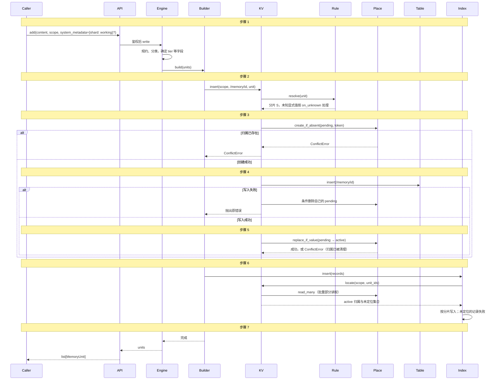
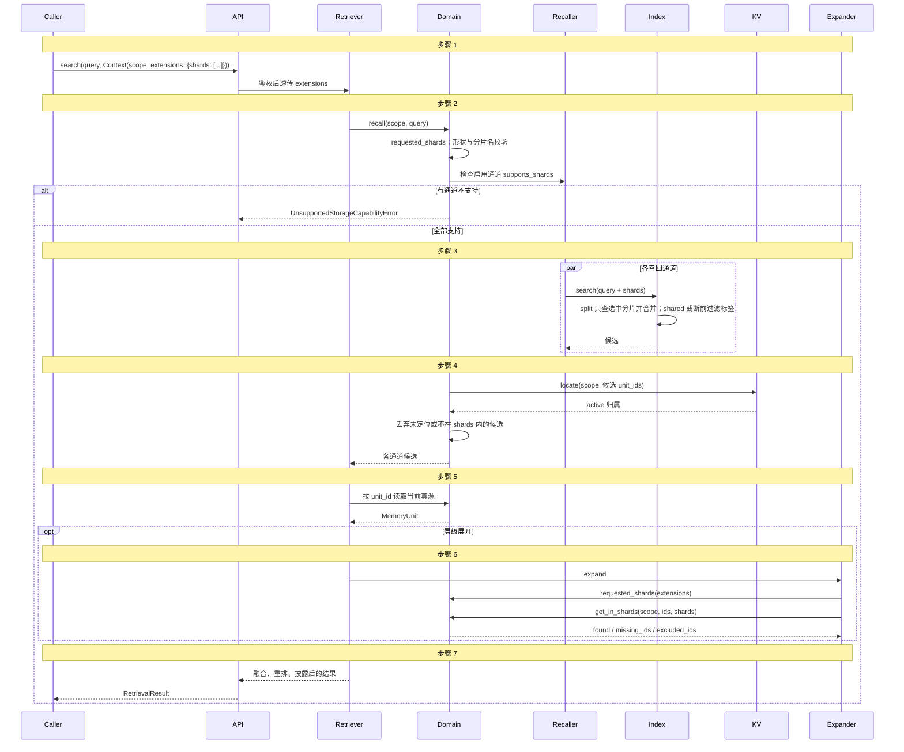
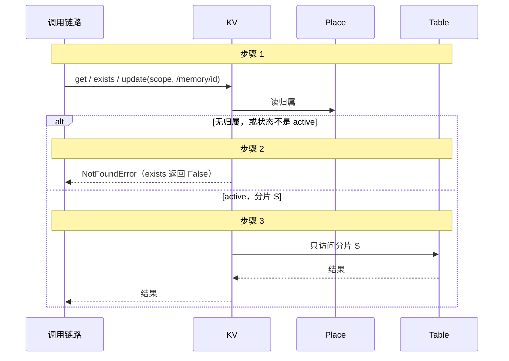
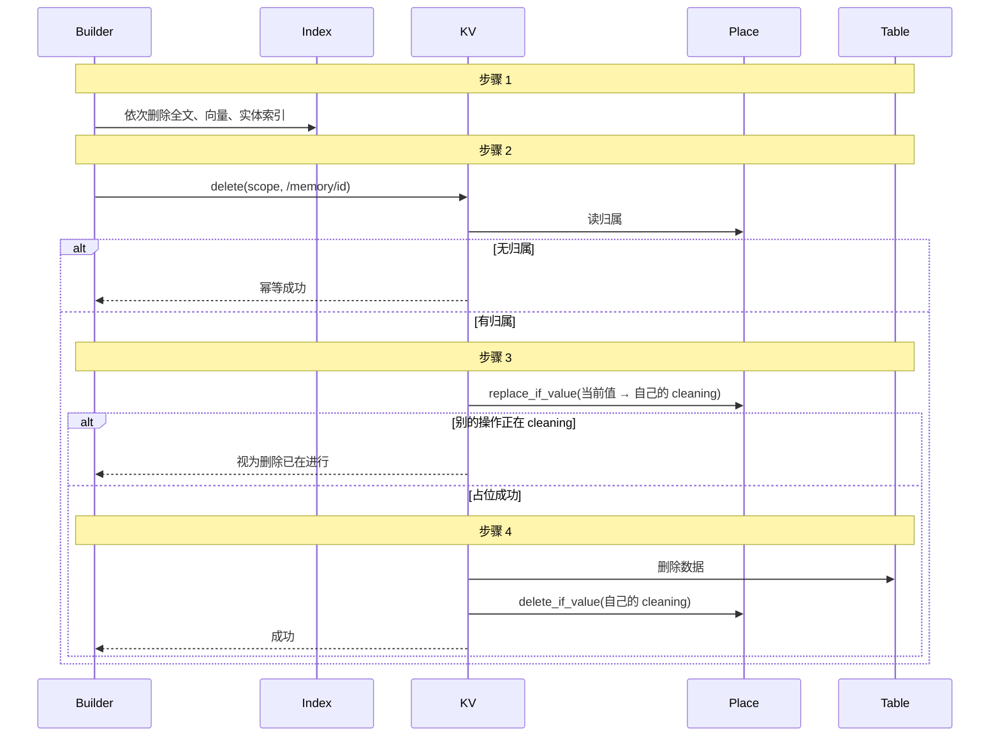
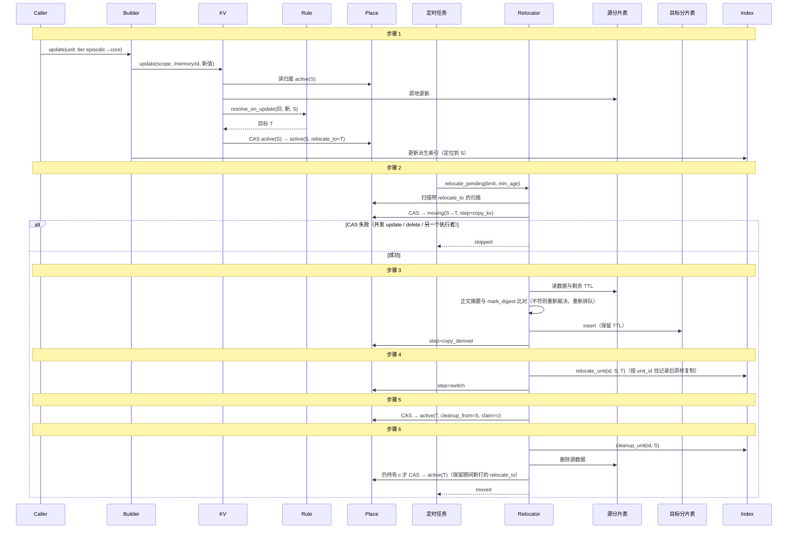
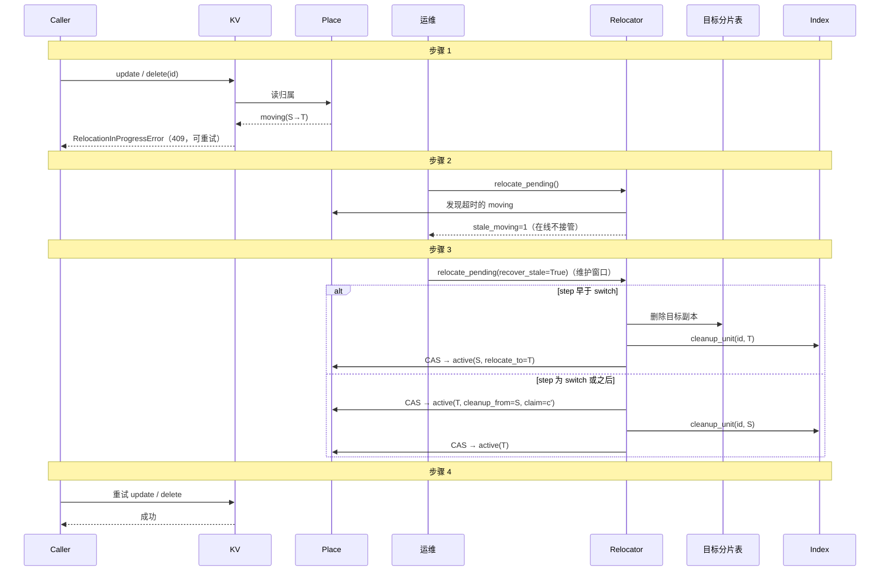

# 逻辑分片（shard）——分片逻辑由 storage 统一管理，写入透明、读取可按分片收窄

> **术语**：「逻辑分片」（shard）指分片规则输出、对外可见的分片名（如 `working` / `profile` / `episodic`）。分片名是**对外契约**；分片背后的物理表 / 索引名、分片规则、分片标签的生成与维护由 storage 管理，不向上暴露。代码标识符统一使用 `ShardResolver` / target `shard_routed`。
>
> 本方案是**业务逻辑分区**：按业务规则把记忆分到不同物理表 / 索引，指定分片检索时只扫描选中分片，从而缩小单次查询的索引规模。不包含自动均衡、热点迁移、在线扩缩容；按哈希扩容由各后端自身能力承担。

## 元信息

| 项 | 值 |
|---|---|
| 日期 | 2026-11-12 |
| 影响范围 | `jiuwen_memory/storage/`（分片规则与定位契约、`ConditionalKV` 归属协议、KV / 向量 / 全文 / 实体 / 关联图 `shard_routed` 包装层与 `EncryptedKVStore` 拒绝包装分片包装层、`StoreCapability` 能力声明、`EntityStore` 契约补齐（`Scope`、`shards`、增量 `UNLINK`、分组关联）、`DomainStore.get_in_shards`、`keyword_recaller.py` 透传分片到实体查询、`graph_recaller.py` 图通道分片支持、图后端截断前过滤、装配期自动拓扑登记与支持矩阵）、`jiuwen_memory/common/type_def/`（`memory_field_value`）、`jiuwen_memory/construction/index_builder_impl/entity_index_builder.py`（新签名与增量 `UNLINK`）、`jiuwen_memory/retrieval/expander_impl/default_expander.py`（`get_in_shards` 与 `shard_excluded`）、`scripts/`（DDL 模板、迁移 / 对账 / 退役 / 索引重建工具）、`docs/specs/S02-memory-api.md`、`docs/specs/S06-storage.md`、`docs/specs/S08-config.md`、`deploy/sharding/README.md`（运维手册） |
| 测试基线 | `pytest tests/unit/storage -q --ignore=tests/unit/storage/test_local_watchdog.py` 全绿；shard 相关用例含 `tests/unit/storage/test_shard_*.py`、`test_shards_extension.py`、`test_entity_contract.py`、`test_kv_ttl_contract.py`、`test_shard_routed_graph.py`、`test_nano_graph_shard_filter.py`、`test_neo4j_graph_store.py`、`tests/unit/api/test_sharded_api_flow.py` 与 `test_shard_role_assembly.py`。`pytest tests/unit` 全绿（需按 `.[dev]` 安装 `watchdog`）。真后端 PG/Redis/ES 用例见 `tests/integration/storage/test_integration_shard_conditional.py`（未配置环境时跳过）。 |
| Refs | — |

> **实现状态（2026-11-12）**：第一阶段全部落地——`ShardResolver` / `ShardLocator` /
> `ConditionalKV`（内存 / PG / Redis）、KV / 向量 / 全文 / 实体 `shard_routed` 包装层、
> `DomainStore.get_in_shards` 与展开器 `shard_excluded`、装配支持矩阵、拓扑登记与对账、
> DDL 模板与迁移/退役工具。关联图 shared / split 已落地，证据图按普通后端隔离；
> `--relocate-shard` 的范围限制、归属存储加密的真后端验证见「已知遗留」。

## 一页摘要

**做了什么**：把记忆按配置定义的逻辑分片（如 `working` / `profile` / `episodic`）分开存放。KV 真源按分片物理拆表；向量、全文三层与实体索引默认也按分片拆分（可逐端口改为单索引加分片标签）；关联图支持 shared / split，证据图保持普通后端。分片规则、物理表与标签全部由 storage 管理，上层只看到分片名。

**对外怎么用**（不新增 API，见 D15）：
- 写入：`add` / `batch_add` 不变，按配置规则分片；可在 `system_metadata` 写显式分片键指定落点。
- 检索：`search` 的 `context.extensions["shards"]`、`list` 的 `extensions["shards"]` 只查选中分片；未配置的分片名或空集合报 `ValidationError`，启用通道不支持分片时报不支持，不静默退回全量。
- 按 id 读、改、删不变，由归属记录定位，忽略 `shards`。

**与以前的差异**：
- 记忆的分片在创建时确定（粘性归属）。默认的 `update`（`SUPERSEDE`）会生成新 id 的新版本，新版本按当前内容落位，所以改 `tier` / 显式分片键后新版本就在新分片；只有 `mode=OVERWRITE` 原地覆盖与演进原地合并会让记忆留在原分片。需要这两种情况也跟随字段当前值时，开启 D16（默认关闭）。
- 新增一个所有分片共用的归属存储，是写入、点读与按分片检索的共同依赖。
- 启用分片需要配置、建表并在维护窗口首次分区，见[运维手册](../../../deploy/sharding/README.md)。

**升级注意**：只写派生索引的构建器、混合拓扑下按分片检索、`encrypted` 包装分片端口都会被拒绝；ES 实体 `INSERT` 改为冲突语义；实体解除最后一个关联需要 UPDATE + DELETE 权限；Redis 归属存储不支持 Cluster。完整列表见「已知遗留」中的发布说明。

## 背景

### 诉求

1. **用户可自定义分片**：分片名称、数量由配置决定。
2. **按 MemoryUnit 字段分片**：例如按抽取阶段由 LLM 判定的 `tier` 分片。
3. **用户可直接指定某条记忆存到哪个分片**，且优先于按字段分片。
4. **分片逻辑只在 storage**：分片规则、物理表、分片标签由 storage 管理；上层唯一可见的是分片名，读取时可用 `shards` 指定只查哪些分片（同 ES：客户端知道索引名 / 别名，不知道物理落点）。上层只透传分片名，不理解分片规则。
5. **指定分片时，分片过滤在各通道截断候选之前生效**：不采用「先召回全部、再过滤」。各通道仍有自身的近似与预算边界（ANN 近似、实体按记录数计 limit、图的深度与访问预算），见 D11。检索耗时以「性能基线」中的验收目标衡量，不作为已成立的结论。

### 现状

- **真源单表混存**：所有记忆同住 `agent_memory_kv`——`/memory/{id}` 存序列化 `MemoryUnit`（`value bytea`），`/messages/{id}` 存原文，`/space/info` 等根 scope 元数据也同表。
- **索引全量混合，但已支持召回前过滤**：向量与全文各三层（正文 L2 走 `default` 端口，摘要 L0 / 概览 L1 走 `layers_l0` / `layers_l1` 端口），记录 metadata 带 `tier` / `system_metadata.*` / `user_metadata.*` 等字段，`filters` 在 top-k 截断前下推到后端。**因此「只查某些 tier」本身不需要拆表，现状用 `filters` 即可做到**。不能下推的是实体扩展：实体索引只存 unit_id，召回后再点读真源过滤。
- **写入顺序**：`HybridIndexBuilder` 依次写正排 KV → 全文 → 向量 → 实体；写实体时该记忆已落 KV。
- **透明门面先例**：`EncryptedKVStore`、`config/routing.py` 的 `Routing*Store` 都实现原 ABC、对上层透明。

### 必要性

**业务动机**（2026-11-09 与业务方确认）：

1. **KV 多表是业务方的硬性要求**，本阶段不以检索收益作为是否采用的判断依据。KV 一旦物理分表，按 id 读写都必须先知道记忆在哪张表、跨表的 id 唯一性也只能由共享记录保证，因此归属记录（D7）是 KV 多表的必然结果，不是可选优化。
2. **分片是用户可感知的显式契约**：分片名由配置定义，写入可用显式分片键指定落点，检索用 `extensions["shards"]` 只查选中分片，归属在创建时确定（D5）。这套语义与后端无关，PG / Redis / ES / Milvus 等后端给出同一套行为。后端原生分区（如 Milvus partition key）对 agent-memory 透明，用户无法按名称指定或选择分片，不能满足这一要求（见 R31）。
3. **派生索引默认跟随 KV 物理拆分**（向量、全文三层与实体默认 `split`）：让「只查选中分片」在每个通道上都是物理隔离，而不只是共享索引内的过滤。不指定 `shards` 时 `split` 需要扇出全部分片，代价高于单索引（见「性能基线」）；部署可按端口改为 `shared`。

除上述采用依据外，物理分片还服务于**存储治理**：

| 需求 | 是否需要物理分片 |
|---|---|
| 大容量下降低指定分片检索的代价 | 需要（派生索引 `split`）；本阶段不作为采用依据，以性能基线记录实测 |
| 只召回某些 tier | 不一定，现有 `filters` 下推即可 |
| 自定义业务分类 | 不一定 |
| 不同索引参数、embedding 资源配额 | 按端口评估；后端不能在共享索引内提供所需治理时才拆分 |
| 不同数据库、集群或存储后端 | 需要 |
| 独立容量管理、独立备份 | 有价值；共享索引及归属总账仍限制恢复独立性（见[运维手册](../../../deploy/sharding/README.md)） |
| 不同保留策略（TTL） | 有价值，但需要完整的派生索引清理协议，**第一阶段不提供** |
| 强安全隔离 | 不能仅靠分片保证，仍需授权与部署边界 |

**采用门槛**：只需要按当前字段筛选时继续使用现有 filters，不启用本方案。需要用户可感知的显式分片、稳定的逻辑归属或 KV 多表时启用。每个派生索引独立选择共享或拆分：向量、全文三层与实体默认 `split`；图默认 `shared`（`split` 会丢失跨分片多跳关系，见 D10）。不需要降低检索代价、希望保留单索引排序或减少资源数的端口可改为 `shared`。各端口的两种模式与角色图均在首版支持范围内。

### 第一阶段非目标

- Markdown 文件及其目录不按 shard 拆分，不增加 Markdown 路由包装层；这不等于首版已支持 Document Mode 与分片组合，Shadow 真源与召回仍受 D12 的限制。

- 按分片的保留策略 / TTL 生命周期治理。
- 扩容意义上的分片（自动均衡、热点迁移、扩缩容）。
- 跨分片全文检索与单索引排序完全等价（见 D8）。
- 改路由字段后自动换分片：默认关闭；打开 D16 的 `relocate_on_update` 后由后台搬迁（D16）。

---

## 决策

### 决策总览

所有召回相关的存储端口换成 storage 内的 `shard_routed` 包装层。**KV 是分片归属的唯一事实来源**：只有 KV 包装层在创建记忆时用分片规则决定归属；向量、全文、实体、图包装层一律经 `ShardLocator` 查询该记忆在 KV 中的分片并跟随，不自行按规则判定。

| 端口 | 分片方式 | 指定分片检索 |
|---|---|---|
| KV 真源 | 物理拆表 | 只查选中分片的表 |
| 向量（`default` / `layers_l0` / `layers_l1`） | `split` 分表（默认）/ `shared` 单索引 | 共享索引前置过滤 / 只查选中物理分片 |
| 全文（`default` / `layers_l0` / `layers_l1`） | `split` 分索引（默认）/ `shared` 单索引 | 共享索引前置过滤 / 只查选中物理分片 |
| 实体 | 可配置：`split`（默认，每分片一个实体索引）/ `shared`（单索引，storage 给关联打分片标签） | `shared` 下推分片过滤；`split` 只查选中分片的索引 |
| 图 | 可配置：`shared`（默认，单图，storage 给节点打分片标签）/ `split`（每分片一个图存储） | `shared` 节点过滤下推、过滤后截 limit；`split` 只查选中分片的图 |

真源保持 bytea 模型；不新增业务类型；实体、图各有一处契约补齐（D9 / D10）。

### D1. 分片完全配置驱动

- 不引入 `MemoryDomain` 等公共业务类型；分片名、物理表名只出现在配置里。
- 每张物理表 / 索引对应一个普通 Store 实例，后端、连接、加密（内层套 `encrypted`）各自独立。
- 库代码只实现「按规则把记录分发到某个分片」，不识别任何具体分片。

### D2. 分片规则契约（`ShardResolver`）

- **契约与注册**：`ShardResolver` 是 ABC，经 `ShardResolverProducer`（顶层段 `shard_resolver`）注册与装配；默认实现 target `rule_based`，可替换。
- **分片集合的唯一权威来源**：`shard_resolver` 的 `shards` 参数显式列出全部分片名。规则里的分片名、`default_shard`、`shard_from` 运行时取到的值都必须属于该集合；各端口包装层只负责为该集合中的每个分片提供存储（`table_template` 按它展开）。只供显式指定的分片也要列在这里，即使它不出现在任何 `match` 规则中。
- **只在 KV 创建记忆时求值**：分片规则只由 KV 包装层在 `insert` 新记忆时使用，对 `MemoryUnit` 求值，求值语义复用 `list` / `search` 现有的 `matches_memory_unit`，值规范化与过滤同源。向量、全文、实体、图不对规则求值，而是经 `ShardLocator` 跟随 KV（D6），因此不存在「KV 与索引两侧各自求值、结果不一致」的问题，也不需要把索引投影下沉为公共函数。
- **纯函数**：结果只由「创建时的记忆内容 + 启动时冻结的配置」决定，不依赖历史状态。
- **规则写法**（按顺序首条命中，都不命中落 `default_shard`）：
  - `match`：`FilterExpr` 条件语义，**仅允许引用受支持的路由字段**（D4）。
  - `shard_from: <字段>`：字段值即分片名。
  - 两种写法是有意保留的：`shard_from` 对应「直接指定」，`match` 对应「谓词分类」。只用 `match` 的话，显式指定要为每个分片各写一条规则，新增分片也得改规则。
- **值规范化**：
  - 字段缺失、`None`、空字符串视为「未命中」。
  - 枚举按其 `value` 字符串比较（如 `tier` 比较 `"core"`）。
  - 数组字段只能用 `contains` / `in` 类条件；`shard_from` 不允许指向数组字段（启动校验）。
  - `shard_from` 取到非字符串值，或字符串不是已配置分片名时，按 `on_unknown` 处理：默认 `reject`（拒绝写入，抛 `ValidationError`），可选 `default`（落 `default_shard` 并告警）。
  - 嵌套 metadata 用扁平路径引用（如 `system_metadata.shard`）。

### D3. 两种分片需求都只靠配置满足

- **需求 A（按字段分片，如 `tier`）**：规则在记忆写入 storage 时求值，此时抽取 / 分类已填好 `tier`。本特性只保证按最终 `tier` 路由，不保证 LLM 正确填写 `tier`；任意合法值都有确定落点（未命中落 `default_shard`）。
- **需求 B（用户直接指定）**：规则按顺序「用户指定 → 字段规则 → `default_shard`」，如 `{ shard_from: system_metadata.shard }` 放在第一条。自定义键不在内核保留键内，调用方可以写。
- **显式指定的边界**：约束本次写入的记忆及其单一来源的派生记忆（经 `inherited_system_metadata` 继承）；多源合并时只保留取值相同的键，来源指定了不同分片的新记忆按自身规则落位。显式分片键只在创建时生效，之后被修改或被演进合并删掉都不拒绝、不搬迁（R19）。
- **层级摘要**：层级摘要是独立记忆，按自身字段落位，可能与子记忆不在同一分片。展开时子记忆同样受 `shards` 约束：`DomainStore.get_in_shards` 返回 found / missing_ids / excluded_ids，展开器分别记 `missing_child` 与 `shard_excluded`；普通 `get` 语义不变。

### D4. 受支持的路由字段（启动校验）

- **允许**：`tier`、`tags`、`source`、`system_metadata.*`、`user_metadata.*`。
- **禁用**：`lifecycle`、`t_valid`、`t_invalid`、`t_ingest`、`t_event`、`t_message`、层级字段（`hierarchy_*` / `tree_*`）。这些字段在创建时多为默认值或系统盖章值（如 `lifecycle` 恒为 `ACTIVE`），之后又会被 supersede、软删除、时间补全、树结构调整频繁改写；按创建时的值分片既没有区分意义，又会让分片与字段的当前值长期不一致，容易误解，故禁用。
- 规则引用不在允许集合内的字段 → 启动失败。

### D5. 粘性归属

- insert 时按规则确定分片，此后固定；分片 KV 的 `update`（同 id 原地写）在原分片更新，不重新判定。
- 对外语义：「一条记忆属于哪个分片」= 它被创建时放进的分片，不随字段当前值变化。按当前 `tier` 筛选用 `filters`（在召回前下推）。
- 影响面已核实（2026-11-10 端到端实测）：
  - **API `update` 默认 `SUPERSEDE`**：生成新 id 的新版本（经 IndexBuilder 写入，即分片 KV 的 `insert`），按新内容落位；旧版本标记 `SUPERSEDED`，不再被检索返回。因此默认模式下改 `tier` 或显式分片键，新版本直接出现在新分片，不受粘性归属影响。
  - **API `update(mode=OVERWRITE)`**：同 id 原地覆盖，走分片 KV 的 `update`，记忆留在原分片。
  - **演进**：SUPERSEDE 写新记忆按自身字段落位；UPDATE 原地合并内容与 metadata、不改 `tier`；按 metadata 分片时会造成分片与字段当前值不一致，只是不一致，不报错也不丢数据。
  - 生命周期转换（superseded / archived 等）原地改 `lifecycle`，不是路由字段，不影响分片。
- 收益：无需迁移锁与副本裁决，派生索引始终跟随 KV 的归属。规则变更只影响新建记忆；移动已有记忆是维护窗口内的显式重新分区（R26）。
- 需要 `OVERWRITE` 与演进原地合并也跟随字段当前值时，打开 D16 的 `relocate_on_update`：由后台把记忆搬到新分片，搬迁完成前语义与本节相同。

### D6. storage 内部协作契约

| 契约 | 职责 | 提供方 | 使用方 |
|---|---|---|---|
| `ShardResolver` | 新记忆内容 → 分片名 | `shard_resolver` 实例 | KV 包装层（仅 insert） |
| `ShardLocator` | 批量 `(scope, [unit_id])` → 只含 `active` 归属的映射 + 未定位集合，单个缺失不使整批失败 | 分片 KV 包装层 | 向量 / 全文 / 实体包装层、`CompositeDomainStore` |
| `ConditionalKV` | 原子创建、按完整值条件替换 / 删除、批量部分读取、存储侧时间 | 归属存储 | 分片 KV 包装层 |

- 包装层经具名 `locator` 注入定位端口，启动时按能力声明校验，不做类型判断、不穿透代理。
- 「未定位」的处理：派生写入该条失败（不落默认分片）；召回校验丢弃该候选；实体 `find_by_linked_memory_id` 扇出查询。
- 前提是先写 KV 再写派生存储，两条写入路径（`HybridIndexBuilder`、`UnifiedIndexBuilder`）都满足；分片部署下只写派生索引的构建器在装配期拒绝。
- 不做定位缓存：删除后同 id 可能在别的分片重新插入，缓存在多实例下无法保证正确（R24）。

### D7. KV 包装层与归属记录

归属记录的完整定义、状态转换、协议保证与不保证见 [S06「归属记录协议」](../../specs/S06-storage.md#归属记录协议)。本节只记录设计理由：

- **为什么需要归属记录**：KV 物理拆表后，单表唯一约束挡不住两个并发 insert 写进不同分片的表（R20），按 id 读写也必须先知道记忆在哪张表。归属记录放在注入的、声明 `ConditionalKV` 的 KV 中，靠存储自身的原子「不存在才创建」实现跨表唯一，不依赖事务（与 R5 私有反查表的区别）。
- **为什么要三种状态加操作 token**：只有原子占位时，insert 与 delete 交错会出现「insert 返回成功但读不到」，同 id 的不同内容会被误当成补写（R23）。`pending` → `active` 的条件提交保证 insert 只有在归属仍属于自己时才成功；token 区分同一时间戳的两次创建尝试（R29）。
- **为什么不用锁或代次**：锁约束不到已失去锁仍在途的写入（R30）；代次要扩展到所有物理 key 与索引 metadata，复杂度不值得（R27）。当前协议不阻止失效 insert 的晚到写入，只保证它不可见，由此产生的可用性限制写入已知遗留。
- **为什么 `cleaning` 不在线接管、超期 `pending` 不允许新 insert 接管**：在线接管会让变慢的旧清理者在恢复后删掉新插入的数据（R28）。
- **关键交错**：并发 insert 同一 id 最多一个成功；insert 与 delete 交错时 insert 返回失败，不会「成功却读不到」；失效的旧 insert 与新 insert 交错时最坏两者都失败、旧内容不可见；旧 update 与删除后重新插入的结果都能排成合法串行顺序，与单表盲写相同。
- **其它**：`get` 只依赖归属存储和目标分片；`list` 扫描选中分片后批量校验归属再统一分页，是兼容实现，成本随数据量线性增长；对账只清理超期 `pending` 与无主数据，需运维定时执行；`persistent_atomic_records` / `claim_single_writer` 委托 `passthrough`。

### D7a. 辅助索引与完整扫描

- `scan(scope, prefix)` 返回逻辑 KV 视图：只覆盖非记忆键时读取 passthrough；覆盖 `/memory/` 时扫描相关物理表，再批量校验 active 归属；空前缀等混合范围合并两者，排除 passthrough 中迁移保留的旧 `/memory/` 副本及全部保留控制键。按逻辑 key 去重，顺序不承诺；跨表不提供快照一致性，失败不返回伪完整结果。
- `scopes()` 合并 passthrough 与各分片的 Scope，去重并隐藏仅有控制记录的 Scope；允许返回曾使用过但目前为空的 Scope，与既有契约一致。它是受管理权限约束的枚举能力，不授予跨 Scope 数据访问。没有 shard 参数的扫描和后台任务遍历全部逻辑分片。
- Schema 实体→属性反向索引（`/schema/entity-properties/v1`）保留在 passthrough，共享维护 unit_id、排除记录及 scope watermark，不复制 shard 归属。初始化/降级回扫必须经过上述逻辑 scan。按 shard 的属性扩展先定位关联 id、按归属收窄，再截断候选及回读；内部全量维护不携带 shard 限制。
- 同 id 搬迁不改变反向关联；删除沿用索引删除协议。首次分区、恢复、重新分区和退役须使受影响 scope watermark 失效，经逻辑真源重建、核对关联及排除记录后再提交 watermark，禁止把部分重建标记为完整。
- Markdown/文件不拆分。Shadow 的全文、向量、hash 反查属于 Document Mode，首版与分片组合启动失败；Fusion 同样明确不支持。层级子记忆、Schema 属性扩展等按 id 读取路径使用 `get_in_shards`；不允许只检查常规召回而遗漏扩展。新插件增加找回记忆 ID 的路径时必须申报过滤、删除、重建及恢复语义。

### D8. 向量 / 全文包装层

- **模式**：每个端口 `mode: shared | split`，默认 `split`，让指定分片检索在该通道上是物理隔离。共享模式注入 `inner`，写入时由 storage 覆盖写入分片标签 `system_metadata.storage_shard`，查询把分片条件与 Scope、授权、用户 filters 取 AND 后在 top-k 前下推；后端须声明前置过滤能力（`SHARD_PREFILTER`），否则启动失败，不退化为后过滤。
- **拆分模式写入跟随 KV**：从记录 metadata 取 `unit_id` 经 `ShardLocator` 定位后写入对应分片，不按记录里的 `tier` 自行判定（R18）。记录 id 必须由 `unit_id` 派生（契约见 [S06](../../specs/S06-storage.md#归属记录协议)）；现有构建器的 id 形式都满足，且记忆 id 为 uuid4，同一记录 id 只能属于一条记忆。
- **旧记录残留**：删除后同 id 重建到别的分片时，旧分片会残留索引。写入路径不做跨分片清理（否则暂停后恢复的旧任务会误删新分片的有效索引），残留只在维护窗口清理；在线时只影响相关性，不越过分片边界。
- **返回内容来自当前真源**：索引只用于召回与排序，三条检索路径都回读当前 `MemoryUnit` 组装结果（验收条件）。
- **跨分片合并**：不带 `shards` 时各分片取 top-k 后按分数合并。启动时校验各分片向量的 embedding 配置、维度、度量与分数方向一致；ANN 本身近似，不承诺全局精确。全文 BM25 受各索引统计影响，合并后与单索引近似而非等价；内层声明可合并查询的能力时才走原生合并。

### D9. 实体包装层：`shared` / `split` 两种模式

- **两种模式**：`split`（默认，每分片一个实体索引）与 `shared`（单索引，关联按分片分组）。构建层发出的指令与看到的 `EntityRecord` 在两种模式下一致。
- **`EntityStore` 契约补齐**（公共契约变更，以 `CONTRACT_VERSION = 2` 标识）：首参由 `space_id` 改为 `scope`；`find_by_entity_text_hash` / `search` 增加可选 `shards`；新增增量操作 `UNLINK`（只移除关联，不删记录，空记录不被查询返回）与 `DELETE_IF_EMPTY`（存储内原子判空并删除）。构建层原来的「读出全部关联 → 整体替换」会与并发 `LINK` 互相覆盖，改为发 `UNLINK`，只在剩余为空时同批追加 `DELETE_IF_EMPTY`。
- **原子性是能力声明**：实现须声明 `atomic_unlink`；分片实体包装层要求内层声明，否则启动失败。旧签名适配器只能非原子模拟，声明 `atomic_unlink = False`，只允许在未分片部署使用，有废弃期。
- **授权**：保留实体专用代理按批次内每条操作推导动作并全部通过才执行；新增 `UNLINK` → UPDATE、`DELETE_IF_EMPTY` → DELETE。解除最后一个关联从「只需 DELETE」收紧为「UPDATE + DELETE」，写入发布说明（R25）。授权改用真实 Scope，原先按近似 Scope 放行的请求可能被拒绝。
- **新增关联要定位，移除关联不依赖定位**：`INSERT` / `LINK` 必须定位到 `active` 归属；`UNLINK` 在归属已删除时也能幂等完成（shared 从所有分组移除，split 扇出到全部分片）。
- **shared 模式**：ES 物理文档维护 `linked_memory_ids`（并集）、`linked_shards`（供过滤）、`linked_by_shard`（每分片关联），由同一个脚本在单文档内原子维护；`shards` 过滤在截断前下推。
- **split 模式**：对外是稳定的逻辑实体 id，每个分片的物理文档 id 由逻辑 id 确定性派生（`{逻辑 id}@{分片}`），对聚合结果的 `LINK` / `UNLINK` / `DELETE` 作用于全部物理文档（R21）；某分片首次关联需要 `LINK` 携带 `record` 作为模板。
- **部分失败**：`execute_operations` 按条返回；一条操作中有 id 定位失败只使该条失败，涉及多个分片时任一分片失败整条报失败，重试幂等。

### D10. 图包装层（已实现）

**两类图用途不同，只有关联图参与分片**：

| | 关联图 | 证据图 |
|---|---|---|
| 配置 | 默认 `graph_store` | 角色记忆的 `evidence` 图，后端 `kv` / `neo4j` |
| 写入 | evolver `ASSOCIATE` 写节点/边 | `EvidenceGraphBuilder` 用 `project_edge` / `unproject_edge` 投影关系 |
| 节点 | id 就是记忆 `unit_id`，节点属性不需要 `MemoryRef` | `continuity:memory:<hash>`，属性带 `ref` |
| 读取 | `GraphRecaller` 参与 `search`，受 `shards` 影响 | 角色视图与接续服务按 `incident_edges` 读，不经过 `search`，也不接收 `shards` |

证据图的节点会引用其他 Scope 的记忆、读取也不按分片组织，**只能用普通后端**。它要求
`supports_incident_edges` 与 `supports_conditional_projection`；`shard_routed` 图包装层不声明
这两项，`EvidenceGraphBuilder` 构建时直接拒绝，支持矩阵也禁止该组合。

**shared（默认）**：单图，节点写入时由包装层用 `ShardLocator` 按节点 id（即 `unit_id`）查归属，
在 `Node.properties["storage_shard"]` 写标签。关联图节点就是记忆，**不存在公共节点**：查不到
归属直接 `ValidationError`（与向量 / 全文 / 实体一致）；已删除记忆留下的无标签旧节点不参与
带 `shards` 的返回，避免占掉 limit 名额。边不写标签，跨分片关系完整保留。
`seed_ids` / `search` 的 `extensions["shards"]` 由后端在**截断 `limit` 之前**按标签过滤。
遍历可以经过授权范围内的任何节点（包括其它分片的节点），只在收集返回结果时过滤，不能
在扩展邻居阶段剪枝；内存、nano-graphrag、Neo4j 三个后端统一该语义，内层须声明
`SHARD_PREFILTER`。

**split**：每个分片一个独立图存储。节点按 KV 归属路由，归属缺失同样直接报 `ValidationError`；
边只有 source / target 落在同一分片时才写入，跨分片的边直接丢弃——因此接受跨分片多跳
关系丢失。两种模式对外部写入的失败语义一致。split 的每个分片图须声明互不相同的
`resource_descriptor()`（内存等进程内后端返回 `None` 并跳过拓扑登记），同一物理资源
重复声明会在装配期拒绝。`search` / `seed_ids` 只访问选中分片的图，合并按
节点 id 去重后截断；`get` 按 id 扇出全部图并按输入顺序合并。

**搬迁中的写入**：`RelocationInProgressError` 与向量 / 全文 / 实体一致，`insert` / `update`
命中 `moving` 节点（含边端点）即拒绝，不能覆盖过渡标签把节点永久留在源分片；`delete` 同样
拒绝 `moving` 节点，避免切换后目标副本"复活"。

**缺归属的异常与后台写入**：图包装层缺归属时抛 `MissingShardPlacementError`（`ValidationError`
子类）。evolver 的 ASSOCIATE 逐个写节点、逐条写边，只跳过 `MissingShardPlacementError` 与
`RelocationInProgressError` 的那一条并记日志，同批其它关系照常写入；图后端自身的
`ValidationError` 不被吞掉。

**兼容旧签名插件**：`seed_ids` 新增的 `extensions` 是可选关键字参数；`GraphRecaller` 与
`RoutingGraphStore` 在未指定 `shards` 时按旧形式 `seed_ids(scope, tokens)` 调用，没有该形参的
第三方图插件在未分片部署中不受影响。

**搬迁（D16）**：shared 只改标签，写 `storage_shard_next=目标`，`cleanup_unit(源)` 才转正、
`cleanup_unit(目标)` 用于回滚去掉过渡标签；split 把节点复制到目标图（跨分片边不复制），
`cleanup_unit(源)` 删除源节点及其关联边。split 搬迁后该节点在目标图里暂时没有边：源图中的
边随节点删除，指向目标分片节点的边当初是跨分片边、未曾写入；下一次 ASSOCIATE 才会重新建立。
装配期开启 `relocate_on_update` 时，跟随同一 KV 的关联图端口也必须声明 `SHARD_RELOCATABLE`。

**不引入**：不为图另建控制 KV、逻辑目录、每 Scope 写入占位、操作日志或提交代次，也不支持
一个节点关联多条记忆 / split 占位节点。关联图一个节点就对应一条记忆；证据图不分片。

### D11. 按分片检索：`extensions["shards"]`

- **语义**：

  | 取值 | 行为 |
  |---|---|
  | 键不存在 | 查全部分片 |
  | `["working"]` / `["profile", "episodic"]` | 只查这些分片 |
  | `[]` / `None` / 含未配置的分片名 | storage 抛 `ValidationError` |
  | 按 id 的 `get` / `update` / `delete` | 忽略 `shards` |

- **透传**：`search` 的 API 边界只取走约定键，其余经查询解析透传，向量 / 全文 / 图召回算子复制进各自 `Query.extensions`；实体通道由 `keyword_recaller` 显式传入（D9）；`list` 的扩展参数原样到达 KV。
- **语义归属**：`extensions["shards"]` 的解析归数据面（`DomainStore.requested_shards`），检索层（含层级展开器）只把扩展参数交下去、不解析这个 key；`[]` / `None` / 空字符串成员一律 `ValidationError`，不得当成「未指定」而退回全分片。
- **通道支持声明**：每个召回通道（包装层、召回算子）须声明是否支持分片。请求带 `shards` 而某启用通道不支持时，**报错而不是静默返回全部**。
- **一致性边界**：「属于某分片」指记忆**所在**的分片，即生效归属中的分片（创建时确定，D5），不是按字段当前值重新计算的结果。按字段当前值筛选请使用 `filters`。
  - **最终保证由真源校验给出**：指定 `shards` 时，`CompositeDomainStore` 在召回结果交给检索层之前，按候选的 unit_id 经 `ShardLocator` 批量部分读取 `active` 归属，丢弃不在 `shards` 中或未定位的候选，其余候选照常保留。层级展开的子记忆经 `DomainStore.get_in_shards` 同样按归属过滤（D3）。
  - **各通道的分片过滤是性能路径**：正常情况下，各通道的分片过滤已使候选都在目标分片内，真源校验不会丢弃任何候选。只有派生存储残留旧记录（D8，删除后同 id 重建到别的分片）等竞争情况下，校验才会丢弃候选——表现为该次召回少一条，结果不会越过分片边界。
  - 因此**返回结果中每条记忆都位于 `shards` 中的某个分片**，以返回前读取的生效归属为准。真源校验每次检索只做一次批量归属读取，不点读记忆内容。
- **内容来源不受 `shards` 约束**：`shards` 限定的是**返回记录所在的位置**，不保证内容来源全部来自这些分片。
  - 例如：层级摘要或演进合并后的记忆，可能综合了多个分片的记忆；它本身落在 working 分片时，`shards=["working"]` 会返回它，其内容仍可能含有 profile 来源的信息。
  - 如果业务要求「只利用指定分片的信息作答」，需要另外限制跨分片的摘要生成与演进合并，仅靠存储路由无法满足。该边界写入 S02。
- **各通道的保证与边界**：分片过滤都在该通道截断候选之前生效，但各通道原有的近似与预算边界不变：
  - 向量：ANN 近似，各分片局部 top-k 合并，不承诺全局精确（D8）；
  - 全文：跨分片 BM25 合并近似（D8）；
  - 实体：`limit` 按实体记录数计，不等于记忆数；
  - 图：深度、访问预算、超时会限制找到的节点；`split` 模式不保留跨分片多跳关系（D10）。
- **可用性**：指定分片检索时，split 端口只访问选中物理分片，shared 端口访问共享实例并前置过滤；回读真源依赖归属存储与目标分片（D7），不依赖其它分片。
- **安全**：`shards` 只能收窄，永远与授权、scope 过滤取 AND（S09 #11）。

### D12. 支持矩阵与装配校验

| 组合 | 第一阶段 | 装配行为 |
|---|---|---|
| KV 的 `shard_routed` | 支持 | 归属总账 + 物理分表 |
| 向量 / 全文三层 `shared` / `split` | 支持 | shared 校验前置过滤；split 校验物理资源及分数兼容 |
| 实体 `shard_routed`，`mode: shared` / `split` | 支持 | `shared` 要求 `inner` 声明分组关联能力；`split` 要求每个分片都有实体存储 |
| 关联图 `shard_routed`，`mode: shared` / `split` | 支持 | 两种模式都拒绝无归属节点与 `moving` 节点写入；shared 内层须声明 `SHARD_PREFILTER`，遍历可经过其它分片、结果在截断前按标签过滤；split 每分片独立图存储，跨分片边丢弃。证据图不适用（下一行） |
| 证据图（`evidence`）+ `shard_routed` | 不支持 | `EvidenceGraphBuilder` 要求 `supports_incident_edges` / `supports_conditional_projection`；分片图不声明，构建期拒绝 |
| Markdown 文件与目录 | 不拆分 | 保持现有存储方式；Document Mode 组合限制见下一行 |
| 未配置实体或图通道 | 支持 | 无需对应包装层 |
| Document Mode（`write_document=true`，`shadow` 召回）+ 分片 | 不支持 | 启动失败 |
| FusionStore（当前不在召回链路）+ 分片 | 不支持 | 分片模式下若有消费方注入 FusionStore，启动失败 |

以上「不支持」组合由装配器依据**能力声明**判定（如 `StorageCapability.DOCUMENT_SHADOW`、`FUSION` 是否被分片部署中的消费方请求，以及各端口是否声明分片支持），不按具体 target 名称、模块路径或实现类型判断（S09 #9）。
| 自定义 DomainStore / Recaller | 须声明分片支持 | 未声明时，请求带 `shards` 报错（D11） |
| 新增端口 | 仅限已有 Store 类型、已有 `shard_routed` 实现、记录 metadata 带 `unit_id`（供定位） | 其它情况启动失败 |

同时校验：

- KV 与 split 端口为每个 shard 提供独立资源（严格 1:1）；shared 端口由同一个实例覆盖全部 shard；规则中的分片名与 default_shard 都属于 shards；
- 归属存储声明 `ConditionalKV` 能力（D6 / D7）；`shard_routed` 实体包装层的内层声明 `atomic_unlink = True`（D9）；
- 拓扑登记（见[运维手册](../../../deploy/sharding/README.md#分片相关运维操作)）：各分片物理标识与登记一致；登记中的分片都仍在 `shards` 中；规则不输出 `retiring` 分片；
- 向量分数可比条件（D8）；
- 物理资源命名（D13）；
- **索引构建器必须写正排 KV**：分片归属由 KV insert 创建，只写派生索引的构建器
  （`fulltext` / `vector`）会让每条 add 都因缺归属而失败，装配期直接拒绝并提示
  改用 `forward` / `hybrid` / `unified`。

### D13. 配置与装配

- 配置按 Producer 顶层段划分（`shard_resolver` / `kv_store` / `vector_store` / `fulltext_store` / `entity_store` / `graph_store`），依赖经 `Producer.dep` 引用；完整配置示例见[运维手册](../../../deploy/sharding/README.md)。
- `table_template` 对每个分片替换 `{shard}` 后经对应 Producer 的标准 `build` 路径构建**内联实例**，不成为对外端口，避免分片表被绕过路由直接访问；`tables` 覆盖也推荐用内联声明。任一分片构建失败只清理本次新建的实例。
- 内联实例由创建它的包装层持有，包装层 `close()` 时关闭一次（重复调用安全），借用实例不关闭。`runtime.close()` 目前不会触达存储端口（已知遗留）。
- 物理资源命名校验：分片名须匹配 `^[a-z][a-z0-9_]{0,31}$`，数据中的值从不拼进 SQL / 索引标识符；展开后的名字满足后端限制；同一端口内不同分片不得指向同一张表或索引，也不得与 `passthrough` 重名。
- 归属存储默认是内联专用表，不成为端口；若放在共用实例中，使用保留前缀 `/__shard_placement/`，包装层对外拒绝该前缀的读写并在扫描中隐藏。
- 加密准入覆盖内联实例；`encrypted` 只能包物理分片表 / `passthrough` / 归属存储，不能包分片包装层。
- 连接预算：每个分片表实例各持连接池，装配期按对象身份汇总，超过 `globals.storage_connection_budget` 拒绝启动。
- 能力协议见 [S06 能力协议](../../specs/S06-storage.md#逻辑分片能力协议第一阶段已实现)：实现只经公开能力入口获得端口，能力集在生命周期内固定，缺能力返回 `UnsupportedStorageCapabilityError`；授权 / 加密代理须显式转发能力。

### D14. 故障与一致性

- **查全部分片**：任一分片不可用则整体失败，不静默返回部分结果。分片越多，全局查询的可用性越受单个分片影响，这是严格完整性的代价。
- **指定分片**：依赖选中物理分片或共享索引，以及归属/图控制存储（D7、D11）。
- **共享故障域（架构事实）**：归属存储是所有记忆写入、点读与指定分片检索的共同依赖。分片隔离了数据与索引负载，但**没有消除这个共享故障域**——归属存储不可用时，所有分片的记忆读写都不可用。它的可用性要求与现在的单表 KV 相同，应按同等级别部署与备份。
- **跨索引部分失败**：写 KV 成功但写向量 / 全文 / 实体失败——现状已有同样问题，由既有 `BulkWriteError` / partial failure 语义承担。派生存储一律跟随 KV 的归属，不各自判定分片，避免独立规则造成的错放；删除重建期间仍可能出现 D8 的陈旧记录，不能宣称强一致。
- **加密**：`encrypted` 套在每个分片表内层，各分片可独立开关、独立密钥；**外层不得包装 `shard_routed` 端口**，显式配置该组合在装配期直接拒绝（双重加密且丢掉分片粒度），代理也不得靠方法名转发分片能力。离线迁移必须经包装层写入，以便按各分片密钥重新加密。

### D15. 对外接口：不新增 MemoryAPI 方法

分片能力全部并入现有接口，`MemoryAPI`、HTTP、CLI、MCP 都不增加方法，也不增加入参：

| 用户要做的事 | 使用的现有接口 |
|---|---|
| 按规则分片 | `add` / `batch_add` 不用改，由 `shard_resolver` 规则决定 |
| 显式指定落点 | `add` / `batch_add` 的 `system_metadata`，键名由部署规则 `shard_from` 决定（如 `system_metadata.shard`） |
| 只检索某些分片 | `search` 的 `context.extensions["shards"]` |
| 只列出某些分片 | `list` 的 `extensions["shards"]` |
| 按 id 读取、更新、删除 | `get` / `update` / `delete` 不变，由归属记录定位，忽略 `shards` |
| 启用、对账、重新分区、退役 | 不进 API，只由配置和 `scripts/migrate_kv_by_shard.py` 在运维面执行 |

新增的 `ShardResolver`、`ShardLocator`、`ConditionalKV`、`DomainStore.requested_shards` / `get_in_shards` 都是 storage 与检索层之间的内部契约，不对调用方暴露。`shards` 只收窄范围，与 Scope 和授权取 AND。

### D16. 改路由字段后的自动搬迁（已实现）

> **实现状态**：已实现（存储层 `ShardRelocator` + 派生端口 `SHARD_RELOCATABLE` / 后端 `UNIT_RECORD_LOOKUP`）。开关 `kv_store.<name>.params.relocate_on_update` 默认 `false`；为 `false` 时行为与 D5 粘性归属完全一致，归属记录字节也不变。契约见 [S06「改路由字段后的搬迁协议」](../../specs/S06-storage.md#改路由字段后的搬迁协议已实现)，运维见[运维手册「自动搬迁」](../../../deploy/sharding/README.md#改路由字段后的自动搬迁)。

**要解决的问题**：同 id 原地写（`update(mode=OVERWRITE)`、演进原地合并 metadata）改了路由字段后，记忆仍留在原分片，用 `shards` 按新值查不到它（D5）。默认 `SUPERSEDE` 的 update 生成新版本、本来就按新内容落位，不需要 D16。业务若要求原地写也「分片跟随字段当前值」，首版只能在维护窗口重新分区；D16 让分片在一次原地写之后**最终**跟随字段当前值，无需停机。

**核心取舍**

| 维度 | 选择 | 理由（被否决的方案见 R32–R36） |
|---|---|---|
| 谁来搬 | storage 层自理：分片 KV 发现变化，storage 内的 `ShardRelocator` 协调 KV 与各派生端口 | 分片知识保持只在 storage；控制层、构建层、检索层不感知（R32） |
| 派生索引怎么搬 | 原样复制已存储的记录（含 embedding），不经 IndexBuilder 重建 | 不重算 embedding、不依赖构建层，搬迁前后向量完全一致（R32） |
| 何时搬 | 异步：update 只打标记，由运维 / 定时任务调用 `relocate_pending()` 执行 | update 时延不变；搬迁可小批、可重试、可观测（R33） |
| 搬迁期间的写入 | 该条记忆短暂只读，update / delete 返回可重试错误 | 不引入记录版本与 fencing；只读窗口只覆盖单条记忆的搬迁时长（R34） |
| 崩溃后谁接手 | 在线不接管遗留的 `moving`，只在维护窗口恢复 | 与 `cleaning` 不在线接管同理，避免变慢的旧执行者恢复后覆盖新结果（R35） |
| 搬迁顺序 | 先复制、再原子切换归属、最后清理源分片 | 切换之前一直以源分片为准，切换是唯一的可见性翻转点（R36） |

**触发规则**（`ShardResolver.resolve_on_update(old, new, current)`）：只在开关打开时，于 KV 包装层 `update` 写入新值后求值。

1. 显式分片键（`shard_from` 引用的字段）在新内容中有值 → 目标为该值（变了才搬）。
2. 显式分片键在旧内容中有值、新内容中被删除或为空 → **不搬**。演进 UPDATE 合并 metadata 时可能删掉该键（R19），删除不代表用户想换分片。
3. 其余情况按规则对新内容求值；结果与当前分片相同 → 不搬。
4. 求得的目标是 `retiring` 分片 → 不打标记并记告警，记忆留在原分片。

求值结果写在归属记录的 `relocate_to` 上，不在 update 请求内搬迁。同一记忆在执行前被再次 update，标记覆盖为最新目标；回到当前分片则清除标记。演进 UPDATE 不改 `tier`（D5 已核实），按 `tier` 分片时系统自身的更新不会触发搬迁。

**状态机**（归属记录新增状态 `moving` 与可选字段 `relocate_to` / `source` / `step` / `cleanup_from` / `failures` / `mark_digest` / `claim` / `claimed_at`；字段为空时不序列化，未开启时旧记录字节不变）

```text
active(S)                       ──update 求得 T──▶ active(S, relocate_to=T, mark_digest=d)
active(S, relocate_to=T)        ──开始搬迁（CAS，新 token）──▶ moving(S→T, step=copy_kv)
moving(step=copy_kv)            ──源正文摘要 ≠ d：按当前真源重新裁决──▶ active(S[, relocate_to=T'])
moving(step=copy_kv)            ──复制 KV（保留剩余 TTL）──▶ moving(step=copy_derived)
moving(step=copy_derived)       ──各派生端口 relocate_unit──▶ moving(step=switch)
moving(step=switch)             ──CAS 切换并领取清理权──▶ active(T, cleanup_from=S, claim=c)
active(T, cleanup_from=S, claim=c) ──各端口 cleanup_unit(S)、删源 KV、仅持有 c 者 CAS 去掉标记──▶ active(T)
moving(任意 step) 失败          ──CAS step=rollback，删除目标派生记录与 KV──▶ active(S, relocate_to=T)
```

- 每推进一步前先用条件替换持久化 `step`，崩溃后按 `step` 回滚 / 前滚；`step=switch` 不能仅凭 step 前滚，必须先复核目标 KV 副本存在且（源仍在时）与源一致，否则按回滚处理（回滚可能已删掉目标副本，前滚会切到空目标并删除唯一有效数据）。回滚开始前先把 `step` 置为 `rollback`：回滚会先删目标派生记录、再删目标 KV，若停在 `switch` 而目标 KV 尚在，恢复会误判可前滚并清理源分片，导致派生索引永久丢失；`rollback` 步骤的记录恢复时一律继续回滚。
- **标记绑定数据版本**：打标记时同时记下本次写入正文的摘要 `mark_digest`（sha256）。开始搬迁、持有 `moving` 后先比对源分片当前正文：不一致说明标记出自一个已被并发写入覆盖的版本，此时按当前真源重新调用 `resolve_on_update` 求目标并重新排队（目标等于当前分片则清除标记），不按过期标记搬迁。**取消标记也绑定数据版本**：只有请求写入的正文仍是源分片当前内容时才允许清除；CAS 重试时发现更新的写入已建立不同意图，保留新标记。
- **索引刷新不假设他人已刷新**：`_touch_index` 的 CAS 冲突必须重读后重试创建 / 替换；旧清理任务可能刚按旧值删除了索引，若直接忽略，标记会指向不存在的索引而永不被扫描。重试失败时不写标记。
- **清理独占**：切换时同一次条件替换写入 `claim`（随机 token）与 `claimed_at`。只有持有该 `claim` 的执行者能清除 `cleanup_from`；`claim` 存在期间 delete 返回 `RelocationInProgressError`、同 id 的新搬迁不开始。清理失败时持有者释放 `claim` 保留 `cleanup_from`，下一轮重新领取；执行者崩溃遗留的 `claim` 超过 `relocate_stale_after` 也只在 `recover_stale=True`（维护窗口）时接管。这样「清理旧源 S」与「记忆又被搬回 S」不会交错，清理不会删掉搬回来的数据。
- **只改自己负责的字段**：打标记只改 `relocate_to` / `mark_digest` 等搬迁意图字段，清理只改 `cleanup_from` / `claim`，各自基于最新记录做字段级替换，清理结束不会抹掉期间新打的 `relocate_to`。
- **待搬迁索引按版本删除**：`/__shard_placement/relocation/<id>` 的值是 `时间:uuid`，执行者先读索引再读归属，删除索引时以读到的值做条件删除；期间被新标记刷新过的索引不会被误删。
- 复制派生记录前，后端按 `metadata.unit_id` 找出该记忆在源分片的全部记录 id（新能力 `UNIT_RECORD_LOOKUP`，覆盖分块、L0 / L1 层记录）；派生包装层通过新能力 `SHARD_RELOCATABLE` 提供 `relocate_unit` / `cleanup_unit`。拆分模式复制到目标分片的物理索引；共享模式在切换前只写过渡标签 `system_metadata.storage_shard_next=T`、保留原标签，分片过滤按「标签或过渡标签命中」放行，再由归属校验决定可见性，清理阶段才把标签改为 T 并去掉过渡标签，因此任何时刻记录都在当前归属分片上可见；实体拆分模式先在目标分片的物理文档追加关联、清理阶段再从源分片解除，共享模式先追加目标分组 `memory_shards={id: T}`、清理阶段按分组解除源分组（`GROUPED_LINKS` 的分组级 `UNLINK`，记忆仍属其它分组时不从 `linked_memory_ids` 移除），每一步都不会出现「两边都没有关联」的窗口；批量写入结果中的 `failed_ids` 非空即报 `BackendError` 并回滚，不把部分失败当成功。
- `relocate_unit` 与 `cleanup_unit` 都必须幂等，且 `cleanup_unit` 只删除指定分片中该记忆的记录，不做跨分片盲删（与 D8 一致）。

**对外语义**（开关打开时；「旧分片」S、「新分片」T）

| 阶段 | `get` / `exists` / `list` | `search` 带 `shards=[S]` | `search` 带 `shards=[T]` | `update` | `delete` |
|---|---|---|---|---|---|
| 已标记，未执行 | 读 S | 命中 | 不命中 | 正常（可改写标记） | 正常，标记随归属删除 |
| 搬迁中（`moving`） | 读 S | 命中 | 不命中 | `RelocationInProgressError`（409，可重试） | `RelocationInProgressError` |
| 已切换，待清理 | 读 T | 不命中（残留被归属校验过滤） | 命中 | 正常（写 T） | `RelocationInProgressError`（清理持有 `claim`，结束后重试成功） |
| 完成 | 读 T | 不命中 | 命中 | 正常 | 正常 |

- 不带 `shards` 的检索在任何阶段都能命中该记忆，结果按 unit_id 去重，内容回读当前真源。
- 改完字段到新分片可见的延迟取决于 `relocate_pending()` 的执行周期，通常为一个周期加单条搬迁时长；在此之前语义与粘性归属相同。
- 未开启开关、或部署中任一分片派生端口不支持搬迁时，装配期拒绝开启（见下文），不会出现「只搬了 KV」的半成品状态。

**关键交错**

| 交错 | 结果 |
|---|---|
| 两个执行者同时处理同一条标记 | 只有一个能把 `active` 条件替换为 `moving`，另一个跳过 |
| update 读到 `active` 之后、写数据之前开始搬迁 | update 写完后复核归属，发现换主即返回 `RelocationInProgressError`，调用方重试后写进当前归属分片；搬迁在切换前复核源数据，发现被改写即回滚、下一轮按新内容重搬，不丢修改 |
| 读归属之后该记忆已搬完并清理了源分片 | update 写源分片得到不存在，复核归属后改报 `RelocationInProgressError`，不误报「记忆不存在」 |
| 同一记忆并发 update 打标记 | 条件替换失败后重读：同一归属只是标记变了就按最新记录重试，已换主则让调用方重试 |
| 标记之后、执行之前再次 update | 标记覆盖为最新目标，只搬一次 |
| `moving` 期间 update / delete | 返回可重试错误；搬迁完成或回滚后重试成功，不丢写入 |
| `moving` 期间对账 | 对账跳过 `moving`；目标分片里的副本因归属仍指向 S 被视为错放副本，不会被当作无主数据删除 |
| 已切换、待清理期间 delete | 清理持有 `claim`，delete 返回可重试错误；若允许删除后立即重建并被搬回 S，旧清理会删掉新数据 |
| 清理旧源 S 期间又被 update 改回 S | 新标记照常写入，但 `cleanup_from` 未清除前不开始新搬迁；清理结束只清自身字段，保留新的 `relocate_to`，下一轮再搬回 S |
| 标记之后、执行之前又有并发写入把内容改回 | 开始搬迁时 `mark_digest` 与源正文不符，按当前真源重新裁决；最终分片与最终内容一致 |
| 清理执行者崩溃 | `claim` 遗留；在线执行只计入 `stale_moving`，维护窗口 `recover_stale=True` 接管 |
| 共享模式下切换前后检索 | 切换前过渡标签与原标签同时存在，切换后归属校验立即按 T 放行，不出现两个分片都查不到的窗口 |
| 实体批量 LINK 部分失败 | `failed_ids` 非空即失败回滚，源分组 / 源文档的关联始终保留到清理阶段 |
| 复制 KV 时源记录已过期 | `remaining_ttl` 无法给出 → 回滚并记失败，不写成永久记录 |
| 同一记忆反复失败 | 每次回滚 `failures` 加 1，标记时间重置（自然退避一个 `min_age`）；达到 `relocate_max_failures`（默认 5）清除标记并记错误日志，记忆留在原分片 |
| 目标分片已被标为 `retiring` | 搬迁开始前检查，跳过并清除标记 |
| 构建层的派生写入在打标记之前已定位到 S，执行晚于复制 | 可能写入 S 中即将被清理的记录，目标分片保留的是复制时的版本，造成派生索引内容陈旧（只影响排序与召回，返回内容仍回读真源）。缓解：`min_age` 默认 30 秒（`relocate_min_age`），标记不足该时长的记录本轮跳过，留给在途写入落地；残留风险列入已知遗留 |
| 派生后端近实时（ES 未 refresh、Milvus 弱一致） | 按 unit_id 反查前 ES 先显式 refresh 并分页取全、Milvus 强一致查询并在触顶时报错，不会因为「查不到刚写的记录」在清理源分片时丢记录 |
| 大量记忆、少量待搬迁 | `relocate_pending` 只扫描待搬迁索引（`/__shard_placement/relocation/<id>`），成本与待处理数量成正比 |
| 执行者在任一步崩溃 | 归属停在 `moving`；在线执行只计数不接管；维护窗口 `recover_stale=True`：`step` 早于 `switch` 回滚；`switch` 及之后前滚前复核目标副本存在且与源一致，不满足按回滚处理 |

**与现有机制的关系**

- **归属协议（D7）**：新增状态 `moving` 与 `pending` / `active` / `cleaning` 一样参与协调；可见性规则改为「`active` 或 `moving` 的归属分片中存在数据」，`moving` 以源分片为准。
- **对账**：在线对账跳过 `moving`；`active` 带 `cleanup_from` 的记录由 `relocate_pending()` 在线补做清理（此时归属已切走，只删源分片中该 id，安全）。
- **重新分区**：复用 `ShardRelocator`，派生索引随 KV 一起搬，不再需要 `--kv-only` 加 `--rebuild-indexes` 两步。
- **TTL**：复制时保留剩余 TTL；无法给出时拒绝搬迁该条。
- **加密**：KV 复制读解密值、写入目标分片的加密层，各分片按自己的密钥加密；派生记录按各端口的保护原样写入。
- **共享 / 拆分模式**：两种模式都要实现搬迁能力；共享模式只改标签与过渡标签，代价最小。
- **图**：关联图 shared 只改节点标签（过渡标签 `storage_shard_next`），split 复制节点后清理源节点及其关联边；证据图仍必须使用普通后端。

**代价**

- 每次搬迁额外读写：KV 一读一写一删，每个派生端口（默认 3 向量 + 3 全文 + 1 实体）一次查 id、一次复制、一次清理。
- 各后端需要对 `metadata.unit_id` 建索引（pgvector metadata 索引、ES keyword 映射、Milvus 标量索引），否则按 unit_id 查记录会全表扫描。
- 搬迁期间单条记忆只读；遗留 `moving` 在维护窗口恢复前保持只读。

**装配校验**：派生端口按 `locator_name()` 绑定到对应的分片 KV（同一端口经别名出现多次只绑定一次）。某个 KV 打开 `relocate_on_update` 时，跟随它的 `shard_routed` 派生端口都必须声明 `SHARD_RELOCATABLE`（其内层后端须声明 `UNIT_RECORD_LOOKUP`），否则启动失败；未开启的 KV 不绑定任何派生端口，多个分片 KV 之间互不影响。

---

## 主要流程时序图

参与方说明：**Caller** 为 SDK / HTTP / CLI / MCP 调用方；**API** 为 `MemoryAPI`；**Engine** 为 `MemoryEngine`；**Builder** 为 `HybridIndexBuilder`；**KV** 为 `shard_routed` KV 包装层；**Rule** 为 `ShardResolver`；**Place** 为归属存储；**Table** 为选中的物理分片表；**Index** 为向量 / 全文 / 实体（以及可选关联图）的 `shard_routed` 包装层；**Domain** 为 `CompositeDomainStore`。图中「步骤 N」与图下说明的编号对应。启动装配、对账、重新分区与退役的时序图见[运维手册](../../../deploy/sharding/README.md#流程时序图)。

### 写入：add / batch_add



图中缩写：**C** = 调用方（SDK / HTTP / CLI / MCP）；**API** = `MemoryAPI`；**E** = `MemoryEngine`；**B** = 索引构建器 `HybridIndexBuilder`；**KV** = `shard_routed` KV 包装层；**R** = 分片规则 `ShardResolver`；**P** = 归属存储（登记每条记忆在哪个分片及状态）；**T** = 选中的物理分片表；**I** = 向量 / 全文 / 实体的 `shard_routed` 包装层。

步骤说明（编号对应图中的「步骤 N」标注）：

1. 调用方照常调用 `add`，需要时在 `system_metadata` 里写显式分片键。API、Engine、Builder 都不理解分片规则。
2. 只有 `/memory/` 记录走分片规则，其他 key 写 `passthrough`。规则按顺序取首条命中，都不命中落 `default_shard`；分片处于 `retiring` 时拒绝写入。
3. 原子创建 `pending` 归属。同 id 已有任何状态的归属都返回 `ConflictError`，保证跨表唯一。
4. 在选中的分片表中原子创建数据，已有同 key 或后端失败时释放自己的 `pending` 并报错，残留数据不可见，由对账清理。
5. 把归属条件替换为 `active`，成功才算写入成功。若归属已被删除或对账清理，insert 失败，写入的数据成为不可见的无主数据。
6. 派生索引在 KV 之后写入。包装层经 `ShardLocator` 批量读取归属并跟随 KV，不自己判定分片；定位不到的记录失败，不会落到默认分片。`shared` 模式另写入 `system_metadata.storage_shard` 标签。
7. 返回写入的记忆单元。`batch_add` 逐项走同样的路径。

### 检索：search 带 shards



图中缩写：**C** = 调用方；**API** = `MemoryAPI`；**Ret** = 检索器 `Retriever`；**D** = 数据面 `CompositeDomainStore`；**Rc** = 各召回通道 `Recaller`；**I** = 向量 / 全文 / 实体的 `shard_routed` 包装层；**KV** = `shard_routed` KV 包装层（提供 `ShardLocator`）；**Ex** = 层级展开器 `DefaultExpander`。

步骤说明（编号对应图中的「步骤 N」标注）：

1. 分片选择放在现有的 `context.extensions` 中。不带 `shards` 时查全部分片；`list` 用自己的 `extensions` 参数，语义相同。
2. 数据面统一解析 `shards`：空值、非集合和未配置的分片名返回 `ValidationError`。任一启用通道不支持分片时直接报不支持，不退化为先全量召回再过滤。
3. 分片过滤在各通道截断前生效：`split` 只访问选中分片的物理索引，再按分数合并去重；`shared` 把标签条件和 Scope、授权、用户 filters 取 AND 后下推。
4. 返回前做一次批量归属校验，丢弃未定位或不在 `shards` 中的候选，保证结果不越过分片边界。这一步只读归属，不读内容。
5. 返回内容一律回读当前真源，索引只用于召回和排序。
6. 层级展开的子记忆也受 `shards` 约束：不存在的记 `missing_child`，存在但不在选中分片的记 `shard_excluded`。
7. 后续融合、重排和披露与未分片时相同。

### 按 id 读取与更新



图中缩写：**U** = 发起按 id 操作的调用链路（API / Engine / DomainStore）；**KV** = `shard_routed` KV 包装层；**P** = 归属存储；**T** = 归属指向的物理分片表。

步骤说明（编号对应图中的「步骤 N」标注）：

1. 按 id 的操作先读归属记录，不看 `shards`，也不重新计算规则。
2. `pending`、`cleaning` 或没有归属都按不存在处理，所以写入中途或删除中途的数据不可见。
3. 只访问归属指向的分片，不依赖其他分片。分片 KV 的 `update`（同 id 原地写，如 `OVERWRITE`）在原分片内原地修改；即使修改了 `tier` 或显式分片键，记忆也留在原分片（粘性归属；开启 D16 后由后台搬迁）。默认 `SUPERSEDE` 的 API update 不走这条路径，而是按写入流程插入新版本。`mget` 用批量定位后按分片分组读取，任一缺失整批报 `NotFoundError`，与原语义一致。

### 删除



图中缩写：**B** = 索引构建器 `HybridIndexBuilder`；**I** = 向量 / 全文 / 实体的 `shard_routed` 包装层；**KV** = `shard_routed` KV 包装层；**P** = 归属存储；**T** = 归属指向的物理分片表。

步骤说明（编号对应图中的「步骤 N」标注）：

1. 先删检索索引，正排最后删，中途失败时记忆本体仍在，可以重试。`split` 模式按 id 扇出到各分片幂等删除。
2. 没有归属视为已删除，幂等返回。
3. 把归属条件替换为自己的 `cleaning`，期间同 id 无法重新插入，进行中的 insert 提交时也会失败。竞争失败时重读，最多重试 3 次。
4. 删除数据后，按自己的 token 删除归属。崩溃遗留的 `cleaning` 不在线接管，只在维护窗口用 `--reconcile --include-cleaning` 清理（见[运维手册](../../../deploy/sharding/README.md)）。

### 改路由字段后的搬迁（D16）



图中缩写：**C** = 调用方；**B** = 索引构建器 `HybridIndexBuilder`；**KV** = `shard_routed` KV 包装层；**R** = 分片规则 `ShardResolver`；**P** = 归属存储；**Op** = 运维或定时任务；**Rl** = storage 内的搬迁协调组件 `ShardRelocator`；**Src** / **Dst** = 源 / 目标物理分片表；**I** = 向量 / 全文 / 实体的 `shard_routed` 包装层。

步骤说明（编号对应图中的「步骤 N」标注）：

1. update 照常在源分片原地写入并返回；开关打开时，KV 包装层按触发规则求出目标分片，只在归属上打 `relocate_to` 标记，并记下本次写入正文的摘要 `mark_digest`。派生索引照常更新到源分片。
2. 定时任务调用 `relocate_pending()`，只处理标记超过 `min_age` 的记录。先把归属条件替换为 `moving`，此后该记忆的 update / delete 返回可重试错误，读取仍以源分片为准。
3. 先比对源正文与 `mark_digest`：不一致说明之后又有写入，按当前真源重新裁决目标并重新排队。一致才复制 KV 到目标分片并保留剩余 TTL；源记录已过期或无法给出 TTL 时回滚。
4. 各派生端口按 `metadata.unit_id` 找出源分片中的全部记录，原样复制到目标分片（共享模式只写过渡标签 `storage_shard_next`，实体只追加目标关联），不重算 embedding；源分片上的记录与关联保持不动。
5. 条件替换归属为目标分片的 `active`，同时记下 `cleanup_from` 并领取清理权 `claim`，这是唯一的可见性翻转点：此后读取与 `shards=[T]` 都以目标分片为准。
6. 持有 `claim` 清理源分片中该记忆的派生记录与 KV 数据（共享模式此时才把标签改为 T、实体此时才解除源分组），最后仅在仍持有 `claim` 时去掉 `cleanup_from`。清理期间 delete 与新搬迁都不开始；中途失败时释放 `claim`、保留 `cleanup_from`，下次 `relocate_pending()` 重新领取后继续。

### 搬迁中的写入与崩溃恢复（D16）



图中缩写：**C** = 调用方；**KV** = `shard_routed` KV 包装层；**P** = 归属存储；**Op** = 运维；**Rl** = `ShardRelocator`；**Dst** = 目标物理分片表；**I** = 向量 / 全文 / 实体的 `shard_routed` 包装层。

步骤说明（编号对应图中的「步骤 N」标注）：

1. 搬迁期间同一 id 的 update / delete 被拒绝（切换后的清理阶段只拒绝 delete），错误是 `ConflictError` 的子类，调用方按冲突重试即可；读取不受影响。
2. 执行者崩溃后归属停在 `moving`，或清理阶段遗留 `claim`。在线执行发现超时的 `moving` / `claim` 只计数和告警，不接管，避免变慢的旧执行者恢复后与新执行者互相覆盖。
3. 维护窗口内排空在途操作后显式恢复：切换前回滚到源分片并保留标记，下次重新搬；`switch` 及之后先复核目标副本存在且与源一致，再前滚完成清理，复核失败按回滚处理。
4. 恢复完成后，被拒绝的 update / delete 重试成功。

---

## 拒绝的方案

- **R1. 所有索引强制跟随 KV 物理拆分**：强制拆分会让不需要降低检索代价的部署也承担资源数与跨分片排序合并成本，图还会丢失跨分片多跳关系。改为各索引独立选择 shared / split：向量、全文、实体默认 `split`，使显式分片在这些通道上也是物理隔离，图默认 `shared`，部署可逐端口覆盖。
- **R5. `unit_domain_map` 反查表（包装层私有 PG 表、与数据「同事务」写入）**：私有表违反 S09 #4，`KVStore` 无事务接口，「同事务」无法达成。否决。
  - **与 D7 归属记录的区别**：归属记录放在**注入的 KV 依赖**中，不是私有表；它不依赖事务，而是依赖 KV 自身原子的「不存在才创建」，并定义了「先占位、再写数据」的顺序与中断恢复。
- **R9. 实体 / 图只提供一种形态（只打标签，或只物理拆分）**：
  - 只打标签（`shared`）保留了跨分片关联，但实体 / 图数据无法按分片独立治理（容量、备份、索引参数）；
  - 只物理拆分（`split`）可以独立治理，但会切断跨分片关联（实体在不指定分片时由合并视图恢复，图的跨分片多跳关系丢失）。
  两种诉求都真实存在，改为可配置的 `shared` / `split` 两种模式（D9 / D10），各自定义写入、检索与迁移语义，支持矩阵在装配时校验。
- **R15. 第一阶段用「KV 加锁 + 先写后删 + 进程内通知」实现在线搬迁**：锁只约束 KV 单次操作，约束不到随后的派生索引更新，会发生跨存储路由漂移；也无法处理删除复活、崩溃恢复、重试覆盖、锁过期写入；进程内通知不可靠。另一种做法「声明上层保证串行」在当前代码中不成立。改为第一阶段分片在创建时固定，在线迁移按完整协议放到第二阶段。
- **R17. update 使分片变化时拒绝更新**：能保证分片与 `tier` 始终一致，但会让「修改已有记忆的 `tier`」这一常规操作失败，需要删除重写（id 变化，图与 continuity 中引用旧 id 的关系失效）。业务已确认可以接受「改 `tier` 不改分片」，改为粘性归属（D5），按当前 `tier` 筛选用 `filters`。
- **R18. 向量 / 全文按记录 metadata 自行判定分片**：`tier` 被修改后，IndexBuilder 重写的索引记录带新 `tier`，若按 metadata 判定会写到新分片，与留在原分片的 KV 不一致。改为一律经 `ShardLocator` 跟随 KV（D6 / D8），同时省去「KV 与索引共用路由投影」的改造。
- **R19. 修改显式分片键时拒绝更新**：本意是避免「键写着 profile、记忆却在 working」的误导，但系统自身会改动该键——演进器 UPDATE 用 `inherited_system_metadata` 合并 metadata，可能删掉原记忆的分片键，拒绝会导致演进失败。改为与 `tier` 一致的粘性归属，在 S02 中写明「显式分片键只在创建时生效」。
- **R20. 写入前逐表探测冲突 + 读取时并行探测、命中即返回**：两个并发 `insert` 可能都探测为空后分别写入不同分片的表，单表唯一约束挡不住跨表重复；读取时提前返回又无法发现重复。改为归属记录（D7）。
- **R21. 实体 `split` 模式返回「任取一个分片 id 的合并视图」**：对该 id 的 `DELETE` / 整体替换只作用于一个分片，合并视图并不是可正确更新的实体。改为确定性派生物理 id 的稳定逻辑实体身份（D9）。
- **R23. 归属记录只做原子占位（无状态）+「同分片补写」重试规则**：原子占位只解决「谁占到位」，不保证整个操作正确——insert 与 delete 交错会出现「insert 返回成功但读不到」；同 id、同分片的不同内容会被误当成同一次补写。改为 `pending` / `active` / `cleaning` 状态 + 操作 token + 按完整值的条件提交与删除；超期 `pending` 由在线对账清理，但不允许新 insert 接管它的 id（D7）。
- **R24. 进程内缓存「id → 分片」**：允许删除后同 id 重新插入后，其它实例的缓存会让派生写入落到旧分片；TTL 只能缩短陈旧时间，不能保证正确。改为每次批量读归属（D6）。
- **R26. 修改规则即要求迁移全部历史数据**：粘性归属下已有记忆已有权威落点，把「改新记忆的分配策略」与「移动已有记忆」绑在一起会增加停机成本，还可能移动用户希望保持不变的数据。改为规则变更只影响新建记忆，重新分区是独立的显式操作（见[运维手册](../../../deploy/sharding/README.md)）。
- **R27. 数据 key 与索引记录带代次**：能在 id 复用时隔离旧请求，但代次要扩展到所有物理 key 与索引 metadata，list 与对账也要按代次比对，复杂度高。系统中 `/memory/` 的 id 不会在删除前复用，删除后复用的竞争结果与单表相同（后写覆盖前写），代次带来的收益不足以抵消复杂度。保留状态与条件操作即可防止「插入返回成功但读不到」（D7）。
- **R30. 用锁协调同一 id 的 insert / delete**：锁同样约束不到「已失去锁、仍在途」的写入，要真正隔离还需要在数据写入上做 fencing（等价于代次）。第一阶段改用归属记录做互斥位：它约束所有仍持有归属的操作，但**不阻止**失效在途 insert 的晚到写入，只保证旧内容不可见；由此产生的可用性限制写入已知遗留（D7）。完整隔离留给第二阶段的代次设计。
- **R31. 用后端原生分区代替显式分片**（Milvus partition key、PG 声明式分区、ES routing 等）：
  - 原生分区是插件内部的物理优化，对 agent-memory 透明：用户看不到分片，不能按名称指定写入落点或只查某些分片，不满足「分片是用户可感知的显式契约」这一业务要求；
  - 各后端的分区语义不同（哈希分区、列表分区、路由键），无法给出跨后端一致的对外契约；
  - 只覆盖单个后端，无法满足 KV 多表的硬性要求。
  - 两者不互斥：显式分片决定「记忆属于哪个分片」，原生分区可由后端插件在内部作为物理优化叠加（例如 Milvus 插件把 `system_metadata.storage_shard` 提为分区键），对包装层与上层不可见，不改变本特性的语义。
- **R32. 改字段后由控制层调用 IndexBuilder 在目标分片重建索引**：KV 包装层不认识构建器，必须由控制层协调，分片知识会扩散到 storage 之外；重建要重算 embedding，模型或参数变过时搬迁前后向量不一致，成本也更高。改为 storage 内的 `ShardRelocator` 原样复制已存储的派生记录（D16）。
- **R33. 在 update 请求内同步搬迁**：语义最直观，但一次 update 要读写 KV 与全部派生端口，时延随端口数放大；任一端口失败就要在请求内回滚，失败面全部暴露给调用方。改为 update 只打标记、后台小批执行（D16）。
- **R34. 搬迁期间不阻塞写入**：需要给记录与派生索引引入版本号和 fencing，才能保证搬迁中的 update 不丢失，预估 5–8 人周，收益只是消除单条记忆的短暂只读。改为搬迁期间对该条返回可重试错误（D16）。
- **R35. 在线接管遗留的 `moving`**：变慢的旧执行者恢复后可能删掉新执行者已提交的目标副本，或把旧状态写回。改为在线只计数告警，维护窗口按 `step` 回滚 / 前滚，前滚前复核目标副本（D16）。
- **R36. 先切换归属再复制数据**：切换后读取指向尚未写入的目标分片，会出现「存在却读不到」。改为先复制、再以一次条件替换翻转可见性、最后清理（D16）。
- **R37. 图分片引入控制 KV 目录、操作日志与每 Scope 写入占位**（原附录目标设计）：为「一个节点关联多条记忆、split 占位节点、公共节点」准备，保证跨图更新可恢复。合入角色记忆后核实：关联图节点一对一对应记忆，不存在多引用与公共节点；证据图不经过 `search`、也不分片。这套机制没有使用场景，却会让图写入按 Scope 串行。改为 D10 的简化模型：节点跟随 KV 归属，split 丢弃跨分片边。
- **其它被否决的做法**（R2–R4、R6–R8、R10–R14、R16、R22、R25、R28、R29）：全链路字段化、硬编码 `MemoryDomain` 枚举、在构建层或数据面按分片装配、自造路由条件词表、向调用方暴露物理表、每分片一套 `StoreManager`、固定 `rrf`、一个分片再拆多个向量索引、实体 / 图先召回全部再过滤、构建层透传分片标签、给 MemoryUnit 加 `shard` 字段、「filter 能表达的字段都能分片」、「禁止搬迁即不需并发协调」、实体端口换通用授权代理、在线回收超期 `pending`、用创建时间充当操作标识。共同原因：分片知识泄漏出 storage、违反 S09 #1 / #4 / #9、与 `FilterExpr` 漂移，或无法保证跨表唯一与授权粒度。

---

## 验证要点

- **未启用分片零回归**：不配置分片时行为与现状一致；构建 / 检索层只依赖公共契约并透传 `shards`，不识别 target 或分片规则。
- **规则与需求**：`match` 与 `list` / `search` 过滤语义一致；缺失 / `None` / 空串 / 枚举 / 数组 / 非字符串 `shard_from` 的规范化；`on_unknown` 拒绝或回落；显式指定优先、单源派生继承、多源合并按自身落位。
- **粘性归属**：`OVERWRITE` 改 `tier` 后 KV、向量三层、全文三层、实体分组仍在原分片，`shards` 按原分片命中，`filters` 按当前值命中；默认 `SUPERSEDE` 的新版本按新内容落位；演进合并删掉分片键后写回成功且不搬迁。
- **归属协议**：S06 中每条关键交错都用确定性并发测试复现（并发 insert、insert 与 delete、慢插入与对账、删除与重新插入、失效慢 insert 与新 insert、对账与新 insert、`cleaning` 不在线接管、同时间戳 token、每步崩溃、多实例）；`ConditionalKV` 在 PG / Redis / 内存上的契约测试；`remaining_ttl` 契约与迁移保留 TTL。
- **派生存储跟随 KV**：未定位记录写入失败；删除重建后跟随新归属；记录 id 与 `unit_id` 绑定校验；写入不做跨分片删除；返回内容来自当前真源（残留旧索引场景）。
- **实体**：两种模式各一套契约测试，覆盖增量 `UNLINK`、原子 `DELETE_IF_EMPTY`（判空与删除之间注入并发 `LINK`）、逐条授权与权限收紧、逻辑 id 聚合、旧签名适配器。
- **关联图**：shared 截断前过滤且可经过其它分片节点（内存 / nano-graphrag / Neo4j 三后端同一语义）；split 跨分片边丢弃；两种模式拒绝缺归属与 `moving` 节点的写入与删除；ASSOCIATE 一条坏边不连累同批；split 同一物理资源装配失败；证据图配 `shard_routed` 被拒绝；角色记忆配置 + 分片 KV 端到端（接续写入、关系投影、角色视图、D16 搬迁后引用仍有效，`tests/unit/api/test_shard_role_assembly.py`）。
- **按分片检索**：split 模式其它分片零调用、shared 模式过滤在截断前；三条检索路径不越界；`get_in_shards` 三分类与未知分片报错；不支持的启用通道报错；端到端经 `assemble_runtime` 验证写入、`search` / `list` 收窄与非法分片报错（`tests/unit/api/test_sharded_api_flow.py`）。
- **装配与运维**：支持矩阵、命名、能力缺失、连接预算、拓扑登记启动失败场景；内联实例加密准入；首次分区 / 重新分区幂等重跑；替换 `ShardResolver`、某分片 KV 后端、实体后端不需改核心代码。
- **真后端**：PG / pgvector / ES / Redis 上验证过滤下推、排序合并、分页与条件 KV（`tests/integration/storage/test_integration_shard_conditional.py`，未配置环境时跳过）。

- **自动搬迁（D16）**：开关关闭时行为与归属字节不变；显式分片键被删除不触发搬迁；搬迁中读取命中源分片、update / delete 返回可重试错误；每一步后崩溃，在线不接管、维护窗口前滚或回滚后恰有一个可见副本；同一记忆连续两次改字段只搬一次；保留剩余 TTL；派生记录原样复制（embedding 不变）。

- **自动搬迁的故障注入（D16）**：`step=switch` 回滚失败后维护恢复必须复核目标副本并回滚，不能切到空目标；旧请求的「取消标记」不能清除更新写入的搬迁意图；索引刷新遇到 CAS 冲突后重试创建；实体搬迁拒绝截断的关联枚举；向量搬迁读取覆盖全部 ID（Milvus 强一致）。

---

## 性能基线

以下是设计默认验收门槛，不是实测结论或业务 SLA。实现提交必须填入实际结果与运行环境；部署若调整阈值，须在评测配置中显式记录理由，不得测试后临时放宽。

采集工具：`scripts/benchmark_shards.py --config <配置> --iterations 1000 --top-k 10 [--json report.json]`，
对当前配置输出 `kv_get` / `kv_list` / `kv_scan` / `recall` 的 P50/P95/P99 与错误率。分别用
未分片 / shared / split 三份配置在目标环境运行后填入下表；工具本身不生成结论数字。

- 固定同一硬件、数据集、模型及后端参数，对比未启用路由、shared、split；4/10 shard，10K/100K 记忆每 shard，top-k 10/50，预热后每场景至少 1000 请求，报告 P50/P95/P99、错误率与内存/连接峰值。
- **大容量收益（记录项，本阶段不作为验收门槛）**：采用依据是业务硬性要求与显式分片契约（见「必要性」），不以检索收益判定。仍在 100K 记忆每 shard 档记录 `split` 模式单 shard 查询相对未分片基线的 P95，供后续评估；在取得实测数据前，不对外宣称分片降低了检索代价。
- `shared` 模式的单 shard 查询、以及各模式的全 shard 查询 P95 分别不超过对应未分片基线的 1.25/1.50 倍；点读不超过 1.25 倍，写入不超过 1.50 倍。分别报告归属读取与最终校验成本，不能通过关闭安全校验达标。
- 全文 split 的 Recall@10 相对同数据 shared 基线下降不超过 2 个百分点；向量同模型比较 Recall@10，下降不超过 2 个百分点。图 split 的跨 shard 多跳损失另列语义用例，不混入同语义召回率达标结论。
- list/scan 在 1K/10K/100K 档验证结果完整，P95 不超过同规模逻辑全扫基线 1.5 倍；记录峰值内存，不把线性扫描宣称为可无限扩展。
- 首版认证上限 10 shard；更大配置需显式放宽部署上限并重新测量。装配时汇总连接池上限，超出部署必填的连接预算即失败；任何后台索引重建都计入预算。
- 图分片不引入额外写入串行化：写入代价为每次写入一次批量归属查询；shared 带 `shards` 的图召回单独报告 Neo4j 每跳邻居读取量（受保守 `LIMIT` 约束）。全量迁移先 dry-run 测吞吐，预留实测预计耗时 2 倍的维护窗口，超窗不得重新开放未完成数据集。

---

## 已知遗留

- **自动搬迁（D16）的残留风险**：构建层的派生写入若在打标记前已定位到源分片、却在复制之后才落地，目标分片保留的是复制时的派生版本，造成派生索引内容陈旧（只影响排序与召回，返回内容回读真源）；以 `min_age`（默认 30 秒）缓解，重建索引可消除。

- **ES 实体完整枚举仍用 `from/size` 翻页**：搬迁时按 `total` 分页，超过 `index.max_result_window`（10000）直接拒绝搬迁；尚未改成 `search_after` + PIT，翻页没有固定排序，翻页期间同批实体文档被并发更新时可能出现「漏一条、重复一条」而总数仍对得上。
- **打标记在索引刷新连续失败时放弃本次标记**：`update` 已写入正文且仍返回成功，只是本次不建立搬迁意图；不会在后台补标记，下一次 update 或人工重新打标再补。
- **自动搬迁的后端验证**：pgvector / Milvus / ES 的 `record_ids_for_units`、共享模式过渡标签 `system_metadata.storage_shard_next` 的过滤（ES keyword 映射、Milvus JSON 过滤）、ES 实体分组级 `UNLINK` 脚本，以及 nano-graphrag / Neo4j 的图分片过滤与跨分片遍历只有单元测试（ES、Milvus 用客户端替身覆盖刷新、分页、一致性与触顶报错），尚未在真实后端集成测试中验证；上线前须在目标版本实测。
- **重新分区失败会留下待搬迁标记**：开关打开时，`--repartition` 某条失败会回滚到源分片并保留 `relocate_to` 标记，之后的定时 `--relocate-pending` 会自动重试它；不希望重试时需人工清除。
- **存储端口的关闭链路未接通**：`StoreManager` 没有 `close()`，`runtime.close()` 不会调用各存储端口，分片包装层的 `close()` 也不会被触发。这不是分片引入的（普通存储同样如此），但分片表各持连接池，影响随分片数放大：进程退出时由操作系统回收，同进程反复装配会累积连接。应作为一次统一的存储生命周期治理处理，不单独为分片打通。
- **TTL 到期后的归属不回收**：记录带 TTL 且到期后，`active` 归属仍在，该 id 读取为不存在、同 id 再次 insert 为 `ConflictError`，对账也不清理。当前写入链路写 `/memory/` 时不传 TTL，触发不到；启用带 TTL 的记忆前须先定义回收规则。
- **跨端口物理身份未去重**：同一端口内不同分片指向同一张表 / 索引会启动失败（见下文「内存后端跳过自动拓扑登记」），不同端口（如 L0 与 L2 两层向量）配成同一物理资源目前不校验，只有配置写错才会发生，后续补启动校验。
- **KV 错放副本没有清理工具**：`--repartition` 切换归属后删除旧数据失败时，旧分片留下读不到的副本，对账不清理，该分片退役时会被 `--verify` 拦下，需在维护窗口人工处理。
- **退役校验不覆盖派生存储**：`--verify` 只校验归属与 KV 分片表；派生索引是否已重建或清空由运维确认，未重建就退役会导致按分片检索漏召回。

- **Milvus descriptor 升级兼容**：向量物理标识从实例级 `milvus://uri` 升级为
  `milvus://uri/collection`；启动比对遇到旧登记会在同一实例下自动升级登记，collection
  变化仍按物理身份变更拒绝。滚动升级并发写入时条件替换冲突会重读一次，若登记已等于目标值则视为成功；
  升级前已登记部署无需人工重登，但外部备份的拓扑登记仍是旧格式。
- **Neo4j 邻居读取的保守上限**：为经过其它分片节点，邻居查询不再带分片条件，但保留
  `max(64, (limit + visited) * 8)` 的 `LIMIT` 防止枢纽节点单跳读爆；极端高连接枢纽上
  可能少读到部分远端节点，属于已知取舍，需要精确全量邻接时应提高上限或改为游标分页。
- **全文跨分片排序**：异构后端只能近似合并（D8）。
- **list 规模边界**：首版为全量扫描选中分片后统一分页（D7）。
- **派生索引残留只在维护窗口清理**：删除后同 id 重建到别的分片时，旧分片的索引残留到维护窗口；在此之前，查全部分片时它可能按旧内容参与排序（返回的仍是当前记忆）（D8）。
- **非 UUID 记忆 id**：索引记录 id 跨分片唯一的论证依赖记忆 id 为 uuid4 形式（D8）；若有路径写入非 UUID id，需另行约束 id 格式。
- **update 的弱一致性**：update 不参与同 id 协调，与单表 KV 相同，可能把陈旧内容写进删除重建后的同 id 新记录（D7）。
- **悬空关联**：删除某分片或单独恢复某分片备份时，实体关联与图节点可能指向不存在的记忆；召回按 `MissingMemoryUnit` 降级，由对账清理。
- **同一 id 再次插入的可用性限制**（[S06 归属记录协议](../../specs/S06-storage.md#归属记录协议)「不保证」）：
  - 崩溃遗留的 `pending` 在对账清理前、遗留的 `cleaning` 在维护窗口清理前，同 id 的 insert 返回 `ConflictError`；
  - 失效的在途 insert 晚到写入会占住数据位置，使同 id 的下一次 insert 失败，直到对账清理；不保证有限次数内重试成功；
  - 「最长写入时长」阈值需权衡慢写入被误判与阻塞时间。
  - 这些情况只影响同 id 再次插入（schema update 等少数路径），不会使旧内容可见；无主数据与派生存储残留记录由对账清理。
- **并发 insert 同一 id 时两者都可能失败**：赢家在提交前失败时，输家已收到 `ConflictError`，比单表「恰好一个成功」略弱（D7）。
- **`shards` 不约束内容来源**：跨分片生成的摘要与合并记忆可能带出其它分片的信息（D11）。
- **首次分区与重新分区需维护窗口**：不停读的版本化切换留作后续工作。
- **实体 split 的 `LINK` 首次关联到新分片需要 `record`**：`record` 在契约里是可选的。已有物理
  文档的分片照常增量追加；某个分片还没有这个实体的物理文档时，需要 `record` 作为模板创建，
  不带则该条失败（不在该分片凭空建文档）。一条 LINK 跨多个分片时任一份失败即整条报失败，
  补上 `record` 重试是幂等的。内置构建层始终携带 `record`，不受影响。
- **归属存储加密已支持但缺真后端验证**：`EncryptedKVStore` 转发 `ConditionalKV`（解密比较 +
  密文 CAS），工具与单测覆盖内存实现；PG / Redis 真后端待部署环境补测。
- **重新分区与派生索引**：未开启 `relocate_on_update` 时 `--repartition` 只移动 KV 归属与数据
  （保留 TTL、拒绝迁入 `retiring` 分片），之后仍须 `--rebuild-indexes`，否则 split 模式下
  向量 / 全文 / 实体指向旧分片、按 `shards` 召回漏记忆。开启搬迁后复用 `ShardRelocator` 的
  派生端口能力，KV 与派生索引一起搬，不再需要 `--rebuild-indexes`。
- **`--rebuild-indexes` 是全量重建**：按 Scope 读取全部记忆（反序列化按批进行），先
  `remove(SOFT)` 清旧索引再 `build(RETRIEVAL_ONLY)`；维护窗口内执行，耗时随数据量线性增长。
  **必须用生产写入使用的同一个 IndexBuilder**（`--index-builder`）：重建只产出该构建器本身
  负责的投影，例如 `unified` 不写独立向量 / 全文索引，重建它也只会重建实体关联。
- **不提供自动反向合并**：回滚到单后端需按[运维手册「回滚」](../../../deploy/sharding/README.md#回滚--告警)手工迁回并全量重建索引。
- **`--relocate-shard` 只做数据拷贝（保留剩余 TTL）与拓扑更新**：`scripts/migrate_kv_by_shard.py
  --relocate-shard X --destination-kv name --descriptor kv=...` 完成拷贝、逐条校验并更新登记，
  之后仍需切换配置并重启；不自动切换。
- **内存后端跳过自动拓扑登记**：装配期对声明了 `resource_descriptor()` 的后端（PG / Redis /
  ES / SQLite / Milvus / nano-graphrag 工作目录 / Neo4j `uri/database` / KV 图）自动登记；内存等
  进程内后端没有跨重启稳定的物理身份，跳过并记 info。登记键为 `{capability}:{port_name}`，
  向量 L2/L0/L1 三层不会互相覆盖；KV 只声明部分分片标识时视为装配错误。
  `split` 包装层在构造时对非 `None` descriptor 去重，同一端口的不同分片指向同一物理资源
  会在启动期报 `ValidationError`（KV / 向量 / 全文 / 实体 / 图共用
  `require_distinct_shard_resources`）。
- **超期 `pending` 需要周期性对账**：首版**不内置后台对账任务**，`reconcile()` 由运维定时
  调用（`migrate_kv_by_shard.py --reconcile`）。在两次对账之间，insert 崩溃遗留的 `pending`
  会阻止同 id 重新插入（D7 的可用性限制从「短暂」变为「至下一次对账」）。接入调度器后由
  后台任务承担，届时更新本节与 S06。
- **维护窗口只能人工确认**：工具用 `AGENT_MEMORY_MAINTENANCE_WINDOW=1` 作为操作者确认，
  无法验证在途请求与后台任务确实排空；排空步骤仍是运维必做项。
- **`locate` 的授权动作**：已映射为 `SEARCH`，避免落到 ADMIN；但派生存储的写入路径本身
  不携带 `access`，非放行策略下仍以 `access=None` 判定。需要按请求身份细粒度授权的部署
  应把授权放在入口层并对派生写入使用受信主体（与现有索引构建路径一致）。
- **发布说明（ES 实体）**：`ElasticsearchEntityStore` 的 `INSERT` 从 `index` 动作改为
  `create`，与「新建实体应冲突」的契约一致；未分片部署若依赖旧的覆盖语义（同 id 重复
  INSERT 被静默覆盖），升级后会出现冲突，需要先查后建。
- **shared 模式的后端范围**：pgvector / Milvus / Elasticsearch 已声明 `SHARD_PREFILTER`
  （查询在截断前下推过滤），shared 模式可用；其它自研后端必须声明该能力并通过契约测试，
  否则装配期拒绝。
- **实体 split 的 `LINK` 缺失模板**：见上条目录缓存；`DELETE_IF_EMPTY` 对缺失物理文档是 no-op。
- **分片与路由字段当前值可能不一致**：粘性归属的预期结果（D5），来源包括 API update 与演进合并 metadata；首版需要归位时在维护窗口重新分区，后续由自动搬迁处理（D16）。
- **实体并发新建的重复**：两个请求同时为同一实体文本各自新建，会得到两个实体。这是现状「先查后建」的已有行为，分片不加剧，本方案不解决。
- **连接池按实例**：每个分片表实例各持连接池（D13），分片多时需调小单表池上限。
  装配期已按对象身份汇总各实例自报的上限，超过 `globals.storage_connection_budget` 即拒绝启动；
  未配置该键时只汇总日志（S08）。
- **发布说明（行为收紧，升级前确认）**：
  - **只写派生索引的 IndexBuilder 在分片部署下启动失败**：`fulltext` / `vector` 目标不写正排 KV，记忆永远没有分片归属（此前每条 add 报 `no active shard placement`）。改用 `forward` / `hybrid` / `unified`，或关闭逻辑分片。
  - **混合拓扑下按分片检索会报错**：KV / 向量 / 全文 / 实体里只有部分端口是 `shard_routed`、
    其它仍是裸后端时，启用通道收到 `shards` 会抛 `UnsupportedStorageCapabilityError`，不再
    「先召回全部再后过滤」。要么把该链路的端口都改成分片模式，要么关掉该通道。
  - **`encrypted` 显式包装 `shard_routed` 端口启动失败**：加密必须落在物理分片表 /
    `passthrough` / 归属存储上。此前能启动的该组合升级后会被拒绝，需要改配置。
  - **旧实体适配器把 `DELETE_IF_EMPTY` 计入失败**：旧签名没有按 id 读记录的能力，无法模拟
    原子判空，因此如实报告部分完成。未分片的 legacy 部署里「解除最后一个关联」会看到
    `failed_count=1`（空记录由对账清理），不再静默报成功。
  - **Redis 归属存储只支持单机 / 主从**：后端用单节点客户端，Cluster 部署会收到 `MOVED`，
    当前不支持，也不在支持矩阵内。
  - **shared 模式分片标签字段改名**：由 `storage_shard` 改为 `system_metadata.storage_shard`。
    用旧字段建过共享索引的环境升级后需重建（或补写该字段），否则按分片过滤会漏召回。
- **待实现时核实**：
  - 图后端过滤遍历的读放大成本，须通过真实后端测量；
  - `shard_from` 拒绝发生在 storage 写入时，此时 LLM 抽取已完成。

---

## 实现前置条件

- **部署必填清单**：分片集合与规则、每个索引的 shared/split 选择及治理理由、连接预算、维护窗口；默认性能门槛按「性能基线」执行。需求仅为字段筛选时不启用路由。
- **业务诉求**（2026-11-06 确认，2026-11-09 补充）：KV 多表为业务方硬性要求，本阶段不以检索收益作为采用依据；分片须是用户可感知的显式契约，不以后端原生分区替代（R31）；向量、全文、实体默认 `split`。
- **粘性归属**（2026-10-30 已确认，2026-11-10 补充）：分片在创建时确定；同 id 原地写（`OVERWRITE`、演进原地合并）不改分片，默认 `SUPERSEDE` 的新版本按新内容落位；原地写也需跟随字段当前值时开启 D16。
- **实体 / 图模式**（2026-10-30 已确认）：接受 `split` 模式下图的跨分片多跳关系丢失这一代价；各部署按需选择 `shared`（保留跨分片关联）或 `split`（独立治理）。

---
