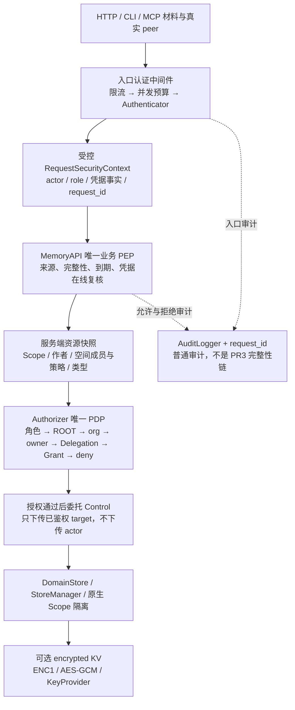

# Security 安全功能使用指南

最近一次修订日期：2026-10-14

安全功能覆盖入口认证、业务授权、Scope 隔离、凭据撤销、资源保护、静态加密、审计和日志脱敏。
本文说明各项能力在哪一层生效、如何配置与调用，以及出现拒绝、撤权、加密或关闭问题时如何排查。

认证、授权、加密和审计分别保护不同边界，并不是一个默认全开的开关。
DEV、加密 KV 或 `healthz` 成功都不能代表生产安全能力已经完整启用。

配置与接口以对应版本源码为准，主要入口包括：

- [公开 API 与装配入口](../../../jiuwen_memory/api/__init__.py)
- [安全装配辅助](../../../jiuwen_memory/api/access_security.py)
- [SecurityRuntime](../../../jiuwen_memory/common/security/runtime.py)
- [Authenticator](../../../jiuwen_memory/common/security/authentication/base.py)
- [PrincipalKeyStore](../../../jiuwen_memory/common/security/authentication/key_store.py)
- [请求安全上下文](../../../jiuwen_memory/common/security/request_context.py)
- [Authorizer 契约](../../../jiuwen_memory/common/security/authorization/base.py)
- [密码学与密钥契约](../../../jiuwen_memory/common/security/cryptography/base.py)
- [加密 KV 实现](../../../jiuwen_memory/storage/kv_impl/encrypted_kv_store.py)
- [接入认证中间件](../../../jiuwen_memory_entry/core/auth_middleware.py)

配置的通用组织与引用规则见 [Config 配置与装配指南](config.md)，控制层与存储层接口见
[Control 层 API](control.md) 和 [Storage 层 API](storage.md)。

## 1. 适用版本与能力状态

> 当前上游 `mem2.0` 已合入 PR1。PR2、PR1-1 和 PR3 已在各自实现分支落地，但尚未共同
> 合入上游。本文保留这些已实现能力的使用说明，并在章节标注适用版本；不能把不同分支的
> 配置合在一起当作一个已交付的安全发行版。

| 版本或分支 | 已实现内容 | 使用边界 |
|---|---|---|
| 上游 `mem2.0`（PR1） | DEV/API Key/Trusted 认证、主体凭据、入口保护、密码学与显式加密 KV、普通审计、基础日志脱敏 | API 业务授权仍使用旧 PermissionManager；SecurityRuntime 的 Authorizer 占位不执行终局判定 |
| `sec/isolation`（PR2） | 唯一 PEP/PDP、Grant/Delegation、空间两轴、返回快照隔离、代理代写、公开 Server 装配及关闭屏障 | 本文业务授权和 `assemble_server_runtime` 示例的主线版本；尚未合入上游 |
| `sec/storage-encryption`（PR1-1） | 全后端静态加密策略、KV/FS 应用加密、索引与控制库部署保护 | 独立版本，不含当前 PR2、PR3 或最新文档模式 |
| `sec/audit`（PR3） | 链式审计、完整性验证与本地 MAC | 独立版本仍基于较早 PR2，不含当前 PR2 后续整改、PR1-1 或最新文档模式 |

| 能力 | 启用条件或当前限制 |
|---|---|
| PR1 认证、主体凭据、入口保护、显式 KV 加密 | 已合入上游；是否启用由配置决定 |
| PR2 业务授权与隔离 | 需要 `sec/isolation` 的实现，不能仅在上游添加 Authorizer 配置 |
| 普通审计记录与查询 | 已合入上游；默认 SQLite `:memory:`，持久路径须显式配置 |
| PR1-1 全后端静态加密 | 需要 `sec/storage-encryption`；上游及 PR2 尚无统一开关或 EncryptedFS |
| PR3 审计完整性 | 需要 `sec/audit`；PR2 未装配 provider 时返回 `unsupported` |
| PR3 外部锚点 | 有核对契约，但无内置 WORM/KMS/云锚点产品、YAML target 或自动发布链头作业 |
| 主体 Key 与动态委托的网络管理接口 | 尚无 HTTP/CLI/MCP 签发、角色变更或动态委托管理产品入口 |
| Markdown/shadow 静态加密 | 新文档模式未与 PR1-1 合并，不在全后端加密的已覆盖范围 |

后续安全 PR 合入时更新本页的适用状态、配置和使用示例。特性设计、决策与遗留维护在
`docs/features/common/F04-security-interfaces-and-encryption.md`；本文是使用指南，不另建
安全特性总纲，也不修改冻结接口。

## 2. 生效层与模块

下图是 PR2 的完整请求链路。当前上游 PR1 只消费入口认证与保护，业务判定仍走
PermissionManager；不能把图中的 Authorizer、来源复核与同源关闭屏障视为上游已启用。



| 能力 | 生效位置 | 使用者必须知道的边界 |
|---|---|---|
| 凭据归一 | `jiuwen_memory_entry/core/auth_middleware.py::credentials_from_headers` | Bearer 优先，兼容 X-API-Key；不从 JSON 读 actor/role |
| 认证前保护 | `jiuwen_memory_entry/core/auth_middleware.py::authenticated` | limiter → guard → authenticate；guard 在 finally 释放 |
| DEV/API Key/Trusted | `jiuwen_memory/common/security/authentication/` | 同一 Authenticator 契约；行为差异通过 capability，不靠封闭模式名分支 |
| 主体 Key | `jiuwen_memory/common/security/authentication/key_store.py` 及 memory 实现 | Argon2id 验证与指纹撤销；当前内置后端仅 memory |
| 上下文来源 | `jiuwen_memory/common/security/request_context.py` | new_request_context/internal_context 受控构造；不是同进程恶意插件沙箱 |
| PEP | api/memory_api_impl/pep_ops.py 与各操作 mixin | 所有业务副作用前先验上下文、到期与需复核的凭据 |
| PDP | authorization/authorization_impl | standard、space_aware、routing；不自行读协议/payload/ContextVar |
| 同源绑定 | api/memory_api_impl/assembly.py | Server 通过公开 assemble_server_runtime 获得已绑定结果，不访问私有钩子 |
| Grant 管理 | api/memory_api_impl/admin_ops.py + GrantManagementCapability | 单一可写真源；原子创建、真实 grantor 判权、条件撤销 |
| 私有代理装配 | security/_delegation_binding.py + PEP/PDP | 可信指纹绑定现有 Delegation；不从目标 Scope 推导用户 |
| 空间两轴 | security/space_roles.py、SpaceAwareAuthorizer、API space_ops | Control SpaceManager/Membership 只提供可信事实；metadata 不得覆盖 |
| 返回对象隔离 | API query_ops/admin_ops | get 最终版本、list 本次快照、inspect/trace 每个祖先逐条判权 |
| dreaming 持续授权 | API dreaming/dreaming_security | 注册、tick、恢复、fan-out；不保存原始凭据、不恢复续期 |
| 原生存储隔离 | Storage 的 Scope 命名空间/过滤 | 索引过滤与 API 授权同时保留，不能互相替代 |
| KV 静态加密 | storage/kv_impl/encrypted_kv_store.py | 只保护经过此端口的 KV value；密码学算法在 security/cryptography |
| 普通审计 | common/audit + 入口/API/Governor | 实际 actor/action/decision/request_id；审计库本身不是匿名或防篡改链 |
| 日志脱敏 | common/log 及各消费点 | 标记敏感参数并过滤；不是自动清除一切任意字符串日志 |
| 资源关闭 | MemoryRuntime、SecurityRuntime、SecurityResourceOwner、IngestJobController | 先完成后台使用者，再关闭共享依赖；重复释放按 identity 去重 |

## 3. 本地快速开始（PR2）

安装按仓库根布局，不往空 src 目录放代码。

```bash
pip install -e ".[dev,security]"
# 需要 MCP 时另外安装：pip install -e ".[mcp]"
```

下面是仅供本地开发的完整 Python 例子。使用默认内存数据面与 echo/hashing，不需要模型或外部数据库。DEV 无映射时固定身份为 `org=local,user=developer,role=ROOT`，并不适用于生产。

```python
from jiuwen_memory.api import (
    Context, Scope, assemble_server_runtime, internal_context,
)

config = {
    "security": {
        "default": {
            "target": "standard",
            "params": {"authenticator": {"target": "dev"}},
        }
    }
}
runtime = assemble_server_runtime(config=config)
try:
    security = internal_context(runtime.security_runtime.authenticator)
    target = Scope(org="local", user="developer")
    unit = runtime.api.add("local security demo", target, security=security)[0]
    assert runtime.api.get(unit.id, target, security=security).content == "local security demo"
    result = runtime.api.search(
        "security demo", Context(scope=target), security=security, with_trajectory=True,
    )
    assert result is not None
finally:
    runtime.close(wait=True)
```

`internal_context` 只接收一个认证器，内部使用空 Credentials。它适合显式 DEV/受信内部调用，不是网络请求的 API Key 验证捷径。API Key、映射 DEV、Trusted 应先调用认证器的 authenticate，再构造受控上下文。

同步 add 等方法有内部异步桥接；已有 asyncio loop 时使用已提供的 add_async/batch_add_async 等异步入口。不存在公共 search_async 方法，不要凭命名推导接口。

### 3.1 HTTP 与 CLI

以下固定 DEV 命令也适用于当前上游 PR1；仅用于回环开发测试。

```bash
scripts/run-server.sh --auth-mode dev --host 127.0.0.1 --port 8137

curl -i -X POST http://127.0.0.1:8137/v1/add \
  -H 'Content-Type: application/json' \
  -d '{"content":"local demo","scope":{"org":"local","user":"developer"}}'

scripts/run-cli.sh --auth-mode dev add \
  --content "local demo" \
  --scope '{"org":"local","user":"developer"}'
```

这是固定 DEV 身份，不需要 token，但服务必须限制回环。Windows 可在 PowerShell 中使用仓库 venv，并设置 `$env:PYTHONPATH` 为“仓库根;jiuwen_memory_entry/core”，再执行对应 `python -m jiuwen_memory_entry.http_server` 或 CLI 模块；HTTP JSON 引号按所用 shell 转义。

CLI 默认本地内存配置一条命令一个进程，第二条命令不会自动看见第一条的记忆或内存 Key。需要持久 Store、NDJSON batch 的同一会话，或者长命 HTTP 服务。

## 4. 配置的两层包装

服务配置文件使用外层 `memory_api`，例如：

```yaml
profile: local-security
memory_api:
  security:
    default:
      target: standard
      params:
        authenticator: {target: dev}
```

Python `assemble_runtime(config=...)`（上游）和 `assemble_server_runtime(config=...)`（PR2）只传内层 mapping。不能把 profile/http/memory_api 的整个服务配置当成内核两级命名空间。

需要特别检查以下三种行为：

1. 外层 profiles 多文件浅覆盖：后文件的 memory_api 可能整体取代前文件安全段。内核与默认配置的 namespace/name 合并是另一回事；实例 params 也不是逐字段深合并。
2. HTTP/CLI/MCP 的 config_loader.load_layer 支持 JSON/YAML 及 `${VAR}` / `${VAR:-默认}` 展开；不要照抄其旧注释误以为 CLI 不展开。
3. SDK 普通 dict、或 yaml.safe_load 后直接传 mapping，不会自动展开环境占位符。`${ROOT_API_KEY}` 可能被当成字面 Key；SDK 应显式使用 `os.environ[...]` 或已经正确展开的 mapping。

拓扑由 Producer 注册 target 和具名引用决定，不接受任意 Python import path。没有 security 配置时不自动创建 DEV；required 入口业务请求失闭。

## 5. 三种认证模式

### 5.1 DEV

固定 DEV 产出 `local/developer` ROOT。映射模式则把测试 selector 放在 api_key 材料中，匹配服务端预设 actor/role；未知或缺失 selector 拒绝，不回退固定 ROOT。

```yaml
authenticator:
  demo:
    target: dev
    params:
      identities:
        demo-alice: {actor: {org: demo, user: alice}, role: user}
        demo-bob: {actor: {org: demo, user: bob}, role: user}
```

actor 的 org 必须非空，user 与 agent 恰好一个非空；session 挂在已有主体下。资源 Scope 可以表达更复杂归属，但不能作为认证 actor 直接传入。
上方映射片段还必须让 `security.default.params.authenticator: demo` 指向它；只新增 demo
命名实例但仍选择固定 DEV，不会切换成 Alice/Bob。

`--auth-mode dev` 只在未声明 security 时补配置，不会覆盖已有 API Key/Trusted 部署。HTTP 可配置 `http.dev_identities` 映射；CLI 远程 `--server` 不接受本地 `--auth-mode dev` 或 `--config`，认证必须由服务端决定。

### 5.2 API Key

认证与主体 KeyStore 已在上游 PR1 实现。下面的服务配置只使用 PR1 能力；业务访问是否获准
仍取决于该版本的 PermissionManager。完整的角色、撤权和资源授权链路需要 PR2。

内置 API Key 认证支持部署级 Root Key，以及由 PrincipalKeyStore 管理的主体 Key。

```yaml
# 完整服务外层示例；属于单进程原型，不是持久化凭据产品完成声明。
memory_api:
  security:
    default:
      target: standard
      params:
        authenticator: issuer
        rate_limiter: ingress
        workload_guard: auth_budget
        binding_policy: default
  authenticator:
    issuer:
      target: api_key
      params:
        key_store: principals
        root_api_key: ${AGENT_MEMORY_ROOT_API_KEY}
  key_store:
    principals: {target: memory}
  rate_limiter:
    ingress:
      target: token_bucket
      params: {capacity: 30, refill_per_sec: 5, max_tracked: 10000}
  workload_guard:
    auth_budget: {target: semaphore, params: {max_concurrent: 4}}
  binding_policy:
    default: {target: loopback}
```

Root Key 认证为 `system/root` ROOT；它不由主体 Store 签发，主体 issue 不允许 ROOT。Root Key、网关 Key 和加密根密钥是不同用途的材料，不能复用。

主体 Key 的明文只在 issue 返回一次，服务端保存验证材料和 SHA-256 指纹。内置 memory Store 用 Argon2id，4 次、128 MiB、parallelism=2；缺 argon2-cffi 装配拒绝，不降级明文或单轮 hash。未命中补 dummy verify 降低前缀侧信道。

当前只有内置 memory 主体 KeyStore，重启失效。配置 SQLite Grant/Delegation 不会让主体 Key 变持久。生产若需要可靠凭据持久化，应实现遵守契约及在线撤销能力的插件和受信管理入口，不能用探测 `_records` 的临时脚本冒充产品方案。

#### 5.2.1 受信凭据管理（上游 PR1）

下面是服务端受信凭据管理示例，不是 HTTP endpoint，也不是要求 Access 层 import 内核实现。Role/fingerprint 来自公共安全契约；key_store property 是内置 ApiKeyAuthenticator 的公开属性，不是所有第三方 Authenticator 的必备成员。

下面只验证当前上游已经实现的签发、认证和撤销。示例使用公开装配辅助，不访问私有
Factory、注册表字段或 Runtime 内核字段；它不宣称 PR1 已完成缓存上下文的业务撤权。

```python
import secrets
from jiuwen_memory.api import (
    AuthenticationError, Credentials, Scope, build_configured_security_runtime,
)
from jiuwen_memory.common.security.authentication.key_store import fingerprint
from jiuwen_memory.common.security.types import Role

config = {
    "security": {"default": {"target": "standard", "params": {"authenticator": "issuer"}}},
    "authenticator": {"issuer": {"target": "api_key", "params": {
        "key_store": "principals", "root_api_key": secrets.token_urlsafe(32),
    }}},
    "key_store": {"principals": {"target": "memory"}},
}
runtime = build_configured_security_runtime(config)
try:
    issuer = runtime.authenticator
    actor = Scope(org="demo", user="alice")
    token = issuer.key_store.issue(actor, Role.USER)
    assert issuer.authenticate(Credentials(api_key=token)).actor == actor
    issuer.key_store.revoke(fingerprint(token))
    try:
        issuer.authenticate(Credentials(api_key=token))
    except AuthenticationError:
        pass
    else:
        raise AssertionError("a revoked key must not authenticate")
finally:
    runtime.close()
```

#### 5.2.2 缓存上下文的在线撤销（PR2）

以下示例同时验证已签发的请求上下文在撤权后不能继续读记忆，需要 PR2 的公开
`assemble_server_runtime` 与 PEP 在线复核能力。

```python
import secrets
from jiuwen_memory.api import (
    Credentials, PermissionDeniedError, Scope, Surface,
    assemble_server_runtime, new_request_context,
)
from jiuwen_memory.common.security.authentication.key_store import fingerprint
from jiuwen_memory.common.security.types import Role

config = {
    "security": {"default": {"target": "standard", "params": {"authenticator": "issuer"}}},
    "authenticator": {
        "issuer": {"target": "api_key", "params": {
            "key_store": "principals", "root_api_key": secrets.token_urlsafe(32),
        }}
    },
    "key_store": {"principals": {"target": "memory"}},
}
runtime = assemble_server_runtime(config=config)
try:
    authenticator = runtime.security_runtime.authenticator
    actor = Scope(org="demo", user="alice")
    token = authenticator.key_store.issue(actor, Role.USER)
    auth = authenticator.authenticate(Credentials(api_key=token))
    security = new_request_context(auth, surface=Surface.SDK)
    unit = runtime.api.add("private demo", actor, security=security)[0]
    authenticator.key_store.revoke(fingerprint(token))
    try:
        runtime.api.get(unit.id, actor, security=security)
    except PermissionDeniedError:
        pass
    else:
        raise AssertionError("cached context must fail after the key is revoked")
finally:
    runtime.close()
```

不要打印 token/Root Key/验证 hash。真实生产材料从 secret 管理渠道获取；随机示例只在本进程有效。

PR2 中，通用插件通过公开 CredentialSourcesCapability 声明 `(credential_type, issuer, Store)`，PEP Registry 绑定认证器实际签发真源。更换认证器会替换旧 issuer 注册，不能额外创建一套同名但不同对象的 KeyStore。

当前没有 `/v1/issue_key`、`list_keys`、`set_role` 等 HTTP/CLI/MCP 方法。MANAGE_PRINCIPAL 枚举也不能证明这些入口存在。Store 的受信公共方法包括 issue/resolve/revoke/get_role；同主体活跃 Key 角色不一致时拒绝新签发，管理方需保存指纹清单并先撤销旧 Key，再签发新角色。

### 5.3 Trusted 网关

把 authenticator target 配为 trusted，引用 principals KeyStore，并配置 gateway_key。身份由受信网关注入：

| Header | 内容 |
|---|---|
| Authorization: Bearer 或 X-API-Key | 网关共享 gateway_key |
| X-Org-Id | 组织 |
| X-Principal-Type | user 或 agent |
| X-Principal-Id | 该主体 ID |

角色从服务端注册表查，不接受 X-Role 或 payload 的 role。主体必须预先注册；网关 Key 不对或主体未注册均拒绝。

```yaml
authenticator:
  issuer:
    target: trusted
    params:
      key_store: principals
      gateway_key: ${AGENT_MEMORY_GATEWAY_KEY}
```

默认缺 gateway_key 拒绝装配。`allow_no_gateway_key=true` 只表示明确选择由可信反代/mTLS/网络隔离承担边界，不是推荐默认；否则任何能直连的人可自述网关身份。

真实 peer 来自 socket，不采信 X-Forwarded-For/X-Real-IP。反代后 peer 可能集中到代理地址，影响限流桶，这需要部署容量规划，不应通过信任客户端转发头绕过。

PR2 中 Root Key 与 Trusted 的 credential_status_required=false；有指纹不等于 PrincipalKeyStore.revoke 能废弃它们所有旧上下文。轮换需重新装配相应认证器，并复核长寿后台注册身份的处置。

## 6. 授权和隔离（PR2）

### 6.1 标准判定与可信上下文

StandardAuthorizer 的顺序为管理角色闸门 → ROOT → org 硬边界 → owner-cover → Delegation → Grant → 默认拒绝。普通 Grant/Delegation 不绕过管理角色闸门；非 ROOT 不跨 org。ADMIN 有组织管理能力，不代表自动可读所有用户正文。

认证 actor 只来自 `security.auth.actor`，目标 scope 表示要操作的资源。不能从目标 Scope 形状、空 Scope、ContextVar 或客户端 metadata 推导 ROOT/代理身份。

PEP 先验证受控来源、actor 完整性、认证期限和需在线复核凭据，再读空间/业务事实或产生 fallback space 等副作用。Scope 本身是可变模型，因此边界复制快照并绑定完整值；构造上下文后改 actor 会导致拒绝。

来源证明不是同进程沙箱。受信插件能调用受控构造器，防恶意插件需要进程/权限隔离，不能仅依赖 Python 私有名或 HMAC。

### 6.2 Grant 分享与撤销

当前管理域只有一个共享 GrantStore，管理写入与实际 PDP 判定同源。singular/plural 方法是同一真源的两种视图，不是扇出事务协议。

下面的完整本地示例验证 Bob 无权 → 授权可读 → 撤销拒绝。DEV 映射只用于测试身份，不赋予两人 ROOT。

```python
from jiuwen_memory.api import (
    Action, Credentials, Grant, PermissionDeniedError, Scope, Surface,
    assemble_server_runtime, new_request_context,
)

config = {
    "security": {"default": {"target": "standard", "params": {"authenticator": "demo"}}},
    "authenticator": {"demo": {"target": "dev", "params": {"identities": {
        "demo-alice": {"actor": {"org": "demo", "user": "alice"}, "role": "user"},
        "demo-bob": {"actor": {"org": "demo", "user": "bob"}, "role": "user"},
    }}}},
    "grant_store": {"default": {"target": "sqlite", "params": {"db_path": ":memory:"}}},
    "delegation_store": {"default": {"target": "sqlite", "params": {"db_path": ":memory:"}}},
}
runtime = assemble_server_runtime(config=config)
def security(selector):
    auth = runtime.security_runtime.authenticator.authenticate(Credentials(api_key=selector))
    return new_request_context(auth, surface=Surface.SDK)
try:
    alice, bob = security("demo-alice"), security("demo-bob")
    target = Scope(org="demo", user="alice")
    unit = runtime.api.add("Alice uses Python", target, security=alice)[0]
    try:
        runtime.api.get(unit.id, target, security=bob)
    except PermissionDeniedError:
        pass
    else:
        raise AssertionError("Bob must not read before a grant")
    granted = runtime.api.grant(Grant(
        grantor=target, grantee=bob.auth.actor, actions=frozenset({Action.READ}),
    ), security=alice)
    assert granted.grant_id
    assert runtime.api.get(unit.id, target, security=bob).content == "Alice uses Python"
    runtime.api.revoke(granted, security=alice)
    try:
        runtime.api.get(unit.id, target, security=bob)
    except PermissionDeniedError:
        pass
    else:
        raise AssertionError("Bob must not read after revocation")
finally:
    runtime.close()
```

保存 grant 返回的服务端 grant_id；revoke 传返回对象即可。撤销按 ID 读取真实 grantor 并原子绑定目标，修改请求中的 grantor 不会改变判权依据。未知 ID/重复撤销幂等，无 ID 不是有效撤销请求。

Store 的 create_grant 按 ID 幂等，不代表新的网络 grant 请求自动去重；丢失响应后重试可能生成另一 ID。不要把接口行为宣传为恰好一次网络提交。

第三方旧 GrantStore 可以用于只读 PDP，但 grant/revoke 需要公开 GrantManagementCapability，不能要求私有 `_get_for_revoke/_revoke_bound`。`globals.require_grant_management=true` 让缺能力在装配时失败；默认 false 保留只读插件兼容。多个不同管理 Store 始终拒绝，不采用无法保证的补偿扇出写入。

HTTP 形状：

```json
{
  "grant": {
    "grantor": {"org": "demo", "user": "alice"},
    "grantee": {"org": "demo", "user": "bob"},
    "actions": ["read"]
  }
}
```

POST `/v1/grant`，Bearer 在 header 中。revoke 请求仍有 grant 对象并带 grant_id；业务 JSON 不接受 security、identity、actor、acting_user 等自述身份。

### 6.3 空间两轴与最小空间示例

启用空间内容治理需要 `authorizer.default=space_aware` 包装具名 standard，并选择支持非空 space 的 CloudEngine。不能在 PR2 里仅配置旧 `permission=space_aware` 就认为内容授权生效。

| 轴 | 角色 | 作用 |
|---|---|---|
| 内容 | none / viewer / contributor / editor | 无内容权、只读、可贡献且改删限自己作者、可改删空间内任意条目 |
| 治理 | none / manager / owner | 管理成员与策略；owner 另具空间删除能力；不自动赋予正文读取权 |
| 组织角色 | USER / ADMIN / ROOT | 管理角色闸门，不能与空间 manager 混称 admin |

owner-cover 根据服务端 principal_path 解释 user_agent 或 agent_user；两条轴不可用简单“管理员最大”混成一轴。成员授予不能超过当前授予上界，自提禁止仍适用；ROOT 有明确例外。

下面是内核 mapping 的 YAML，可在服务文件外包 `memory_api:`。只用于本地 DEV，需与同名示例中的 Python 对应。

```yaml
security:
  default:
    target: standard
    params: {authenticator: demo, authorizer: default}
authenticator:
  demo:
    target: dev
    params:
      identities:
        demo-ops: {actor: {org: demo, user: ops}, role: admin}
        demo-alice: {actor: {org: demo, user: alice}, role: user}
        demo-bob: {actor: {org: demo, user: bob}, role: user}
engine:
  default:
    target: cloud
    params:
      ingestor: default
      index_builder: default
      retriever: default
      scheduler: default
      evolver: default
      lifecycle: default
      job_factory: default
authorizer:
  default: {target: space_aware, params: {delegate: standard}}
  standard:
    target: standard
    params: {grant_store: default, delegation_store: default}
grant_store:
  default: {target: sqlite, params: {db_path: ":memory:"}}
delegation_store:
  default: {target: sqlite, params: {db_path: ":memory:"}}
```

将上方内核 YAML 保存为 `space-security.yml`，再执行下面代码：

```python
import yaml
from jiuwen_memory.api import (
    Credentials, Scope, SpaceMember, SpaceSpec, Surface,
    assemble_server_runtime, new_request_context,
)

# 此文件是上方内核段，不含环境占位符；服务外层文件应取 data["memory_api"]。
with open("space-security.yml", encoding="utf-8") as config_file:
    memory_api_config = yaml.safe_load(config_file)
runtime = assemble_server_runtime(config=memory_api_config)
def security(selector):
    auth = runtime.security_runtime.authenticator.authenticate(Credentials(api_key=selector))
    return new_request_context(auth, surface=Surface.SDK)
try:
    ops, alice, bob = security("demo-ops"), security("demo-alice"), security("demo-bob")
    runtime.api.create_space(SpaceSpec(
        org="demo", space="team", owner=Scope(org="demo", user="alice"),
    ), security=ops)
    runtime.api.add_space_member(
        "demo", "team", SpaceMember(scope=Scope(user="bob")), security=alice,
    )
    target = Scope(org="demo", space="team")
    unit = runtime.api.add("Alice uses Python", target, security=alice)[0]
    assert runtime.api.get(unit.id, target, security=bob).content == "Alice uses Python"
finally:
    runtime.close()
```

CloudEngine 是本地可装配的业务引擎，不代表此示例需要远程 Cloud 服务。SpaceMember 默认 contributor；需要 viewer/editor/manager 等角色时显式设置公开字段，不要继续填写旧 role 字符串期待它控制两轴。

HTTP `POST /v1/add_space_member` 的只读成员请求示例：

```json
{
  "org": "demo",
  "space": "team",
  "member": {
    "scope": {"user": "bob"},
    "content_role": "viewer",
    "governance_role": "none"
  }
}
```

调用者仍需相应治理权限，Bearer 不在该 JSON 中。HTTP 解码会把枚举字符串转成类型；
Python 直接构造 SpaceMember 时则传相应 SpaceContentRole/SpaceGovernanceRole 枚举，
不要把字符串当 enum 对象。

类型/策略路由由 RoutingAuthorizer 根据服务端资源事实选择 delegate，必须有安全 fallback；所有 policy 共享同一 GrantStore。路由配置存在但授权器不读空间事实时拒绝启动，不能以关闭校验“让服务先起来”。

### 6.4 返回对象与查询隔离

list 在本次返回分页的同一真源快照逐条 READ；get 对最终 as_of 选定版本重新判权；inspect/trace 对每个返回祖先判权。仅检查请求 ID、请求 Scope 或预读作者不够。

系统 Scope/权限过滤与用户 filters 外层 AND，不能被 OR 覆盖。无权资源、未知类型路由、跨 org 或失效委托不能通过搜索参数扩大范围。debug 时先看实际返回快照与系统谓词，不先把 filter 或权限兜底改成放行。

## 7. 受控代理代写（PR2）

当前采用私有可信服务端装配过渡，不增加冻结网络接口。已认证凭据的指纹绑定既有 DelegationStore 记录，由 PEP/PDP 逐次复核。真实 actor 仍是单主体 agent，不改成被代理用户；作者归属可从有效委托派生，审计始终记录真实 actor。

此配置是空间示例的增量片段，不能单独启动；适用于 PR2。在空间示例中添加 DEV 映射 `demo-agent`，actor 为 `{org: demo, agent: agent1, session: session1}`、role=user；在 `security.default.params` 加以下字段。指纹是公开测试 selector `demo-agent` 的 SHA-256，不是真实生产 token：

```yaml
delegation_store: default
delegation_bindings:
  7a281dacac30cea2f30d7c8f489ab9c046efb0f2215c0e4218c58c182a9c28b4: alice-agent1
delegations:
  - delegation_id: alice-agent1
    delegator: {org: demo, user: alice}
    delegate: {org: demo, agent: agent1, session: session1}
    actions: [read, write]
    expires_at: "<服务端生成的未来有限期 ISO-8601 时间，包含时区>"
    allowed_spaces: [team]
    bound_credential_id: 7a281dacac30cea2f30d7c8f489ab9c046efb0f2215c0e4218c58c182a9c28b4
    bound_session: session1
```

到期时间应在服务端用当前 UTC 加明确有限期限生成，不能把上面的占位符直接作为运行配置。绑定的 Store 必须与 Authorizer 的实际委托源是同一个对象；相同连接串但不同实例不满足同源。

复核包括撤销、到期、动作、空间、凭据、session，以及委托人的当前内容权。委托不借出治理权、不自动创建 fallback 空间。代理写入后的 author_principal 可为 `user:alice`、author_agent 为 `agent1`，但 auth.actor.user 仍为空。

禁止客户端从 header/payload 指定 delegation_id、acting_user 或 `_delegator.*` 事实来提权；后者只允许服务端可信投影。动态创建/撤销委托的网络管理接口当前没有，正式产品化需另立接口决策。

## 8. 入口资源保护与传输

| 保护 | 配置/边界 | 结果 |
|---|---|---|
| RateLimiter | token_bucket.capacity/refill_per_sec/max_tracked；网络真实 peer | 耗尽 429，不以攻击者可换的 API Key 分桶 |
| WorkloadGuard | semaphore.max_concurrent；认证阶段预算 | authenticate 结束后 finally 释放，不覆盖后续记忆业务/LLM；满槽快速拒绝 |
| BindingPolicy | loopback + Authenticator.requires_loopback_binding | DEV 强制回环；非回环不代表 TLS 已启用 |
| HTTP 连接槽 | 当前上限 256 | 保护 ThreadingHTTPServer，满槽拒绝 |
| HTTP body | 默认 4 MiB；读取超时 30 秒；认证后再读正文 | 超限 413，避免未认证上传占用内存 |
| TLS | 模型、Store 各自出站 SSL 参数；服务入站由部署代理承担 | 当前 HTTP listener 没有原生 TLS 参数 |

DEV 因回环 capability 默认 unlimited；API Key 等非回环认证默认 token_bucket。选择逻辑依赖 capability，不识别具体插件 target。HTTP 当前直接把 Runtime guard 交中间件，CLI/MCP 会先按 requires_concurrency_guard 选择；不能把认证预算描述成全请求、所有 surface 完全相同的业务并发限制。并发预算与限流是两种不同保护；不要把无限并发/无界排队作为修复 429 的方法。

API_KEY 能监听非回环不代表可通过明文 HTTP 把 token 公开传输。反代应终止 TLS、限制直接后端访问并正确承担 Trusted 边界。没有 `http.ssl_verify` 这一通用 TLS listener 开关；Store TLS 与模型 TLS 也不是同一配置。

## 9. KV 静态加密

启用加密必须让实际 KV 端口使用 encrypted 装饰器，仅配置 SecurityRuntime.cryptography 不会自动加密数据。

```yaml
# 内核段；服务配置外包 memory_api。
kv_store:
  raw: {target: memory}
  default:
    target: encrypted
    params: {raw_kv_store: raw, cryptography: default}
cryptography:
  default: {target: local, params: {key_provider: default}}
key_provider:
  default:
    target: local
    params:
      key_env: AGENT_MEMORY_ENCRYPTION_ROOT_KEY
      key_file: ""
      create_key_file: false
      key_epoch: 1
```

生产把 raw 换持久后端并按部署管理好密钥；路径/连接串必须与备份和 Scope 命名空间一起核对。可在 `security.default.params.cryptography: default` 引用同一具名 provider，避免加密存储与 Runtime 各建一份。

local 根密钥优先 key_hex → key_b64 → key_env → key_file，必须 32 bytes；环境支持 hex/base64。缺钥默认拒绝；单机开发明确选择 create_key_file=true 才允许创建，不能把丢失旧钥后生成新钥当恢复。

信封为 ENC1 v2、AES-256-GCM，绑定用途、org/Scope、object_id、格式及 key epoch 的 AAD；v1 仅只读兼容。非信封、错误 Scope/object_id、tag 或密钥不对均失败，不存在 allow_plaintext/tag 校验关闭选项。

| 受到保护 | 不自动覆盖 |
|---|---|
| 经过 encrypted KV value 端口的记忆、原文或控制记录 | KV key、全文/向量/实体/图投影、FS 媒体、Markdown、shadow SQLite、普通审计 DB、模型出站内容 |

检索索引和模型处理可能需要明文；应分别做后端 ACL/TLS、磁盘/服务保护、数据最小化与端点可信管理，不能宣传“全链路零明文”。

local `rotate()` 生成新随机根密钥并推进 epoch，但新钥和旧代集合仅在内存，不持久化。轮换后重启可能读不回新密文；生产跨重启轮换应使用能持久管理多代材料的 KeyProvider，而不是直接建议 rotate 后重启。

明文迁移要离线明确执行、备份与验证，不能通过关闭校验或无密钥重新装配来修复。AAD 中 Scope 或 ID 变化也不是简单移动 bytes。

## 10. 全后端静态加密（PR1-1）

本节仅适用于 `sec/storage-encryption`。它把“所有已知持久化后端必须有静态保护”
收敛为装配策略，但不是把所有索引字段加密，更不是密态检索。

| 数据面 | 保护方式与生效位置 |
|---|---|
| 全部具名 KV、独立 message_store、注入 KV、公开 raw KV 端口 | StoreManager 装配统一 ENC1 value 包装，并更新 Producer 共享缓存 |
| 全部具名 memory/local FS | EncryptedFSStore 整对象 ENC1；显式 encrypted target 或全局装配包装 |
| ES 全文/L0/L1/实体、Milvus、pgvector、graph/fusion | 部署侧磁盘/卷或服务端静态加密；应用核对绑定真实位置的 at_rest 声明 |
| 文件型 SQLite audit/旧 permission、space_aware | 部署加密应用目录；SQLite :memory: 无落盘声明要求 |
| 仓库 Docker profile 的 Redis/ES/Milvus/etcd/MinIO/PG、模型缓存和应用控制文件 | Linux 加密 launcher 将持久化 mount 改为核查过的加密根下 bind |

BM25、ANN、过滤、融合仍由原后端执行；解锁后的数据库/应用进程仍可读取明文。
`StoreSecurity.enabled()` 是应用层 Store 能力，不是对远端磁盘的密码学证明。
Markdown/shadow/watchdog 和 PR2 的新 Grant/Delegation Store 尚未与本分支合并，
不能从“全后端”标题推导它们已完成覆盖。

### 10.1 统一开关和本地 API 示例

先用安全方式给进程设置 `AGENT_MEMORY_ENCRYPTION_ROOT_KEY`，值为专用 32 字节
根密钥的 64 字符 hex；不要打印或提交。以下内核 YAML 保存为 `pr1-1-encryption.yml`。
它选择默认内存业务数据面，`permission.allow_all` **仅用于本地离线验证**；
不是生产授权方案，也不能与 PR2 的配置语义混用。

```yaml
globals:
  storage_encryption_enabled: true
  storage_encryption_cryptography: default
  vector_enabled: false
  graph_enabled: false
cryptography:
  default:
    target: local
    params: {key_provider: default}
key_provider:
  default:
    target: local
    params:
      key_env: AGENT_MEMORY_ENCRYPTION_ROOT_KEY
      key_file: ""
      create_key_file: false
permission:
  default: allow_all  # 仅本地离线验证；该分支仍为 PR1 授权链。
```

```python
import yaml
from jiuwen_memory.api import (
    Context, Credentials, DisclosureLevel, Scope, Surface,
    assemble_runtime, build_dev_authenticator, new_request_context,
)

with open("pr1-1-encryption.yml", encoding="utf-8") as config_file:
    config = yaml.safe_load(config_file)
runtime = assemble_runtime(config=config)
try:
    auth = build_dev_authenticator().authenticate(Credentials())
    security = new_request_context(auth, surface=Surface.INTERNAL)
    scope = Scope(org="local", user="developer")
    units = runtime.api.add("project zephyr launch plan", scope, security=security)
    result = runtime.api.search(
        "zephyr", Context(scope=scope),
        disclosure=DisclosureLevel.L2, security=security,
    )
    assert units and result.items
finally:
    runtime.close(wait=True)
```

统一开关默认 false，只接受 bool 或 true/false 字符串；数字 1、yes、None 拒绝。
它和 provider 选择是装配期策略，不支持热切换。已显式 encrypted 不二次包装；
同 raw 引用不同 provider 拒绝；开启时 KV/FS 的 new_instance=true 拒绝。
直接绕过标准 API/StoreManager 使用原生构造器或 Producer，不会自动获得保护。

持久 KV 可在本例中另配 sqlite/redis/postgres；正文可持久化不等于默认内存全文/
向量索引也随重启恢复。关闭统一开关不拆除显式 encrypted，也不解密历史 ENC1。

### 10.2 持久化索引的部署声明

下例是**运营方已经核查远端静态加密后**填写的服务端配置片段；必须换成真实
地址和核查记录，不能靠复制 reference 来宣称后端安全。

```yaml
fulltext_store:
  default:
    target: elasticsearch
    params:
      hosts: https://es.example.com:9200
      at_rest:
        method: backend
        reference: ops/change-123/encryption-verification
        bindings: {hosts: "https://es.example.com:9200"}
```

method 仅 volume/backend；reference 非空；bindings 的键集合与实际地址/目录
全等。每个具名端口、L0/L1 都校验：ES hosts（实体兼容 endpoint）、Milvus uri、
pgvector dsn、graph working_dir、fusion 的 uri+working_dir、SQLite db_path。
内存索引与 :memory: 无落盘要求；未知持久化 target 必须先扩展位置契约。
ConfigSource 不允许初始覆盖或后续热改受保护连接；共享晚绑定键的多实例必须同位置，
index/table/collection 可以不同。更换位置需重新核查并重装配。

### 10.3 FS 消费方式与限额

开启统一开关时，普通 `fs_store.default: {target: local, params: {root: ./assets}}`
由受管 StoreManager 自动包装；关闭统一开关也能显式配置：

```yaml
fs_store:
  default:
    target: encrypted
    params:
      inner: {target: local, params: {root: ./encrypted-assets}}
      cryptography: default
      max_plaintext_bytes: 67108864
      max_ciphertext_bytes: 0
```

受信存储集成代码从公开 `manager.fs(name)` 获取端口，沿用
`insert(scope, key, binary_stream)`、`get(scope, ref)`、`update(scope, ref, stream)`、
`delete(scope, ref)`。get 返回的新明文流由调用方关闭，输入明文流也由调用方管理；
不能从 MemoryRuntime 私有字段取 kernel 来当公开资产接口。**MemoryAPI 尚无对应
资产上传/下载产品流程。**

新增可选 object_id 能力要求 key/ref/别名/update 后引用对应稳定同一对象；未知后端
不支持时 encrypted 装配拒绝。AAD 绑定五维 Scope、object_id、fs_object 用途与格式版本。
默认明文上限 64 MiB；max_ciphertext_bytes=0 表示明文上限加 4 KiB，不是无限。
采用整对象缓冲，不是 chunked encryption；stat.size 是密文长度，stat 之外仍检查
实际流和解密后长度。明文、篡改、跨 Scope/对象搬运和错误密钥均失败关闭。
路径、Scope 和 KV key 仍可见。

### 10.4 Linux 部署与迁移

真实入口是 `deploy/encryption/volume.py` 的 init/open/check/close，以及
`deploy/encryption/compose.py --profile local|online|postgres --action check|up|ps|down`。
需同宿主 Linux Docker daemon、cryptsetup、findmnt/lsblk、ext4 工具；Windows/
Docker Desktop VM 的宿主挂载不能作为该部署模型的证据。

1. 运维准备新的 LUKS2 镜像或已满足要求的 ext4/dm-crypt 挂载。init 只创建不存在的
   新镜像，不能拿已有数据路径当初始化对象；卷密钥与 ENC1 应用密钥是两份私密文件。
2. 用 volume.py check 核对指定根路径的实际挂载、设备各分支与内部 journal；
   实际使用的数据子目录和控制文件由后续 compose.py 逐项核查，不是根路径检查的递归保证。
3. 目标 profile 的 .env 设置 STORAGE_ENCRYPTION_ENABLED=true、
   STORAGE_ENCRYPTION_ROOT、STORAGE_ENCRYPTION_APPLICATION_KEY_FILE；
   应用密钥文件保存专用的 64 字符 hex。使用加密 launcher，不是直接原 docker compose up。
4. 先运行 compose.py 的 check，再执行 up。注意其 check 也会准备目录、生成配置和
   应用密钥文件，并检查真实 Compose model，**不是纯只读命令**。
5. 首次全新布局 up 要求 --fresh-data。已有 named-volume/KV/FS 数据先停写、备份、
   离线迁移；不能用 --fresh-data 掩盖旧数据尚未迁移。raw 明文转 ENC1 必须读 raw、
   再经 encrypted 写入，不能复制明文字节到新布局。
6. 停服务后再 close 卷。备份、导出、swap、快照和密钥备份需各自保护；应用不持续
   监控管理员在运行中替换挂载的行为。

配置声明与离线 API 验证不能替代真实 LUKS+Docker 部署验收。生产部署还需核查实际
挂载、迁移及恢复路径。该分支源码入口为
`config/encryption.py`、`storage/encryption.py`、`storage/fs_impl/encrypted_fs_store.py`
及 `deploy/encryption/`。本地 provider 的跨重启轮换限制仍然适用。

## 11. 审计与日志

### 11.1 普通审计与日志脱敏

入口拒绝、成功认证与 API 判定事件记录实际 actor、action、target、decision、指纹和服务端 request_id，便于关联 HTTP X-Request-ID、错误响应与普通日志。客户端提交的同名请求 ID 不作为服务端可信 ID。

默认 AuditLogger 为 SQLite `:memory:`，进程重启不会保留；需要持久审计时明确配 audit.default.params.db_path 及保留、访问、备份政策。普通审计记录不是防篡改链，审计库也不会由日志脱敏自动匿名化。

verify_audit 按独立 VERIFY_AUDIT 判权。当前 PR2 无 PR3 provider 时返回验证 DTO 的 `status="unsupported"`；HTTP 可为 200，因为调用成功地报告不支持，而不是“验证 clean”或“接口不存在”。该分支的 provider/专用 guard/参数上限接缝不等于已启用完整性，独立 PR3 的实装方式见下节。

PR1 已提供普通日志脱敏；PR2 在结构化参数与敏感字段标记处继续补齐调用点。普通业务日志不应包含 token、
密钥、hash、完整正文/prompt，debug 材料也应脱敏。PR2 对文档记忆新增的标题、原文、
Evolver prompt/content/Scope 与模型响应 trace 补齐敏感标记；
业务数据不因此改变。该结论仅属于当前 PR2，不表示上游原树所有日志均已安全。

### 11.2 审计完整性（PR3）

`sec/audit` 已实装的链是：入口/API 审计 → ProtectedAuditLogger → chained_hmac
Provider → 同一具名 AuditLogger/ChainedAuditStore。事件全部受保护字段经版本化
规范化，HMAC-SHA256 绑定前序 digest、sequence 与 key epoch。SQLite 原子 CAS
追加与稳定快照/分页验证避免并发分叉；LocalKeyProvider 提供 MAC capability，
用途标签与 ENC1 加密派生隔离。它不是对外不可否认性证明，也不是审计库静态加密。

以下是此分支的**服务配置**，外层 memory_api 保留。先准备 state 目录、专用审计
根密钥和认证 Root Key。普通 dict 不展开 ${...}；通过已有入口配置加载器解析 YAML。
审计根密钥必须使用独立具名实例及独立真实材料，不与认证 Key、ENC1 根密钥共用。

```yaml
memory_api:
  security:
    default:
      target: standard
      params:
        authenticator: issuer
        authorizer: default
        audit_integrity: default
        audit_verify_guard: audit_verify
  authenticator:
    issuer:
      target: api_key
      params:
        key_store: principals
        root_api_key: ${AGENT_MEMORY_ROOT_API_KEY}
  key_store:
    principals: {target: memory}
  audit:
    default:
      target: sqlite
      params: {db_path: ./state/audit-integrity.sqlite3}
  key_provider:
    audit_keys:
      target: local
      params:
        key_env: AGENT_MEMORY_AUDIT_ROOT_KEY
        key_file: ""
        create_key_file: false
        key_epoch: 1
  audit_integrity:
    default:
      target: chained_hmac
      params:
        audit: default
        key_provider: audit_keys
        max_cas_retries: 10
        max_key_retries: 5
        verify_page_size: 1000
        max_samples: 20
  workload_guard:
    audit_verify:
      target: semaphore
      params: {max_concurrent: 1}
  globals:
    audit_verify_max_page_size: 1000
    audit_verify_max_samples: 20
```

该分支 defaults 提供 authorizer.default；也可显式配置 standard 和对应 Grant/
Delegation Store。memory KeyStore 仍有新进程凭据初始化边界，部署 Root Key 是
受控运维凭据，不供普通用户长期共享。AGENT_MEMORY_AUDIT_ROOT_KEY 必须可解码为
32 字节 hex/base64。只有顶层 audit_integrity、没有 security 引用时拒绝启动；
Provider 的 audit 与 API 审计器必须是同一对象，不只是同路径。

audit_verify_guard 不配时装配器会建立独立 semaphore；建议具名配置，不与认证
budget 共用。内存 audit 或 SQLite :memory: 是 test-only；仅本地测试可以在
security.default.params 设置 allow_test_only_security=true，持久链不需要该放行。

调用仍走公开 MemoryAPI.verify_audit、HTTP POST /v1/verify_audit、CLI verify_audit
或 MCP memory_verify_audit。需要根 scope 的 VERIFY_AUDIT 和受信 ROOT；普通
ADMIN 不够。下面请求体没有 scope，也不接受调用方提供 digest/proof/key：

```json
{
  "after_sequence": 0,
  "page_size": 1000,
  "max_samples": 20,
  "anchor_policy": "if_configured"
}
```

HTTP 认证放 Bearer header；CLI 的业务参数是
`verify_audit --after-sequence 0 --page-size 1000 --max-samples 20 --anchor-policy if_configured`。
进程内调用沿用已经取得的受控 security 上下文，对 `api.verify_audit` 传相同四个
关键字参数。此分支实际公开的装配入口是 assemble_runtime；没有当前 PR2 新增的
assemble_server_runtime/ServerRuntime，不能照抄主线新门面或另造一个凭据 Store
来认证。生产接入优先使用该版本现有入口的完整装配流程。

| status/字段 | 使用时的含义 |
|---|---|
| clean | 本次稳定快照的检查范围内证明一致；不代表防回滚已完成 |
| tampered | 内容、proof 或链接不一致 |
| incomplete | 缺证据/历史密钥代、未知格式、记录缺口或没有到达快照链头 |
| rollback_suspected | 本地历史与可信外部锚点冲突 |
| unsupported | 没有装配完整性 provider |
| high_water_mark | 本次连续成功验证到的序号，不是实时变化的当前链头 |
| truncated | 错误样本超过有效上限，不是“全链扫描已经完成”标记 |

增量 after_sequence>0 会验证 checkpoint；不存在时 incomplete，不从 genesis
猜接。判断成功必须读 DTO，tampered/incomplete 的正常返回也可能是 HTTP 200。
当前独立 PR3 的审计错误族没有专用 HTTP 映射，通常按 AgentMemoryError 返回 400，
不能套用“完整性故障一律 503”。

外部 AuditAnchor 契约和 Provider 核对已实装，但没有 WORM/KMS/云锚点产品、YAML
anchor target 或自动发布链头作业。内置 chained_hmac builder 不消费 anchor 配置；
第三方需实现契约、由可信装配显式注入 constructor 的 anchor，并维护可信外部链头。
无锚点的 if_configured 返回 anchor.checked=false；skip 不核对；required 无锚点
实际抛 ValidationError。必须同时看 checked/status：unavailable 不算核对成功，
lagging 只保证匹配的历史前缀，未锚定的最新后缀不获得相同防回滚保证。
**没有外部锚点时，合法历史前缀连同 head 一起回滚无法由本地链独立识别。**

运维及 debug 还需注意：

- 受保护追加失败会归一 AuditIntegrityError 并置 degraded 闩；显式 mutation 在
  副作用前预检，但不保证业务库与审计库跨库原子，不能把错误返回推定为业务必未写入。
- 旧无签名库以 AuditMigrationRequiredError 拒绝；不会自动补签，也未交付离线迁移工具。
  保留并备份证据、明确迁移边界，不通过删除数据库“让它启动”。
- 完整性库缺列/head 不一致/未来版本拒绝，不做 DDL 自愈；不混入普通 record。
  degraded 闩不会因下一条成功自动清除，修复后重建 Runtime，不改私有标记。
- local MAC 历史轮换材料只在内存，重启可能失去旧 epoch；需持久托管 provider
  才能设计生产轮换。链完整性不替代审计库访问权限、静态加密及备份策略。
- 此 PR3 仍叠旧 PR2，未包含最新能力契约、Server 门面、Grant 原子收口和关闭屏障。
  重新基于当前 PR2 时须逐项合并验收，不继承主线已闭环结论。

关键实现为 `common/audit/protected_audit_logger.py`、
`common/audit/audit_impl/sqlite_audit_logger.py`、
`common/security/audit_integrity/audit_integrity_impl/chained_hmac.py` 和
`common/security/cryptography/cryptography_impl/local_envelope.py`。

## 12. MCP、后台任务与关闭

MCP 的传输认证已在 PR1 实现；本节后半的持续授权与共享关闭屏障需要 PR2。

```bash
# 显式本地 DEV；仅供隔离开发环境。
JIUWEN_MEMORY_MCP_AUTH_MODE=dev scripts/run-mcp.sh

# required：仅在同源凭据 Store 已持久化/已在该进程预置主体 Key 时可用。
AGENT_MEMORY_API_KEY='<主体 Key>' scripts/run-mcp.sh security.yml

# Streamable HTTP：逐请求认证，不回退到进程环境 Key。
MCP_TRANSPORT=http MCP_HOST=127.0.0.1 MCP_PORT=8138 scripts/run-mcp.sh security.yml
```

MCP stdio 使用 AGENT_MEMORY_API_KEY，没有网络 peer，不做 IP 限流；HTTP 使用本次 Bearer/trusted headers 和真实 peer。FastMCP ctx 是框架注入参数，不进模型可见 Schema。MCP 版本约束来自当前 pyproject，勿随意跨到不兼容主版本。
内置 memory KeyStore 每个新进程独立，且没有 YAML 导入已有 Key/网络 issue 入口；
另一个进程签发的普通 Key 不能直接用于新启动的 MCP/本地 CLI。上述 required 主体 Key
命令有同源初始化前提，不能配一个全新 memory Store 就期待认证成功。部署 Root Key 可用于
受控运维引导，但不应当作普通客户端凭据长期分发。

dreaming 注册、恢复和每 tick 都走同一 PEP/PDP。后台只保存受控身份/环境事实，不保存原 token；保留原到期时间，恢复不续期。仅有 actor 的旧注册记录不能补猜角色和凭据能力；短命 CLI 不恢复所有长寿周期任务。

关闭需要区分“停止接收”与“任务完成”。当前方案为：

```text
close(wait=False)
  → 停止 watcher 准入并等待已进入 shadow 的同步工作
  → 首次摄入线程池停机请求可不等待
  → 共享关闭回调仍以 wait=True 等已提交/排队任务及终态写入
  → 停 Scheduler / 释放 dreaming leader 锁
  → 停自有后台 loop
  → 按共享所有者清单关闭 shadow 与安全依赖
```

因此 Runtime 的 wait=False 不承诺整体立即返回，会因安全释放等待而阻塞；控制器自身的非等待停机仍可被后续 wait=True 升级。重复 close 不重复释放成功关闭的共享 Store。

使用完自己拥有的 Runtime 调公开 close；不要探测 `_security_runtime/_authorizer/_conn` 来管理生命周期。成功注入的共享安全组合由公开装配句柄统一管理；错误地关闭某个共享视图会关闭共同根，不能继续当健康 Runtime 使用。外部借用资源应明确所有者，不把多个独立包装都当唯一主人。

当前 PR2 已沿用 start/start_background 公开生命周期，ServerRuntime 转发同一入口。
watcher.stop 不仅停 Observer/timers，还等待已进入数据面的 worker；排队旧代工作在停止后
不访问 shadow，等待不依赖宿主 loop 恢复协程。共享安全视图关闭也执行同一屏障。
同步启动失败传回宿主，关闭后拒绝重启，不通过私有 Kernel/Store 字段管理这些资源。

## 13. 错误与排障

下表以 PR2 完整安全链路为主；PR1、PR1-1 和 PR3 的行为差异按前文适用版本核对。

| 现象 | 优先检查 | 不应采用的绕过 |
|---|---|---|
| 401 AuthenticationError | Bearer/X-API-Key；DEV selector；Key 是否注册/撤销；Trusted 头与 gateway_key | payload 自述 actor/role，隐式 DEV |
| 403 PermissionDeniedError | 同 request_id 审计 reason；真实 org/target；角色闸门、空间轴、作者、Grant/Delegation | allow_all、空 Scope 当 ROOT、绕过 PEP |
| 400 ValidationError | 必填/类型；scope.require_space；无 ID revoke；未知 issuer；配置/空间路由组合 | 吞错成空结果，伪造 security JSON |
| 400 UnsupportedCapabilityError | 只读第三方 GrantStore 未声明管理能力 | 私有撤权钩子或降级按 ID 无目标校验 |
| 409 Conflict/PartialFailure | ID/真源冲突；completed/failed/retry_action；空间删除进度 | 未核对部分完成就盲重试或报告全成功 |
| 429 RateLimitedError | 真实 peer 汇聚、容量/refill、auth budget；HTTP Retry-After 当前为 1 | 随机 Key 换桶，无限并发/无界排队 |
| 503 BackendError | 授权/业务后端、连接关闭、队列容量、原异常链 | 将故障变成 403 或“确实无结果” |
| 503 SecurityUnavailable | required 无 security；多文件外层覆盖掉安全段 | 自动 fallback DEV |
| 413 或上传超时 | body 上限、读取超时、认证前准入 | 未认证先读全部正文 |
| verify_audit unsupported | 当前未启用 PR3，是明确状态 | 将 unsupported 写成 clean/防篡改完成 |
| SQLite closed database | 是否持已关闭 Runtime；共享根是否被其它视图关闭；drain 是否完成 | 访问 `_conn` 重开，跳过共享关闭回调 |
| 加密读取失败/503 | 原根密钥/epoch、AAD Scope/ID、信封格式、轮换重启、明文混入 | 新建另一把钥、allow_plaintext、关闭 tag 校验 |
| healthz 200 但业务失败 | healthz 只证明存活；单独查认证、PDP 和实际后端 | 把 healthz 当全链路健康或安全验收 |

普通主体 Key 已撤销却旧上下文仍可读时，先核对 credential_status_required、credential_type/issuer/ID、Registry 来源和实际认证器是否同源；不要先重启或清缓存掩盖真源分叉。Root/Trusted 不走相同在线复核规则，要先辨明凭据类型。

新 bug 的最小记录模板：

```text
源码分支与版本：
部署形态及认证模式：
实际装配 target / 具名实例 / 持久文件：
脱敏 actor、role、target Scope、action：
request_id / job_id / unit_id / grant_id / delegation_id：
预期允许或拒绝以及依据：
实际错误、DenyReason、retryable、ChannelError：
普通主体凭据是否需在线复核（不附原始材料）：
是否文档模式 / 是否已合入最新上游：
最小复现、运行任务状态、共享关闭顺序：
修复及新增回归、实际执行与跳过范围：
```

授权 ID/指纹不是秘密材料，但仍是关联信息，应按问题授权范围保存。不要收集原 token、根密钥、密码 hash、完整用户正文或模型 prompt。

## 14. 配置检查与维护

上线前至少检查以下项目：

1. 确认使用版本与所需安全能力一致，不把独立分支的实现状态当作已合入上游。
2. 核对安全、认证器、凭据 Store、授权器和审计器的实际具名引用，避免分成两套真源。
3. 生产禁用 DEV；API Key/Trusted 的公网入口使用 TLS，并限制后端直接访问。
4. 通过完整请求测试凭据撤销、授权拒绝、跨 Scope 隔离、委托到期和空间权限下降。
5. 核对后台任务与资源关闭顺序；不要用私有字段重开已关闭连接。
6. 分别核查 KV、索引、FS、Markdown/shadow、审计库和备份的静态保护范围。
7. 密钥轮换必须验证跨重启读取与恢复；local provider 的内存轮换不等于生产持久轮换。
8. 对完整性验证读取 DTO 的状态与锚点检查结果，不以 HTTP 200 代替验证成功。

本页随安全实现 PR 和使用反馈同步维护配置、API、能力状态及排障说明。
详细复现、验收和临时执行记录不写入本文；接口契约变更仍同步对应 specs，设计决策仍维护
F04。安全 PR 合入目标分支后，应实际验证示例与跨层链路，再移除本页相应的版本限制。
