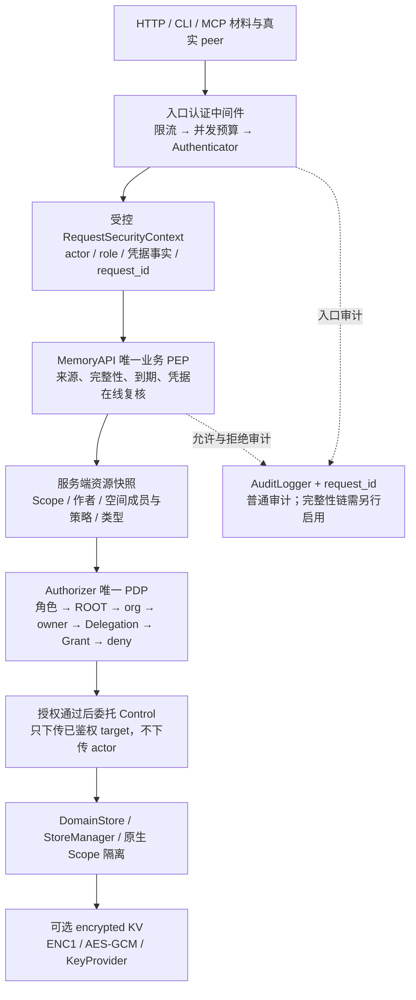

# Security 安全功能使用指南

最近一次修订日期：2026-10-28

配置的通用组织与引用规则见 [Config 配置与装配指南](config.md)，控制层与存储层接口见
[Control 层 API](control.md) 和 [Storage 层 API](storage.md)。

## 1. 使用前确认支持的能力

调用服务前，准备服务地址、本人可用的 Key 和允许访问的 Scope。使用已有服务时，
由服务管理员提供这些信息，并确认已启用哪些安全能力；无需查阅代码修改记录。
自行部署时，按下表确认所用版本支持相应能力，再执行对应章节的配置。

| 能力 | 使用前提与限制 |
|---|---|
| 基础认证 | 支持 DEV、API Key 或 Trusted；生产环境选择 API Key 或 Trusted，配置见第 5 节 |
| 业务授权与隔离 | 服务需支持并启用 Authorizer；用于限制普通用户的访问范围，见第 6 节；仅配置认证不代表已有这项能力 |
| 主体 Key | 由受信服务端代码签发；内置 KeyStore 在内存中，重启失效；Root 管理引导见第 5.2.1 节 |
| Grant 与 Delegation 记录 | 默认在内存中；需要重启保留时显式配置文件型 SQLite，见第 6.2.4 节 |
| 普通审计 | 默认 SQLite `:memory:` 不持久；需保留记录时显式配置文件路径，见第 11.1 节 |
| KV 内容加密 | 需要配置加密 KV 端口与根密钥；不自动覆盖索引与其他文件，见第 9 节 |
| 全后端静态加密 | 需要支持统一加密策略的实现；KV/FS 使用应用加密，索引与控制文件使用部署保护，见第 10 节 |
| Markdown/shadow 静态保护 | 支持统一加密策略时核查 Markdown 根目录和 shadow SQLite 的部署保护与位置绑定；不对 Markdown 正文做 ENC1 包装 |
| 审计完整性 | 需要启用完整性 provider；未装配时验证返回 `unsupported`，不代表验证通过，见第 11.2 节 |
| 外部审计锚点 | 只有集成契约，没有内置 WORM/KMS/云锚点产品或自动发布作业；由部署方完成集成 |

不同部署可能只提供部分能力。增加一段配置不会使不支持该能力的版本自动具备实现，
也不能将多个独立实现的配置直接拼接为一个服务。


## 2. 一次请求如何经过安全检查

以 Alice 读取自己的记忆为例：入口先检查她提交的 Key，得到服务端认可的身份；
再根据请求中的 Scope 找到目标数据，检查 Alice 是否有读取权；通过后才读取数据。
若数据已加密，存储层在读取时解密，正常 API 响应仍是可读正文。审计记录这次调用。

客户端提交的 Scope 只表示“想访问哪里”，不会把调用者变成该 Scope 的主人。
例如 Bob 把请求改成 Alice 的 Scope，启用业务授权后，服务仍会按 Bob 的真实身份检查权限。

<details>
<summary>需要排查实现时，展开查看请求链路与模块位置</summary>

下图展示已启用业务授权的完整请求链路。只支持基础认证的实现仍走旧 PermissionManager；
配置认证不代表图中的 Authorizer、上下文复核与共享资源关闭屏障都已启用。
图中的 PEP 是执行权限检查的入口，PDP 是作出权限判定的组件；具名实例指配置中
有名字、可被其他组件引用的同一份对象。



| 能力 | 生效位置 | 使用者必须知道的边界 |
|---|---|---|
| 凭据归一 | `jiuwen_memory_entry/core/auth_middleware.py::credentials_from_headers` | Bearer 优先，兼容 X-API-Key；不从 JSON 读 actor/role |
| 认证前保护 | `jiuwen_memory_entry/core/auth_middleware.py::authenticated` | limiter → guard → authenticate；guard 在 finally 释放 |
| DEV/API Key/Trusted | `jiuwen_memory/common/security/authentication/` | 同一 Authenticator 契约；行为差异通过 capability，不靠封闭模式名分支 |
| 主体 Key | `jiuwen_memory/common/security/authentication/key_store.py` 及 memory 实现 | Argon2id 验证与指纹撤销；当前内置后端仅 memory |
| 上下文来源 | `jiuwen_memory/common/security/request_context.py` | new_request_context/internal_context 受控构造；不是同进程恶意插件沙箱 |
| PEP | api/memory_api_impl/pep_ops.py 与各操作 mixin | 所有业务副作用前先验上下文、到期与需复核的凭据 |
| PDP | authorization/authorization_impl | standard、space_aware、routing；不自行读协议/payload/ContextVar |
| 同源绑定 | api/memory_api_impl/assembly.py | Server 通过公开 assemble_server_runtime 获得已绑定结果，不访问私有钩子 |
| Grant 管理 | api/memory_api_impl/admin_ops.py + GrantManagementCapability | 单一可写真源；原子创建、真实 grantor 判权、条件撤销 |
| 私有代理装配 | security/_delegation_binding.py + PEP/PDP | 可信指纹绑定现有 Delegation；不从目标 Scope 推导用户 |
| 空间两轴 | security/space_roles.py、SpaceAwareAuthorizer、API space_ops | Control SpaceManager/Membership 只提供可信事实；metadata 不得覆盖 |
| 返回对象隔离 | API query_ops/admin_ops | get 最终版本、list 本次快照、inspect/trace 每个祖先逐条判权 |
| dreaming 持续授权 | API dreaming/dreaming_security | 注册、tick、恢复、fan-out；不保存原始凭据、不恢复续期 |
| 原生存储隔离 | Storage 的 Scope 命名空间/过滤 | 索引过滤与 API 授权同时保留，不能互相替代 |
| KV 静态加密 | storage/kv_impl/encrypted_kv_store.py | 只保护经过此端口的 KV value；密码学算法在 security/cryptography |
| 普通审计 | common/audit + 入口/API/Governor | 实际 actor/action/decision/request_id；审计库本身不是匿名或防篡改链 |
| 日志脱敏 | common/log 及各消费点 | 标记敏感参数并过滤；不是自动清除一切任意字符串日志 |
| 资源关闭 | MemoryRuntime、SecurityRuntime、SecurityResourceOwner、IngestJobController | 先完成后台使用者，再关闭共享依赖；重复释放按 identity 去重 |

</details>

## 3. 本地快速开始

安装按仓库根布局，不往空 src 目录放代码。

```bash
pip install -e ".[dev,security]"
# 需要 MCP 时另外安装：pip install -e ".[mcp]"
```

### 3.1 HTTP 与 CLI

以下命令使用固定 DEV 身份，仅用于本机回环开发测试。

```bash
scripts/run-server.sh --auth-mode dev --host 127.0.0.1 --port 8137

curl -i -X POST http://127.0.0.1:8137/v1/add \
  -H 'Content-Type: application/json' \
  -d '{"content":"local demo","scope":{"org":"local","user":"developer"}}'

scripts/run-cli.sh --auth-mode dev add \
  --content "local demo" \
  --scope '{"org":"local","user":"developer"}'
```

这是固定 DEV 身份，默认角色为 USER，不需要 token，但服务必须限制回环。Windows 可在 PowerShell 中使用仓库 venv，并设置 `$env:PYTHONPATH` 为“仓库根;jiuwen_memory_entry/core”，再执行对应 `python -m jiuwen_memory_entry.http_server` 或 `python -m jiuwen_memory_entry.cli`；HTTP JSON 引号按所用 shell 转义。

CLI 默认本地内存配置一条命令一个进程，第二条命令不会自动看见第一条的记忆或内存 Key。需要持久 Store、NDJSON batch 的同一会话，或者长命 HTTP 服务。

### 3.2 Python SDK（需要业务授权能力）

下面是仅供本地开发的完整 Python 例子。使用默认内存数据面与 echo/hashing，不需要模型或外部数据库。固定 DEV 默认身份为 `org=local,user=developer,role=USER`，并不适用于生产。

```python
from jiuwen_memory.api import (
    Context, Scope, assemble_server_runtime, internal_context,
)

config = {
    "security": {
        "default": {
            "target": "standard",
            "params": {"authenticator": {"target": "dev", "params": {"role": "user"}}},
        }
    }
}
runtime = assemble_server_runtime(config=config)
try:
    security = internal_context(runtime.security_runtime.authenticator)
    target = Scope(org="local", user="developer")
    unit = runtime.api.add("local security demo", target, security=security)[0]
    assert runtime.api.get(unit.id, target, security=security).content == "local security demo"
    result = runtime.api.search(
        "security demo", Context(scope=target), security=security, with_trajectory=True,
    )
    assert result is not None
finally:
    runtime.close(wait=True)
```

`internal_context` 只接收一个认证器，内部使用空 Credentials。它适合显式 DEV/受信内部调用，不是网络请求的 API Key 验证捷径。API Key、映射 DEV、Trusted 应先调用认证器的 authenticate，再构造受控上下文。

同步 add 等方法有内部异步桥接；已有 asyncio loop 时使用已提供的 add_async/batch_add_async 等异步入口。不存在公共 search_async 方法，不要凭命名推导接口。

## 4. 安全参数填在哪里

先分清“启动服务时配置什么”和“每次调用时发送什么”。服务端选择认证、授权、
加密和审计方式；客户端通常只提交自己的凭据，以及要操作的数据与 Scope。

| 参数 | 谁来提供 | 放在哪里 | 示例或说明 |
|---|---|---|---|
| 认证模式、限流、加密组件 | 部署人员 | 服务 YAML 的 `memory_api` 内 | `security.default.params.authenticator: issuer` |
| 认证 Root Key | 部署人员 | 服务进程环境变量，再由 YAML 引用 | `${AGENT_MEMORY_ROOT_API_KEY}`；名称由配置引用决定 |
| 网关共享 Key | 网关与服务部署人员 | 服务配置 `gateway_key`；网关发给后端的请求头 | 不发给普通客户端 |
| 加密根密钥 | 部署人员 | `key_provider` 指定的环境变量或私密文件 | 默认环境变量 `AGENT_MEMORY_ENCRYPTION_ROOT_KEY`；不放请求正文 |
| 调用凭据 | 客户端 | HTTP `Authorization: Bearer <Key>`，兼容 `X-API-Key` | CLI/stdio MCP 通常从 `AGENT_MEMORY_API_KEY` 读取 |
| 网关确认的身份 | 可信网关 | 后端请求头 `X-Org-Id`、`X-Principal-Type`、`X-Principal-Id` | 第 5.3 节说明如何生成与验证 |
| 目标数据范围 | 客户端 | 业务 JSON 的 `scope`，CLI 的 `--scope`，SDK 的 `Scope` | `{"org":"demo","user":"alice"}`；不代表调用者身份 |
| 请求安全上下文 | SDK 的受信接入代码 | Python 方法的 `security=` 关键字参数 | 先认证，再用 `new_request_context` 构造；不能用普通 dict 替代 |
| 调用者角色 | 服务端 | DEV 测试映射或主体凭据注册表 | 不能通过 JSON 的 `role` 或 `X-Role` 自行指定 |

### 4.1 配置文件的外层与内层

服务配置文件使用外层 `memory_api`，例如：

```yaml
profile: local-security
memory_api:
  security:
    default:
      target: standard
      params:
        authenticator: {target: dev}
```

Python 的基础装配入口 `assemble_runtime(config=...)` 和支持业务授权的
`assemble_server_runtime(config=...)` 都只传内层 mapping。不能把 profile/http/memory_api 的整个服务配置当成内核两级命名空间。

需要特别检查以下三种行为：

1. 外层 profiles 多文件浅覆盖：后文件的 memory_api 可能整体取代前文件安全段。内核与默认配置的 namespace/name 合并是另一回事；实例 params 也不是逐字段深合并。
2. HTTP/CLI/MCP 的 config_loader.load_layer 支持 JSON/YAML 及 `${VAR}` / `${VAR:-默认}` 展开；不要照抄其旧注释误以为 CLI 不展开。
3. SDK 普通 dict、或 yaml.safe_load 后直接传 mapping，不会自动展开环境占位符。`${ROOT_API_KEY}` 可能被当成字面 Key；SDK 应显式使用 `os.environ[...]` 或已经正确展开的 mapping。

拓扑由 Producer 注册 target 和具名引用决定，不接受任意 Python import path。没有 security 配置时不自动创建 DEV；required 入口业务请求失闭。

这里的 `target` 是组件实现名称，`params` 是传给该组件的参数。`issuer`、`principals`
等是本配置自己起的实例名：定义后还要被引用才会使用。第 5.2 节给出了完整引用关系。

### 4.2 从服务配置到一次 HTTP/CLI 调用

以第 5.2 节 API Key 服务配置为例，将其保存为 `api-key.yml`。先在**启动服务的终端**
设置 `AGENT_MEMORY_ROOT_API_KEY`；下面以 Root Key 做一次本地运维验证。
本例目标 Scope 使用 Root 身份自身的 `system/root`。
这两个环境变量分别用于服务端和客户端：

- `AGENT_MEMORY_ROOT_API_KEY`：由服务端 YAML 的 `root_api_key` 引用，保存部署级 Root 凭据。
- `AGENT_MEMORY_API_KEY`：由 CLI 等客户端读取，作为请求的 Bearer 凭据发送给服务端。

**本节的本地 Root 测试中，两者使用同一个值，需要显式赋值；程序不会自动同步，
也没有根据 Root Key 派生客户端 Key 的步骤。** 客户端提交这个值时，以 Root 身份认证。

普通用户接入时，由部署方在受信管理代码中校验 Root 身份后，通过
`key_store.issue(actor, role)` 独立随机签发主体 Key（完整引导见第 5.2.1 节），再把返回值提供给客户端的 `AGENT_MEMORY_API_KEY`。主体 Key
不由 Root Key 计算得到，此时两个变量的值不同。认证成功后能访问哪些范围，仍取决于业务授权。

```bash
# Bash：生成本次本地测试的随机 Root Key，不输出其值。
export AGENT_MEMORY_ROOT_API_KEY="$(python -c 'import secrets; print(secrets.token_urlsafe(32))')"
scripts/run-server.sh api-key.yml --host 127.0.0.1 --port 8137
```

PowerShell 中的等价启动方式（仓库根目录，使用已安装依赖的 Python）：

```powershell
$env:AGENT_MEMORY_ROOT_API_KEY = python -c "import secrets; print(secrets.token_urlsafe(32))"
$env:PYTHONPATH = "$($PWD.Path);$($PWD.Path)\jiuwen_memory_entry\core"
python -m jiuwen_memory_entry.http_server api-key.yml --host 127.0.0.1 --port 8137
```

服务运行时另开终端发请求。新终端不会自动继承启动终端刚设置的变量；先通过受保护
渠道，将服务端使用的同一把测试 Root Key 设置为调用终端的 `AGENT_MEMORY_ROOT_API_KEY`，
再按下面命令赋给 `AGENT_MEMORY_API_KEY`。不要在调用终端重新生成另一把随机 Root Key。

```bash
export AGENT_MEMORY_API_KEY="$AGENT_MEMORY_ROOT_API_KEY"

curl -i -X POST http://127.0.0.1:8137/v1/add \
  -H "Authorization: Bearer ${AGENT_MEMORY_API_KEY}" \
  -H 'Content-Type: application/json' \
  -d '{"content":"security parameter demo","scope":{"org":"system","user":"root"}}'

scripts/run-cli.sh --server http://127.0.0.1:8137 add \
  --content 'security parameter demo' --scope '{"org":"system","user":"root"}'
```

PowerShell 可避免手写 JSON 引号转义：

```powershell
$env:AGENT_MEMORY_API_KEY = $env:AGENT_MEMORY_ROOT_API_KEY

$body = @{content='security parameter demo'; scope=@{org='system'; user='root'}} | ConvertTo-Json
Invoke-RestMethod -Uri 'http://127.0.0.1:8137/v1/add' -Method Post `
  -Headers @{Authorization="Bearer $env:AGENT_MEMORY_API_KEY"} `
  -ContentType 'application/json' -Body $body
```

正确 Key 预期返回 200；删去认证头或换成错误 Key，预期返回 401。此处验证的是认证与
参数传递，不能用 Root Key 测试普通用户之间的隔离。Root Key 测试会话结束后停止服务。

注意：设置环境变量本身不会自动创建认证配置。`AGENT_MEMORY_API_KEY` 是客户端读取
的变量，`AGENT_MEMORY_ROOT_API_KEY` 在本例中由服务 YAML 引用，二者职责不同。
HTTP 服务的配置路径是位置参数；CLI 本地执行才使用 `--config api-key.yml`，
远程 `--server` 调用不接收本地服务配置。CLI 没有通用的 `--security` 或 `--api-key` 参数。

固定 DEV 不通过 Root Key 认证：此时设置这两个变量不会把调用者变成 Root。
只有显式配置为 ROOT 的固定 DEV，才与本例在角色权限上对应，身份和认证过程仍不同；
默认 USER 的 DEV 不具备 Root 权限。详见第 5.1.2 节。

### 4.3 SDK 如何传 `security=`

第 5.2.2 节有完整可运行示例；以下核心步骤要求所用版本支持业务授权：

```python
# runtime 是 assemble_server_runtime 返回的对象，token 是同源注册表签发的 Key。
auth = runtime.security_runtime.authenticator.authenticate(Credentials(api_key=token))
security = new_request_context(auth, surface=Surface.SDK)
target = Scope(org="demo", user="alice")
unit = runtime.api.add("private demo", target, security=security)[0]
```

`security` 表示“经认证的调用者”，`target` 表示“目标数据归属”。HTTP/CLI/MCP 入口会
替调用者完成上下文构造，不需要、也不接受客户端把这个 Python 对象序列化到 JSON。

## 5. 选择一种认证模式

一个运行中的服务使用 `security.default.params.authenticator` 选中的一个认证器。
DEV、API Key 和 Trusted 是**替换使用**的认证方式，不是同时通过的三道检查。

| 模式 | 使用场景 | 客户端提交什么 |
|---|---|---|
| 固定 DEV | 本机调试，所有请求使用同一测试身份 | 不需要 Key；默认角色为 USER |
| 映射 DEV | 本机模拟 Alice、Bob 等不同用户 | 服务端预设的测试 selector，例如 `demo-alice` |
| API Key | 客户端直接访问服务 | Root 管理凭据，或已签发的普通用户 Key |
| Trusted | 通过已部署的认证网关接入 | 客户端向网关认证；网关向后端发送专用 Key 与身份头 |

“认证通过”说明身份有效；能访问哪些数据还取决于授权。测试 Alice/Bob 隔离时，
使用 USER 身份，不用 Root Key 或 ROOT 角色替代普通用户测试。

### 5.1 DEV 配置及模式切换

#### 5.1.1 DEV 与 API Key 配置文件二选一

将下面完整服务配置保存为 `dev.yml`，仅用于本机测试：

```yaml
memory_api:
  security:
    default:
      target: standard
      params: {authenticator: local_dev}
  authenticator:
    local_dev:
      target: dev
      params: {role: user}
```

第 5.2 节的完整配置另存为 `api-key.yml`。启动时选择其中一份：

```bash
# 本机 DEV，不需要 Root Key。
scripts/run-server.sh dev.yml --host 127.0.0.1 --port 8137

# 切换为 API Key：先停止前一个服务，设置 Root Key，再选择另一份配置。
scripts/run-server.sh api-key.yml --host 127.0.0.1 --port 8137
```

PowerShell 按第 4.2 节设置 PYTHONPATH 后，使用
`python -m jiuwen_memory_entry.http_server dev.yml` 或相同命令加 `api-key.yml`。
切换后需重启服务；本机内存数据、Key 和授权记录也会随旧进程结束而丢失。

验收时，对 DEV 发不带认证头的业务请求应返回 200；切换到 API Key 后，同样不带
认证头的请求应返回 401，错误 Key 也返回 401，正确 Root Key 才返回 200。
不要用 `/healthz` 判断模式是否切换成功，该接口不验证业务凭据。第 5.2.1 节的
完整脚本会顺序启动这两份配置，自动检查上述结果，再验证普通用户 Key。
脚本在一个终端内完成，不需要手工将随机 Root Key 转交另一个终端。

不要将两份认证配置当作互补项一起加载。入口对多个配置文件执行顶层浅覆盖，
后一个文件的整个 `memory_api` 可能替换前一个文件的安全和存储配置。
如需在同一配置中定义多个具名认证器，仍只有 `security.default.params.authenticator`
引用的那个生效；仅定义一个 API Key 实例不会自动启用它。

`--auth-mode dev` 是便捷引导：**只在没有显式 `security` 配置时补入 DEV**。
它不会覆盖 `api-key.yml` 中已选择的 API Key，不能用它临时绕过 Key 校验。
默认的 `--auth-mode required` 表示不自动补 DEV，不会替你创建 API Key 配置。
CLI 远程 `--server` 的认证方式由服务端决定，不接受客户端用 `--auth-mode dev` 切换。

#### 5.1.2 DEV 与两个 Key 环境变量是什么关系

| 服务端选择 | `AGENT_MEMORY_API_KEY` 的用途 | `AGENT_MEMORY_ROOT_API_KEY` 的用途 | 认证后的角色 |
|---|---|---|---|
| 固定 DEV，`role: user` 或省略角色 | 不用来校验身份 | 不参与 DEV 认证 | USER，默认身份 `local/developer` |
| 固定 DEV，显式 `role: root` | 不用来校验身份 | 不参与 DEV 认证 | ROOT，身份仍是 `local/developer` |
| 映射 DEV | 本机测试时传 selector | 不参与 DEV 认证 | 由 selector 对应的服务端映射决定 |
| API Key，客户端提交 Root Key | 值须与服务端 Root Key 相同 | 由服务 YAML 的 `root_api_key` 引用 | ROOT，身份 `system/root` |
| API Key，客户端提交普通用户 Key | 值为独立签发的主体 Key | 仅在服务端用于 Root 管理认证 | 由主体注册表决定，通常是 USER |

因此，“DEV 与 Root Key 等价”只适用于**显式 ROOT 的固定 DEV 与 Root Key 的角色
权限比较**，不表示二者身份相同，也不表示默认 DEV 是 Root。Root Key 要验证密钥；
固定 DEV 信任本机部署者选定的身份，不能用于生产。

需要本机 Root 功能测试时，把 `dev.yml` 中 `local_dev.params.role` 改为 `root` 后重启；
不要通过设置 Key 环境变量或 JSON 的 `role` 字段尝试提升固定 DEV 角色。

#### 5.1.3 模拟不同用户：映射 DEV

映射 DEV 将测试 selector 对应到指定身份。下面是另一份完整服务配置：

```yaml
memory_api:
  security:
    default:
      target: standard
      params: {authenticator: demo}
  authenticator:
    demo:
      target: dev
      params:
        identities:
          demo-alice: {actor: {org: demo, user: alice}, role: user}
          demo-bob: {actor: {org: demo, user: bob}, role: user}
```

HTTP 请求使用 `Authorization: Bearer demo-alice`；远程 CLI 可以设置
`AGENT_MEMORY_API_KEY=demo-alice`。selector 是公开的测试标识，不是随机签发的生产 Key。
未知或缺失 selector 返回 401，不回退到固定身份。

`actor.org` 必须非空，`user` 与 `agent` 恰好填写一个；`session` 挂在已有主体下。
固定角色配置与 `identities` 映射不能同时用于同一认证器。第 6.2 节使用这种映射完成
完整的 Grant 测试，不需要先实现生产凭据管理系统。

### 5.2 API Key

将下面完整服务配置保存为 `api-key.yml`。它同时接受部署方的 Root Key，以及同一
主体注册表签发的普通用户 Key。Root Key 与普通用户 Key 属于同一种 API Key 认证模式。

内置 API Key 认证支持部署级 Root Key，以及由 PrincipalKeyStore 管理的主体 Key。

```yaml
# 完整服务配置；内置主体 KeyStore 为单进程内存存储。
memory_api:
  security:
    default:
      target: standard
      params:
        authenticator: issuer
        rate_limiter: ingress
        workload_guard: auth_budget
        binding_policy: default
  authenticator:
    issuer:
      target: api_key
      params:
        key_store: principals
        root_api_key: ${AGENT_MEMORY_ROOT_API_KEY}
  key_store:
    principals: {target: memory}
  rate_limiter:
    ingress:
      target: token_bucket
      params: {capacity: 30, refill_per_sec: 5, max_tracked: 10000}
  workload_guard:
    auth_budget: {target: semaphore, params: {max_concurrent: 4}}
  binding_policy:
    default: {target: loopback}
```

Root Key 认证为 `system/root` ROOT；它不由主体 Store 签发，主体 issue 不允许 ROOT。Root Key、网关 Key 和加密根密钥是不同用途的材料，不能复用。

主体 Key 的明文只在 issue 返回一次，服务端保存验证材料和 SHA-256 指纹。内置 memory Store 用 Argon2id，4 次、128 MiB、parallelism=2；缺 argon2-cffi 装配拒绝，不降级明文或单轮 hash。未命中补 dummy verify 降低前缀侧信道。

当前只有内置 memory 主体 KeyStore，重启失效。配置 SQLite Grant/Delegation 不会让主体 Key 变持久。生产若需要可靠凭据持久化，应实现遵守契约及在线撤销能力的插件和受信管理入口，不能用探测 `_records` 的临时脚本冒充产品方案。

#### 5.2.1 由 Root 管理代码签发普通用户 Key

普通用户不能通过选择 Scope、填写用户名或设置环境变量自行生成有效 Key。
部署方的管理流程是：

1. 使用服务端已有的 Root Key 验证管理员身份。
2. 管理代码检查认证结果的角色确实为 ROOT。
3. 在**将来处理用户请求的同一个 Runtime、同一个 KeyStore** 中调用
   `issue(Scope(org=..., user=...), Role.USER)`。
4. 将返回的普通用户 Key 通过受保护渠道交给该用户，用户只设置自己的
   `AGENT_MEMORY_API_KEY`；不向用户分发 Root Key。

这里的“Root 签发”是受信管理流程，不是用 Root Key 对用户名做计算。
KeyStore 随机生成新 Key，保存身份、角色、验证 hash 与指纹；明文只在 `issue` 返回。
`issue` 本身不接收管理员身份，**下面的 Root 检查必须由管理代码执行**，不能把它
包装成任意用户都能调用的签发函数。目前没有 `/v1/issue_key`、CLI `issue_key`
或 MCP 签发工具；不能仅凭 Root Key 发起一个不存在的签发请求。

本地测试可以直接运行下面的完整脚本。先将第 5.1.1、5.2 节的完整配置分别保存为
仓库根目录的 `dev.yml`、`api-key.yml`，将脚本保存为同一目录下的
`check_api_key.py`。先停止占用 8137 端口的服务，再从仓库根目录执行：

```bash
# 使用第 3 节已安装项目及依赖的 Python 环境。
export PYTHONPATH="$PWD:$PWD/jiuwen_memory_entry/core"
python check_api_key.py
```

PowerShell：

```powershell
$env:PYTHONPATH = "$($PWD.Path);$($PWD.Path)\jiuwen_memory_entry\core"
python check_api_key.py
```

<details>
<summary>check_api_key.py：DEV/API Key 切换、Root 签发与普通用户 HTTP 调用</summary>

```python
import json
import os
import secrets
import threading
from contextlib import contextmanager
from http.server import ThreadingHTTPServer
from urllib.error import HTTPError
from urllib.request import Request, urlopen

from config_loader import load_layer
from profiles import load_config
from jiuwen_memory.api import Credentials, Scope
from jiuwen_memory.common.security.types import Role
from jiuwen_memory_entry.http_server.__main__ import HttpServer


@contextmanager
def running(filename):
    service = HttpServer.build(load_config([load_layer(filename)]))
    server = None
    worker = None
    try:
        server = ThreadingHTTPServer(("127.0.0.1", 8137), service.handler_cls())
        server.daemon_threads = True
        worker = threading.Thread(target=server.serve_forever, daemon=True)
        worker.start()
        yield service
    finally:
        if worker is not None:
            server.shutdown()
            worker.join()
        if server is not None:
            server.server_close()
        service.close(wait=True)


def post(method, key, body, expected):
    headers = {"Content-Type": "application/json"}
    if key is not None:
        headers["Authorization"] = f"Bearer {key}"
    request = Request(
        f"http://127.0.0.1:8137/v1/{method}",
        data=json.dumps(body).encode(), headers=headers,
    )
    try:
        with urlopen(request, timeout=20) as response:
            status, result = response.status, json.load(response)
    except HTTPError as error:
        status, result = error.code, None
        error.close()
    assert status == expected, f"{method}: expected {expected}, got {status}"
    return result


with running("dev.yml"):
    post("add", None, {
        "content": "DEV test", "scope": {"org": "local", "user": "developer"},
    }, 200)
    print("PASS DEV: no credential -> 200")

# 只为本次测试生成 Root Key；不打印、不写文件，不修改父终端的环境变量。
os.environ["AGENT_MEMORY_ROOT_API_KEY"] = secrets.token_urlsafe(32)
with running("api-key.yml") as service:
    root_key = os.environ["AGENT_MEMORY_ROOT_API_KEY"]
    root_body = {"content": "Root test", "scope": {"org": "system", "user": "root"}}
    post("add", None, root_body, 401)
    post("add", "invalid-test-key", root_body, 401)
    os.environ["AGENT_MEMORY_API_KEY"] = root_key
    assert os.environ["AGENT_MEMORY_API_KEY"] == root_key
    post("add", os.environ["AGENT_MEMORY_API_KEY"], root_body, 200)
    print("PASS API Key: missing/wrong -> 401; Root -> 200")

    # 这是受信服务端管理代码；检查 Root 后，向实际处理 HTTP 的同一 KeyStore 签发。
    admin = service.authenticator.authenticate(Credentials(api_key=root_key))
    if admin.role is not Role.ROOT:
        raise PermissionError("ROOT management identity required")
    alice = Scope(org="demo", user="alice")
    alice_key = service.authenticator.key_store.issue(alice, Role.USER)
    assert alice_key != root_key
    os.environ["AGENT_MEMORY_API_KEY"] = alice_key
    identity = service.authenticator.authenticate(Credentials(api_key=alice_key))
    assert identity.actor == alice and identity.role is Role.USER
    print("PASS issuance: Root checked; independent USER Key issued")

    # 模拟客户端只拿到 Alice Key，通过真正的 HTTP 接口写入、读取。
    body = {"content": "Alice private demo", "scope": {"org": "demo", "user": "alice"}}
    units = post("add", os.environ["AGENT_MEMORY_API_KEY"], body, 200)
    unit = post("get", alice_key, {"unit_id": units[0]["id"], "scope": body["scope"]}, 200)
    assert unit["segments"][0]["content"] == "Alice private demo"
    post("add", alice_key, root_body, 403)
    print("PASS USER HTTP: own write/read -> 200; Root scope -> 403")
print("PASS complete: listeners closed; in-memory Keys discarded")
```

</details>

预期依次看到五行 `PASS`（中间可能有普通服务日志），分别对应 DEV、API Key、签发、
普通用户 HTTP 调用和资源关闭；出现异常或状态码不符即未通过。脚本使用默认内存
数据面，不需要模型、外部数据库或生产凭据。端口被占用时先停止旧服务再重试。

该脚本把受信管理端和测试客户端放在一个进程中，避免在终端间复制密钥；它使用的
API Key 配置与正式入口相同，但不会安装管理接口，也不会输出可复用的用户 Key。
普通用户只需接收管理员交付的 Key；实际部署中，部署方应将初始化逻辑放进服务
启动流程，通过受保护渠道交付 `issue` 返回值，然后让客户端显式执行
`export AGENT_MEMORY_API_KEY='<管理员交付的普通用户 Key>'`，或 PowerShell 的
`$env:AGENT_MEMORY_API_KEY = '<管理员交付的普通用户 Key>'`。这里的占位符必须替换，
不填 Root Key。内置 KeyStore 在内存中：独立签发脚本退出后，再启动另一个服务，
原 Key 不会随之出现；本脚本退出后生成的测试 Key 也全部失效。

主体 Key 只支持签发 USER/ADMIN，不允许 `issue(..., Role.ROOT)`；Root 凭据由部署配置
提供。同一主体的活跃 Key 不能具有冲突角色，需要改角色时先撤销旧 Key，再由管理方重签。
撤销主体 Key 使用 `key_store.revoke(fingerprint(token))`；它与撤销 Grant 是不同操作。

#### 5.2.2 缓存上下文的在线撤销（需支持在线撤权）

以下示例同时验证已签发的请求上下文在撤权后不能继续读记忆，需要公开
`assemble_server_runtime` 装配入口与业务层在线凭据复核能力。

```python
import secrets
from jiuwen_memory.api import (
    Credentials, PermissionDeniedError, Scope, Surface,
    assemble_server_runtime, new_request_context,
)
from jiuwen_memory.common.security.authentication.key_store import fingerprint
from jiuwen_memory.common.security.types import Role

config = {
    "security": {"default": {"target": "standard", "params": {"authenticator": "issuer"}}},
    "authenticator": {
        "issuer": {"target": "api_key", "params": {
            "key_store": "principals", "root_api_key": secrets.token_urlsafe(32),
        }}
    },
    "key_store": {"principals": {"target": "memory"}},
}
runtime = assemble_server_runtime(config=config)
try:
    authenticator = runtime.security_runtime.authenticator
    actor = Scope(org="demo", user="alice")
    token = authenticator.key_store.issue(actor, Role.USER)
    auth = authenticator.authenticate(Credentials(api_key=token))
    security = new_request_context(auth, surface=Surface.SDK)
    unit = runtime.api.add("private demo", actor, security=security)[0]
    authenticator.key_store.revoke(fingerprint(token))
    try:
        runtime.api.get(unit.id, actor, security=security)
    except PermissionDeniedError:
        pass
    else:
        raise AssertionError("cached context must fail after the key is revoked")
finally:
    runtime.close()
```

不要打印 token/Root Key/验证 hash。真实生产材料从 secret 管理渠道获取；随机示例只在本进程有效。

支持业务授权时，通用插件通过公开 CredentialSourcesCapability 声明 `(credential_type, issuer, Store)`，PEP Registry 绑定认证器实际签发真源。更换认证器会替换旧 issuer 注册，不能额外创建一套同名但不同对象的 KeyStore。

当前没有 `/v1/issue_key`、`list_keys`、`set_role` 等 HTTP/CLI/MCP 方法。MANAGE_PRINCIPAL 枚举也不能证明这些入口存在。Store 的受信公共方法包括 issue/resolve/revoke/get_role；同主体活跃 Key 角色不一致时拒绝新签发，管理方需保存指纹清单并先撤销旧 Key，再签发新角色。

### 5.3 Trusted 网关：先理解两次认证

网关是客户端与记忆服务之间的一层服务。客户端先向网关证明身份，网关确认后，再向
记忆服务发送身份头和网关专用 Key。因此这里有两种不同凭据：

```text
客户端 ── 客户端凭据 ──> 网关 ── gateway_key + 已确认的身份头 ──> 记忆服务
                         验证身份                              查注册角色
```

记忆服务内置的是网关请求的接收与校验逻辑，**不会自动创建上游网关、登录页或 SSO 服务**。
生产网关由接入方部署；没有现成网关时，可先用本节的本地模拟网关测试协议。

#### 5.3.1 后端需要收到哪些参数

后端使用以下**完整服务配置**。主体注册还需受信初始化代码，不能只靠这份 YAML 完成。

```yaml
memory_api:
  security:
    default:
      target: standard
      params: {authenticator: gateway}
  authenticator:
    gateway:
      target: trusted
      params:
        key_store: principals
        gateway_key: ${AGENT_MEMORY_GATEWAY_KEY}
  key_store:
    principals: {target: memory}
```

`AGENT_MEMORY_GATEWAY_KEY` 由后端与网关部署人员通过受保护渠道提供相同值。
普通客户端不持有它。网关验证客户端后，新建发往后端的请求：

| Header | 内容 |
|---|---|
| Authorization: Bearer 或 X-API-Key | 网关共享 gateway_key |
| X-Org-Id | 组织 |
| X-Principal-Type | user 或 agent |
| X-Principal-Id | 该主体 ID |

角色从服务端注册表查，不接受 X-Role 或 payload 的 role。主体必须预先注册；网关 Key 不对或主体未注册均返回 401。

网关必须根据自己验证出的身份生成这些头，清除或覆盖客户端原有的同名头、`X-Role` 和
客户端 Authorization。仅把客户端的 `X-Principal-Id` 原样转发，会让客户端自行选择身份。

内置 memory 注册表没有 YAML 主体导入或网络注册接口。受信代码调用
`PrincipalKeyStore.issue(actor, role)` 时会同时登记角色；Trusted 认证只查询这个注册表，
不使用该方法返回的主体 Key。初始化与接收请求必须使用**同一个服务进程中的同一个 Store**；
在另一进程先运行签发脚本，再单独启动后端，后端不会获得那些内存记录。

#### 5.3.2 本机搭建最小测试网关

本例基于基础认证实现，用于验证网关协议；不验证第 6 节的业务授权。已启用业务授权
的部署应使用相应的受控装配入口，不将此测试脚本作为生产服务启动器。
安装第 3 节依赖后，保存下方脚本为仓库根目录的 `gateway_demo.py`。脚本同时启动：

- 测试网关：`127.0.0.1:8139`，只接受 `/v1/add`；一个客户端测试 Key 固定对应 `demo/alice`。
- 记忆后端：`127.0.0.1:8137`，同进程预注册 Alice，使用随机生成且不输出的独立网关 Key。

先停止占用这两个端口的旧测试服务。Bash 启动命令如下：

```bash
export DEMO_CLIENT_KEY="$(python -c 'import secrets; print(secrets.token_urlsafe(32))')"
export PYTHONPATH="$PWD:$PWD/jiuwen_memory_entry/core"
python gateway_demo.py
```

PowerShell 启动命令：

```powershell
$env:DEMO_CLIENT_KEY = python -c "import secrets; print(secrets.token_urlsafe(32))"
$env:PYTHONPATH = "$($PWD.Path);$($PWD.Path)\jiuwen_memory_entry\core"
python gateway_demo.py
```

<details>
<summary>展开复制完整 gateway_demo.py（仅用于回环测试，无需安装额外网关软件）</summary>

```python
import hmac
import os
import secrets
import threading
from dataclasses import replace
from http.client import HTTPConnection
from http.server import BaseHTTPRequestHandler, ThreadingHTTPServer

from profiles import load_config

from jiuwen_memory.api import Scope
from jiuwen_memory.common.security.authentication.authentication_impl.trusted_authenticator import (
    TrustedAuthenticator,
)
from jiuwen_memory.common.security.types import Role
from jiuwen_memory_entry.http_server.__main__ import HttpServer


def main():
    client_key = os.environ["DEMO_CLIENT_KEY"]
    if not client_key:
        raise ValueError("DEMO_CLIENT_KEY must not be empty")
    gateway_key = secrets.token_urlsafe(32)
    # 基础认证实现的内存注册表没有 YAML 导入入口；先用公开属性完成同进程初始化。
    config = {"memory_api": {
        "security": {"default": {"target": "standard", "params": {
            "authenticator": "bootstrap",
        }}},
        "authenticator": {"bootstrap": {"target": "api_key", "params": {
            "key_store": "principals", "root_api_key": secrets.token_urlsafe(32),
        }}},
        "key_store": {"principals": {"target": "memory"}},
    }}
    service = HttpServer.build(load_config([config]))
    store = service.authenticator.key_store
    store.issue(Scope(org="demo", user="alice"), Role.USER)
    # issue 同时注册主体角色；返回的主体 Key 在此测试中不使用、不输出。
    service.security_runtime = replace(
        service.security_runtime,
        authenticator=TrustedAuthenticator(store, gateway_key=gateway_key),
    )
    backend = ThreadingHTTPServer(("127.0.0.1", 8137), service.handler_cls())
    backend.daemon_threads = True

    class Gateway(BaseHTTPRequestHandler):
        timeout = 10

        def log_message(self, *_args):
            pass

        def do_POST(self):
            if self.path != "/v1/add":
                self.send_error(404)
                return
            supplied = self.headers.get("Authorization", "").encode()
            expected = f"Bearer {client_key}".encode()
            if not hmac.compare_digest(supplied, expected):
                self.send_error(401)
                return
            try:
                size = int(self.headers.get("Content-Length", "0"))
            except ValueError:
                self.send_error(400)
                return
            if not 0 < size <= 65536:
                self.send_error(413)
                return
            body = self.rfile.read(size)
            # 重新建立头部，不转发客户端自述的身份、角色或后端 Key。
            headers = {
                "Authorization": f"Bearer {gateway_key}",
                "X-Org-Id": "demo",
                "X-Principal-Type": "user",
                "X-Principal-Id": "alice",
                "Content-Type": "application/json",
            }
            connection = HTTPConnection("127.0.0.1", 8137, timeout=10)
            try:
                connection.request("POST", "/v1/add", body=body, headers=headers)
                response = connection.getresponse()
                data = response.read()
                self.send_response(response.status)
                self.send_header("Content-Type", "application/json")
                self.send_header("Content-Length", str(len(data)))
                self.end_headers()
                self.wfile.write(data)
            finally:
                connection.close()

    gateway = ThreadingHTTPServer(("127.0.0.1", 8139), Gateway)
    gateway.daemon_threads = True
    worker = threading.Thread(target=backend.serve_forever, daemon=True)
    worker.start()
    try:
        gateway.serve_forever()
    except KeyboardInterrupt:
        pass
    finally:
        gateway.server_close()
        backend.shutdown()
        backend.server_close()
        worker.join()
        service.close(wait=True)


if __name__ == "__main__":
    main()
```

</details>

脚本先用公开 API Key 认证器的 `key_store` 属性初始化内存主体，再通过公开构造器
切换到 `TrustedAuthenticator`；这一步是测试服务的受信装配代码，不是客户端调用流程。
它不会把内存注册表变为可持久化产品。脚本只使用本地默认数据面，不需要真实模型或数据库。

#### 5.3.3 请求与验收结果

另开终端，通过受保护渠道设置与启动终端相同的 `DEMO_CLIENT_KEY`，然后执行：

```bash
curl -i -X POST http://127.0.0.1:8139/v1/add \
  -H "Authorization: Bearer ${DEMO_CLIENT_KEY}" \
  -H 'Content-Type: application/json' \
  -d '{"content":"gateway demo","scope":{"org":"demo","user":"alice"}}'
```

PowerShell 请求：

```powershell
$body = @{content='gateway demo'; scope=@{org='demo'; user='alice'}} | ConvertTo-Json
Invoke-RestMethod -Uri 'http://127.0.0.1:8139/v1/add' -Method Post `
  -Headers @{Authorization="Bearer $env:DEMO_CLIENT_KEY"} `
  -ContentType 'application/json' -Body $body
```

每次只改变下表中的条件，其他请求参数保持相同：

| 测试条件 | 预期结果 | 说明 |
|---|---|---|
| 正确客户端 Key，经 8139 访问 | 200，返回写入的记忆列表 | 两次认证均通过 |
| 缺失或错误客户端 Key，经 8139 访问 | 401，由测试网关拒绝 | 不应到达后端业务接口 |
| 正确客户端 Key，额外发送 `X-Principal-Id: bob`、`X-Role: root` | 请求仍按 Alice 身份转发 | 网关代码重新建立身份头；可结合后端审计核对 actor |
| 用客户端 Key 直接访问 8137，即使填全身份头 | 401，由记忆后端拒绝 | 客户端 Key 不是网关 Key |
| 受信网关向后端发送未注册主体 | 401 | 正确网关 Key 也不会自动注册或授予角色 |

最后一项由测试部署人员修改脚本中转发的 `X-Principal-Id` 为未注册值后重启验证，
不是让客户端选择身份。客户端和网关的错误 Key 不要同时修改，以免无法定位是哪一跳失败。

测试结束在启动终端按 Ctrl+C，两个监听器随之关闭，内存数据和主体记录丢弃。
此脚本只演示固定身份、单接口和有限正文的本地链路；生产网关需接入真实认证系统、
TLS 与网络隔离，限制直接访问后端，并按受信身份生成头部。普通 CLI 的远程客户端只发送
Bearer，不自动生成 Trusted 身份头；不要让它拿着网关共享 Key 直连后端冒充网关。

默认缺 gateway_key 拒绝装配。`allow_no_gateway_key=true` 只表示明确选择由可信反代/mTLS/网络隔离承担边界，不是推荐默认；否则任何能直连的人可自述网关身份。

真实 peer 来自 socket，不采信 X-Forwarded-For/X-Real-IP。反代后 peer 可能集中到代理地址，影响限流桶，这需要部署容量规划，不应通过信任客户端转发头绕过。

在业务授权链路中，Root Key 与 Trusted 的 credential_status_required=false；有指纹不等于 PrincipalKeyStore.revoke 能废弃它们所有旧上下文。轮换需重新装配相应认证器，并复核长寿后台注册身份的处置。

## 6. 授权和隔离

本节要求服务支持并启用业务授权。使用已有服务时，由管理员确认你的角色、可访问的
Scope 和已授予的权限。

### 6.1 标准判定与可信上下文

StandardAuthorizer 的顺序为管理角色闸门 → ROOT → org 硬边界 → owner-cover → Delegation → Grant → 默认拒绝。普通 Grant/Delegation 不绕过管理角色闸门；非 ROOT 不跨 org。ADMIN 有组织管理能力，不代表自动可读所有用户正文。

认证 actor 只来自 `security.auth.actor`，目标 scope 表示要操作的资源。不能从目标 Scope 形状、空 Scope、ContextVar 或客户端 metadata 推导 ROOT/代理身份。

PEP 先验证受控来源、actor 完整性、认证期限和需在线复核凭据，再读空间/业务事实或产生 fallback space 等副作用。Scope 本身是可变模型，因此边界复制快照并绑定完整值；构造上下文后改 actor 会导致拒绝。

来源证明不是同进程沙箱。受信插件能调用受控构造器，防恶意插件需要进程/权限隔离，不能仅依赖 Python 私有名或 HMAC。

### 6.2 Grant：把自己的资源访问权分享给别人

场景：Alice 有自己的记忆，希望 Bob 能读取，但不能修改。Alice 仍是数据所属用户，
Bob 仍用自己的身份访问。给 Bob 签发 Key 只解决“Bob 是谁”，**还需要 Grant 才能
开放 Alice 的资源范围**。Grant 也可以授给 agent，并不限于人与人之间。

#### 6.2.1 谁能调用授权和撤销接口

| 调用 | 认证凭据 | 还要通过的权限检查 |
|---|---|---|
| `POST /v1/grant` | 实际授予方的 Key；测试中可用 Alice 的 DEV selector | 调用者对 `grantor` 指定范围须有 `share` 权限；本人拥有的私有范围通常满足 |
| `POST /v1/revoke` | 有权回收分享的调用者 Key | 按保存记录中的真实 `grantor` 检查 `revoke_share`，不是相信请求中重填的归属 |
| Bob 读取 Alice 的记忆 | Bob 自己的 Key | 检查有效 Grant 是否同时覆盖 Bob、目标 Scope、`read` 动作和有效期 |

Root 可执行管理操作，但普通所有者分享本人资源不要求持有 Root Key。ADMIN 角色
也不自动拥有所有人的正文或分享权。只获 `read` 的 Bob 不能凭这条分享继续授权给别人，
也不能撤销 Alice 的分享。

`grantor` 是被开放的**资源范围**，`grantee` 是获权主体；二者都不是 HTTP 调用者的
身份声明。调用者由 Bearer 认证确定。Bob 在请求体写 `grantor=alice` 不会变成 Alice。
普通角色的 Grant 不跨组织生效，也不会把 USER 变成 ADMIN/ROOT。

#### 6.2.2 用 HTTP 发起和撤销分享

已有 API Key 服务时，使用各人真实的主体 Key。没有凭据管理服务的本机测试，可将
下面完整配置保存为 `grant-demo.yml`；它是另一份 DEV 测试配置，不与 `api-key.yml` 叠加：

```yaml
memory_api:
  security:
    default:
      target: standard
      params: {authenticator: demo, authorizer: default}
  authenticator:
    demo:
      target: dev
      params:
        identities:
          demo-alice: {actor: {org: demo, user: alice}, role: user}
          demo-bob: {actor: {org: demo, user: bob}, role: user}
  authorizer:
    default:
      target: standard
      params: {grant_store: default, delegation_store: default}
  grant_store:
    default: {target: memory}
  delegation_store:
    default: {target: memory}
```

```bash
scripts/run-server.sh grant-demo.yml --host 127.0.0.1 --port 8137
```

另开终端，Alice 用自己的 selector 授权 Bob 读取：

```bash
curl -i -X POST http://127.0.0.1:8137/v1/grant \
  -H 'Authorization: Bearer demo-alice' \
  -H 'Content-Type: application/json' \
  -d '{"grant":{"grantor":{"org":"demo","user":"alice"},"grantee":{"org":"demo","user":"bob"},"actions":["read"]}}'
```

请求体字段说明：

| 字段 | 用途 |
|---|---|
| `grant.grantor` | Alice 开放的 Scope；本例为 Alice 的全部私有记忆范围，不是单条记忆 ID |
| `grant.grantee` | 得到访问权的 Bob；Bob 后续仍用自己的 Key |
| `grant.actions` | 本例只授 `read`；不包含 `write`、`update`、`delete`、`share` 等其他动作 |
| `grant.expires_at` | 可选的未来 ISO-8601 时间，含时区；省略或 null 表示不设到期时间 |
| 响应中的 `grant_id` | 服务端生成的记录 ID；创建成功后保存，撤销时必须使用它 |

成功返回 200，响应正文为创建后的 Grant 对象，包含 `grant_id`，不是另套一层
`{"ok":...}`。下次创建同样的分享可能得到另一个 ID；不要因响应丢失就假定重试不会重复授权。

撤销时，将下面 `<grant_id>` 替换为创建响应里的真实 ID，仍由 Alice 调用：

```bash
curl -i -X POST http://127.0.0.1:8137/v1/revoke \
  -H 'Authorization: Bearer demo-alice' \
  -H 'Content-Type: application/json' \
  -d '{"grant":{"grant_id":"<grant_id>","grantor":{"org":"demo","user":"alice"},"grantee":{"org":"demo","user":"bob"},"actions":["read"]}}'
```

PowerShell 可以直接保存并回传完整返回对象，避免手工复制 ID：

```powershell
$headers = @{Authorization='Bearer demo-alice'}
$body = @{grant=@{
  grantor=@{org='demo'; user='alice'}
  grantee=@{org='demo'; user='bob'}
  actions=@('read')
}} | ConvertTo-Json -Depth 10
$created = Invoke-RestMethod -Uri 'http://127.0.0.1:8137/v1/grant' -Method Post `
  -Headers $headers -ContentType 'application/json' -Body $body
$revokeBody = @{grant=$created} | ConvertTo-Json -Depth 10
Invoke-RestMethod -Uri 'http://127.0.0.1:8137/v1/revoke' -Method Post `
  -Headers $headers -ContentType 'application/json' -Body $revokeBody
```

远程 CLI 的参数形状相同：先设置 Alice 的 `AGENT_MEMORY_API_KEY`，使用
`--server http://127.0.0.1:8137 grant --grant '<Grant JSON>'`；JSON 直接是 Grant
对象，CLI 会将其放入名为 `grant` 的参数，不再手工包一层 `grant`。

上面的 curl/PowerShell 演示单次授权和撤销。验收完整链路时，在**刚启动的
`grant-demo.yml` 服务**上运行下面脚本；不要保留其他测试给 Bob 的有效分享，也不要
在测试中途重启服务。将代码保存为 `check_grant_http.py`，另开终端执行
`python check_grant_http.py`。只需 Python 标准库；默认连接 8137，使用其他端口时执行
`python check_grant_http.py http://127.0.0.1:你的端口`。Windows 启动服务的完整命令为：

```powershell
$env:PYTHONPATH = "$($PWD.Path);$($PWD.Path)\jiuwen_memory_entry\core"
python -m jiuwen_memory_entry.http_server grant-demo.yml --host 127.0.0.1 --port 8137
```

<details>
<summary>check_grant_http.py：自动保存记忆 ID、授权 ID 并验证撤销</summary>

```python
import json
import sys
from urllib.error import HTTPError
from urllib.request import Request, urlopen

base = (sys.argv[1] if len(sys.argv) > 1 else "http://127.0.0.1:8137").rstrip("/")
alice = {"org": "demo", "user": "alice"}
bob = {"org": "demo", "user": "bob"}


def post(label, method, selector, body, expected):
    headers = {"Content-Type": "application/json"}
    if selector is not None:
        headers["Authorization"] = f"Bearer {selector}"
    request = Request(f"{base}/v1/{method}", data=json.dumps(body).encode(), headers=headers)
    try:
        with urlopen(request, timeout=20) as response:
            status, result = response.status, json.load(response)
    except HTTPError as error:
        status, result = error.code, None
        error.close()
    assert status == expected, f"{label}: expected {expected}, got {status}"
    print(f"PASS {label}: {status}")
    return result


units = post("Alice writes", "add", "demo-alice", {
    "content": "Grant HTTP test", "scope": alice,
}, 200)
read = {"unit_id": units[0]["id"], "scope": alice}
request = {"grant": {"grantor": alice, "grantee": bob, "actions": ["read"]}}
post("Bob before grant", "get", "demo-bob", read, 403)
post("No credential", "grant", None, request, 401)
post("Bob cannot impersonate grantor", "grant", "demo-bob", request, 403)
created = post("Alice grants READ", "grant", "demo-alice", request, 200)
try:
    assert created["grant_id"], "Server must return grant_id"
    unit = post("Bob after grant", "get", "demo-bob", read, 200)
    assert unit["segments"][0]["content"] == "Grant HTTP test"
    post("Bob cannot revoke Alice grant", "revoke", "demo-bob", {"grant": created}, 403)
finally:
    # 即使中间断言失败，也由 Alice 撤销本次创建的分享。
    result = post("Alice revokes", "revoke", "demo-alice", {"grant": created}, 200)
    assert result is None, "Successful revoke returns JSON null"
post("Bob after revoke", "get", "demo-bob", read, 403)
post("Alice still owns data", "get", "demo-alice", read, 200)
post("Bob Key still valid", "add", "demo-bob", {"content": "Bob own data", "scope": bob}, 200)
```

</details>

预期看到十一行 `PASS`；其中 Bob 读取同一条记忆的状态按 **403 → 200 → 403** 变化。
若出现连接失败，先确认服务仍在运行且端口一致；若缺凭据返回 200，确认启动的不是
固定 DEV；若第一次 Bob 读取就成功，使用新进程重建本例的内存测试服务，排除旧分享。
本例中的 selector 是公开测试标识，不用于生产。`add` 返回记忆列表，脚本保存
第一条的 `id`；`get` 请求传 `unit_id` 和原来的 Alice `scope`。HTTP 返回的记忆正文
在 `segments` 内，本例从 `segments[0].content` 核对文本，不能直接取顶层 `content`。
SDK 则可使用对象的 `.content` 属性，完整流程见下一节。

接口验收结果：

| 阶段或错误条件 | 预期结果 |
|---|---|
| 分享前，Bob 读取 Alice 的数据 | 403 |
| Alice 创建有效 `read` 分享后，Bob 读取相同数据 | 200 |
| Alice 撤销后，Bob 再次读取 | 403；Bob 自己的 Key 仍有效 |
| 没有凭据或凭据错误 | 401；DEV 示例中未知 selector 也返回 401 |
| Bob 尝试代替 Alice 创建/撤销分享 | 403 |
| revoke 缺少 `grant_id` | 400 |

撤销已不存在的 ID 或重复撤销是幂等处理；成功并不证明原来一定有该记录。
若 Bob 还有另一条有效授权、所有者权限或其他独立允许依据，撤销一条 Grant 不会清除它们。
撤销 Grant 也不会注销 Bob 的 Key，更不会删除 Alice 的记忆。

#### 6.2.3 Python：分享前拒绝、分享后允许、撤销后拒绝

下面示例在一个进程中完成全部验证。测试 selector 不是生产 Key；所有授权记录保存在
本进程的内存 GrantStore 中。

```python
from jiuwen_memory.api import (
    Action, Credentials, Grant, PermissionDeniedError, Scope, Surface,
    assemble_server_runtime, new_request_context,
)

config = {
    "security": {"default": {"target": "standard", "params": {"authenticator": "demo"}}},
    "authenticator": {"demo": {"target": "dev", "params": {"identities": {
        "demo-alice": {"actor": {"org": "demo", "user": "alice"}, "role": "user"},
        "demo-bob": {"actor": {"org": "demo", "user": "bob"}, "role": "user"},
    }}}},
    "grant_store": {"default": {"target": "memory"}},
    "delegation_store": {"default": {"target": "memory"}},
}
runtime = assemble_server_runtime(config=config)
def security(selector):
    auth = runtime.security_runtime.authenticator.authenticate(Credentials(api_key=selector))
    return new_request_context(auth, surface=Surface.SDK)
try:
    alice, bob = security("demo-alice"), security("demo-bob")
    target = Scope(org="demo", user="alice")
    unit = runtime.api.add("Alice uses Python", target, security=alice)[0]
    try:
        runtime.api.get(unit.id, target, security=bob)
    except PermissionDeniedError:
        pass
    else:
        raise AssertionError("Bob must not read before a grant")
    granted = runtime.api.grant(Grant(
        grantor=target, grantee=bob.auth.actor, actions=frozenset({Action.READ}),
    ), security=alice)
    assert granted.grant_id
    assert runtime.api.get(unit.id, target, security=bob).content == "Alice uses Python"
    runtime.api.revoke(granted, security=alice)
    try:
        runtime.api.get(unit.id, target, security=bob)
    except PermissionDeniedError:
        pass
    else:
        raise AssertionError("Bob must not read after revocation")
finally:
    runtime.close()
```

SDK 的 `security=` 同样必须来自实际认证器，不能用包含 `actor`、`role` 的 dict 代替。
`grant` 返回的对象带服务端 ID，可直接传给 `revoke`。

#### 6.2.4 GrantStore 的记录存在哪里

**当前默认 GrantStore 是 `memory`，授权信息确实保存在进程内存中。** 默认
DelegationStore 也在内存中。进程退出或重建后记录丢失，多个服务进程各有自己的内存表。

| 存储对象 | 保存什么 | 默认与重启行为 |
|---|---|---|
| KeyStore | 主体 Key 的验证材料、身份、角色与撤销状态 | 内置 `memory`，重启失效 |
| GrantStore | 分享 ID、资源 Scope、获权主体、动作、到期及撤销状态 | 默认 `memory`，重启丢失分享 |
| DelegationStore | agent 委托及有效期、凭据/session 绑定、撤销状态 | 默认 `memory`，重启丢失委托 |
| SQLite `:memory:` | 另一种进程内授权数据库 | 虽然 target 是 sqlite，但仍不落盘，连接关闭即丢失 |
| 文件型 SQLite | `auth_grants` / `auth_delegations` 授权记录表 | 显式配置文件路径后可持久化 |

要保留分享和委托，在**所选服务配置的 `memory_api` 内**替换或增加下面字段。
这是存储配置片段，保留原有 `security`、`authenticator` 等字段，不把它作为新的
外层配置文件叠加加载：

```yaml
authorizer:
  default:
    target: standard
    params: {grant_store: default, delegation_store: default}
grant_store:
  default:
    target: sqlite
    params: {db_path: ./state/grants.sqlite3}
delegation_store:
  default:
    target: sqlite
    params: {db_path: ./state/delegations.sqlite3}
```

路径相对服务进程的工作目录。容器部署需将 `state` 放在持久卷中，并配置目录访问权限、
备份和所需的静态加密。`grant/revoke` 只写入当前 Authorizer 实际引用的 GrantStore；
另建一个同名表或只修改旧 `permission` 配置，不会成为当前授权来源。

持久化记忆的 KV/向量库不会自动持久化分享；持久化 GrantStore 也不会让内存 KeyStore
变成持久凭据服务。重启后即使 Grant 还在，用户仍需要被当前 KeyStore 认可的凭据。
不要通过重启“撤销”内存权限，应使用正式撤销流程；重建前还需确认服务的部署方式。

### 6.3 空间两轴与最小空间示例

启用空间内容治理需要 `authorizer.default=space_aware` 包装具名 standard，并选择支持非空 space 的 CloudEngine。仅配置旧 `permission=space_aware` 不会启用该内容授权链路。

| 轴 | 角色 | 作用 |
|---|---|---|
| 内容 | none / viewer / contributor / editor | 无内容权、只读、可贡献且改删限自己作者、可改删空间内任意条目 |
| 治理 | none / manager / owner | 管理成员与策略；owner 另具空间删除能力；不自动赋予正文读取权 |
| 组织角色 | USER / ADMIN / ROOT | 管理角色闸门，不能与空间 manager 混称 admin |

owner-cover 根据服务端 principal_path 解释 user_agent 或 agent_user；两条轴不可用简单“管理员最大”混成一轴。成员授予不能超过当前授予上界，自提禁止仍适用；ROOT 有明确例外。

下面是内核 mapping 的 YAML，可在服务文件外包 `memory_api:`。只用于本地 DEV，需与同名示例中的 Python 对应。

```yaml
security:
  default:
    target: standard
    params: {authenticator: demo, authorizer: default}
authenticator:
  demo:
    target: dev
    params:
      identities:
        demo-ops: {actor: {org: demo, user: ops}, role: admin}
        demo-alice: {actor: {org: demo, user: alice}, role: user}
        demo-bob: {actor: {org: demo, user: bob}, role: user}
engine:
  default:
    target: cloud
    params:
      ingestor: default
      index_builder: default
      retriever: default
      scheduler: default
      evolver: default
      lifecycle: default
      job_factory: default
authorizer:
  default: {target: space_aware, params: {delegate: standard}}
  standard:
    target: standard
    params: {grant_store: default, delegation_store: default}
grant_store:
  default: {target: sqlite, params: {db_path: ":memory:"}}
delegation_store:
  default: {target: sqlite, params: {db_path: ":memory:"}}
```

将上方内核 YAML 保存为 `space-security.yml`，再执行下面代码：

```python
import yaml
from jiuwen_memory.api import (
    Credentials, Scope, SpaceMember, SpaceSpec, Surface,
    assemble_server_runtime, new_request_context,
)

# 此文件是上方内核段，不含环境占位符；服务外层文件应取 data["memory_api"]。
with open("space-security.yml", encoding="utf-8") as config_file:
    memory_api_config = yaml.safe_load(config_file)
runtime = assemble_server_runtime(config=memory_api_config)
def security(selector):
    auth = runtime.security_runtime.authenticator.authenticate(Credentials(api_key=selector))
    return new_request_context(auth, surface=Surface.SDK)
try:
    ops, alice, bob = security("demo-ops"), security("demo-alice"), security("demo-bob")
    runtime.api.create_space(SpaceSpec(
        org="demo", space="team", owner=Scope(org="demo", user="alice"),
    ), security=ops)
    runtime.api.add_space_member(
        "demo", "team", SpaceMember(scope=Scope(user="bob")), security=alice,
    )
    target = Scope(org="demo", space="team")
    unit = runtime.api.add("Alice uses Python", target, security=alice)[0]
    assert runtime.api.get(unit.id, target, security=bob).content == "Alice uses Python"
finally:
    runtime.close()
```

CloudEngine 是本地可装配的业务引擎，不代表此示例需要远程 Cloud 服务。SpaceMember 默认 contributor；需要 viewer/editor/manager 等角色时显式设置公开字段，不要继续填写旧 role 字符串期待它控制两轴。

HTTP `POST /v1/add_space_member` 的只读成员请求示例：

```json
{
  "org": "demo",
  "space": "team",
  "member": {
    "scope": {"user": "bob"},
    "content_role": "viewer",
    "governance_role": "none"
  }
}
```

调用者仍需相应治理权限，Bearer 不在该 JSON 中。HTTP 解码会把枚举字符串转成类型；
Python 直接构造 SpaceMember 时则传相应 SpaceContentRole/SpaceGovernanceRole 枚举，
不要把字符串当 enum 对象。

类型/策略路由由 RoutingAuthorizer 根据服务端资源事实选择 delegate，必须有安全 fallback；所有 policy 共享同一 GrantStore。路由配置存在但授权器不读空间事实时拒绝启动，不能以关闭校验“让服务先起来”。

### 6.4 返回对象与查询隔离

list 在本次返回分页的同一真源快照逐条 READ；get 对最终 as_of 选定版本重新判权；inspect/trace 对每个返回祖先判权。仅检查请求 ID、请求 Scope 或预读作者不够。

系统 Scope/权限过滤与用户 filters 外层 AND，不能被 OR 覆盖。无权资源、未知类型路由、跨 org 或失效委托不能通过搜索参数扩大范围。debug 时先看实际返回快照与系统谓词，不先把 filter 或权限兜底改成放行。

## 7. Delegation：让 agent 在限定范围内代用户工作

场景：Alice 让会议助手 agent 在接下来 30 分钟内，把会议结果写入 Alice 的记忆。
agent 使用自己的凭据和 session；服务端确认 Alice 的委托仍有效后才允许代操作。
这样不需要把 Alice 的个人 Key 或 Root Key 交给助手，也能单独停止这次代理任务。

### 7.1 与 Grant 的区别

| 对比 | Grant：资源分享 | Delegation：有限期代操作 |
|---|---|---|
| 意图 | “Bob/助手可以访问我的这部分资源” | “助手在限定任务内代表我工作” |
| 获权主体 | 可为用户或 agent；以自身身份使用分享 | 本实现被委托方为 agent，调用身份仍是该 agent |
| 有效期 | 可不设到期时间，也可限时 | 必须有未来的有限到期时间 |
| 约束 | 资源 Scope、grantee、动作、有效期 | 委托人、agent、动作、有效期，可再绑定空间、凭据和 session |
| 作者与审计 | 不因分享把调用者变成资源主人 | 代写可归属委托人，保留 agent 作者信息；审计仍记录真实 agent |
| 撤销 | 用公开 `grant/revoke` 管理分享 ID | 由受信委托管理流程撤销委托 ID |

同一个 agent 仅需要读取共享资料时，可以使用 Grant；需要表达“为某用户执行一次
有期限的代理任务”时，使用 Delegation。二者不是不同名字的同一把 Key。

撤销 Delegation 不会顺带撤销独立 Grant，撤销 Grant 也不会注销 agent Key。
但一个已绑定委托的请求在委托失效时会被拒绝，不会悄悄降级为“再试试普通分享”。

### 7.2 如何建立并使用委托

本节需要服务支持代理委托，由受信服务端代码配置：

1. 部署方确认 Alice 的授权意愿和可授出范围，为 agent 分配独立身份、凭据与 session。
2. 建立 Delegation 记录，填写 delegator、delegate、允许动作及有限到期时间。
3. 将 agent 凭据指纹绑定到这条记录，并让认证与授权使用同一个 DelegationStore。
4. agent 正常提交自己的凭据调用业务接口；服务端逐次检查委托是否到期、撤销，
   以及动作、空间、凭据与 session 是否匹配。

普通客户端不需要、也不能把 `delegation_id`、`acting_user` 或委托人角色写进
HTTP 头或业务 JSON 来选择身份。目前没有公共 `/v1/delegate` 或对应 CLI/MCP
委托管理入口；不能把调用 `grant` 当作创建代理任务。

允许委托的动作仅为 `read/write/update/delete`，不转交 `share/revoke_share` 或管理
角色能力；空间场景还要复核委托人当前的内容权限。ROOT 身份也不是 agent 委托的替代品。

### 7.3 可直接运行的委托与撤销测试

委托建立和撤销目前没有网络管理接口，因此本例由**受信服务端测试脚本**装配完整
配置、创建委托并撤销；普通客户端不能执行这些管理步骤。该脚本独立运行，
不需要拼接第 6.3 节的空间配置，也不连接前面启动的 HTTP 服务。

将下列代码保存为仓库根目录的 `check_delegation.py`，使用第 3 节安装好项目的
Python 环境执行 `python check_delegation.py`。从源码目录运行时，Bash 先设置
`export PYTHONPATH="$PWD:$PWD/jiuwen_memory_entry/core"`；PowerShell 先设置
`$env:PYTHONPATH = "$($PWD.Path);$($PWD.Path)\jiuwen_memory_entry\core"`。
不需要设置 Root Key 或 `AGENT_MEMORY_API_KEY`；脚本只使用公开的 DEV 测试 selector。

<details>
<summary>check_delegation.py：30 分钟代写、真实身份、作者归属与在线撤销</summary>

```python
import hashlib
from datetime import UTC, datetime, timedelta

from jiuwen_memory.api import (
    Credentials, PermissionDeniedError, Scope, assemble_server_runtime,
)
from jiuwen_memory.common.security.capabilities import delegation_sources

selector = "demo-agent"
credential_id = hashlib.sha256(selector.encode()).hexdigest()
agent_scope = {"org": "demo", "agent": "agent1", "session": "session1"}
alice_scope = {"org": "demo", "user": "alice"}
config = {
    "security": {"default": {"target": "standard", "params": {
        "authenticator": "demo", "authorizer": "default", "delegation_store": "default",
        "delegation_bindings": {credential_id: "alice-agent1"},
        "delegations": [{
            "delegation_id": "alice-agent1", "delegator": alice_scope,
            "delegate": agent_scope, "actions": ["read", "write"],
            "expires_at": (datetime.now(UTC) + timedelta(minutes=30)).isoformat(),
            "bound_credential_id": credential_id, "bound_session": "session1",
        }],
    }}},
    "authenticator": {"demo": {"target": "dev", "params": {"identities": {
        "demo-alice": {"actor": alice_scope, "role": "user"},
        selector: {"actor": agent_scope, "role": "user"},
    }}}},
    "authorizer": {"default": {"target": "standard", "params": {
        "grant_store": "default", "delegation_store": "default",
    }}},
    "grant_store": {"default": {"target": "memory"}},
    "delegation_store": {"default": {"target": "memory"}},
}
runtime = assemble_server_runtime(config=config)
try:
    agent = runtime.authenticate(Credentials(api_key=selector))
    assert agent.auth.actor == Scope(**agent_scope)
    assert not agent.auth.actor.user
    print("PASS identity: caller remains agent1/session1")
    target = Scope(**alice_scope)
    unit = runtime.api.add("Delegated meeting notes", target, security=agent)[0]
    assert unit.system_metadata["author_principal"] == "user:alice"
    assert unit.system_metadata["author_agent"] == "agent1"
    assert runtime.api.get(unit.id, target, security=agent).content == "Delegated meeting notes"
    print("PASS delegation: agent writes/reads; author is Alice with agent1 recorded")

    # 服务端管理流程撤销当前 Authorizer 实际使用的同一委托 Store。
    stores = delegation_sources(runtime.security_runtime.authorizer)
    assert len(stores) == 1
    stores[0].revoke("alice-agent1")
    try:
        runtime.api.get(unit.id, target, security=agent)
    except PermissionDeniedError:
        print("PASS revoke: previously authenticated agent context is denied")
    else:
        raise AssertionError("Revoked delegation must deny the agent")
    alice = runtime.authenticate(Credentials(api_key="demo-alice"))
    assert runtime.api.get(unit.id, target, security=alice).content == "Delegated meeting notes"
    print("PASS owner: Alice can still read; data was not deleted")
finally:
    runtime.close(wait=True)
```

</details>

预期看到四行 `PASS`。身份检查确认没有把 agent 变成 Alice；代写检查确认记忆归属
Alice 并保留 agent 信息；撤销检查使用**撤销前已认证的上下文**，确认不能继续访问；
最后确认撤销没有删除记忆或影响 Alice 自身的访问。全部数据和委托均在本进程内存中，
脚本退出后丢弃，不会产生可供另一个服务使用的委托。

配置中的 `delegation_bindings` 将凭据 SHA-256 指纹指向委托 ID；`bound_credential_id`
和 `bound_session` 将该记录限制在同一凭据与 session；`expires_at` 每次运行时生成
当前 UTC 加 30 分钟，不需要手填日期。生产中应使用独立随机 agent Key 的指纹，
不能沿用公开 selector。本例针对 Alice 的私有记忆；空间场景还需创建目标空间，
确认 Alice 当前有相应内容权，并用 `allowed_spaces` 限定允许的空间。

建立和撤销实际任务时，部署方必须先验证用户授权意愿和管理调用者的权限，再操作
同一委托 Store；脚本直接配置/撤销是本机受信测试装配，不是给普通用户开放的管理接口。
认证与授权必须引用同一 Store 对象，不能另外新建一个数据库连接冒充当前委托源。
客户端始终只提交自己的凭据与正常业务参数，不传 `delegation_id`、`acting_user`
或 `_delegator.*` 来选择被代理用户。委托失效会拒绝绑定请求，不回退到普通 Grant。

## 8. 入口资源保护与传输

| 保护 | 配置/边界 | 结果 |
|---|---|---|
| RateLimiter | token_bucket.capacity/refill_per_sec/max_tracked；网络真实 peer | 耗尽 429，不以攻击者可换的 API Key 分桶 |
| WorkloadGuard | semaphore.max_concurrent；认证阶段预算 | authenticate 结束后 finally 释放，不覆盖后续记忆业务/LLM；满槽快速拒绝 |
| BindingPolicy | loopback + Authenticator.requires_loopback_binding | DEV 强制回环；非回环不代表 TLS 已启用 |
| HTTP 连接槽 | 当前上限 256 | 保护 ThreadingHTTPServer，满槽拒绝 |
| HTTP body | 默认 4 MiB；读取超时 30 秒；认证后再读正文 | 超限 413，避免未认证上传占用内存 |
| TLS | 模型、Store 各自出站 SSL 参数；服务入站由部署代理承担 | 当前 HTTP listener 没有原生 TLS 参数 |

DEV 因回环 capability 默认 unlimited；API Key 等非回环认证默认 token_bucket。选择逻辑依赖 capability，不识别具体插件 target。HTTP 当前直接把 Runtime guard 交中间件，CLI/MCP 会先按 requires_concurrency_guard 选择；不能把认证预算描述成全请求、所有 surface 完全相同的业务并发限制。并发预算与限流是两种不同保护；不要把无限并发/无界排队作为修复 429 的方法。

API_KEY 能监听非回环不代表可通过明文 HTTP 把 token 公开传输。反代应终止 TLS、限制直接后端访问并正确承担 Trusted 边界。没有 `http.ssl_verify` 这一通用 TLS listener 开关；Store TLS 与模型 TLS 也不是同一配置。

## 9. KV 静态加密

KV 可以理解为按“键”保存“值”的存储。这里加密的是值，例如记忆正文；键和路径仍可见。
应用在写入前加密、读取后解密，因此正常调用 API 仍返回可读内容。此功能没有 Linux
专属部署工具的限制；需要 Python 依赖与支持的存储后端。第 10 节另行说明 Linux 卷加密。

启用加密必须让实际 KV 端口使用 encrypted 装饰器，仅配置 SecurityRuntime.cryptography 不会自动加密数据。

```yaml
# 内核段；服务配置外包 memory_api。
kv_store:
  raw: {target: memory}
  default:
    target: encrypted
    params: {raw_kv_store: raw, cryptography: default}
cryptography:
  default: {target: local, params: {key_provider: default}}
key_provider:
  default:
    target: local
    params:
      key_env: AGENT_MEMORY_ENCRYPTION_ROOT_KEY
      key_file: ""
      create_key_file: false
      key_epoch: 1
```

生产把 raw 换持久后端并按部署管理好密钥；路径/连接串必须与备份和 Scope 命名空间一起核对。可在 `security.default.params.cryptography: default` 引用同一具名 provider，避免加密存储与 Runtime 各建一份。

local 根密钥优先 key_hex → key_b64 → key_env → key_file，必须 32 bytes；环境支持 hex/base64。缺钥默认拒绝；单机开发明确选择 create_key_file=true 才允许创建，不能把丢失旧钥后生成新钥当恢复。

应用密文使用 ENC1 格式（当前 v2，v1 仅只读兼容），算法为 AES-256-GCM。
可以把“信封”理解为带格式版本、密钥代号和校验信息的密文包。校验同时绑定用途、
org/Scope 与对象 ID（这些绑定信息称为 AAD），用于防止把一份密文搬给另一用户或对象。
密钥错误、密文被改动、归属不匹配或混入明文都会读取失败；没有关闭校验或自动读取
明文的 `allow_plaintext` 选项。

| 受到保护 | 不自动覆盖 |
|---|---|
| 经过 encrypted KV value 端口的记忆、原文或控制记录 | KV key、全文/向量/实体/图投影、FS 媒体、Markdown、shadow SQLite、普通审计 DB、模型出站内容 |

检索索引和模型处理可能需要明文；应分别做后端 ACL/TLS、磁盘/服务保护、数据最小化与端点可信管理，不能宣传“全链路零明文”。

local `rotate()` 生成新随机根密钥并推进 epoch，但新钥和旧代集合仅在内存，不持久化。轮换后重启可能读不回新密文；生产跨重启轮换应使用能持久管理多代材料的 KeyProvider，而不是直接建议 rotate 后重启。

明文迁移要离线明确执行、备份与验证，不能通过关闭校验或无密钥重新装配来修复。AAD 中 Scope 或 ID 变化也不是简单移动 bytes。

## 10. 全后端静态加密

本节要求所用服务版本支持全后端静态加密，并提供对应的部署工具。仅支持第 9 节
加密 KV 的版本不能直接使用本节的统一开关。
**仓库内置的全后端 Docker 加密部署只支持 Linux 宿主机，并要求 Docker daemon
与加密卷在同一宿主。Windows、macOS 和 Docker Desktop 的宿主目录挂载不适用于这套启动器。**
Windows 测试人员可以验证 KV/FS 应用加密；ES 等后端的完整加密部署应安排在满足
第 10.4 节条件的 Linux 测试机上。

“全后端”使用两种配合的保护方式：KV/FS 内容在应用中加密；ES 等需要执行查询的
索引及其他持久文件放在加密磁盘或卷上。统一开关要求已知持久化位置都有对应保护，
不会把所有索引字段转换为应用密文，也不提供密态检索。

### ES（Elasticsearch）到底怎样加密

ES 是全文检索后端。应用需要让 ES 分词、建立索引和执行查询，因此 ES 运行时仍会
接收和处理明文。仓库方案加密的是 **ES 数据目录所在的磁盘/卷**，不是查询接口或字段：

```text
记忆正文 ── 应用 ENC1 加密 ──> KV 后端保存密文
检索内容 ── ES 分词与索引 ──> ES 数据文件 ── Linux 加密卷 ──> 磁盘保存密文
```

Linux 内置方案用 LUKS2 管理加密卷、dm-crypt 执行块设备加解密，卷内使用 ext4。
解锁挂载后，ES 像使用普通目录一样读取文件；卸载并关闭卷后，直接取得磁盘或镜像
不能按普通 ES 数据目录读取。**通过正常 ES 查询仍能返回正文，这是预期行为，不能
据此认定静态加密失败。** 它也不防止已经获得运行中 ES 访问权限的人查询数据。

| 方式 | 需要做什么 | 平台与限制 |
|---|---|---|
| KV/FS 应用加密 | 配 ENC1 provider 与根密钥，使用加密端口或统一开关 | 不依赖 Linux 加密卷；只能证明这些内容端口的保护 |
| 本仓库 ES/Docker 全后端部署 | 准备加密卷，使用第 10.4 节启动器替换持久化挂载 | 仅同宿主 Linux Docker；还需管理权限与系统工具 |
| 连接已有远端 ES/数据库 | 由运维确认远端磁盘或服务端静态加密，再填写第 10.2 节声明 | 平台支持由远端方案决定；本地声明不能替远端开启加密 |

仅设置 HTTPS 保护的是传输；仅填写 `at_rest` 记录的是部署声明；两者都不会把普通
ES 数据目录自动变成加密卷。应用不会内置开启某个 ES 产品的原生加密功能。

| 数据面 | 保护方式与生效位置 |
|---|---|
| 全部具名 KV、独立 message_store、注入 KV、公开 raw KV 端口 | StoreManager 装配统一 ENC1 value 包装，并更新 Producer 共享缓存 |
| 全部具名 memory/local FS | EncryptedFSStore 整对象 ENC1；显式 encrypted target 或全局装配包装 |
| ES 全文/L0/L1/实体、Milvus、pgvector、graph/fusion | 部署侧磁盘/卷或服务端静态加密；应用核对绑定真实位置的 at_rest 声明 |
| 文件型 SQLite audit/旧 permission、space_aware | 部署加密应用目录；SQLite :memory: 无落盘声明要求 |
| 仓库 Docker profile 的 Redis/ES/Milvus/etcd/MinIO/PG、模型缓存和应用控制文件 | Linux 加密 launcher 将持久化 mount 改为核查过的加密根下 bind |

BM25、ANN、过滤、融合仍由原后端执行；解锁后的数据库/应用进程仍可读取明文。
`StoreSecurity.enabled()` 是应用层 Store 能力，不是对远端磁盘的密码学证明。
Markdown 根目录与 shadow SQLite 的部署声明也会核查并绑定真实位置；它们保存的
文件仍需部署侧加密。业务授权使用的 Grant/Delegation Store 应另外核查实际存储保护，不能仅从本节推导为已覆盖。

### 10.1 统一开关和本地 API 示例

先用安全方式给进程设置 `AGENT_MEMORY_ENCRYPTION_ROOT_KEY`，值为专用 32 字节
根密钥的 64 字符 hex；不要打印或提交。仅做本次内存示例时，可在同一终端生成测试密钥：

```bash
export AGENT_MEMORY_ENCRYPTION_ROOT_KEY="$(python -c 'import secrets; print(secrets.token_hex(32))')"
```

```powershell
$env:AGENT_MEMORY_ENCRYPTION_ROOT_KEY = python -c "import secrets; print(secrets.token_hex(32))"
```

这些命令每次会生成不同的密钥，不能用于重启后读取原有持久数据。持久部署应保留并
安全备份同一把密钥。以下内核 YAML 保存为 `storage-encryption.yml`。
它选择默认内存业务数据面，`permission.allow_all` **仅用于本地离线验证**；
不是生产授权方案，也不能用于替代第 6 节的业务授权配置。

```yaml
globals:
  storage_encryption_enabled: true
  storage_encryption_cryptography: default
  vector_enabled: false
  graph_enabled: false
cryptography:
  default:
    target: local
    params: {key_provider: default}
key_provider:
  default:
    target: local
    params:
      key_env: AGENT_MEMORY_ENCRYPTION_ROOT_KEY
      key_file: ""
      create_key_file: false
permission:
  default: allow_all  # 仅本地离线验证；本例使用基础认证实现的旧权限管理。
```

```python
import yaml
from jiuwen_memory.api import (
    Context, Credentials, DisclosureLevel, Scope, Surface,
    assemble_runtime, build_dev_authenticator, new_request_context,
)

with open("storage-encryption.yml", encoding="utf-8") as config_file:
    config = yaml.safe_load(config_file)
runtime = assemble_runtime(config=config)
try:
    auth = build_dev_authenticator().authenticate(Credentials())
    security = new_request_context(auth, surface=Surface.INTERNAL)
    scope = Scope(org="local", user="developer")
    units = runtime.api.add("project zephyr launch plan", scope, security=security)
    result = runtime.api.search(
        "zephyr", Context(scope=scope),
        disclosure=DisclosureLevel.L2, security=security,
    )
    assert units and result.items
finally:
    runtime.close(wait=True)
```

统一开关默认 false，只接受 bool 或 true/false 字符串；数字 1、yes、None 拒绝。
它和 provider 选择是装配期策略，不支持热切换。已显式 encrypted 不二次包装；
同 raw 引用不同 provider 拒绝；开启时 KV/FS 的 new_instance=true 拒绝。
直接绕过标准 API/StoreManager 使用原生构造器或 Producer，不会自动获得保护。

持久 KV 可在本例中另配 sqlite/redis/postgres；正文可持久化不等于默认内存全文/
向量索引也随重启恢复。关闭统一开关不拆除显式 encrypted，也不解密历史 ENC1。

### 10.2 持久化索引的部署声明

如果使用第 10.4 节内置 Linux 启动器，它会在核查挂载后生成声明。
如果自己部署或连接远端服务，则由部署人员先落实加密，再在应用配置中记录：

| 字段 | 应填写的内容 |
|---|---|
| `method: volume` | 数据目录位于已核查的加密磁盘/卷上 |
| `method: backend` | 远端后端或服务提供方已经落实静态加密 |
| `reference` | 可供核查的运维记录编号或位置；示例值没有证明作用 |
| `bindings` | 这份核查记录对应的实际连接地址或目录，必须与组件配置一致 |

下例是**运营方已经核查远端静态加密后**填写的服务端配置片段；必须换成真实
地址和核查记录，不能靠复制 reference 来宣称后端安全。

```yaml
fulltext_store:
  default:
    target: elasticsearch
    params:
      hosts: https://es.example.com:9200
      at_rest:
        method: backend
        reference: ops/change-123/encryption-verification
        bindings: {hosts: "https://es.example.com:9200"}
```

method 仅 volume/backend；reference 非空；bindings 的键集合与实际地址/目录
全等。每个具名端口、L0/L1 都校验：ES hosts（实体兼容 endpoint）、Milvus uri、
pgvector dsn、graph working_dir、fusion 的 uri+working_dir、SQLite db_path。
内存索引与 :memory: 无落盘要求；未知持久化 target 必须先扩展位置契约。
ConfigSource 不允许初始覆盖或后续热改受保护连接；共享晚绑定键的多实例必须同位置，
index/table/collection 可以不同。更换位置需重新核查并重装配。

### 10.3 FS 消费方式与限额

开启统一开关时，普通 `fs_store.default: {target: local, params: {root: ./assets}}`
由受管 StoreManager 自动包装；关闭统一开关也能显式配置：

```yaml
fs_store:
  default:
    target: encrypted
    params:
      inner: {target: local, params: {root: ./encrypted-assets}}
      cryptography: default
      max_plaintext_bytes: 67108864
      max_ciphertext_bytes: 0
```

受信存储集成代码从公开 `manager.fs(name)` 获取端口，沿用
`insert(scope, key, binary_stream)`、`get(scope, ref)`、`update(scope, ref, stream)`、
`delete(scope, ref)`。get 返回的新明文流由调用方关闭，输入明文流也由调用方管理；
不能从 MemoryRuntime 私有字段取 kernel 来当公开资产接口。**MemoryAPI 尚无对应
资产上传/下载产品流程。**

新增可选 object_id 能力要求 key/ref/别名/update 后引用对应稳定同一对象；未知后端
不支持时 encrypted 装配拒绝。AAD 绑定五维 Scope、object_id、fs_object 用途与格式版本。
默认明文上限 64 MiB；max_ciphertext_bytes=0 表示明文上限加 4 KiB，不是无限。
采用整对象缓冲，不是 chunked encryption；stat.size 是密文长度，stat 之外仍检查
实际流和解密后长度。明文、篡改、跨 Scope/对象搬运和错误密钥均失败关闭。
路径、Scope 和 KV key 仍可见。

### 10.4 在 Linux 测试机部署与验收

以下命令在**支持全后端静态加密的仓库根目录、Linux 宿主机终端**执行，不在容器内执行。
先准备 Python >=3.11、PyYAML、同宿主 Docker Compose，以及 `cryptsetup`、
`findmnt`、`lsblk`、`mkfs.ext4`、`tune2fs`。运维需提供两份独立的私密文件，
权限为 600：`/secure/volume.key` 用来解锁磁盘卷；`/secure/application.key` 存放
64 字符 hex 应用根密钥，用于 KV/FS ENC1。它们不能互相替代，也不等于认证 Key。

**步骤一：准备新测试卷。** 下面以全新 20 GiB 测试镜像为例；路径必须不存在。
若已经有符合要求的挂载，可跳过 init/open，直接 check。init 失败留下的同名镜像
应先由运维排查，不能对已有镜像或数据目录重新格式化。

```bash
sudo python -m deploy.encryption.volume init \
  --image /srv/agent-memory.luks --key-file /secure/volume.key --size-gib 20
sudo python -m deploy.encryption.volume open \
  --image /srv/agent-memory.luks --key-file /secure/volume.key \
  --mountpoint /srv/agent-memory-encrypted
sudo python -m deploy.encryption.volume check /srv/agent-memory-encrypted
```

**步骤二：配置并启动。** 以 `online` profile 为例，将
`deploy/docker/online/.env.example` 复制为同目录 `.env`，按该 profile 的部署说明
填写模型等原有参数，再添加：

```dotenv
STORAGE_ENCRYPTION_ENABLED=true
STORAGE_ENCRYPTION_ROOT=/srv/agent-memory-encrypted
STORAGE_ENCRYPTION_APPLICATION_KEY_FILE=/secure/application.key
```

这三个变量由部署启动器读取，不是 HTTP 参数。启动器会生成应用所需的
`globals.storage_encryption_enabled`、provider 和后端保护声明；只修改 `.env`
再直接运行原 `docker compose up` 不会给旧 named volumes 加密。

```bash
# 准备后端镜像，检查器需要读取镜像中实际运行用户的 UID。
docker compose --project-directory deploy/docker/online \
  -f deploy/docker/online/docker-compose.yml pull
sudo python -m deploy.encryption.compose --profile online --action check
# 仅首次、确认是全新数据布局时使用 --fresh-data；不执行旧数据迁移。
sudo python -m deploy.encryption.compose --profile online --action up --fresh-data
sudo python -m deploy.encryption.compose --profile online --action ps
```

`check` 会准备目录、配置与应用密钥文件，不是纯只读命令。它检查 ES 等实际使用的
子目录和 Compose 挂载，而不只是根路径是否加密。后续启动去掉 `--fresh-data`；
换用 `local` 或 `postgres` 时，同步替换 profile、目录和该 profile 的原有参数。

**步骤三：验收并关闭。** 正常写入、检索应可读；停止服务、重新打开同一卷并重启后，
原有数据仍应可读。把加密根目录换成普通目录时，部署检查应拒绝启动。ES 正常查询
返回明文不能用于判断磁盘是否加密；部署人员还应核对实际 ES 挂载，并验证关闭卷后
镜像不能按普通文件系统读取。不要在运行中的数据库目录上删除或改写文件做测试。

```bash
sudo python -m deploy.encryption.compose --profile online --action down
sudo python -m deploy.encryption.volume close --mountpoint /srv/agent-memory-encrypted
```

已有 named-volume/KV/FS 数据应先停写、备份，再离线迁移，不能用 `--fresh-data`
掩盖旧数据尚未迁移。索引文件迁入加密卷；KV/FS 明文则必须从 raw 端口读取、经
encrypted 端口写入，不能只复制明文字节。备份、导出、swap、快照和密钥备份也需
各自保护。运行期间应用不持续监控管理员是否替换了挂载。

配置声明与离线 API 验证不能替代真实 LUKS+Docker 部署验收。生产部署还需核查实际
挂载、迁移及恢复路径。部署与加密相关源码入口为
`config/encryption.py`、`storage/encryption.py`、`storage/fs_impl/encrypted_fs_store.py`
及 `deploy/encryption/`。本地 provider 的跨重启轮换限制仍然适用。

## 11. 审计与日志

### 11.1 普通审计与日志脱敏

入口拒绝、成功认证与 API 判定事件记录实际 actor、action、target、decision、指纹和服务端 request_id，便于关联 HTTP X-Request-ID、错误响应与普通日志。客户端提交的同名请求 ID 不作为服务端可信 ID。

默认 AuditLogger 为 SQLite `:memory:`，进程重启不会保留；需要持久审计时明确配 audit.default.params.db_path 及保留、访问、备份政策。普通审计记录不是防篡改链，审计库也不会由日志脱敏自动匿名化。

`verify_audit` 按独立 VERIFY_AUDIT 权限判定。未装配完整性 provider 时，验证结果
中的 `status` 为 `unsupported`；HTTP 可以返回 200，表示请求已处理，不代表审计记录
已经通过完整性验证。启用与检查方法见下一节。

日志脱敏需要在实际日志调用处标记敏感参数，不能自动识别任意字符串。普通业务日志
不应包含 token、密钥、验证 hash、完整正文或模型 prompt；排障材料也应脱敏。
日志脱敏不改变业务数据，也不替代审计库的访问与保存策略。

### 11.2 审计完整性

启用完整性审计后的写入链路是：入口/API 审计 → ProtectedAuditLogger → chained_hmac
Provider → 同一具名 AuditLogger/ChainedAuditStore。事件全部受保护字段经版本化
规范化，HMAC-SHA256 绑定前序 digest、sequence 与 key epoch。SQLite 原子 CAS
追加与稳定快照/分页验证避免并发分叉；LocalKeyProvider 提供 MAC capability，
用途标签与 ENC1 加密派生隔离。它不是对外不可否认性证明，也不是审计库静态加密。

以下是启用完整性审计的**服务配置**，外层 memory_api 保留。先准备 state 目录、专用审计
根密钥和认证 Root Key。普通 dict 不展开 ${...}；通过已有入口配置加载器解析 YAML。
审计根密钥必须使用独立具名实例及独立真实材料，不与认证 Key、ENC1 根密钥共用。

```yaml
memory_api:
  security:
    default:
      target: standard
      params:
        authenticator: issuer
        authorizer: default
        audit_integrity: default
        audit_verify_guard: audit_verify
  authenticator:
    issuer:
      target: api_key
      params:
        key_store: principals
        root_api_key: ${AGENT_MEMORY_ROOT_API_KEY}
  key_store:
    principals: {target: memory}
  audit:
    default:
      target: sqlite
      params: {db_path: ./state/audit-integrity.sqlite3}
  key_provider:
    audit_keys:
      target: local
      params:
        key_env: AGENT_MEMORY_AUDIT_ROOT_KEY
        key_file: ""
        create_key_file: false
        key_epoch: 1
  audit_integrity:
    default:
      target: chained_hmac
      params:
        audit: default
        key_provider: audit_keys
        max_cas_retries: 10
        max_key_retries: 5
        verify_page_size: 1000
        max_samples: 20
  workload_guard:
    audit_verify:
      target: semaphore
      params: {max_concurrent: 1}
  globals:
    audit_verify_max_page_size: 1000
    audit_verify_max_samples: 20
```

完整性审计参考实现的默认配置提供 authorizer.default；也可显式配置 standard 和对应 Grant/
Delegation Store。memory KeyStore 仍有新进程凭据初始化边界，部署 Root Key 是
受控运维凭据，不供普通用户长期共享。AGENT_MEMORY_AUDIT_ROOT_KEY 必须可解码为
32 字节 hex/base64。只有顶层 audit_integrity、没有 security 引用时拒绝启动；
Provider 的 audit 与 API 审计器必须是同一对象，不只是同路径。

audit_verify_guard 不配时装配器会建立独立 semaphore；建议具名配置，不与认证
budget 共用。内存 audit 或 SQLite :memory: 是 test-only；仅本地测试可以在
security.default.params 设置 allow_test_only_security=true，持久链不需要该放行。

调用仍走公开 MemoryAPI.verify_audit、HTTP POST /v1/verify_audit、CLI verify_audit
或 MCP memory_verify_audit。需要根 scope 的 VERIFY_AUDIT 和受信 ROOT；普通
ADMIN 不够。下面请求体没有 scope，也不接受调用方提供 digest/proof/key：

```json
{
  "after_sequence": 0,
  "page_size": 1000,
  "max_samples": 20,
  "anchor_policy": "if_configured"
}
```

HTTP 认证放 Bearer header；CLI 的业务参数是
`verify_audit --after-sequence 0 --page-size 1000 --max-samples 20 --anchor-policy if_configured`。
进程内调用沿用已经取得的受控 security 上下文，对 `api.verify_audit` 传相同四个
关键字参数。支持完整性审计的版本提供 `assemble_server_runtime`/`ServerRuntime`，
SDK 可按第 4.3 节
从实际 Runtime 的认证器构造上下文；不要另造一个凭据 Store 来认证。

| status/字段 | 使用时的含义 |
|---|---|
| clean | 本次稳定快照的检查范围内证明一致；不代表防回滚已完成 |
| tampered | 内容、proof 或链接不一致 |
| incomplete | 缺证据/历史密钥代、未知格式、记录缺口或没有到达快照链头 |
| rollback_suspected | 本地历史与可信外部锚点冲突 |
| unsupported | 没有装配完整性 provider |
| high_water_mark | 本次连续成功验证到的序号，不是实时变化的当前链头 |
| truncated | 错误样本超过有效上限，不是“全链扫描已经完成”标记 |

增量 after_sequence>0 会验证 checkpoint；不存在时 incomplete，不从 genesis
猜接。判断成功必须读 DTO，tampered/incomplete 的正常返回也可能是 HTTP 200。
当前参考实现的审计错误族没有专用 HTTP 映射，通常按 AgentMemoryError 返回 400，
不能套用“完整性故障一律 503”。

外部 AuditAnchor 契约和 Provider 核对已实装，但没有 WORM/KMS/云锚点产品、YAML
anchor target 或自动发布链头作业。内置 chained_hmac builder 不消费 anchor 配置；
第三方需实现契约、由可信装配显式注入 constructor 的 anchor，并维护可信外部链头。
无锚点的 if_configured 返回 anchor.checked=false；skip 不核对；required 无锚点
实际抛 ValidationError。必须同时看 checked/status：unavailable 不算核对成功，
lagging 只保证匹配的历史前缀，未锚定的最新后缀不获得相同防回滚保证。
**没有外部锚点时，合法历史前缀连同 head 一起回滚无法由本地链独立识别。**

运维及 debug 还需注意：

- 受保护追加失败会归一 AuditIntegrityError 并置 degraded 闩；显式 mutation 在
  副作用前预检，但不保证业务库与审计库跨库原子，不能把错误返回推定为业务必未写入。
- 旧无签名库以 AuditMigrationRequiredError 拒绝；不会自动补签，也未交付离线迁移工具。
  保留并备份证据、明确迁移边界，不通过删除数据库“让它启动”。
- 完整性库缺列/head 不一致/未来版本拒绝，不做 DDL 自愈；不混入普通 record。
  degraded 闩不会因下一条成功自动清除，修复后重建 Runtime，不改私有标记。
- local MAC 历史轮换材料只在内存，重启可能失去旧 epoch；需持久托管 provider
  才能设计生产轮换。链完整性不替代审计库访问权限、静态加密及备份策略。
- 链式审计与全后端静态加密分别启用，需确认部署同时支持两项能力；启用链式审计
  不会自动加密审计 SQLite 文件，部署时仍需检查其磁盘、访问和备份保护。

关键实现为 `common/audit/protected_audit_logger.py`、
`common/audit/audit_impl/sqlite_audit_logger.py`、
`common/security/audit_integrity/audit_integrity_impl/chained_hmac.py` 和
`common/security/cryptography/cryptography_impl/local_envelope.py`。

## 12. MCP、后台任务与关闭

MCP 认证配置适用于基础认证能力；本节后半的持续授权与共享关闭屏障需要服务支持
业务授权。普通调用者只需使用部署方提供的 MCP 配置与凭据。

```bash
# 显式本地 DEV；仅供隔离开发环境。
JIUWEN_MEMORY_MCP_AUTH_MODE=dev scripts/run-mcp.sh

# required：仅在同源凭据 Store 已持久化/已在该进程预置主体 Key 时可用。
AGENT_MEMORY_API_KEY='<主体 Key>' scripts/run-mcp.sh security.yml

# Streamable HTTP：逐请求认证，不回退到进程环境 Key。
MCP_TRANSPORT=http MCP_HOST=127.0.0.1 MCP_PORT=8138 scripts/run-mcp.sh security.yml
```

MCP stdio 使用 AGENT_MEMORY_API_KEY，没有网络 peer，不做 IP 限流；HTTP 使用本次 Bearer/trusted headers 和真实 peer。FastMCP ctx 是框架注入参数，不进模型可见 Schema。MCP 版本约束来自当前 pyproject，勿随意跨到不兼容主版本。
内置 memory KeyStore 每个新进程独立，且没有 YAML 导入已有 Key/网络 issue 入口；
另一个进程签发的普通 Key 不能直接用于新启动的 MCP/本地 CLI。上述 required 主体 Key
命令有同源初始化前提，不能配一个全新 memory Store 就期待认证成功。部署 Root Key 可用于
受控运维引导，但不应当作普通客户端凭据长期分发。

dreaming 注册、恢复和每 tick 都走同一 PEP/PDP。后台只保存受控身份/环境事实，不保存原 token；保留原到期时间，恢复不续期。仅有 actor 的旧注册记录不能补猜角色和凭据能力；短命 CLI 不恢复所有长寿周期任务。

关闭需要区分“停止接收”与“任务完成”。当前方案为：

```text
close(wait=False)
  → 停止 watcher 准入并等待已进入 shadow 的同步工作
  → 首次摄入线程池停机请求可不等待
  → 共享关闭回调仍以 wait=True 等已提交/排队任务及终态写入
  → 停 Scheduler / 释放 dreaming leader 锁
  → 停自有后台 loop
  → 按共享所有者清单关闭 shadow 与安全依赖
```

因此 Runtime 的 wait=False 不承诺整体立即返回，会因安全释放等待而阻塞；控制器自身的非等待停机仍可被后续 wait=True 升级。重复 close 不重复释放成功关闭的共享 Store。

使用完自己拥有的 Runtime 调公开 close；不要探测 `_security_runtime/_authorizer/_conn` 来管理生命周期。成功注入的共享安全组合由公开装配句柄统一管理；错误地关闭某个共享视图会关闭共同根，不能继续当健康 Runtime 使用。外部借用资源应明确所有者，不把多个独立包装都当唯一主人。

支持业务授权的 Runtime 使用 start/start_background 公开生命周期，ServerRuntime 转发同一入口。
watcher.stop 不仅停 Observer/timers，还等待已进入数据面的 worker；排队旧代工作在停止后
不访问 shadow，等待不依赖宿主 loop 恢复协程。共享安全视图关闭也执行同一屏障。
同步启动失败传回宿主，关闭后拒绝重启，不通过私有 Kernel/Store 字段管理这些资源。

## 13. 错误与排障

下表覆盖认证、业务授权、加密与审计的常见问题。先向服务管理员确认实际启用的能力，
再根据错误排查；某项能力尚未提供时，不能只靠更改客户端参数启用。

| 现象 | 优先检查 | 不应采用的绕过 |
|---|---|---|
| 401 AuthenticationError | Bearer/X-API-Key；DEV selector；Key 是否注册/撤销；Trusted 头与 gateway_key | payload 自述 actor/role，隐式 DEV |
| 403 PermissionDeniedError | 同 request_id 审计 reason；真实 org/target；角色闸门、空间轴、作者、Grant/Delegation | allow_all、空 Scope 当 ROOT、绕过 PEP |
| 400 ValidationError | 必填/类型；scope.require_space；无 ID revoke；未知 issuer；配置/空间路由组合 | 吞错成空结果，伪造 security JSON |
| 400 UnsupportedCapabilityError | 只读第三方 GrantStore 未声明管理能力 | 私有撤权钩子或降级按 ID 无目标校验 |
| 409 Conflict/PartialFailure | ID/真源冲突；completed/failed/retry_action；空间删除进度 | 未核对部分完成就盲重试或报告全成功 |
| 429 RateLimitedError | 真实 peer 汇聚、容量/refill、auth budget；HTTP Retry-After 当前为 1 | 随机 Key 换桶，无限并发/无界排队 |
| 503 BackendError | 授权/业务后端、连接关闭、队列容量、原异常链 | 将故障变成 403 或“确实无结果” |
| 503 SecurityUnavailable | required 无 security；多文件外层覆盖掉安全段 | 自动 fallback DEV |
| 413 或上传超时 | body 上限、读取超时、认证前准入 | 未认证先读全部正文 |
| verify_audit unsupported | 服务未提供或未装配审计完整性 provider | 将 unsupported 写成 clean/防篡改完成 |
| SQLite closed database | 是否持已关闭 Runtime；共享根是否被其它视图关闭；drain 是否完成 | 访问 `_conn` 重开，跳过共享关闭回调 |
| 加密读取失败/503 | 原根密钥/epoch、AAD Scope/ID、信封格式、轮换重启、明文混入 | 新建另一把钥、allow_plaintext、关闭 tag 校验 |
| healthz 200 但业务失败 | healthz 只证明存活；单独查认证、PDP 和实际后端 | 把 healthz 当全链路健康或安全验收 |

普通主体 Key 已撤销却旧上下文仍可读时，先核对 credential_status_required、credential_type/issuer/ID、Registry 来源和实际认证器是否同源；不要先重启或清缓存掩盖真源分叉。Root/Trusted 不走相同在线复核规则，要先辨明凭据类型。

新 bug 的最小记录模板：

```text
服务版本与已启用的安全能力：
部署形态及认证模式：
实际装配 target / 具名实例 / 持久文件：
脱敏 actor、role、target Scope、action：
request_id / job_id / unit_id / grant_id / delegation_id：
预期允许或拒绝以及依据：
实际错误、DenyReason、retryable、ChannelError：
普通主体凭据是否需在线复核（不附原始材料）：
是否启用文档记忆 / 持久化配置：
最小复现、运行任务状态、共享关闭顺序：
修复及新增回归、实际执行与跳过范围：
```

授权 ID/指纹不是秘密材料，但仍是关联信息，应按问题授权范围保存。不要收集原 token、根密钥、密码 hash、完整用户正文或模型 prompt。

## 14. 配置检查与维护

上线前至少检查以下项目：

1. 确认部署版本支持所需安全能力，且相关配置已经启用。
2. 核对安全、认证器、凭据 Store、授权器和审计器的实际具名引用，避免分成两套真源。
3. 生产禁用 DEV；API Key/Trusted 的公网入口使用 TLS，并限制后端直接访问。
4. 通过完整请求测试凭据撤销、授权拒绝、跨 Scope 隔离、委托到期和空间权限下降。
5. 核对后台任务与资源关闭顺序；不要用私有字段重开已关闭连接。
6. 分别核查 KV、索引、FS、Markdown/shadow、审计库和备份的静态保护范围。
7. 密钥轮换必须验证跨重启读取与恢复；local provider 的内存轮换不等于生产持久轮换。
8. 对完整性验证读取 DTO 的状态与锚点检查结果，不以 HTTP 200 代替验证成功。

服务升级或调整安全配置后，应重新验证凭据、授权、加密读写与审计结果，并核对
本页各示例的启用条件。部署中暂未提供的能力，由服务管理员向使用者说明。
